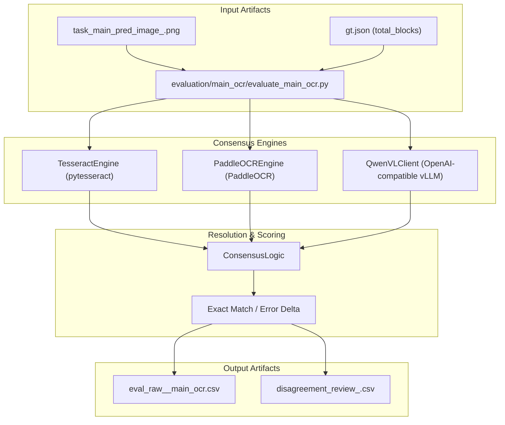
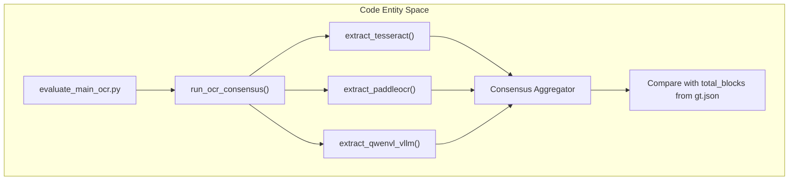

<!-- source: DeepWiki mcp.deepwiki.com · repo NVIDIA/Spatial-IQ · page 4.3 OCR Consensus Pipeline (main_ocr) · fetched 2026-10-26 -->

# OCR Consensus Pipeline (main_ocr)

Relevant source files

The following files were used as context for generating this wiki page:

- [README.md](README.md)
- [THIRD_PARTY_LICENSES.md](THIRD_PARTY_LICENSES.md)
- [analyses/inference_results/eval_raw_image_gemini-image.csv](analyses/inference_results/eval_raw_image_gemini-image.csv)

## Purpose and Scope

The OCR consensus pipeline located under `evaluation/main_ocr/` is designed to score image-output models for the composite target task (`task_main`) [README.md:32-32](). When models generate an annotated visual output (`task_main_pred_image_<slug>.png`), standard pixel-level silhouette masks cannot capture numeric count annotations rendered by the model. 

The `evaluate_main_ocr.py` script bridges this gap by combining three independent optical character recognition and vision-language systems—**Tesseract**, **PaddleOCR**, and a local **Qwen2.5-VL** instance served via an OpenAI-compatible vLLM endpoint—to extract, cross-validate, and reach consensus on the integer block count present in the image. Disagreements among the engines are logged into dedicated review CSVs for auditing.

---

## Pipeline Architecture and Data Flow

The OCR consensus evaluation processes per-view image predictions, extracts text strings through three distinct engines, evaluates consensus rules, and outputs both scored evaluation CSVs and disagreement review artifacts.

*Sources: [README.md:32-32](), [THIRD_PARTY_LICENSES.md:49-54]()*

---

## Core Components and Implementation Details

### 1. Multi-Engine Text Extraction
The pipeline invokes three independent backends to read embedded numbers or text from the generated prediction image:
* **Tesseract**: Uses `pytesseract` [THIRD_PARTY_LICENSES.md:53-53]() wrapped with image preprocessing to isolate numeric glyphs.
* **PaddleOCR**: Utilizes `PaddleOCR` [THIRD_PARTY_LICENSES.md:51-52]() configured for text detection and recognition optimized for dense numbers and annotations.
* **Qwen2.5-VL (vLLM)**: Connects to a locally hosted OpenAI-compatible vLLM server using the `openai` Python client library [THIRD_PARTY_LICENSES.md:43-46]() (`base_url` pointing to the local serving instance). It prompts the vision model to return the explicit integer count of blocks visible or annotated in the image.

*Sources: [README.md:32-32](), [THIRD_PARTY_LICENSES.md:43-54]()*

### 2. Consensus and Disagreement Resolution
When all engines return their extracted integer values:
* If all three engines agree, the consensus value is accepted as the model's prediction.
* If a majority (2 out of 3) agree, the majority value is accepted, and a minor discrepancy flag is raised.
* If all three engines return distinct values, or if confidence thresholds are unmet, the sample is flagged as a **disagreement**, recorded in a separate review artifact, and resolved via fallback heuristics or manual audit logs.

---

## Disagreement Review CSVs

To maintain rigorous scientific transparency, samples where the OCR engines fail to reach unanimous agreement are logged into disagreement review CSV files alongside standard evaluation metrics.

| Column Name | Description |
|---|---|
| `view` | Path to the view directory (`offset*_fov*_dist*`) [README.md:46-55]() |
| `total_blocks` | Ground-truth block count from `gt.json` [README.md:49-49]() |
| `tesseract_prediction` | Integer count extracted by Tesseract |
| `paddle_prediction` | Integer count extracted by PaddleOCR |
| `qwenvl_prediction` | Integer count extracted by Qwen2.5-VL vLLM |
| `consensus_prediction` | Final resolved prediction value |
| `disagreement_flag` | Boolean indicating whether engines returned conflicting counts |

Sources: [README.md:32-88](), [THIRD_PARTY_LICENSES.md:43-54]()

---

## Environment Setup & Dependencies

The OCR consensus pipeline relies on native binaries and Python packages that are scoped separately from the core API clients to avoid heavy system dependencies [README.md:102-108]().

* **Setup Script**: `bash evaluation/main_ocr/setup_ocr.sh`
* **Requirements Manifest**: `evaluation/main_ocr/requirements.txt` [README.md:108-108]()
* **Key Dependencies**: 
  * `PaddleOCR` and `PaddlePaddle` (Apache-2.0) [THIRD_PARTY_LICENSES.md:51-52]()
  * `pytesseract` (Apache-2.0) [THIRD_PARTY_LICENSES.md:53-53]()
  * Tesseract OCR system binary (installed via `conda-forge`) [THIRD_PARTY_LICENSES.md:54-54]()
  * `openai` client library communicating with local vLLM [THIRD_PARTY_LICENSES.md:43-46]()

Sources: [README.md:102-108](), [THIRD_PARTY_LICENSES.md:43-54]()

---

