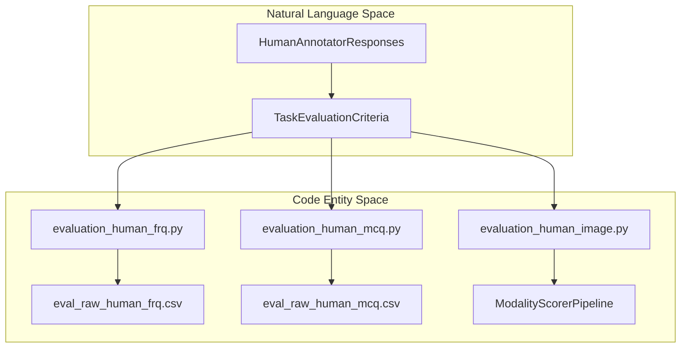
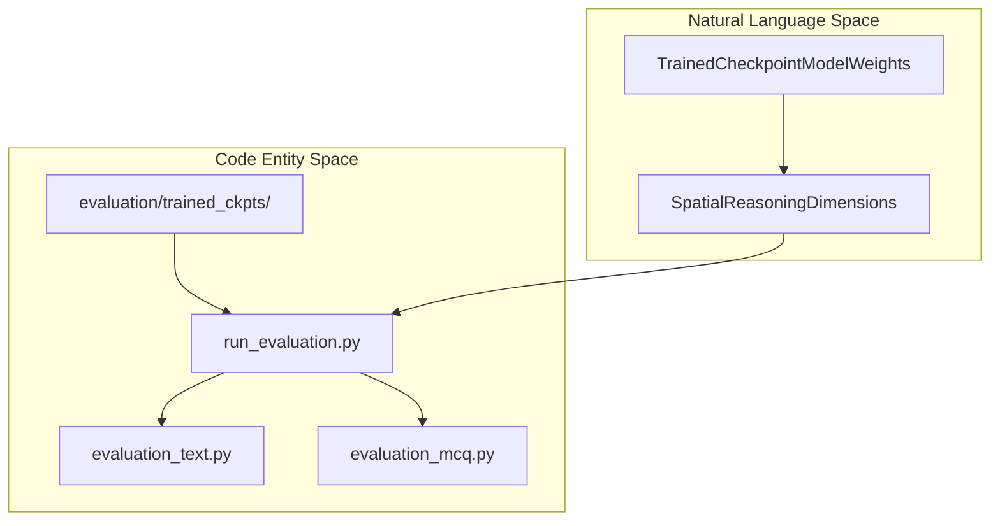

<!-- source: DeepWiki mcp.deepwiki.com · repo NVIDIA/Spatial-IQ · page 4.4 Human Baselines and Trained-Checkpoint Evaluation · fetched 2026-10-26 -->

# Human Baselines and Trained-Checkpoint Evaluation

Relevant source files

The following files were used as context for generating this wiki page:

- [analyses/analyses_results/tables/table_04_trained_text_summary.csv](analyses/analyses_results/tables/table_04_trained_text_summary.csv)
- [analyses/inference_results/eval_raw_human_frq.csv](analyses/inference_results/eval_raw_human_frq.csv)
- [analyses/inference_results/eval_raw_human_mcq.csv](analyses/inference_results/eval_raw_human_mcq.csv)

## Purpose and Scope
This page details the implementation and workflows for establishing human performance baselines (`evaluation_human_frq.py`, `evaluation_human_mcq.py`, `evaluation_human_image.py`) and evaluating fine-tuned model checkpoints via configuration files located under `evaluation/trained_ckpts/`. These evaluation pipelines provide comparative reference points against multimodal large language models, breaking down performance across specific 3D spatial reasoning tasks (`task1` through `task11` and `main`) and cognitive axes such as object counts, referential chains, summation mechanisms, and mental rotation [analyses/inference_results/eval_raw_human_frq.csv:1-2](), [analyses/inference_results/eval_raw_human_mcq.csv:1-2](), [analyses/analyses_results/tables/table_04_trained_text_summary.csv:1-2]().

Sources: [analyses/inference_results/eval_raw_human_frq.csv:1-2](), [analyses/inference_results/eval_raw_human_mcq.csv:1-2](), [analyses/analyses_results/tables/table_04_trained_text_summary.csv:1-2]()

---

## 1. Human Baseline Evaluation Workflows

The human baseline evaluation subsystem processes human response records across Free-Response (FRQ), Multiple-Choice (MCQ), and Image evaluation modalities. These scripts normalize human inputs, compare them against ground-truth JSON files (`gt.json`), and emit raw evaluation CSV logs (e.g., `eval_raw_human_frq.csv` and `eval_raw_human_mcq.csv`) for downstream aggregation and statistical analysis.

### Modality-Specific Workflows
* **Free-Response (`evaluation_human_frq.py`)**: Parses numeric and text-based free responses from human annotators for tasks like counting visible or hidden blocks, evaluating exact integer values against `main_gt` and task-specific ground truths [analyses/inference_results/eval_raw_human_frq.csv:1-2]().
* **Multiple-Choice (`evaluation_human_mcq.py`)**: Evaluates categorical choices made by human participants, recording correctness markers (`correct`, `remove_support_column_blocks`, `missing_nonmatch_fallback_unique_0`, etc.) across `task1`–`task11` and `main` [analyses/inference_results/eval_raw_human_mcq.csv:1-2]().
* **Image Modality (`evaluation_human_image.py`)**: Assesses human-generated or human-selected visual assets or edit tasks against expected spatial transformations.

**Diagram 1:** Bridging natural language evaluation metrics to code execution entities for human baseline pipelines.

Sources: [analyses/inference_results/eval_raw_human_frq.csv:1-2](), [analyses/inference_results/eval_raw_human_mcq.csv:1-2]()

---

## 2. Trained-Checkpoint Configuration and Scoring

Evaluation of fine-tuned model checkpoints (such as Supervised Fine-Tuning [SFT], Chain-of-Thought [CoT], and Direct Alignment Policy Optimization [DAPO] variants across 7B and 32B scales) is driven by configuration files stored under `evaluation/trained_ckpts/`. 

These configs define model weights paths, decoding parameters, and task-specific prompt mappings, allowing fine-tuned models to be scored through the unified evaluation dispatcher (`run_evaluation.py`).

### Summary Performance Schema
Evaluated metrics capture fine-grained reasoning categories, including object counts, visible/hidden support layers, referential chains, summation mechanisms, and mental rotation performance. Below is an excerpt illustrating the performance profile schema tracked across human baselines and fine-tuned checkpoints:

| model | display_name | object_count | visible_count | hidden_count | referential_chain | visible_support | hidden_support | summation_mechanism | mental_rotation_mean |
| :--- | :--- | :--- | :--- | :--- | :--- | :--- | :--- | :--- | :--- |
| `human` | Human | 0.821 | 0.768 | 0.799 | 0.901 | 0.844 | 0.784 | 0.691 | 0.461 |
| `dapo-32b-tight` | dapo-32b-tight | 0.625 | 0.645 | 0.781 | 0.949 | 0.736 | 0.861 | 0.932 | — |
| `sft-32b-cot-100pct` | sft-32b-cot-100pct | 0.467 | 0.488 | 0.792 | 0.954 | 0.613 | 0.856 | 0.929 | — |
| `sft-32b-plain-100pct` | sft-32b-plain-100pct | 0.400 | 0.309 | 0.000 | 0.000 | 0.850 | 0.000 | 0.000 | — |

**Diagram 2:** Mapping trained checkpoint configurations to scoring execution handlers.

Sources: [analyses/analyses_results/tables/table_04_trained_text_summary.csv:1-10]()

---

## 3. Data Structures and Output Schema

The output logs for both human baselines and fine-tuned checkpoints follow structured tabular schemas designed for direct ingestion by the analysis pipeline (`spatial-IQ_analyses.py`).

### Free-Response Raw Schema (`eval_raw_human_frq.csv`)
Each row corresponds to a specific evaluation sample view, capturing view paths, object types, total blocks, hidden blocks, and columns alongside per-task ground truths and predicted raw values [analyses/inference_results/eval_raw_human_frq.csv:1-2]():
* `view`: Path to the rendered scene view asset [analyses/inference_results/eval_raw_human_frq.csv:1-2]()
* `total_blocks`, `num_hidden_blocks`, `num_columns`, `num_layers`: Scene difficulty attributes [analyses/inference_results/eval_raw_human_frq.csv:1-2]()
* `task{2..11}_pred`, `task{2..11}_gt`, `task{2..11}_manual`: Task-specific prediction, ground truth, and manual validation flags [analyses/inference_results/eval_raw_human_frq.csv:1-2]()

### Multiple-Choice Raw Schema (`eval_raw_human_mcq.csv`)
Tracks categorical selection outcomes per task view [analyses/inference_results/eval_raw_human_mcq.csv:1-2]():
* `task{1..11}_choice_type`: Classification of answer correctness or specific error category (e.g., `correct`, `remove_support_column_blocks`, `missing_nonmatch_fallback_unique_0`) [analyses/inference_results/eval_raw_human_mcq.csv:1-4]()

Sources: [analyses/inference_results/eval_raw_human_frq.csv:1-2](), [analyses/inference_results/eval_raw_human_mcq.csv:1-4](), [analyses/analyses_results/tables/table_04_trained_text_summary.csv:1-10]()

---

