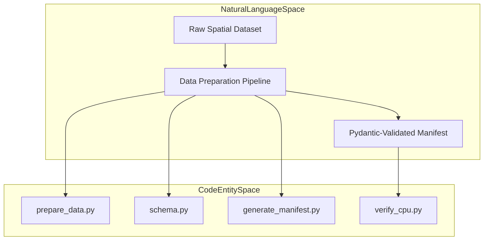
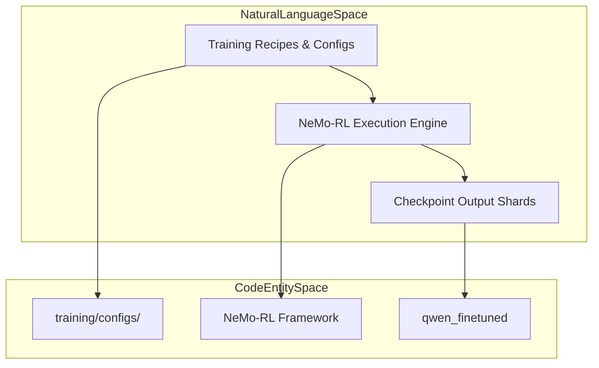

<!-- source: DeepWiki mcp.deepwiki.com · repo NVIDIA/Spatial-IQ · page 5 Training & Fine-Tuning · fetched 2026-10-26 -->

# Training & Fine-Tuning

Relevant source files

The following files were used as context for generating this wiki page:

- [README.md](README.md)
- [THIRD_PARTY_LICENSES.md](THIRD_PARTY_LICENSES.md)

This page provides an overview of the `training/` and `training_evaluation/` subsystems within Spatial-IQ. The training pipeline implements Supervised Fine-Tuning (SFT) and Reinforcement Learning with Verifiable Rewards (RLVR) using NeMo-RL, focusing on Chain-of-Thought (CoT) reasoning and Direct-Alignment Policy Optimization (DAPO) variants. The evaluation subsystem handles regression testing on general multimodal benchmarks via VLMEvalKit.

Sources: [`README.md:33-34`]()

---

## 5.1 Training Data Preparation and Schema

The training data preparation subsystem processes raw spatial datasets into Pydantic-validated manifests suitable for NeMo-RL training recipes. Scripts such as `prepare_data.py`, `generate_manifest.py`, and verification utilities (`verify_cpu.py`, `eval_accuracy.py`) organize prompt templates, ground-truth annotations, and modality variants (SFT vs. CoT vs. DAPO). 

For detailed information on data preparation, schema validation, and prompt structures, see [Training Data Preparation and Schema](#5.1).

### Data Preparation Code Mapping

Sources: [`README.md:33`]()

---

## 5.2 Training Configs and NeMo-RL Runs

Training recipes are defined under `training/configs/` using YAML and JSON formats. These configurations manage hyperparameter settings, distributed training options, and checkpoint output layouts for NeMo-RL runs. Checkpoints map directly to evaluation slugs for downstream scoring and regression testing.

For detailed configurations, training recipes, and run-to-slug mappings, see [Training Configs and NeMo-RL Runs](#5.2).

### NeMo-RL Configuration Code Mapping

Sources: [`README.md:33`]()

---

## 5.3 General-Benchmark Regression via VLMEvalKit

To ensure that fine-tuning on spatial reasoning tasks does not degrade general capabilities, the `training_evaluation/` subsystem integrates [VLMEvalKit](https://github.com/open-compass/VLMEvalKit). Setup scripts (`training_evaluation/setup.sh`) clone and configure VLMEvalKit alongside evaluation configurations (`eval_config.json`) to run benchmarks like MMBench, MMMU, OCRBench, and MathVista, utilizing `OPENAI_API_KEY` for grading where required.

For comprehensive instructions on setting up VLMEvalKit and running general benchmark regressions, see [General-Benchmark Regression via VLMEvalKit](#5.3).

Sources: [`README.md:34`]()

---

