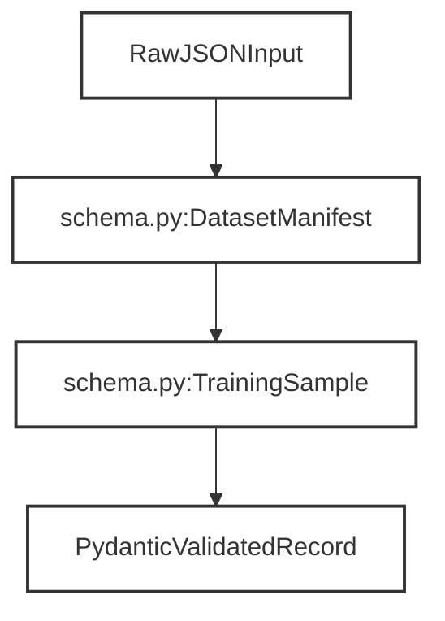
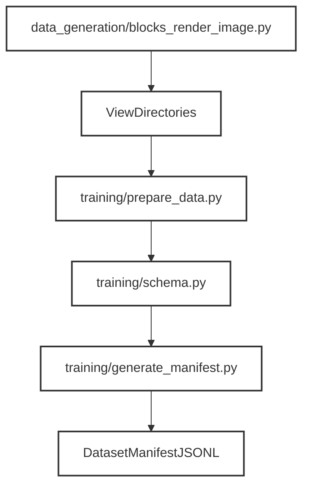

<!-- source: DeepWiki mcp.deepwiki.com · repo NVIDIA/Spatial-IQ · page 5.1 Training Data Preparation and Schema · fetched 2026-10-26 -->

# Training Data Preparation and Schema

Relevant source files

The following files were used as context for generating this wiki page:

- [README.md](README.md)
- [analyses/inference_results/eval_raw_sft-32b-cot-100pct_text.csv](analyses/inference_results/eval_raw_sft-32b-cot-100pct_text.csv)
- [analyses/inference_results/eval_raw_sft-32b-plain-100pct_text.csv](analyses/inference_results/eval_raw_sft-32b-plain-100pct_text.csv)

## Purpose and Scope

This section covers the training data preparation and schema validation subsystem located in the `training/` directory [README.md:33-33](). It governs how raw spatial reasoning views and ground-truth metadata from the Isaac Sim renderer are ingested, validated via Pydantic schemas, formatted with specific prompt templates, and compiled into manifests for supervised fine-tuning (SFT) and reinforcement learning (NeMo-RL GRPO/DAPO-tight) recipes [README.md:33-33]().

---

## Dataset Schema and Validation (`schema.py`)

The dataset structures and individual training samples are validated using Pydantic models defined in `training/schema.py`. This ensures that all required fields—such as image file paths, task identifiers, ground-truth answers, and chain-of-thought (CoT) rationales—conform to strict type definitions before being consumed by training runners or manifest generators [README.md:33-33]().

- **`DatasetManifest`**: Validates global dataset collections, mapping split names to lists of sample records.
- **`TrainingSample`**: Enforces schema constraints on individual entries, verifying the presence of multimodal image inputs, prompt keys, and expected outputs (`task_main`, `task2` through `task9`) [analyses/inference_results/eval_raw_sft-32b-cot-100pct_text.csv:1-1]().

*Figure 1: Pydantic Validation Flow for Training Records*

Sources: [README.md:33-33](), [analyses/inference_results/eval_raw_sft-32b-cot-100pct_text.csv:1-1]()

---

## Data Preparation and Manifest Generation (`prepare_data.py`, `generate_manifest.py`)

Raw views generated by `blocks_render_image.py` are processed into training-ready formats through data preparation scripts:

1. **`prepare_data.py`**: Iterates through dataset directories, extracts view assets (`view.png`, `gt.json`, `scene.json`), pairs them with task definitions, and structures them into text or chat-style instruction-tuning records.
2. **`generate_manifest.py`**: Compiles the prepared records into a unified manifest file (`manifest.json` or JSONL) used by NeMo-RL data loaders.

*Title: Natural Language Space to Code Entity Space Manifest Generation Pipeline*

Sources: [README.md:29-33]()

---

## Prompt Engineering (`prompts/`)

The `training/prompts/` directory houses system and user prompt templates that steer models toward precise 3D spatial reasoning. Depending on the training variant, prompts instruct the model to output either a direct answer (plain SFT) or structured reasoning steps (Chain-of-Thought) [README.md:33-33]().

- **System Prompts**: Define the spatial reasoning rules, gravity assumptions, and counting constraints for `task_main` and atomic tasks (`task1`–`task11`) [README.md:69-79]().
- **Format Templates**: Specify JSON or XML-like tags for intermediate reasoning blocks (`<cot>...</cot>`) and final answers.

Sources: [README.md:33-33](), [README.md:69-79]()

---

## Verification and Accuracy Utilities (`verify_cpu.py`, `eval_accuracy.py`)

To ensure data integrity and track model convergence during training development, auxiliary scripts are provided:

- **`verify_cpu.py`**: Performs CPU-side sanity checks on generated dataset splits, validating image resolutions, missing file references, and JSON schema compliance.
- **`eval_accuracy.py`**: Computes preliminary accuracy metrics on validation splits without requiring full downstream evaluation pipelines, allowing rapid sanity checks on intermediate NeMo-RL checkpoints [README.md:33-33]().

Sources: [README.md:33-33]()

---

## Training Variants: SFT vs CoT vs DAPO

Spatial-IQ training recipes support distinct methodological variants to study how reasoning capability scales:

- **Supervised Fine-Tuning (SFT Plain)**: Trains models on direct input-output pairs without explicit intermediate reasoning steps, often leading to systematic summation errors on occluded blocks [analyses/inference_results/eval_raw_sft-32b-plain-100pct_text.csv:1-48]().
- **Chain-of-Thought (CoT)**: Incorporates explicit step-by-step spatial decomposition (column analysis, layer counts, support inference) prior to emitting the final block count (`task_main`), significantly improving spatial consistency [analyses/inference_results/eval_raw_sft-32b-cot-100pct_text.csv:1-49]().
- **Direct Alignment Preference Optimization (DAPO-tight)**: Utilizes NeMo-RL reinforcement learning with tight divergence constraints to optimize policy models against ground-truth spatial verification rewards [README.md:33-33]().

Sources: [README.md:33-33](), [analyses/inference_results/eval_raw_sft-32b-cot-100pct_text.csv:1-49](), [analyses/inference_results/eval_raw_sft-32b-plain-100pct_text.csv:1-48]()

---

