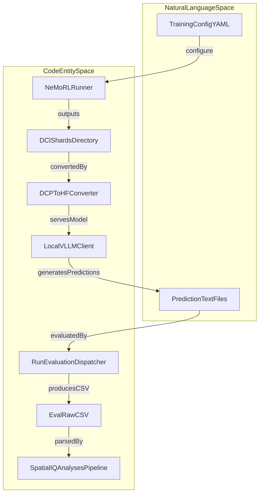
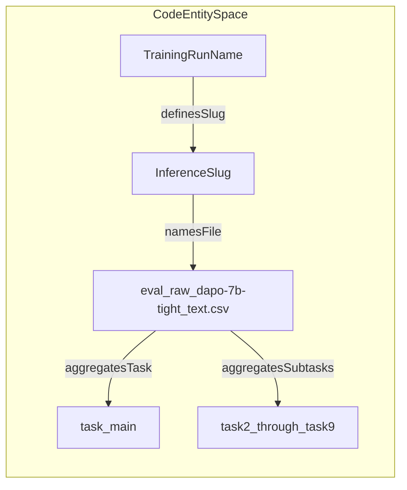

<!-- source: DeepWiki mcp.deepwiki.com · repo NVIDIA/Spatial-IQ · page 5.2 Training Configs and NeMo-RL Runs · fetched 2026-10-26 -->

# Training Configs and NeMo-RL Runs

<details>
<summary>Relevant source files</summary>

The following files were used as context for generating this wiki page:

- [README.md](README.md)
- [analyses/inference_results/eval_raw_dapo-7b-tight_text.csv](analyses/inference_results/eval_raw_dapo-7b-tight_text.csv)

</details>


## Purpose and Scope
This page details the configuration recipes, checkpoint output structures, and naming mappings used for fine-tuning multimodal models on Spatial-IQ using the NeMo-RL framework. It covers the YAML/JSON configuration files located under `training/`, the Distributed Checkpoint (DCP) layout generated during reinforcement learning (RLVR / DAPO-tight) and SFT runs, and how training run identifiers map directly to evaluation slugs (`<slug>`) consumed by evaluation scripts and analysis pipelines [README.md:33-35]().

---

## 1. NeMo-RL Training Configuration Structure

Spatial-IQ leverages the [NeMo-RL](https://github.com/NVIDIA-NeMo/RL) training runner for Supervised Fine-Tuning (SFT) and Reinforcement Learning via Rule-Based Rewards (RLVR), specifically implementing Group Relative Policy Optimization (GRPO) and DAPO-tight recipes [README.md:33-33](). 

The training subsystem relies on structured configuration files stored within `training/configs/`. These recipes configure:
- **Model Backbones**: Base weights (e.g., Qwen2.5-VL) and vision-language adapter parameters.
- **Rollout Engines**: vLLM integration parameters for generating policy rollouts during RL.
- **Reward Functions**: Rule-based correctness validators aligned with Spatial-IQ ground-truth metadata (`gt.json`).
- **Hyperparameters**: Learning rates, batch sizes, sequence lengths, and DAPO clipping thresholds.

```
Sources: [README.md:33-33]()
```

---

## 2. Checkpoint Output Layout and DCP Shards

During training runs, NeMo-RL outputs model weights using Distributed Checkpoint (DCP) sharding formats to handle large parameter scales efficiently. 

### Checkpoint Directory Layout
- **DCP Shards**: Raw distributed training states are saved into epoch/step-specific directories containing tensor shards and metadata index files.
- **Conversion Utilities**: Checkpoints must be converted from DCP shard layouts back into standard Hugging Face (HF) format before they can be evaluated via `inference/qwen_finetuned/` or scored using `evaluation/trained_ckpts/` [README.md:30-31]().

```
Sources: [README.md:30-33]()
```

---

## 3. Mapping Run Names to Evaluation Slugs

To maintain traceability across training, inference, and evaluation, Spatial-IQ enforces a strict naming convention. A training run name or checkpoint identifier maps directly to an evaluation slug (`<slug>`), which dictates output file naming and parsing rules.

### Mapping Mechanics
1. **Inference Execution**: Inference scripts write predictions using the slug identifier, producing files such as `task<N>_pred_text_<slug>.txt` [README.md:85-92]().
2. **Evaluation Scoring**: The evaluation dispatcher `run_evaluation.py` reads these prediction files and aggregates results into raw evaluation CSVs [README.md:31-31]().
3. **Analysis Pipelines**: The analysis runner processes files matching `eval_raw_<slug>_<mode>.csv` (e.g., `eval_raw_dapo-7b-tight_text.csv`) to generate manuscript tables and figures [README.md:35-35]().

```
Sources: [README.md:31-92](), [analyses/inference_results/eval_raw_dapo-7b-tight_text.csv:1-2]()
```

---

## 4. System-to-Code Architecture Diagrams

### Diagram 1: Training to Evaluation Pipeline Flow
This diagram bridges the natural language concepts of training configurations and run names to their physical code entities and output artifacts.



Sources: [README.md:30-35](), [analyses/inference_results/eval_raw_dapo-7b-tight_text.csv:1-2]()

### Diagram 2: Slug and Checkpoint Resolution Architecture
This diagram illustrates how training run slugs connect checkpoint conversion modules to evaluation data structures.



Sources: [README.md:85-93](), [analyses/inference_results/eval_raw_dapo-7b-tight_text.csv:1-3]()

---

