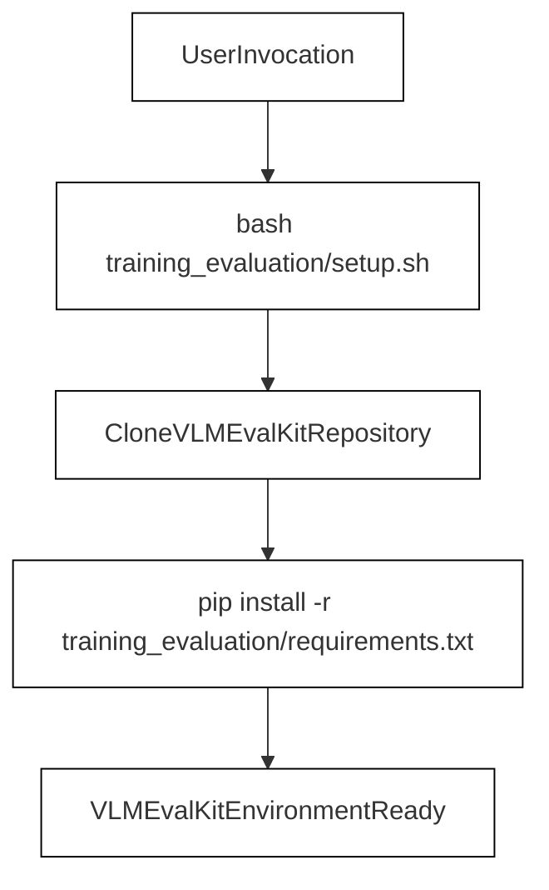
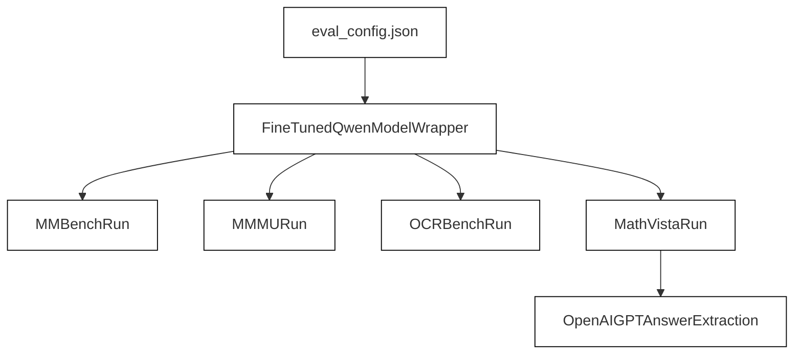

<!-- source: DeepWiki mcp.deepwiki.com · repo NVIDIA/Spatial-IQ · page 5.3 General-Benchmark Regression via VLMEvalKit · fetched 2026-10-26 -->

# General-Benchmark Regression via VLMEvalKit

Relevant source files

The following files were used as context for generating this wiki page:

- [README.md](README.md)
- [THIRD_PARTY_LICENSES.md](THIRD_PARTY_LICENSES.md)

## Purpose and Scope

The `training_evaluation/` subsystem provides an integration framework based on [VLMEvalKit](https://github.com/open-compass/VLMEvalKit) to evaluate fine-tuned Spatial-IQ multimodal checkpoints (such as Qwen2.5-VL SFT and DAPO variants) against established general vision-language benchmarks [README.md:34-34](). This evaluation safeguards against catastrophic forgetting by measuring performance regressions or gains across standard capabilities—specifically covering MMBench, MMMU, OCRBench, and MathVista [README.md:34-34]().

Sources: `README.md:34-34`, `THIRD_PARTY_LICENSES.md:22-22`

---

## Setup and Environment Initialization (`setup.sh`)

The environment setup for general-benchmark regression is managed via a dedicated setup script and a scoped requirements file [README.md:111-111](). 

### Implementation Flow

1. **Repository Cloning**: `training_evaluation/setup.sh` clones the upstream [VLMEvalKit](https://github.com/open-compass/VLMEvalKit) repository into the local environment [THIRD_PARTY_LICENSES.md:74-74]().
2. **Dependency Installation**: Packages are installed using `--no-deps` where appropriate, complemented by the pinned requirements file `training_evaluation/requirements.txt` [THIRD_PARTY_LICENSES.md:74-74]().
3. **Runtime Support Packages**: Installs scientific and utility packages required by VLMEvalKit evaluators (e.g., `openpyxl`, `scikit-learn`, `sympy`, and optionally `num2words` for numeric answer formatting) [THIRD_PARTY_LICENSES.md:75-104]().

*Figure 1: Setup execution flow mapping shell script invocation to VLMEvalKit environment initialization.*

Sources: `README.md:111-111`, `THIRD_PARTY_LICENSES.md:74-104`

---

## Configuration and Benchmark Execution (`eval_config.json`)

Benchmark execution runs are parameterized via `eval_config.json`, which defines model paths, evaluation datasets, and execution flags.

### Supported Benchmark Suites

- **MMBench**: General multimodal perception and reasoning evaluation.
- **MMMU**: Multi-discipline college-level multimodal understanding.
- **OCRBench**: Optical character recognition and text-centric visual reasoning.
- **MathVista**: Visual mathematical problem solving requiring multi-step reasoning.

*Figure 2: Benchmark dispatch data flow bridging `eval_config.json` specifications to specific evaluation runners and grading endpoints.*

Sources: `README.md:34-34`, `THIRD_PARTY_LICENSES.md:47-47`

---

## OpenAI API Integration for Grading (`OPENAI_API_KEY`)

Certain benchmarks within the VLMEvalKit suite (notably MathVista) rely on LLM-based answer extraction and grading to evaluate free-form responses against ground-truth annotations [THIRD_PARTY_LICENSES.md:47-47]().

### Security and Execution Model

- **API Key Requirement**: Execution of MathVista evaluation requires the user to supply their own `OPENAI_API_KEY` via environment variables [THIRD_PARTY_LICENSES.md:47-47]().
- **Non-Logging Policy**: The key is utilized strictly at runtime by the OpenAI client library (`openai`) to interface with the GPT grading endpoints and is never logged or bundled within the repository artifacts [THIRD_PARTY_LICENSES.md:43-47]().
- **Local Isolation**: Other evaluation pipelines (such as `evaluation/main_ocr/`) utilize locally hosted vLLM endpoints and do not require external API credentials [THIRD_PARTY_LICENSES.md:43-46]().

Sources: `THIRD_PARTY_LICENSES.md:43-47`

---

