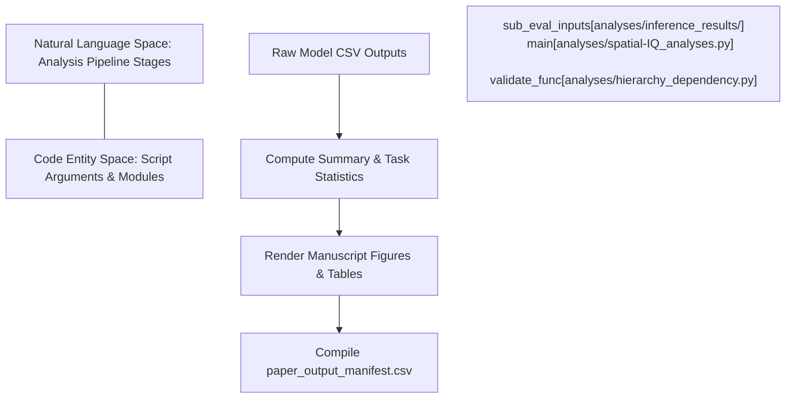
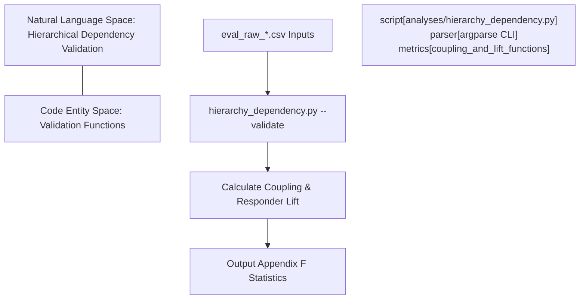

<!-- source: DeepWiki mcp.deepwiki.com · repo NVIDIA/Spatial-IQ · page 6 Analyses & Paper Artifacts · fetched 2026-10-26 -->

# Analyses & Paper Artifacts

Relevant source files

The following files were used as context for generating this wiki page:

- [README.md](README.md)
- [analyses/analyses_results/paper_output_manifest.json](analyses/analyses_results/paper_output_manifest.json)

The `analyses/` subsystem transforms raw evaluation CSV outputs into the publication-ready tables, statistical figures, and machine-readable manifests that populate the manuscript and appendices for *Spatial-IQ: Deconstructing Spatial Intelligence via Hierarchical Capability Tests* [README.md:18-35](). 

This parent page provides a high-level overview of the analysis pipeline, input catalogues, generated tables and figures, and statistical dependency validation tools. For detailed breakdowns, refer to the child pages below:
- **[spatial-IQ_analyses.py Pipeline Stages](#6.1)** — Execution stages (`--stage all/analysis/figures/manifest`), raw CSV discovery, and manifest compilation.
- **[Raw Evaluation Inputs (analyses/inference_results)](#6.2)** — Model slug catalogues, row schemas, and paper-label mappings.
- **[Generated Tables](#6.3)** — Summary tables 01–09, task accuracy bins, McNemar tests, and Appendix F coupling/lift tables.
- **[Generated Figures](#6.4)** — Figure 04–28 catalogue pairing visualizations with underlying CSV metrics.
- **[Hierarchy Dependency Analysis](#6.5)** — Validation scripts (`hierarchy_dependency.py --validate`), coupling/lift definitions, and dependency statistics.

---

## Pipeline Execution Overview

The analysis engine is driven by `analyses/spatial-IQ_analyses.py`, which coordinates data ingestion from `analyses/inference_results/`, computes aggregate performance metrics, renders figures, and validates hierarchical capability dependencies via `analyses/hierarchy_dependency.py`.

*Figure 6.1: Bridging analysis stages from raw evaluation inputs to output manifests through `spatial-IQ_analyses.py`.*

Sources: [README.md:35](), [analyses/analyses_results/paper_output_manifest.json:1-407]()

---

## 6.1. spatial-IQ_analyses.py Pipeline Stages

The core orchestration script `spatial-IQ_analyses.py` manages end-to-end artifact generation through distinct execution stages controlled via command-line arguments. It automatically discovers raw evaluation CSV files, computes core statistics (such as accuracy, variance, and confidence intervals), and outputs structured tables and manifests.

For a full breakdown of the `--stage` parameter options (`all`, `analysis`, `figures`, `manifest`), CSV discovery mechanics, and output schemas, see [spatial-IQ_analyses.py Pipeline Stages](#6.1).

Sources: [README.md:35]()

---

## 6.2. Raw Evaluation Inputs (analyses/inference_results)

Model predictions across text, MCQ, and image modalities are aggregated in `analyses/inference_results/`. Each evaluation target is stored as an `eval_raw_<slug>_<mode>.csv` file containing per-view outcomes, model responses, correctness flags, and token metadata. 

For information on row schemas, model slug naming conventions, and how model identifiers map to formal manuscript labels, see [Raw Evaluation Inputs (analyses/inference_results)](#6.2).

Sources: [README.md:35]()

---

## 6.3. Generated Tables

The analysis pipeline compiles summary performance metrics into structured tables (designated `table_01` through `table_09` alongside appendix datasets). These include model accuracy summaries across `task_main` and `task1`–`task11`, difficulty-bin stratifications, McNemar test matrices, and Appendix F coupling metrics.

For detailed table column definitions and output file paths, see [Generated Tables](#6.3).

Sources: [README.md:35](), [analyses/analyses_results/paper_output_manifest.json:30-65]()

---

## 6.4. Generated Figures

Figures 04 through 28 in the manuscript are dynamically generated by the analysis package, pairing visual assets (such as accuracy bar charts, wrong-answer preference heatmaps, and mental-rotation correlation plots) with exact tabular CSV sources stored under `analyses/tables/`.

For a comprehensive catalogue of generated figures, associated tasks, and paired data files, see [Generated Figures](#6.4).

Sources: [README.md:35](), [analyses/analyses_results/paper_output_manifest.json:30-225]()

---

## Hierarchy Dependency Validation

To test the hypothesis that spatial reasoning capabilities exhibit hierarchical dependencies, `analyses/hierarchy_dependency.py` evaluates conditional probabilities and computes responder lift metrics between prerequisite sub-tasks and composite target tasks.

*Figure 6.2: Bridging hierarchical capability testing from raw evaluations to Appendix F statistical metrics.*

For formal definitions of coupling coefficients, lift formulas, and execution flags for `hierarchy_dependency.py`, see [Hierarchy Dependency Analysis](#6.5).

Sources: [README.md:35]()

---

