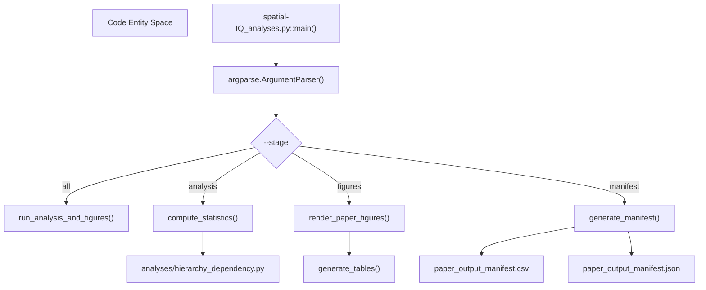
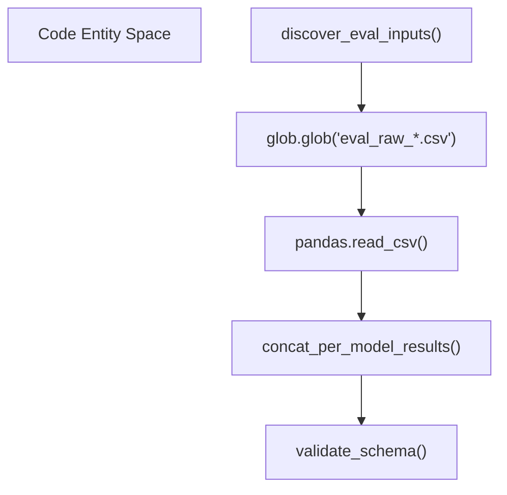
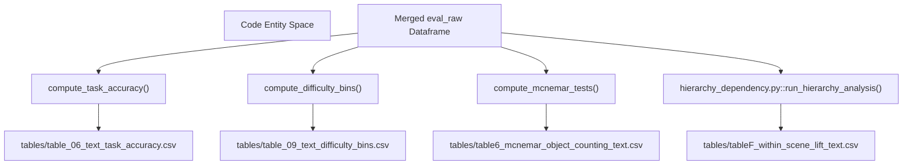
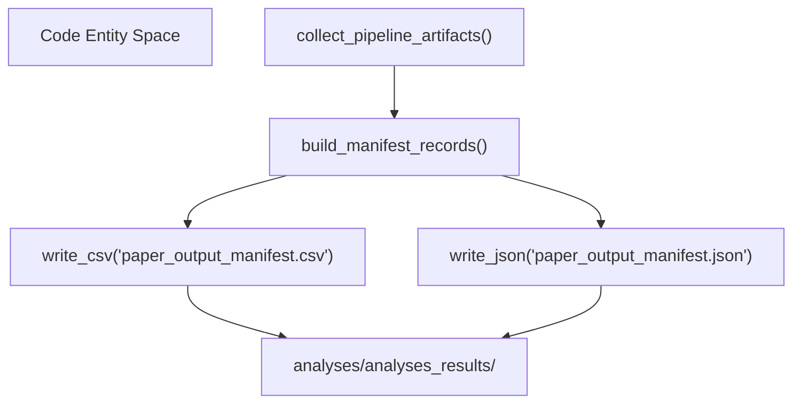

<!-- source: DeepWiki mcp.deepwiki.com · repo NVIDIA/Spatial-IQ · page 6.1 spatial-IQ_analyses.py Pipeline Stages · fetched 2026-10-26 -->

# spatial-IQ_analyses.py Pipeline Stages

Relevant source files

The following files were used as context for generating this wiki page:

- [README.md](README.md)
- [analyses/analyses_results/paper_output_manifest.csv](analyses/analyses_results/paper_output_manifest.csv)
- [analyses/analyses_results/paper_output_manifest.json](analyses/analyses_results/paper_output_manifest.json)

The `analyses/spatial-IQ_analyses.py` script serves as the paper-aligned analysis pipeline driver for the Spatial-IQ benchmark [README.md:35](). Its primary role is to ingest evaluated raw prediction CSV files (`eval_raw_*.csv`), compute statistical aggregations, perform hypothesis tests and structural hierarchy validations, render manuscript tables and figures, and output a machine-readable manifest tracking all generated paper artifacts [README.md:35]().

---

## Pipeline CLI Stages and Execution Modes

The analysis pipeline accepts a `--stage` argument to control which execution phases run during a pipeline invocation. The supported stages are `all`, `analysis`, `figures`, and `manifest`.

- **`all`**: Executes the complete pipeline sequentially, running statistical analysis, generating all figure and table assets, and refreshing the output manifest.
- **`analysis`**: Computes core statistical metrics, accuracy bins, difficulty slices, and hierarchy-dependency statistics via `analyses/hierarchy_dependency.py` [README.md:35]().
- **`figures`**: Renders manuscript figures (Figure 04 through Figure 28) and corresponding table data files stored under `analyses/analyses_results/tables/` and `analyses/analyses_results/figures/` [README.md:35]().
- **`manifest`**: Generates or updates `analyses/analyses_results/paper_output_manifest.csv` [README.md:35]() and `analyses/analyses_results/paper_output_manifest.json` [analyses/analyses_results/paper_output_manifest.json:1]() to reflect the status of all paper artifacts.

Sources: [README.md:35](), [analyses/analyses_results/paper_output_manifest.csv:1-46]()

---

## Input Discovery: `eval_raw_*.csv` Ingestion

The pipeline discovers input data by scanning the inference results directory for raw evaluation files matching the glob pattern `eval_raw_*.csv` [README.md:35](). These files contain per-view, per-task evaluation scores generated by the evaluation subsystem (`evaluation/run_evaluation.py`) [README.md:31]().

- **Directory Location**: `analyses/inference_results/` [README.md:35]()
- **File Naming Pattern**: `eval_raw_<model_slug>_<modality>.csv`
- **Row Schema**: Each row corresponds to a evaluated view (`sample_<NN>/view_<VV>`), recording task identifiers (`task_main`, `task1` through `task11`), raw correctness flags, confidence scores, and categorical mismatch types (such as wrong-answer preferences in MCQ tasks).

Sources: [README.md:31](), [README.md:35]()

---

## Statistics Computed and Statistical Tests

The pipeline computes a wide array of descriptive and inferential statistics required for the manuscript text and appendices [README.md:35](). These computations are structured into dedicated analysis modules called during the `--stage analysis` run:

1. **Per-Task and Per-Modality Accuracy**: Aggregates exact-match scores across `task_main` and `task1` through `task11` [README.md:69]().
2. **Difficulty Bins**: Computes performance slices conditioned on structural difficulty attributes (e.g., block count, vertical occlusion depth) [README.md:78]().
3. **Wrong-Answer Preferences**: Analyzes distractor selection frequencies for multi-choice questions (5CQ, 3CQ, 4CQ) to characterize systematic failure modes [analyses/analyses_results/paper_output_manifest.csv:6]().
4. **Summation & Composition Diagnostics**: Evaluates the additivity of spatial reasoning capabilities across hierarchical tiers.
5. **Mental-Rotation and Bundle Correlations**: Computes Pearson and rank correlations between atomic capability bundles and object-counting tasks [analyses/analyses_results/paper_output_manifest.csv:13-14]().
6. **McNemar Significance Tests**: Performs pairwise McNemar tests on object-counting accuracy across all evaluated models [analyses/analyses_results/paper_output_manifest.csv:45]().
7. **Hierarchy-Dependency Statistics**: Invokes `analyses/hierarchy_dependency.py` to calculate within-scene lifts, joint relation integrity, and responder-controlled fixed-effects models [README.md:35](), [analyses/analyses_results/paper_output_manifest.csv:39-44]().

Sources: [README.md:35](), [analyses/analyses_results/paper_output_manifest.csv:35-46]()

---

## Output Manifest Generation

Upon completing the analysis and figure rendering stages, the `--stage manifest` execution writes out a mapping of paper identifiers to their corresponding generated assets [README.md:35](). This manifest is serialized into two equivalent formats:

- **CSV Manifest**: `analyses/analyses_results/paper_output_manifest.csv` [analyses/analyses_results/paper_output_manifest.csv:1]()
- **JSON Manifest**: `analyses/analyses_results/paper_output_manifest.json` [analyses/analyses_results/paper_output_manifest.json:1]()

Each entry in the manifest contains the paper identifier (`paper_id`), artifact kind (`kind`), descriptive title (`title`), generation status (`status`), underlying analysis CSV path (`analysis_csv`), figure file path (`figure_file`), and qualitative notes (`notes`) [analyses/analyses_results/paper_output_manifest.csv:1-46]().

Sources: [README.md:35](), [analyses/analyses_results/paper_output_manifest.csv:1-46](), [analyses/analyses_results/paper_output_manifest.json:1-25]()

---

