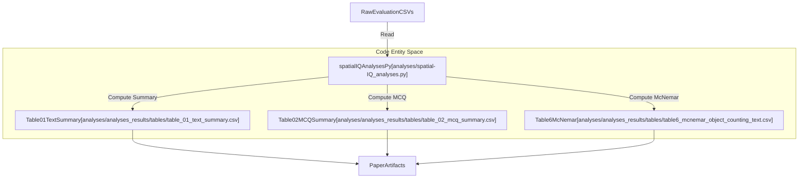
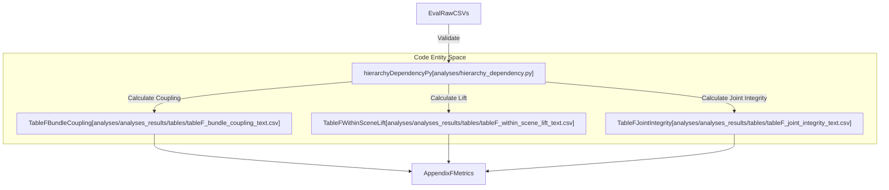

<!-- source: DeepWiki mcp.deepwiki.com · repo NVIDIA/Spatial-IQ · page 6.3 Generated Tables · fetched 2026-10-26 -->

# Generated Tables

Relevant source files

The following files were used as context for generating this wiki page:

- [analyses/analyses_results/tables/figF18_camera_within_structure_text.csv](analyses/analyses_results/tables/figF18_camera_within_structure_text.csv)
- [analyses/analyses_results/tables/figure_19_image_difficulty_bins.csv](analyses/analyses_results/tables/figure_19_image_difficulty_bins.csv)
- [analyses/analyses_results/tables/table6_mcnemar_object_counting_text.csv](analyses/analyses_results/tables/table6_mcnemar_object_counting_text.csv)
- [analyses/analyses_results/tables/tableF_bundle_coupling_text.csv](analyses/analyses_results/tables/tableF_bundle_coupling_text.csv)
- [analyses/analyses_results/tables/tableF_bundle_coupling_twoway_text.csv](analyses/analyses_results/tables/tableF_bundle_coupling_twoway_text.csv)
- [analyses/analyses_results/tables/tableF_joint_integrity_text.csv](analyses/analyses_results/tables/tableF_joint_integrity_text.csv)
- [analyses/analyses_results/tables/tableF_per_responder_lift_text.csv](analyses/analyses_results/tables/tableF_per_responder_lift_text.csv)
- [analyses/analyses_results/tables/tableF_responder_controlled_lift_text.csv](analyses/analyses_results/tables/tableF_responder_controlled_lift_text.csv)
- [analyses/analyses_results/tables/tableF_within_scene_lift_text.csv](analyses/analyses_results/tables/tableF_within_scene_lift_text.csv)
- [analyses/analyses_results/tables/table_01_text_summary.csv](analyses/analyses_results/tables/table_01_text_summary.csv)
- [analyses/analyses_results/tables/table_02_mcq_summary.csv](analyses/analyses_results/tables/table_02_mcq_summary.csv)
- [analyses/analyses_results/tables/table_03_image_summary.csv](analyses/analyses_results/tables/table_03_image_summary.csv)
- [analyses/analyses_results/tables/table_04_trained_text_summary.csv](analyses/analyses_results/tables/table_04_trained_text_summary.csv)
- [analyses/analyses_results/tables/table_05_task_queries.csv](analyses/analyses_results/tables/table_05_task_queries.csv)
- [analyses/analyses_results/tables/table_06_text_task_accuracy.csv](analyses/analyses_results/tables/table_06_text_task_accuracy.csv)
- [analyses/analyses_results/tables/table_07_mcq5_task_accuracy.csv](analyses/analyses_results/tables/table_07_mcq5_task_accuracy.csv)
- [analyses/analyses_results/tables/table_08_image_task_accuracy.csv](analyses/analyses_results/tables/table_08_image_task_accuracy.csv)
- [analyses/analyses_results/tables/table_09_text_difficulty_bins.csv](analyses/analyses_results/tables/table_09_text_difficulty_bins.csv)

### Purpose and Scope
This page documents the structured analytical tables generated by the Spatial-IQ analysis pipeline [analyses/spatial-IQ_analyses.py](). These tables summarize model performance across modalities (text, MCQ, image), detail task-specific accuracies, record McNemar pairwise significance tests, and quantify spatial reasoning dependency structures (Appendix-F bundle coupling, within-scene lift, and responder-controlled metrics) [analyses/analyses_results/tables/]() [analyses/analyses_results/tables/table_01_text_summary.csv]().

---

## 1. Summary Tables Catalog (Tables 01–09)

The analysis subsystem aggregates raw evaluation CSVs into high-level summary tables. Each table targets a specific model family, evaluation modality, or diagnostic subset.

| Table Identifier | Filename | Description | Key Columns |
| :--- | :--- | :--- | :--- |
| **Table 01** | `table_01_text_summary.csv` | Text modality performance breakdown by reasoning category. | `model`, `display_name`, `object_count`, `visible_count`, `hidden_count`, `referential_chain`, `summation_mechanism` [analyses/analyses_results/tables/table_01_text_summary.csv:1-10]() |
| **Table 02** | `table_02_mcq_summary.csv` | Multiple-choice question (MCQ) variants (3-option, 4-option, CQ) summary. | `model`, `display_name`, `object_count`, `visible_count`, `hidden_count`, `referential_chain` [analyses/analyses_results/tables/table_02_mcq_summary.csv:1-14]() |
| **Table 03** | `table_03_image_summary.csv` | Native image and image-edit modality aggregate metrics. | `model`, `display_name`, `object_count`, `visible_count`, `hidden_count`, `summation_mechanism` [analyses/analyses_results/tables/table_03_image_summary.csv:1-4]() |
| **Table 04** | `table_04_trained_text_summary.csv` | Fine-tuned and RL-trained checkpoint evaluations (NeMo-RL / SFT variants). | `model`, `display_name`, `object_count`, `visible_count`, `hidden_count` |
| **Table 05** | `table_05_task_queries.csv` | Mapping of task identifiers (`task1`–`task11`, `main`) to prompt questions and structural definitions. | `task`, `task_display`, `description`, `modality` |
| **Table 06** | `table_06_text_task_accuracy.csv` | Granular per-task accuracy for text models across all benchmark scenes. | `model`, `task`, `accuracy`, `n_correct`, `n_total` |
| **Table 07** | `table_07_mcq5_task_accuracy.csv` | Granular per-task accuracy for MCQ/CQ benchmark configurations. | `model`, `task`, `accuracy`, `n_correct`, `n_total` |
| **Table 08** | `table_08_image_task_accuracy.csv` | Granular per-task accuracy for image-based generation and reasoning tasks. | `model`, `task`, `accuracy`, `n_correct`, `n_total` |
| **Table 09** | `table_09_text_difficulty_bins.csv` | Bin-wise performance breakdown against physical scene difficulty factors (e.g., block counts, occlusions). | `model`, `factor`, `bin`, `accuracy`, `n_samples` |

Sources: [analyses/spatial-IQ_analyses.py](), [analyses/analyses_results/tables/table_01_text_summary.csv](), [analyses/analyses_results/tables/table_02_mcq_summary.csv](), [analyses/analyses_results/tables/table_03_image_summary.csv]()

---

## 2. Task Accuracy and Difficulty-Bin Tables

The pipeline assesses performance degradation across controlled physical dimensions using difficulty binning (`table_09_text_difficulty_bins.csv` and `figure_19_image_difficulty_bins.csv`) [analyses/analyses_results/tables/figure_19_image_difficulty_bins.csv:1-37]().

### Difficulty Bin Schema
* **`factor` / `factor_name`**: The physical scene property controlling difficulty (e.g., `total_blocks`, `num_hidden_blocks`, `num_layers`, `num_columns`, `fill_ratio`) [analyses/analyses_results/tables/figure_19_image_difficulty_bins.csv:1-37]().
* **`bin`**: The discretized range or categorical group (e.g., `4-8`, `9-12`, `13-18`, `19-25`, `26+` for object counts; `Dense`, `Medium`, `Sparse` for fill ratios) [analyses/analyses_results/tables/figure_19_image_difficulty_bins.csv:2-21]().
* **Statistical Metrics**: `accuracy`, `n_correct`, `n_incorrect`, `n`, `binom_se`, `ci_low_wilson`, `ci_high_wilson`, `chance_adjusted_accuracy` [analyses/analyses_results/tables/figure_19_image_difficulty_bins.csv:1-2]().

Sources: [analyses/analyses_results/tables/figure_19_image_difficulty_bins.csv]()

---

## 3. McNemar Significance Tests (`table6_mcnemar_object_counting_text.csv`)

To determine whether performance differences between model pairs are statistically significant, the analysis suite executes pairwise McNemar tests on binary correctness vectors.

### Schema & Columns
* **`modality`, `model_a`, `model_b`**: The evaluation modality and the two models being compared [analyses/analyses_results/tables/table6_mcnemar_object_counting_text.csv:1-10]().
* **`acc_a`, `acc_b`**: Overall accuracy for model A and model B [analyses/analyses_results/tables/table6_mcnemar_object_counting_text.csv:1-10]().
* **`n_common`**: Number of shared evaluation samples evaluated ($N=3000$) [analyses/analyses_results/tables/table6_mcnemar_object_counting_text.csv:1-10]().
* **`a_wrong_b_right`, `a_right_b_wrong`**: Discrepancy counts for the contingency matrix [analyses/analyses_results/tables/table6_mcnemar_object_counting_text.csv:1-10]().
* **`p_mcnemar`, `p_mcnemar_fdr`**: Raw $p$-value from the McNemar test and the Benjamini-Hochberg False Discovery Rate (FDR) corrected $p$-value [analyses/analyses_results/tables/table6_mcnemar_object_counting_text.csv:1-10]().
* **`is_adjacent`**: Boolean flag indicating if the model performance tiers are adjacent [analyses/analyses_results/tables/table6_mcnemar_object_counting_text.csv:1-10]().

Sources: [analyses/analyses_results/tables/table6_mcnemar_object_counting_text.csv]()

---

## 4. Appendix-F Coupling and Lift Tables

Appendix-F analyses quantify hierarchical dependencies and reasoning chains across tasks. The generated CSV files capture Omni-scene statistical coupling, joint integrity, and responder-controlled lift metrics [analyses/analyses_results/tables/tableF_bundle_coupling_text.csv:1-41]() [analyses/analyses_results/tables/tableF_within_scene_lift_text.csv:1-11]().

### Key Table Catalog for Appendix F
1. **`tableF_bundle_coupling_text.csv`**: Measures Pearson correlation ($r_{ws}$) between reasoning bundles and aggregated performance [analyses/analyses_results/tables/tableF_bundle_coupling_text.csv:1-41]().
2. **`tableF_bundle_coupling_twoway_text.csv`**: Two-way scene and scene-responder correlation metrics across $N=27,000$ observations [analyses/analyses_results/tables/tableF_bundle_coupling_twoway_text.csv:1-5]().
3. **`tableF_joint_integrity_text.csv`**: Evaluates multi-step prerequisite chains (e.g., `task3 & task4 -> task5` for Visible Count Hierarchy) [analyses/analyses_results/tables/tableF_joint_integrity_text.csv:1-28]().
4. **`tableF_per_responder_lift_text.csv`**: Per-responder counts (`n_met`, `n_unmet`) and `marginal_lift` [analyses/analyses_results/tables/tableF_per_responder_lift_text.csv:1-19]().
5. **`tableF_responder_controlled_lift_text.csv`**: Bootstrapped confidence intervals (`ci_low`, `ci_high`) and fixed-effect slopes (`twoway_fe_slope`) [analyses/analyses_results/tables/tableF_responder_controlled_lift_text.csv:1-5]().
6. **`tableF_within_scene_lift_text.csv`**: Unary and joint structural lift metrics (`ws_lift`, permutation test $p$-values) [analyses/analyses_results/tables/tableF_within_scene_lift_text.csv:1-11]().

Sources: [analyses/analyses_results/tables/tableF_bundle_coupling_text.csv](), [analyses/analyses_results/tables/tableF_within_scene_lift_text.csv]()

---

## 5. System Architecture & Data Flow Diagrams

### Diagram 1: Natural Language Space to Code Entity Space for Table Generation
This diagram maps abstract paper artifacts (Summary Tables 01–09 and McNemar tests) to their corresponding implementation functions and CSV outputs in the codebase.

Sources: [analyses/spatial-IQ_analyses.py](), [analyses/analyses_results/tables/table_01_text_summary.csv](), [analyses/analyses_results/tables/table6_mcnemar_object_counting_text.csv]()

### Diagram 2: Appendix-F Dependency and Lift Pipeline
This diagram traces how hierarchy dependency validations (`hierarchy_dependency.py`) generate bundle coupling and lift statistics for Appendix F [analyses/analyses_results/tables/tableF_bundle_coupling_text.csv:1-41]() [analyses/analyses_results/tables/tableF_within_scene_lift_text.csv:1-11]().

Sources: [analyses/hierarchy_dependency.py](), [analyses/analyses_results/tables/tableF_bundle_coupling_text.csv](), [analyses/analyses_results/tables/tableF_within_scene_lift_text.csv](), [analyses/analyses_results/tables/tableF_joint_integrity_text.csv]()

---

