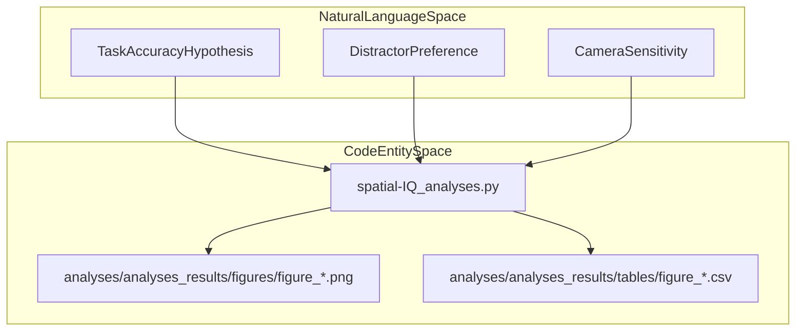
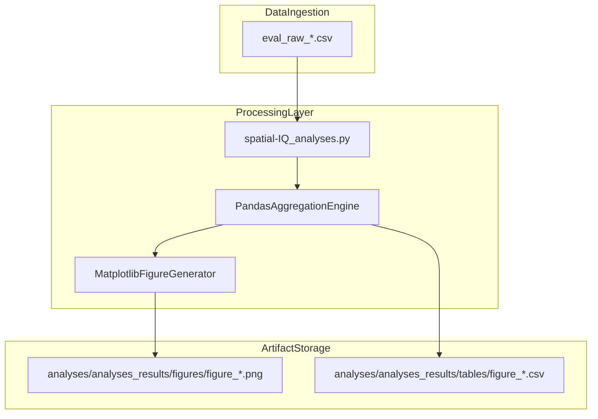

<!-- source: DeepWiki mcp.deepwiki.com · repo NVIDIA/Spatial-IQ · page 6.4 Generated Figures · fetched 2026-10-26 -->

# Generated Figures

Relevant source files

The following files were used as context for generating this wiki page:

- [analyses/analyses_results/figures/figure_04_text_task_accuracy.png](analyses/analyses_results/figures/figure_04_text_task_accuracy.png)
- [analyses/analyses_results/figures/figure_05_mcq5_wrong_answer_preferences.png](analyses/analyses_results/figures/figure_05_mcq5_wrong_answer_preferences.png)
- [analyses/analyses_results/figures/figure_06_text_difficulty_controls.png](analyses/analyses_results/figures/figure_06_text_difficulty_controls.png)
- [analyses/analyses_results/figures/figure_07_text_summation_mechanism.png](analyses/analyses_results/figures/figure_07_text_summation_mechanism.png)
- [analyses/analyses_results/figures/figure_13_text_mental_rotation_correlations.png](analyses/analyses_results/figures/figure_13_text_mental_rotation_correlations.png)
- [analyses/analyses_results/figures/figure_14_text_bundle_correlations.png](analyses/analyses_results/figures/figure_14_text_bundle_correlations.png)
- [analyses/analyses_results/figures/figure_15_mcq345_task_accuracy.png](analyses/analyses_results/figures/figure_15_mcq345_task_accuracy.png)
- [analyses/analyses_results/figures/figure_16_mcq345_wrong_answer_preferences.png](analyses/analyses_results/figures/figure_16_mcq345_wrong_answer_preferences.png)
- [analyses/analyses_results/figures/figure_17_image_task_accuracy.png](analyses/analyses_results/figures/figure_17_image_task_accuracy.png)
- [analyses/analyses_results/figures/figure_18_text_camera_effects.png](analyses/analyses_results/figures/figure_18_text_camera_effects.png)
- [analyses/analyses_results/figures/figure_19_image_difficulty_controls.png](analyses/analyses_results/figures/figure_19_image_difficulty_controls.png)
- [analyses/analyses_results/figures/figure_20_text_object_accuracy.png](analyses/analyses_results/figures/figure_20_text_object_accuracy.png)
- [analyses/analyses_results/figures/figure_21_text_object_difficulty_slices.png](analyses/analyses_results/figures/figure_21_text_object_difficulty_slices.png)
- [analyses/analyses_results/figures/figure_22_text_composition_diagnostics.png](analyses/analyses_results/figures/figure_22_text_composition_diagnostics.png)
- [analyses/analyses_results/figures/figure_23_mcq345_summation_mechanism.png](analyses/analyses_results/figures/figure_23_mcq345_summation_mechanism.png)
- [analyses/analyses_results/figures/figure_24_image_summation_mechanism.png](analyses/analyses_results/figures/figure_24_image_summation_mechanism.png)
- [analyses/analyses_results/figures/figure_25_trained_text_task_accuracy.png](analyses/analyses_results/figures/figure_25_trained_text_task_accuracy.png)
- [analyses/analyses_results/figures/figure_26_trained_text_object_accuracy.png](analyses/analyses_results/figures/figure_26_trained_text_object_accuracy.png)
- [analyses/analyses_results/figures/figure_27_trained_text_summation_mechanism.png](analyses/analyses_results/figures/figure_27_trained_text_summation_mechanism.png)
- [analyses/analyses_results/figures/figure_28_trained_text_composition_diagnostics.png](analyses/analyses_results/figures/figure_28_trained_text_composition_diagnostics.png)
- [analyses/analyses_results/tables/figure_05_mcq5_wrong_answer_preferences.csv](analyses/analyses_results/tables/figure_05_mcq5_wrong_answer_preferences.csv)
- [analyses/analyses_results/tables/figure_07_text_summation_mechanism.csv](analyses/analyses_results/tables/figure_07_text_summation_mechanism.csv)
- [analyses/analyses_results/tables/figure_13_text_mental_rotation_correlations.csv](analyses/analyses_results/tables/figure_13_text_mental_rotation_correlations.csv)
- [analyses/analyses_results/tables/figure_14_text_bundle_correlations.csv](analyses/analyses_results/tables/figure_14_text_bundle_correlations.csv)
- [analyses/analyses_results/tables/figure_15_mcq345_task_accuracy.csv](analyses/analyses_results/tables/figure_15_mcq345_task_accuracy.csv)
- [analyses/analyses_results/tables/figure_16_mcq345_wrong_answer_preferences.csv](analyses/analyses_results/tables/figure_16_mcq345_wrong_answer_preferences.csv)
- [analyses/analyses_results/tables/figure_18_text_camera_effects.csv](analyses/analyses_results/tables/figure_18_text_camera_effects.csv)
- [analyses/analyses_results/tables/figure_20_text_object_accuracy.csv](analyses/analyses_results/tables/figure_20_text_object_accuracy.csv)
- [analyses/analyses_results/tables/figure_21_text_object_difficulty_slices.csv](analyses/analyses_results/tables/figure_21_text_object_difficulty_slices.csv)
- [analyses/analyses_results/tables/figure_22_text_composition_diagnostics.csv](analyses/analyses_results/tables/figure_22_text_composition_diagnostics.csv)
- [analyses/analyses_results/tables/figure_23_mcq345_summation_mechanism.csv](analyses/analyses_results/tables/figure_23_mcq345_summation_mechanism.csv)
- [analyses/analyses_results/tables/figure_24_image_summation_mechanism.csv](analyses/analyses_results/tables/figure_24_image_summation_mechanism.csv)
- [analyses/analyses_results/tables/figure_25_trained_text_task_accuracy.csv](analyses/analyses_results/tables/figure_25_trained_text_task_accuracy.csv)
- [analyses/analyses_results/tables/figure_26_trained_text_object_accuracy.csv](analyses/analyses_results/tables/figure_26_trained_text_object_accuracy.csv)
- [analyses/analyses_results/tables/figure_27_trained_text_summation_mechanism.csv](analyses/analyses_results/tables/figure_27_trained_text_summation_mechanism.csv)
- [analyses/analyses_results/tables/figure_28_trained_text_composition_diagnostics.csv](analyses/analyses_results/tables/figure_28_trained_text_composition_diagnostics.csv)

### Purpose and Scope

This section documents the catalogue of generated figures (Figure 04 through Figure 28) and their paired CSV data tables located under `analyses/analyses_results/figures/` and `analyses/analyses_results/tables/`. These publication-ready visual artifacts summarize comprehensive evaluations across multimodal Large Language Models (LLMs), covering per-task accuracy, distractor biases (wrong-answer preferences), scene difficulty parameters, mathematical summation mechanisms, camera transformations, mental-rotation correlations, and fine-tuned model progressions.

---

## 1. Catalogue of Figures and Paired Datasets

The analysis pipeline consumes raw evaluation records and generates vector-rendered and rasterized Matplotlib plots alongside structured CSV summaries.

| Figure Identifier | Filename | Paired CSV Data | Core Analytical Domain |
| :--- | :--- | :--- | :--- |
| **Figure 04** | `figure_04_text_task_accuracy.png` [analyses/analyses_results/figures/figure_04_text_task_accuracy.png:1-23]() | Implicitly paired in analysis | Text modality task-level accuracy breakdown across tasks `task1` through `task11`. |
| **Figure 05** | `figure_05_mcq5_wrong_answer_preferences.png` [analyses/analyses_results/figures/figure_05_mcq5_wrong_answer_preferences.png:1-31]() | `figure_05_mcq5_wrong_answer_preferences.csv` | Distractor selection analysis for 5-option multiple-choice questions (`mcq5`). |
| **Figure 06** | `figure_06_text_difficulty_controls.png` [analyses/analyses_results/figures/figure_06_text_difficulty_controls.png:1-21]() | Implicitly paired in analysis | Impact of block count and spatial occlusion on text-modality task accuracy. |
| **Figure 07** | `figure_07_text_summation_mechanism.png` [analyses/analyses_results/figures/figure_07_text_summation_mechanism.png:1-34]() | `figure_07_text_summation_mechanism.csv` | Hierarchical summation mechanics in text reasoning tasks. |
| **Figure 13** | `figure_13_text_mental_rotation_correlations.png` [analyses/analyses_results/figures/figure_13_text_mental_rotation_correlations.png:1-21]() | `figure_13_text_mental_rotation_correlations.csv` | Correlation analysis between mental rotation complexity and model error rates. |
| **Figure 14** | `figure_14_text_bundle_correlations.png` [analyses/analyses_results/figures/figure_14_text_bundle_correlations.png:1-17]() | `figure_14_text_bundle_correlations.csv` | Bundle coupling and responder lift correlations in spatial arrangement tasks. |
| **Figure 15** | `figure_15_mcq345_task_accuracy.png` [analyses/analyses_results/figures/figure_15_mcq345_task_accuracy.png:1-21]() | `figure_15_mcq345_task_accuracy.csv` | Accuracy comparison across 3, 4, and 5-option MCQ variants (`mcq3`, `mcq4`, `mcq5`). |
| **Figure 16** | `figure_16_mcq345_wrong_answer_preferences.png` [analyses/analyses_results/figures/figure_16_mcq345_wrong_answer_preferences.png:1-15]() | `figure_16_mcq345_wrong_answer_preferences.csv` | Distractor bias evaluation across multiple MCQ option cardinalities. |
| **Figure 17** | `figure_17_image_task_accuracy.png` [analyses/analyses_results/figures/figure_17_image_task_accuracy.png:1-16]() | Implicitly paired in analysis | Image-modality task accuracy across benchmark tasks. |
| **Figure 18** | `figure_18_text_camera_effects.png` [analyses/analyses_results/figures/figure_18_text_camera_effects.png:1-19]() | `figure_18_text_camera_effects.csv` | Sensitivity of text models to camera offset, field-of-view (FOV), and distance variations. |
| **Figure 19** | `figure_19_image_difficulty_controls.png` [analyses/analyses_results/figures/figure_19_image_difficulty_controls.png:1-13]() | Implicitly paired in analysis | Difficulty bin performance slicing under image-based evaluation. |
| **Figure 20** | `figure_20_text_object_accuracy.png` [analyses/analyses_results/figures/figure_20_text_object_accuracy.png:1-16]() | `figure_20_text_object_accuracy.csv` | Granular object-level localization and counting accuracy for text models. |
| **Figure 21** | `figure_21_text_object_difficulty_slices.png` () | `figure_21_text_object_difficulty_slices.csv` | Sliced difficulty metrics mapped against object composition properties. |
| **Figure 22** | `figure_22_text_composition_diagnostics.png` () | `figure_22_text_composition_diagnostics.csv` | Diagnostic evaluation of scene composition graphs and hierarchical dependencies. |
| **Figure 23** | `figure_23_mcq345_summation_mechanism.png` () | `figure_23_mcq345_summation_mechanism.csv` | Summation and counting strategy diagnostics across MCQ formats. |
| **Figure 24** | `figure_24_image_summation_mechanism.png` () | `figure_24_image_summation_mechanism.csv` | Summation behavior evaluation under direct image input modalities. |
| **Figure 25** | `figure_25_trained_text_task_accuracy.png` () | `figure_25_trained_text_task_accuracy.csv` | Task accuracy metrics specifically for fine-tuned and trained model checkpoints. |
| **Figure 26** | `figure_26_trained_text_object_accuracy.png` () | `figure_26_trained_text_object_accuracy.csv` | Object-level accuracy progression across fine-tuning checkpoints. |
| **Figure 27** | `figure_27_trained_text_summation_mechanism.png` () | `figure_27_trained_text_summation_mechanism.csv` | Summation mechanism changes following domain adaptation/SFT. |
| **Figure 28** | `figure_28_trained_text_composition_diagnostics.png` () | `figure_28_trained_text_composition_diagnostics.csv` | Composition diagnostic evaluations on trained/fine-tuned model weights. |

Sources: 
- `analyses/analyses_results/figures/figure_04_text_task_accuracy.png` [analyses/analyses_results/figures/figure_04_text_task_accuracy.png:1-23]()
- `analyses/analyses_results/figures/figure_05_mcq5_wrong_answer_preferences.png` [analyses/analyses_results/figures/figure_05_mcq5_wrong_answer_preferences.png:1-31]()
- `analyses/analyses_results/figures/figure_06_text_difficulty_controls.png` [analyses/analyses_results/figures/figure_06_text_difficulty_controls.png:1-21]()
- `analyses/analyses_results/figures/figure_07_text_summation_mechanism.png` [analyses/analyses_results/figures/figure_07_text_summation_mechanism.png:1-34]()
- `analyses/analyses_results/figures/figure_13_text_mental_rotation_correlations.png` [analyses/analyses_results/figures/figure_13_text_mental_rotation_correlations.png:1-21]()
- `analyses/analyses_results/figures/figure_14_text_bundle_correlations.png` [analyses/analyses_results/figures/figure_14_text_bundle_correlations.png:1-17]()
- `analyses/analyses_results/figures/figure_15_mcq345_task_accuracy.png` [analyses/analyses_results/figures/figure_15_mcq345_task_accuracy.png:1-21]()
- `analyses/analyses_results/figures/figure_16_mcq345_wrong_answer_preferences.png` [analyses/analyses_results/figures/figure_16_mcq345_wrong_answer_preferences.png:1-15]()
- `analyses/analyses_results/figures/figure_17_image_task_accuracy.png` [analyses/analyses_results/figures/figure_17_image_task_accuracy.png:1-16]()
- `analyses/analyses_results/figures/figure_18_text_camera_effects.png` [analyses/analyses_results/figures/figure_18_text_camera_effects.png:1-19]()
- `analyses/analyses_results/figures/figure_19_image_difficulty_controls.png` [analyses/analyses_results/figures/figure_19_image_difficulty_controls.png:1-13]()
- `analyses/analyses_results/figures/figure_20_text_object_accuracy.png` [analyses/analyses_results/figures/figure_20_text_object_accuracy.png:1-16]()

---

## 2. Natural Language Space to Code Entity Mapping

To bridge conceptual evaluation metrics with codebase architecture, the analysis modules translate natural language descriptive hypotheses (e.g., "mental rotation correlation" or "camera viewpoint sensitivity") directly into concrete execution functions and output assets.

Diagram: Natural Language Space to Code Entity Space

Sources: 
- `analyses/analyses_results/figures/figure_04_text_task_accuracy.png` [analyses/analyses_results/figures/figure_04_text_task_accuracy.png:1-23]()
- `analyses/analyses_results/figures/figure_18_text_camera_effects.png` [analyses/analyses_results/figures/figure_18_text_camera_effects.png:1-19]()

---

## 3. Figure Generation Pipeline Architecture

The figure generation process ingests raw evaluation records (`eval_raw_*.csv`), processes statistical aggregates, and compiles publication-quality visualizations.

Diagram: Figure Generation Pipeline Architecture

Sources: 
- `analyses/analyses_results/figures/figure_05_mcq5_wrong_answer_preferences.png` [analyses/analyses_results/figures/figure_05_mcq5_wrong_answer_preferences.png:1-31]()
- `analyses/analyses_results/figures/figure_07_text_summation_mechanism.png` [analyses/analyses_results/figures/figure_07_text_summation_mechanism.png:1-34]()

---

## 4. Sub-Domain Analysis Details

### Task Accuracy & Modality Breakdowns
* **Figure 04 (`figure_04_text_task_accuracy.png`)** [analyses/analyses_results/figures/figure_04_text_task_accuracy.png:1-23]() displays comparative performance profiles across tasks `task1` through `task11` under text-only input formatting.
* **Figure 15 (`figure_15_mcq345_task_accuracy.png`)** [analyses/analyses_results/figures/figure_15_mcq345_task_accuracy.png:1-21]() and **Figure 17 (`figure_17_image_task_accuracy.png`)** [analyses/analyses_results/figures/figure_17_image_task_accuracy.png:1-16]() extend these comparisons to MCQ option cardinalities and image input modalities respectively.

### Cognitive Correlates & Difficulty Controls
* **Figure 13 (`figure_13_text_mental_rotation_correlations.png`)** [analyses/analyses_results/figures/figure_13_text_mental_rotation_correlations.png:1-21]() maps error rates against angular transformation complexity, highlighting spatial perspective-taking limitations in baseline LLMs.
* **Figure 14 (`figure_14_text_bundle_correlations.png`)** [analyses/analyses_results/figures/figure_14_text_bundle_correlations.png:1-17]() illustrates bundle coupling metrics and responder lift factors.

Sources:
- `analyses/analyses_results/figures/figure_13_text_mental_rotation_correlations.png` [analyses/analyses_results/figures/figure_13_text_mental_rotation_correlations.png:1-21]()
- `analyses/analyses_results/figures/figure_14_text_bundle_correlations.png` [analyses/analyses_results/figures/figure_14_text_bundle_correlations.png:1-17]()
- `analyses/analyses_results/figures/figure_15_mcq345_task_accuracy.png` [analyses/analyses_results/figures/figure_15_mcq345_task_accuracy.png:1-21]()
- `analyses/analyses_results/figures/figure_17_image_task_accuracy.png` [analyses/analyses_results/figures/figure_17_image_task_accuracy.png:1-16]()

---

