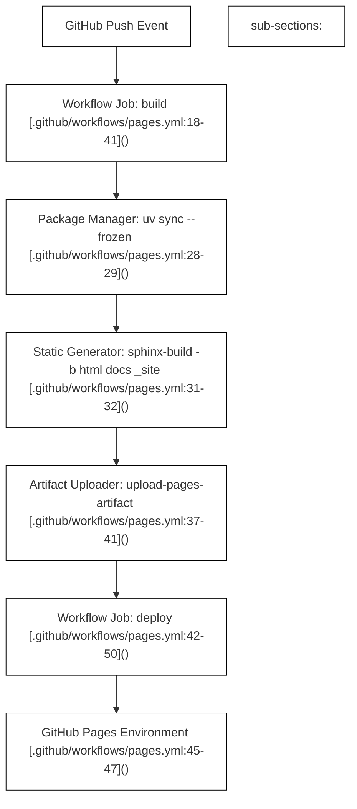
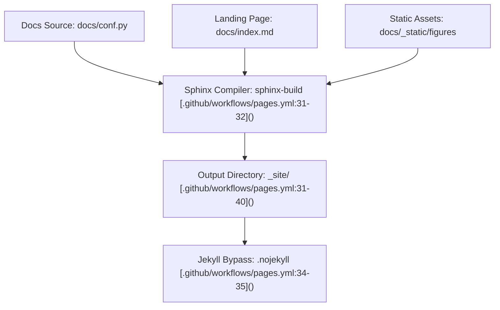

<!-- source: DeepWiki mcp.deepwiki.com · repo NVIDIA/Spatial-IQ · page 7 Documentation Site & CI · fetched 2026-10-26 -->

# Documentation Site & CI

Relevant source files

The following files were used as context for generating this wiki page:

- [.github/workflows/pages.yml](.github/workflows/pages.yml)
- [.gitignore](.gitignore)

## Purpose & Scope
This section covers the documentation architecture and automated deployment pipeline for Spatial-IQ. The documentation is built using Sphinx and hosted automatically via GitHub Actions on GitHub Pages. 

This is a parent page. For deep technical details, refer to the child pages:
- [Sphinx Documentation (docs/)](#7.1)
- [GitHub Pages Deployment Workflow](#7.2)

---

## Architecture Overview

The documentation and CI infrastructure bridges repository source documentation under `docs/` with the automated deployment actions defined in `.github/workflows/pages.yml` [__github/workflows/pages.yml:1-51](). Build artifacts and local caches are ignored by version control as specified in `.gitignore` [.gitignore:13-16]().

### CI Workflow to Code Entity Mapping

*Sources: [.github/workflows/pages.yml:1-50]()*

---

## Documentation Structure & Asset Flow

The Sphinx site aggregates Markdown and reStructuredText source files, compiling them alongside static figures into an HTML output directory (`_site/` or `docs/_build/`), which is excluded from git tracking [.gitignore:13-16]().

*Sources: [.github/workflows/pages.yml:31-40](), [.gitignore:13-16]()*

---

## Sub-Topics & Child Pages

- **Sphinx Documentation ([Sphinx Documentation (docs/)](#7.1))**: Covers `conf.py` settings, landing page structure (`index.md`), asset management in `_static/figures`, and local compilation commands.
- **GitHub Pages Deployment Workflow ([GitHub Pages Deployment Workflow](#7.2))**: Covers the concurrency rules, `pages.yml` execution steps, `uv` dependency locking, and permissions required for publishing.

*Sources: [.github/workflows/pages.yml:1-50](), [.gitignore:1-41]()*

---

