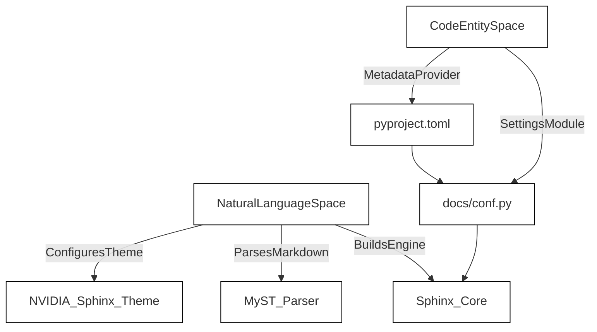
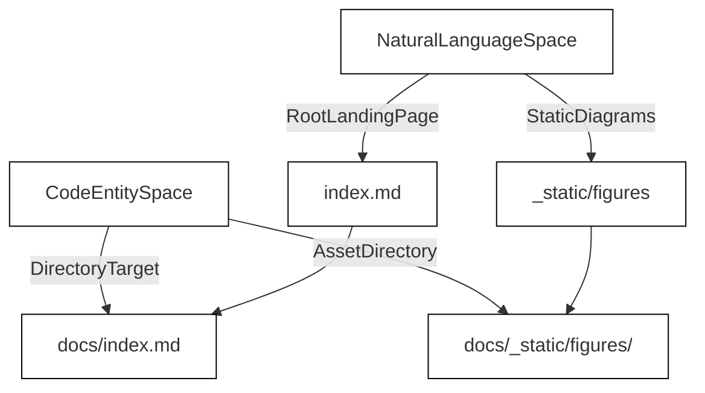

<!-- source: DeepWiki mcp.deepwiki.com · repo NVIDIA/Spatial-IQ · page 7.1 Sphinx Documentation (docs/) · fetched 2026-10-26 -->

# Sphinx Documentation (docs/)

<details>
<summary>Relevant source files</summary>

The following files were used as context for generating this wiki page:

- [.gitignore](.gitignore)
- [THIRD_PARTY_LICENSES.md](THIRD_PARTY_LICENSES.md)

</details>


This page details the technical configuration, asset management, and local build architecture of the Spatial-IQ documentation site located in the `docs/` directory. The documentation system leverages **Sphinx** configured with **MyST-Parser** for Markdown-first authoring and the **NVIDIA Sphinx Theme** for visual branding [THIRD_PARTY_LICENSES.md:106-111]().

---

## Purpose and Scope of `docs/`

The `docs/` subsystem transforms repository-level specifications, research findings, and architecture manuals into a cohesive HTML documentation site. It acts as the canonical source for static publication via GitHub Pages, mirroring the structure of the Spatial-IQ technical wiki.

Sources: [THIRD_PARTY_LICENSES.md:106-111](), [.gitignore:13-20]()

---

## Configuration (`conf.py`) and Theme Architecture

The build process is controlled by Sphinx configuration parameters and project metadata defined in `pyproject.toml`. The documentation relies on three core third-party Python packages:

*   **Sphinx**: The core document processing and publishing engine (`sphinx`).
*   **NVIDIA Sphinx Theme**: Provides custom styling, navigation headers, and NVIDIA visual identity assets.
*   **MyST-Parser**: Enables native parsing of MyST Markdown (`.md`) files, allowing standard Sphinx directives and cross-referencing within Markdown documents.


*Figure 1: Natural Language Space to Code Entity Space mapping for documentation configuration.*

Sources: [THIRD_PARTY_LICENSES.md:106-111]()

---

## Landing Page (`index.md`) and Static Assets (`_static/figures`)

The documentation entry point is defined by `index.md`, which structures the top-level table of contents and provides landing-page abstracts for the benchmark modules.

Static assets, including architectural diagrams, plots, and figures generated during analysis runs, are stored under `docs/_static/figures/`. These assets are bundled directly into the HTML build output by Sphinx.


*Figure 2: Mapping of landing page text and figures to their respective file paths in the repository.*

Sources: [.gitignore:13-20](), [THIRD_PARTY_LICENSES.md:106-111]()

---

## Local Build Commands and Artifact Management

Developers can build and preview the documentation site locally before pushing changes. The build outputs are excluded from version control to maintain a clean repository state [.gitignore:13-20]().

### Local Build Workflow

To build the documentation locally:

1. Install documentation dependencies specified in `pyproject.toml`:
   ```bash
   pip install .[docs]
   ```
2. Navigate to the `docs/` directory and execute the Sphinx Makefile or direct CLI command:
   ```bash
   cd docs
   sphinx-build -b html . _build/html
   ```

### Ignored Build Artifacts

The following build directories and transient outputs are ignored by Git (.gitignore):
*   `docs/_build/`: Local HTML and intermediate build files generated by Sphinx [.gitignore:13-14]()
*   `_site/`: Staging directory for compiled site deployments [.gitignore:15]()
*   `public/`: Distribution directory for static hosting [.gitignore:16]()
*   `Spatial-IQ`: Local symlinks or workspace mount points [.gitignore:18-19]()

Sources: [.gitignore:13-20](), [THIRD_PARTY_LICENSES.md:106-111]()

---

