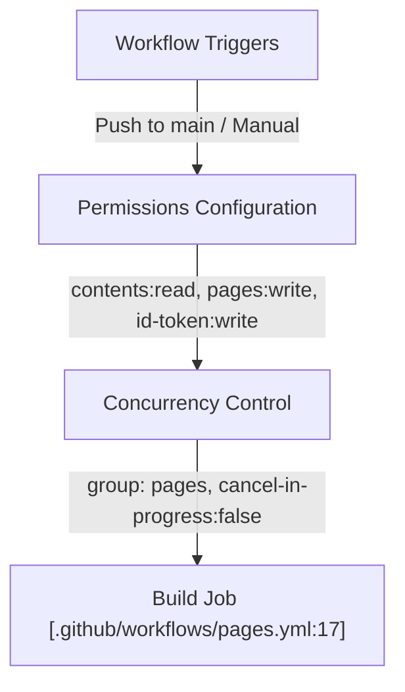
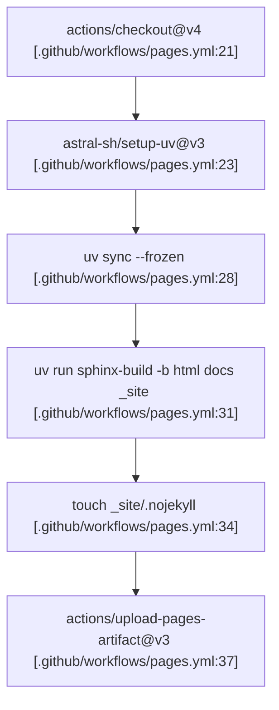

<!-- source: DeepWiki mcp.deepwiki.com · repo NVIDIA/Spatial-IQ · page 7.2 GitHub Pages Deployment Workflow · fetched 2026-10-26 -->

# GitHub Pages Deployment Workflow

<details>
<summary>Relevant source files</summary>

The following files were used as context for generating this wiki page:

- [.github/workflows/pages.yml](.github/workflows/pages.yml)

</details>


The GitHub Pages Deployment Workflow automates the compilation and publishing of the Spatial-IQ documentation site to GitHub Pages. Defined in `.github/workflows/pages.yml` [/.github/workflows/pages.yml:1-50](), this workflow manages environment configuration, dependency synchronization via `uv`, Sphinx HTML generation, artifact staging, and secure deployment.

---

## 1. Workflow Triggers, Permissions, and Concurrency

The workflow execution is controlled by triggers, granular security permissions, and concurrency controls to prevent race conditions during concurrent pushes.

* **Triggers**: Executed automatically on every `push` to the `main` branch or manually via the `workflow_dispatch` event [/.github/workflows/pages.yml:3-6]().
* **Permissions**: Adheres to the principle of least privilege by explicitly scoping GITHUB_TOKEN permissions:
  * `contents: read`: Allows repository checkout [/.github/workflows/pages.yml:9]().
  * `pages: write`: Grants access to publish to the GitHub Pages environment [/.github/workflows/pages.yml:10]().
  * `id-token: write`: Required for OIDC token generation used by GitHub deployment actions [/.github/workflows/pages.yml:11]().
* **Concurrency**: Configured with a static group (`pages`) and `cancel-in-progress: false` to ensure that deployment runs complete sequentially without interrupting active builds [/.github/workflows/pages.yml:13-15]().



Sources: `[.github/workflows/pages.yml:1-16]()`

---

## 2. Build Job Pipeline and Dependency Resolution

The `build` job executes on the `ubuntu-latest` runner environment [/.github/workflows/pages.yml:17-19]() and is responsible for environment setup, strict dependency synchronization, and HTML site compilation.

### Step-by-Step Build Execution
1. **Repository Checkout**: Clones the repository using `actions/checkout@v4` [/.github/workflows/pages.yml:21]().
2. **Environment Setup**: Installs the `uv` Python package installer using `astral-sh/setup-uv@v3` with the version pinned to `latest` [/.github/workflows/pages.yml:23-26]().
3. **Dependency Synchronization**: Executes `uv sync --frozen` to install exact locked dependencies without modifying lockfiles [/.github/workflows/pages.yml:28-30]().
4. **Site Compilation**: Runs Sphinx via `uv run sphinx-build -b html docs _site` to parse reStructuredText/Markdown documentation sources from `docs/` and compile static HTML assets into the `_site` directory [/.github/workflows/pages.yml:31-33]().
5. **Jekyll Bypass**: Generates an empty `.nojekyll` file inside `_site` (`touch _site/.nojekyll`) to prevent GitHub Pages from processing the site through Jekyll, ensuring raw static files (including leading-underscore asset directories) are preserved [/.github/workflows/pages.yml:34-36]().
6. **Artifact Upload**: Packages and uploads the `_site` directory as a GitHub Pages artifact using `actions/upload-pages-artifact@v3` [/.github/workflows/pages.yml:37-41]().



Sources: `[.github/workflows/pages.yml:17-41]()`

---

## 3. Deployment Job and Environment Publishing

The `deploy` job handles releasing the compiled static artifact to the production GitHub Pages environment.

* **Dependencies**: Explicitly requires the `build` job to complete successfully via `needs: build` [/.github/workflows/pages.yml:42-43]().
* **Environment Configuration**: Runs on `ubuntu-latest` targeting the `github-pages` environment, dynamically exposing the output page URL (`${{ steps.deployment.outputs.page_url }}`) [/.github/workflows/pages.yml:44-47]().
* **Deployment Action**: Uses `actions/deploy-pages@v4` to consume the artifact uploaded by the build stage and publish it to the repository's GitHub Pages host [/.github/workflows/pages.yml:49-50]().

```mermaid
graph TD
    Artifact["Build Artifact (_site)"] -->|Consumes| DeployJob["deploy Job [.github/workflows/pages.yml:42]"]
    DeployJob -->|actions/deploy-pages@v4 [.github/workflows/pages.yml:49]| GHEnv["GitHub Pages Environment [.github/workflows/pages.yml:45]"]
    GHEnv -->|Outputs page_url| URL["Live Documentation URL"]

    style Artifact fill:#none
    style DeployJob fill:#none
    style GHEnv fill:#none
    style URL fill:#none
```

Sources: `[.github/workflows/pages.yml:42-50]()`

---

