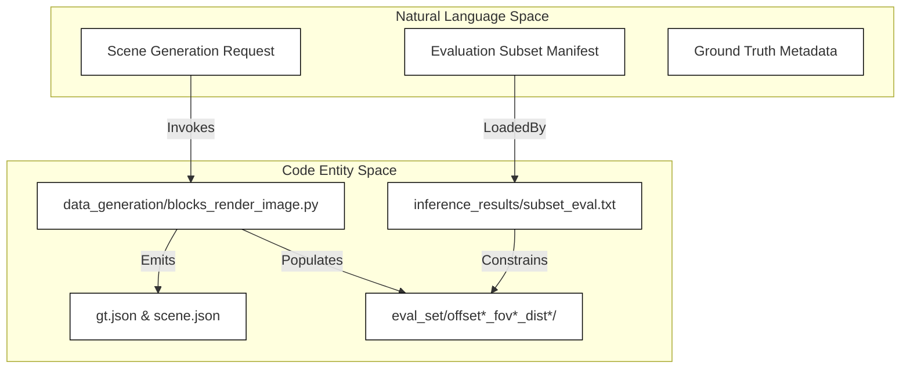
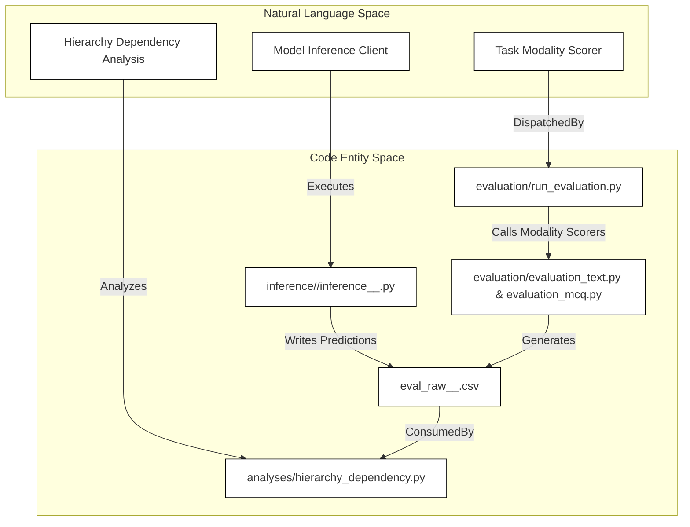

<!-- source: DeepWiki mcp.deepwiki.com · repo NVIDIA/Spatial-IQ · page 8 Glossary · fetched 2026-10-26 -->

# Glossary

Relevant source files

The following files were used as context for generating this wiki page:

- [README.md](README.md)
- [THIRD_PARTY_LICENSES.md](THIRD_PARTY_LICENSES.md)
- [analyses/analyses_results/tables/table_05_task_queries.csv](analyses/analyses_results/tables/table_05_task_queries.csv)
- [analyses/hierarchy_dependency.py](analyses/hierarchy_dependency.py)

## Purpose and Scope

This page provides formal technical definitions, operational context, and codebase pointers for key terms, abbreviations, and architectural concepts used across the Spatial-IQ benchmark repository. It covers data generation structures, inference routing, answer modalities, evaluation pipelines, hierarchical dependency metrics, and third-party runtime dependencies.

---

## Terminology Reference

### `view`
- **Definition**: The fundamental atomic unit of inference and evaluation in Spatial-IQ. Each view represents a distinct camera configuration and angle observing a procedurally generated stacked-block scene.
- **Code Pointer**: Stored as a physical leaf directory under `<dataset_root>/eval_set/` structured as `data_<timestamp>/level_<L>/sample_<NN>/view_<VV>/offset<O>_fov<F>_dist<D>/` [README.md:44-53].
- **Artifacts**: Contains `view.png`, `gt.json`, `scene.json`, task masks, and MCQ choice assets [README.md:48-53].

### `slug`
- **Definition**: A short string identifier representing a specific model inference client or responder family (e.g., `gemini`, `claude`, `vla0`, `human`).
- **Code Pointer**: Corresponds to directory names under `inference/` and flows into evaluation result files and analysis manifests [README.md:30,90-93]. Used in output naming such as `eval_raw_<slug>_<mode>.csv` [README.md:35,91].

### `task_main`
- **Definition**: The composite target task (`Target1` / Object Counting) that requires calculating the total number of blocks in the scene, including hidden or occluded blocks logically required to support visible structures under gravity assumptions [README.md:71-74].
- **Code Pointer**: Mapped in `analyses/analyses_results/tables/table_05_task_queries.csv:11` and handled across evaluation and analysis scripts (`main` column in `analyses/hierarchy_dependency.py:41,93`).

### `task1`–`task11`
- **Definition**: The 11 atomic and derived spatial-reasoning sub-tasks evaluating capabilities such as object categorization, cluster counts, column counts, layer counts, visible/hidden object counts, top-layer identification, direct support, support columns, and mental rotation [README.md:69-79].
- **Code Pointer**: Defined in `analyses/analyses_results/tables/table_05_task_queries.csv:1-13` and enumerated in script column arrays like `TASK_COLS` [analyses/hierarchy_dependency.py:93].

### MCQ / NCQ / CQ
- **Definition**: Answer format variants. **MCQ** (Multiple Choice Question) evaluates models via letter choices (A–E) across 3-, 4-, or 5-way image-option selections [README.md:83-86]. **NCQ** and **CQ** refer to specific negative-choice or cluster-count query variations evaluated in benchmark scripts [README.md:30,86].
- **Code Pointer**: Parsed and scored by `evaluation/evaluation_mcq.py` [README.md:31] and supported by prompt templates under `inference/prompt_mcq_*_Type1.json` [README.md:30].

### FRQ
- **Definition**: Free-Response Question modality where models output unstructured or numeric text predictions rather than constrained multiple-choice selections.
- **Code Pointer**: Evaluated via `evaluation/evaluation_text.py` for exact-match or Pearson correlation [README.md:83-85] and baseline suites like `evaluation/evaluation_human_frq.py` [README.md:31].

### subset file
- **Definition**: A plain-text manifest file containing relative paths to target evaluation views, used to restrict benchmark runs to a standardized evaluation subset.
- **Code Pointer**: Located at `inference_results/subset_eval.txt` [README.md:37,56-58].

### `gt.json`
- **Definition**: Ground-truth metadata file emitted during scene rendering, containing block counts, structural metadata, and correct MCQ answer letters.
- **Code Pointer**: Generated per view by `data_generation/blocks_render_image.py` and read during evaluation [README.md:29,49].

### `scene.json`
- **Definition**: Scene-level structural metadata file capturing global parameters of the generated block configuration.
- **Code Pointer**: Emitted per view alongside `gt.json` in `data_generation/blocks_render_image.py` [README.md:29,50].

### DCP shards
- **Definition**: Distributed Checkpoint format produced by NeMo-RL and NeMo framework training runs, containing distributed model weights and optimizer states.
- **Code Pointer**: Processed and converted to Hugging Face layout by utilities in `inference/qwen_finetuned/` for benchmark reruns [README.md:33].

### SFT
- **Definition**: Supervised Fine-Tuning, the initial training phase where models are fine-tuned on spatial reasoning demonstration data.
- **Code Pointer**: Implemented via configuration recipes and preparation scripts in `training/` [README.md:33].

### DAPO
- **Definition**: Direct Alignment Preference Optimization / Distributed Alignment Policy Optimization (specifically the `DAPO-tight` variant), an advanced reinforcement learning algorithm used in the RLVR training recipe.
- **Code Pointer**: Configured in `training/configs/` YAML/JSON recipes [README.md:33].

### CoT
- **Definition**: Chain-of-Thought reasoning, a structured generation format where models articulate intermediate spatial deductions before outputting final answers.
- **Code Pointer**: Governed by specialized system prompts and Pydantic-validated manifests under `training/` [README.md:33].

### vLLM
- **Definition**: High-throughput, memory-efficient inference engine used to serve local model weights via OpenAI-compatible HTTP endpoints.
- **Code Pointer**: Utilized in local inference scripts across `inference/` and within the OCR consensus pipeline under `evaluation/main_ocr/` [README.md:32,30].

### VLMEvalKit
- **Definition**: An open-source evaluation toolkit utilized for assessing vision-language models on general-purpose academic benchmarks.
- **Code Pointer**: Cloned and configured via `training_evaluation/setup.sh` and `training_evaluation/eval_config.json` to benchmark fine-tuned checkpoints against MMBench, MMMU, OCRBench, and MathVista [README.md:34].

### Isaac Sim / omni / carb / pxr
- **Definition**: NVIDIA Omniverse Isaac Sim simulation environment and its underlying low-level Python modules (`omni.*` simulation kits, `carb.*` carbon framework, `pxr` USD scene graph bindings) powering procedural data generation.
- **Code Pointer**: Imported exclusively by `data_generation/blocks_render_image.py` [THIRD_PARTY_LICENSES.md:114].

### OCR consensus
- **Definition**: A secondary scoring pipeline that re-extracts main object counts from image-output model renderings when direct text parsing is ambiguous.
- **Code Pointer**: Implemented in `evaluation/main_ocr/evaluate_main_ocr.py`, combining Tesseract, PaddleOCR, and Qwen2.5-VL vLLM consensus with disagreement review CSV outputs [README.md:32].

### `eval_raw` CSV
- **Definition**: Standardized tabular evaluation output containing per-view, per-task correctness scores for a given model and modality.
- **Code Pointer**: Named `eval_raw_<slug>_<mode>.csv` [README.md:91], consumed by `analyses/spatial-IQ_analyses.py` and `analyses/hierarchy_dependency.py` [analyses/hierarchy_dependency.py:112-120].

### bundle coupling
- **Definition**: The demeaned (fixed-effect) Pearson correlation ($r_{ws}$) between a hierarchical capability bundle score (fraction of correct tasks within a logical chain) and Object Counting (`main`), evaluated within individual views to isolate structural coupling from scene difficulty.
- **Code Pointer**: Computed in `analyses/hierarchy_dependency.py:24-26,85-91`.

### summation mechanism
- **Definition**: The structural dependency relationship linking visible object counts (`task5`) and hidden object counts (`task8`) to total object counting (`main`).
- **Code Pointer**: Defined in unary dependency edges within `analyses/hierarchy_dependency.py:68-69,89`.

### mental rotation
- **Definition**: Spatial transformation evaluation tasks (`task10` / `Target2a` for 90° rotation, `task11` / `Target2b` for 180° rotation) testing object visibility identification across varying camera perspectives.
- **Code Pointer**: Mapped in `analyses/analyses_results/tables/table_05_task_queries.csv:12-13`.

### difficulty bins
- **Definition**: Stratified groupings of evaluation samples categorized by structural complexity metrics (such as total block count and occlusion ratio) to analyze model performance scaling.
- **Code Pointer**: Generated and visualized by analysis scripts in `analyses/` [README.md:35].

### responder lift
- **Definition**: The marginal accuracy increase ($\Delta = P(\text{child}=1 \mid \text{parent met}) - P(\text{child}=1 \inned \text{parent unmet})$) computed within individual responders while holding scene difficulty constant via view-blocked contingency analysis.
- **Code Pointer**: Implemented in `analyses/hierarchy_dependency.py:16-21`.

---

## Architectural Mapping Diagrams

### Diagram 1: Natural Language Space to Code Entity Space (Data & View Pipeline)

*Sources: README.md:29,37,43-58*

### Diagram 2: Natural Language Space to Code Entity Space (Inference & Analysis Pipeline)

*Sources: README.md:30-35,90-93; analyses/hierarchy_dependency.py:112-120*