# Page: Overview

# Overview

<details>
<summary>Relevant source files</summary>

The following files were used as context for generating this wiki page:

- [LICENSE](LICENSE)
- [README.md](README.md)
- [THIRD_PARTY_LICENSES.md](THIRD_PARTY_LICENSES.md)

</details>


Spatial-IQ is a benchmark designed to evaluate multimodal LLMs on **3D spatial reasoning** using procedurally generated stacked-block scenes [README.md:11-16](). It deconstructs spatial intelligence into a hierarchical set of atomic and composite capability tests [README.md:18-19](). 

The benchmark features an end-to-end pipeline spanning synthetic data generation, multi-model inference across various API and local endpoints, multi-modality evaluation (text, MCQ, image editing, and OCR consensus), and an analysis pipeline that reproduces manuscript tables and figures [README.md:11-16]().

## End-to-End Pipeline

The Spatial-IQ workflow flows sequentially from scene generation to statistical analysis. The diagram below maps these conceptual stages to their corresponding code entities and execution entry points in the repository.

```mermaid
graph TD
    A["Scene Generation"] -->|"blocks_render_image.py"| B["Inference Layer"]
    B -->|"inference/*/inference_*.py"| C["Evaluation & Scoring"]
    C -->|"run_evaluation.py"| D["Analyses & Artifacts"]
    D -->|"spatial-IQ_analyses.py"| E["Paper Tables & Figures"]

    sub-graph DataGen ["data_generation/"]
        A1["data_generation/blocks_render_image.py"]
    end

    sub-graph Inf ["inference/"]
        B1["inference/gpt/"]
        B2["inference/qwen/"]
        B3["inference/claude/"]
    end

    sub-graph Eval ["evaluation/"]
        C1["evaluation/run_evaluation.py"]
        C2["evaluation/evaluation_text.py"]
        C3["evaluation/evaluation_mcq.py"]
        C4["evaluation/evaluation_image.py"]
        C5["evaluation/main_ocr/evaluate_main_ocr.py"]
    end

    sub-graph Anals ["analyses/"]
        D1["analyses/spatial-IQ_analyses.py"]
        D2["analyses/hierarchy_dependency.py"]
    end

    A -.-> A1
    B -.-> B1
    B -.-> B2
    B -.-> B3
    C -.-> C1
    C1 --> C2
    C1 --> C3
    C1 --> C4
    C1 --> C5
    D -.-> D1
    D1 --> D2
```
*Figure 1: End-to-end pipeline linking high-level benchmark phases to codebase entry points.*

Sources: [`README.md:25-38]()`, [`data_generation/blocks_render_image.py:1-50`]() (implied by layout), [`evaluation/run_evaluation.py:1-50`]() (implied by layout), [`analyses/spatial-IQ_analyses.py:1-50`]() (implied by layout).

---

## Repository Layout and Component Architecture

The repository is organized into self-contained subpackages corresponding to each phase of the benchmark lifecycle. The architecture isolates simulation, inference clients, scoring logic, training recipes, and analytical reporting.

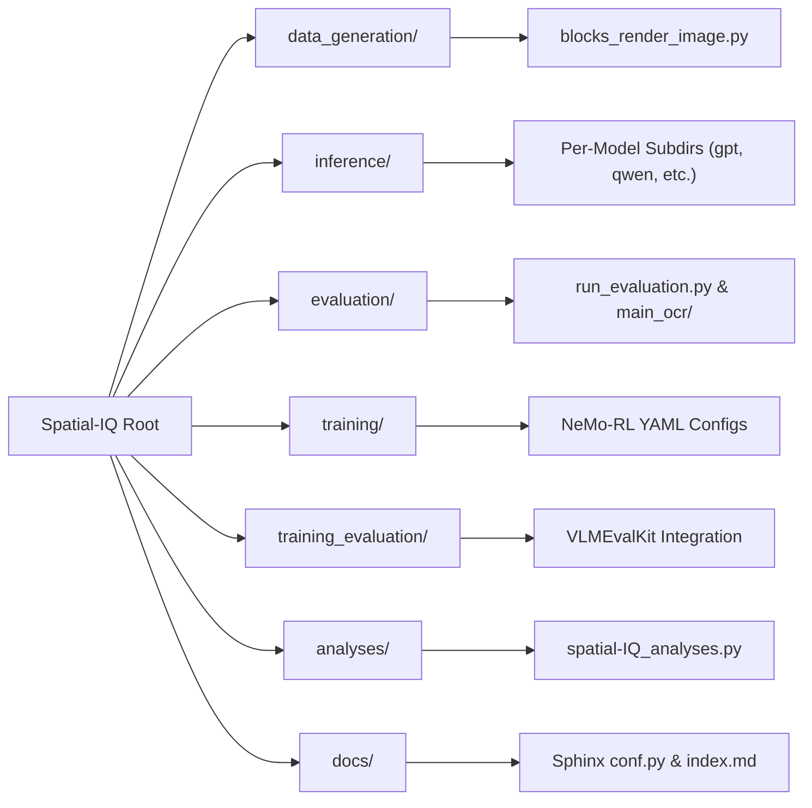
*Figure 2: Repository directory structure mapping top-level subpackages to their primary execution components.*

Sources: [`README.md:25-38`]()

---

## Child Pages & Detailed Topics

For deeper technical specifications, installation steps, and API contracts, refer to the child pages:

- **[Getting Started & Environment Setup](#1.1)** — Python environment management (`uv`, requirements per subpackage), API key configuration, model weight placement, ignored artifacts, and external dependencies such as Isaac Sim, vLLM, Tesseract, and PaddleOCR.
- **[Benchmark Concepts: Tasks, Views and Modalities](#1.2)** — Definitions for `task_main` and `task1`–`task11`, view directory structure (`offset`/`fov`/`dist`), subset manifests, answer modalities (text, MCQ, image, OCR), and file naming slugs.
- **[Project Governance: License, Security, Third-Party Notices](#1.3)** — BSD-3-Clause licensing terms, PSIRT vulnerability reporting protocol, and comprehensive third-party dependency license inventories.

Sources: [`README.md:1-120`]()

---

# Page: Getting Started & Environment Setup

# Getting Started & Environment Setup

<details>
<summary>Relevant source files</summary>

The following files were used as context for generating this wiki page:

- [.gitignore](.gitignore)
- [README.md](README.md)
- [THIRD_PARTY_LICENSES.md](THIRD_PARTY_LICENSES.md)

</details>


## Purpose and Scope

This page outlines the foundational environment configuration required to run Spatial-IQ. Because Spatial-IQ spans diverse computational domains—including synthetic 3D rendering via NVIDIA Isaac Sim, lightweight API client dispatching, deep learning inference with Hugging Face/vLLM, multi-engine OCR consensus pipelines, and rigorous statistical analysis—the repository eschews a monolithic, heavy requirements file in favor of **scoped subpackage requirements**. 

This document details Python environment management using `uv` or `pip`, secure credential handling, local model weight placement, ignored runtime artifacts via `.gitignore`, and the integration of heavy external runtimes (Isaac Sim, vLLM, and Tesseract/PaddleOCR).

Sources: `README.md:96-120` [README.md:96-120]()

---

## Scoped Python Environment & `uv` Integration

Spatial-IQ does not maintain a top-level `requirements.txt` or a single global virtual environment configuration. Instead, dependencies are compartmentalized by functional subsystem. End users install only the specific requirements corresponding to the modules they intend to execute.

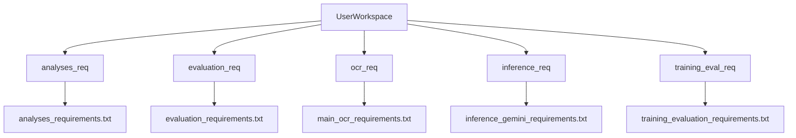
*Figure 1: Subpackage dependency isolation mapping human-level subsystem names to scoped requirement manifests.*

Sources: `README.md:100-112` [README.md:100-112](), `THIRD_PARTY_LICENSES.md:15-24` [THIRD_PARTY_LICENSES.md:15-24]()

### Subpackage Manifest Inventory

The repository defines distinct requirement files across subsystems:
* **`analyses/requirements.txt`**: Scientific and statistical stack (`numpy`, `scipy`, `pandas`, `matplotlib`, `pillow`) [THIRD_PARTY_LICENSES.md:27-36]().
* **`evaluation/requirements.txt`**: Exact-match and MCQ correctness evaluation tooling [README.md:107]().
* **`evaluation/main_ocr/requirements.txt`**: OCR consensus dependencies (`pytesseract`, `PaddleOCR`) [THIRD_PARTY_LICENSES.md:49-54]().
* **`inference/gemini/requirements.txt`**: Lightweight HTTP request client (`requests`) [THIRD_PARTY_LICENSES.md:35]().
* **`inference/qwen/requirements_image_edit.txt`**: Diffusers-based local image-editing client dependencies (`torch`, `diffusers`, `transformers`) [THIRD_PARTY_LICENSES.md:58-63]().
* **`training_evaluation/requirements.txt`**: VLMEvalKit companion benchmark dependencies [THIRD_PARTY_LICENSES.md:72-105]().

Virtual environments can be established using standard Python venv or fast package managers like `uv`:

```bash
# Example: Setting up the evaluation environment
python -m venv .venv
source .venv/bin/activate
pip install -r evaluation/requirements.txt
```

Sources: `README.md:96-120` [README.md:96-120]()

---

## API Keys & Secrets Management

To interact with proprietary hosted multimodal models (such as GPT, Gemini, Claude, Kimi, and GLM), API credentials must be supplied via local configuration files or environment variables. 

Secrets are strictly partitioned from version control. The file `inference/api_keys.txt` and exclusion lists are explicitly ignored by version control to prevent accidental credential leakage [.gitignore:32-35]().

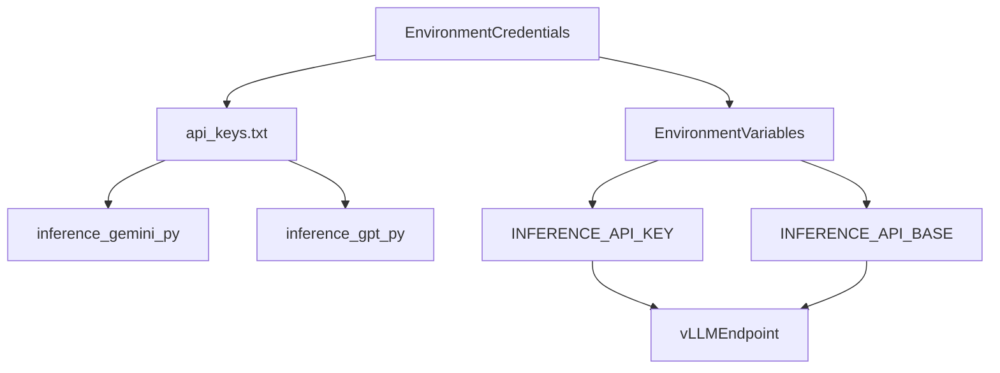
*Figure 2: Credential flow mapping runtime configuration files and environment variables to inference clients (`inference_gemini_py`, `vLLMEndpoint`).*

Sources: `.gitignore:32-35` [.gitignore:32-35](), `README.md:113-120` [README.md:113-120]()

---

## Model Weights Placement

For local execution (such as open-weights models served via vLLM or custom SFT/DAPO checkpoints), large model weights must be stored locally outside of tracked repository content. 

As defined in `.gitignore`, weights directories must be placed directly inside model-specific inference folders [.gitignore:36-39]():
* `inference/*/weights/`
* `inference/*/weights_*/`

Users should fetch weights following upstream Hugging Face instructions for each respective model family (e.g., Qwen2.5-VL, Nemotron, Hunyuan) and place them in these designated paths before launching local inference scripts.

Sources: `.gitignore:36-39` [.gitignore:36-39](), `README.md:36-39` [README.md:36-39]()

---

## Ignored Artifacts & Runtime Outputs

To maintain a clean repository state, runtime outputs, build caches, and generated analysis datasets are excluded from tracking [.gitignore:1-41](). 

Key ignored categories include:
* **Python Caches**: `__pycache__/`, `*.py[cod]`, `.venv/`, `venv/` [.gitignore:5-11]()
* **Documentation Builds**: `docs/_build/`, `_site/`, `public/` [.gitignore:13-16]()
* **Runtime Inference and Evaluation Results**: `evaluation_results/` and per-model prediction text/image outputs [.gitignore:40-41]()
* **Analysis Outputs**: `difficulty_analysis_output/` and temporary matplotlib configuration directories [.gitignore:1-3]()

Sources: `.gitignore:1-41` [.gitignore:1-41]()

---

## External Dependencies & Heavy Runtimes

Certain subsystems rely on heavy external binary runtimes or system packages that cannot be resolved via standard PyPI `pip` installation alone.

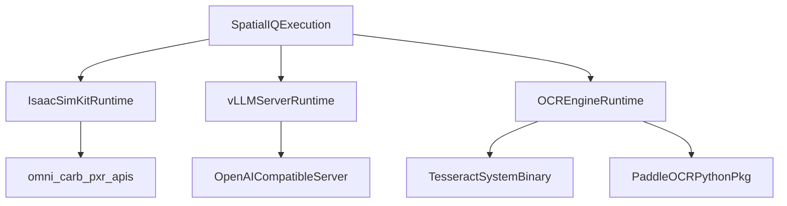
*Figure 3: External dependency topology linking system-level binaries and simulators (`IsaacSimKitRuntime`, `TesseractSystemBinary`) to Spatial-IQ functional blocks.*

Sources: `THIRD_PARTY_LICENSES.md:49-55` [THIRD_Party_LICENSES.md:49-55](), `THIRD_PARTY_LICENSES.md:112-115` [THIRD_PARTY_LICENSES.md:112-115]()

### 1. NVIDIA Isaac Sim
Dataset generation is powered by NVIDIA Isaac Sim 4.5 (`data_generation/blocks_render_image.py`) [README.md:29](). Isaac Sim must be installed independently by the end user in accordance with the NVIDIA Isaac Sim EULA [THIRD_PARTY_LICENSES.md:112-115](). The codebase communicates with the simulator strictly through public Python bindings (`omni.*`, `carb.*`, `pxr`) [THIRD_PARTY_LICENSES.md:112-115]().

### 2. Local vLLM Endpoints
Local evaluation of open-weights models (such as Qwen, Nemotron, and VLA variants) expects an OpenAI-compatible vLLM server [README.md:32](). The openai Python client library (`openai`) acts as the bridge to these local endpoints [THIRD_PARTY_LICENSES.md:43]().

### 3. Tesseract and PaddleOCR
The OCR consensus pipeline (`evaluation/main_ocr/`) requires both the system-level `tesseract` binary (typically installed via `conda-forge`) and the `PaddleOCR` Python package to extract structured object counts from rendered image outputs [THIRD_PARTY_LICENSES.md:49-54]().

Sources: `THIRD_PARTY_LICENSES.md:49-55` [THIRD_PARTY_LICENSES.md:49-55](), `THIRD_PARTY_LICENSES.md:112-115` [THIRD_PARTY_LICENSES.md:112-115]()

---

# Page: Benchmark Concepts: Tasks, Views and Modalities

# Benchmark Concepts: Tasks, Views and Modalities

<details>
<summary>Relevant source files</summary>

The following files were used as context for generating this wiki page:

- [README.md](README.md)
- [analyses/analyses_results/tables/table_05_task_queries.csv](analyses/analyses_results/tables/table_05_task_queries.csv)

</details>


## Purpose and Scope

This page covers the core benchmark concepts of **Spatial-IQ**, focusing on the hierarchical spatial reasoning tasks (`task_main` and `task1`–`task11`), the physical view directory layout and subset files, the four answer modalities (text, MCQ, image, and OCR-based main scoring), and the slug-based file naming conventions used throughout the pipeline [README.md:41-94](). 

---

## 1. View Directory Layout & Dataset Structure

The Spatial-IQ dataset is organized as a hierarchical directory tree rooted at `<dataset_root>/eval_set/`. Each distinct camera perspective on a 3D stacked-block scene is isolated into a unique leaf directory known as a **view** [README.md:43-58]().

### Directory Hierarchy

A typical path to a single view follows this pattern:
```
<dataset_root>/eval_set/data_<timestamp>/level_<L>/sample_<NN>/view_<VV>/offset<O>_fov<F>_dist<D>/
```

Inside each leaf view directory, the data generation pipeline (`data_generation/blocks_render_image.py`) emits a standardized set of artifacts [README.md:29, 47-53]():

- `view.png` — The rendered RGB input image presented to multimodal models.
- `gt.json` — Ground-truth metadata containing counts, MCQ correct letters, and structural attributes.
- `scene.json` — Scene-level metadata describing object placements and physical properties.
- `task<N>_gt_mask.npy` — Per-task NumPy binary pixel masks used for image-modality evaluation.
- `task<N>_gt_image_*.png` — Pre-rendered MCQ option images (e.g., 3-way, 4-way, or 5-way choice panels).

### Subset Files

To restrict inference and evaluation runs to specific benchmarks or subsets, the framework uses subset files such as [`inference_results/subset_eval.txt`]() [README.md:37, 56-58](). These files contain plain text lists of relative paths pointing to specific leaf view directories.

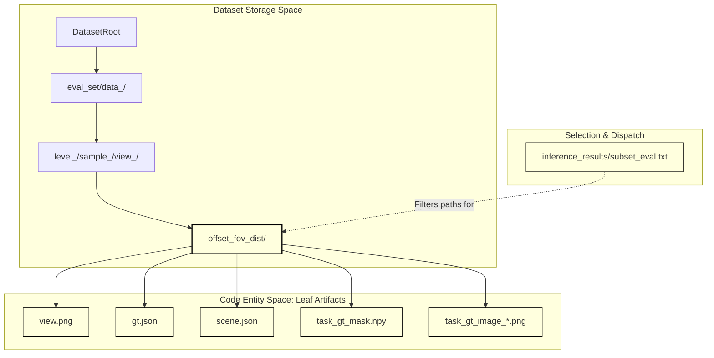

*Sources: [README.md:27-64]()*

---

## 2. Benchmark Tasks (`task_main` and `task1`–`task11`)

Spatial-IQ evaluates multimodal models across 11 atomic spatial reasoning sub-tasks (`task1` through `task11`) and one composite target task (`task_main`) [README.md:67-79](). 

### Task Definitions and Query Mapping

The table below maps the task identifiers used in code (`task1`–`task11`, `main`) to their paper descriptions and query texts [analyses/analyses_results/tables/table_05_task_queries.csv:1-13]():

| Task ID | Source Task Code | Task Name | Query Text |
| :--- | :--- | :--- | :--- |
| **Target1** | `main` | Object Counting | How many objects are in the stacked structure in total? [analyses/analyses_results/tables/table_05_task_queries.csv:11-11]() |
| **Task1** | `task1` | Object Categorization | What object category composes the stacked structure? [analyses/analyses_results/tables/table_05_task_queries.csv:2-2]() |
| **Task2** | `task9` | Cluster Count | How many non-laterally-adjacent clusters of objects are present? [analyses/analyses_results/tables/table_05_task_queries.csv:3-3]() |
| **Task3** | `task3` | Column Count | How many columns are in the stacked structure? [analyses/analyses_results/tables/table_05_task_queries.csv:4-4]() |
| **Task4** | `task4` | Layer Count | How many horizontal layers are in the stacked structure? [analyses/analyses_results/tables/table_05_task_queries.csv:5-5]() |
| **Task5** | `task5` | Visible Object Count | How many visible objects are present? [analyses/analyses_results/tables/table_05_task_queries.csv:6-6]() |
| **Task6** | `task2` | Top Layer | How many objects are in the top-most layer? [analyses/analyses_results/tables/table_05_task_queries.csv:7-7]() |
| **Task7** | `task6` | Direct Support | How many visible objects directly support the top-most object(s)? [analyses/analyses_results/tables/table_05_task_queries.csv:8-8]() |
| **Task8** | `task7` | Support Column | How many visible objects are in columns supporting the top-most object(s)? [analyses/analyses_results/tables/table_05_task_queries.csv:9-9]() |
| **Task9** | `task8` | Hidden Object Count | How many hidden objects must exist to support the visible structure? [analyses/analyses_riters/tables/table_05_task_queries.csv:10-10]()* |
| **Target2a** | `task10` | Mental Rotation 90 | Which objects are visible in the adjacent view but not the reference view? [analyses/analyses_results/tables/table_05_task_queries.csv:12-12]() |
| **Target2b** | `task11` | Mental Rotation 180 | Which objects are visible in the opposite view but not the reference view? [analyses/analyses_results/tables/table_05_task_queries.csv:13-13]() |

* `task_main` requires computing total blocks, including occluded blocks logically required by gravity assumptions [README.md:71-74]().

*Sources: [README.md:67-80](), [analyses/analyses_results/tables/table_05_task_queries.csv:1-13]()*

---

## 3. Answer Modalities & Scoring Pathways

Models interact with the benchmark across four distinct answer modalities [README.md:81-89](). Each modality writes prediction files directly into the view directory and is evaluated by dedicated scripts under the `evaluation/` directory [README.md:31, 83-89]().

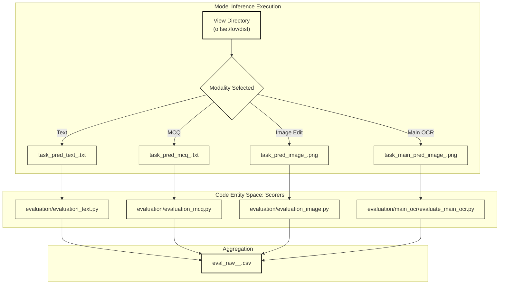

*Sources: [README.md:81-92]()*

### Modality Specifications

1. **Free-Response Text (`text`)**:
   - **Prediction File**: `task<N>_pred_text_<slug>.txt` [README.md:85]()
   - **Scorer**: `evaluation/evaluation_text.py` [README.md:85]()
   - **Metric**: Exact-match or Pearson correlation against numeric/categorical ground truth [README.md:85]().
2. **Multiple Choice Question (`MCQ`)**:
   - **Prediction File**: `task<N>_pred_mcq_<slug>.txt` [README.md:86]()
   - **Scorer**: `evaluation/evaluation_mcq.py` [README.md:86]()
   - **Metric**: Letter match (A–E) across 3-, 4-, or 5-way option panels [README.md:86]().
3. **Image Editing (`image`)**:
   - **Prediction File**: `task<N>_pred_image_<slug>.png` [README.md:87]()
   - **Scorer**: `evaluation/evaluation_image.py` [README.md:87]()
   - **Metric**: Pixel-level silhouette score against ground-truth binary masks (`task<N>_gt_mask.npy`) [README.md:51, 87]().
4. **Main OCR Consensus (`main`)**:
   - **Prediction File**: `task_main_pred_image_<slug>.png` [README.md:88]()
   - **Scorer**: `evaluation/main_ocr/evaluate_main_ocr.py` [README.md:88]()
   - **Metric**: Ensemble OCR consensus (Tesseract + PaddleOCR + Qwen2.5-VL) extracting block counts from annotated images [README.md:32, 88]().

*Sources: [README.md:31-32, 51, 81-89]()*

---

## 4. Slugs and File Naming Conventions

A **slug** represents the unique directory name of an inference client under the `inference/` directory (e.g., `gemini`, `claude`, `vla0`, `qwen`) [README.md:30, 90-92](). 

### Slug Propagation Pipeline

Slugs flow immutably through the entire lifecycle of an evaluation run:
1. **Inference**: Client scripts read prompt templates from `prompt_*_Type1.json` and write outputs tagged with the model's slug [README.md:30, 91]().
2. **Evaluation**: `run_evaluation.py` scans view directories for files matching the active slug and computes scores [README.md:31, 91]().
3. **Outputs**: Scored results are aggregated into CSV files named according to the formula `eval_raw_<slug>_<mode>.csv` [README.md:91]().

*Sources: [README.md:30-31, 90-92]()*

---

# Page: Project Governance: License, Security, Third-Party Notices

# Project Governance: License, Security, Third-Party Notices

<details>
<summary>Relevant source files</summary>

The following files were used as context for generating this wiki page:

- [LICENSE](LICENSE)
- [SECURITY.md](SECURITY.md)
- [THIRD_PARTY_LICENSES.md](THIRD_PARTY_LICENSES.md)

</details>


## Purpose and Scope
This page establishes the project governance structure, licensing terms, security disclosure protocols, and third-party software inventory for the Spatial-IQ codebase. It provides technical stakeholders with the compliance and operational rules governing the repository, including the BSD-3-Clause license terms, the Product Security Incident Response Team (PSIRT) reporting workflow, and a categorized breakdown of runtime dependencies sourced from various configuration and requirements manifests.

Sources: `LICENSE:1-29`, `SECURITY.md:1-30`, `THIRD_PARTY_LICENSES.md:1-120`

---

## 1. Licensing Framework (BSD-3-Clause)

The Spatial-IQ codebase is distributed under the terms of the **BSD-3-Clause License** [LICENSE:3] by NVIDIA Corporation & Affiliates [LICENSE:1]. This permissive license permits the redistribution and use of source and binary forms, with or without modification, subject to three primary conditions:
1. Redistributions of source code must preserve the original copyright notice, the list of conditions, and the disclaimer [LICENSE:8-9].
2. Redistributions in binary form must reproduce the copyright notice, conditions, and disclaimer in documentation or accompanying materials [LICENSE:11-13].
3. Neither the name of the copyright holder nor the names of its contributors may be used to endorse or promote derivative products without specific prior written authorization [LICENSE:15-17].

The software is provided "AS IS" without warranty of any kind, express or implied, including merchantability and fitness for a particular purpose [LICENSE:19-21].

Sources: `LICENSE:1-29`

---

## 2. Security Vulnerability Reporting Protocol (PSIRT)

NVIDIA maintains a strict coordinated vulnerability disclosure policy [SECURITY.md:25]. Security issues or potential vulnerabilities discovered in Spatial-IQ or its associated integrations must **not** be reported through public GitHub issues or pull requests [SECURITY.md:10]. Public disclosure prior to patch availability compromises user security.

### Reporting Channels
Vulnerabilities should be privately disclosed to the NVIDIA Product Security Incident Response Team (PSIRT) via:
* **Web Portal:** [Security Vulnerability Submission Form](https://www.nvidia.com/object/submit-security-vulnerability.html) [SECURITY.md:15]
* **Secure Email:** `psirt@nvidia.com` (recommended to use the [NVIDIA public PGP Key](https://www.nvidia.com/en-us/security/pgp-key) for encryption) [SECURITY.md:16-17]

### Required Submission Metadata
Submissions sent to `psirt@nvidia.com` must contain the following technical parameters to assist evaluation:
* Product or driver name and the specific version or branch containing the defect [SECURITY.md:19].
* Vulnerability class (e.g., remote code execution, denial of service, buffer overflow) [SECURITY.md:20].
* Step-by-step instructions to reproduce the vulnerability [SECURITY.md:21].
* Proof-of-concept (PoC) or exploit scripts [SECURITY.md:22].
* Potential impact assessment and vector analysis [SECURITY.md:23].

```mermaid
graph TD
    "Discovery" -->|"Security Issue Found"| "Private Channel Check"
    "Private Channel Check" -->|"Do Not Use"| "GitHubIssues[GitHub Issues / PRs]"
    "Private Channel Check" -->|"Use Secure Vector"| "SubmissionForm[Security Vulnerability Submission Form]"
    "Private Channel Check" -->|"Use Secure Vector"| "PSIRTEmail[psirt@nvidia.com via PGP Key]"
    "SubmissionForm" -->|"Triage by NVIDIA PSIRT"| "CoordinatedDisclosure[Coordinated Disclosure & Acknowledgement]"
    "PSIRTEmail" -->|"Triage by NVIDIA PSIRT"| "CoordinatedDisclosure"
    
    classDef default stroke:#000,stroke-width:1px,fill:none;
```
*Figure 1: Security Reporting and Disclosure Architecture, mapping vulnerability discovery pathways to private NVIDIA PSIRT ingestion points.*

Sources: `SECURITY.md:1-30`

---

## 3. Third-Party Dependency License Inventory

Spatial-IQ does not bundle runtime third-party packages inside the repository; instead, they are provisioned by the end user via package managers (`pip`, `conda`) or external installers [THIRD_PARTY_LICENSES.md:10-11]. The inventory is derived from several subsystem requirement manifests and configuration files [THIRD_PARTY_LICENSES.md:15-23]:
* `analyses/requirements.txt` [THIRD_PARTY_LICENSES.md:17]
* `evaluation/requirements.txt` [THIRD_PARTY_LICENSES.md:18]
* `evaluation/main_ocr/requirements.txt` [THIRD_Party_LICENSES.md:19]
* `inference/gemini/requirements.txt` [THIRD_PARTY_LICENSES.md:20]
* `inference/qwen/requirements_image_edit.txt` [THIRD_PARTY_LICENSES.md:21]
* `training_evaluation/requirements.txt` [THIRD_PARTY_LICENSES.md:22]
* `pyproject.toml` (Documentation build) [THIRD_PARTY_LICENSES.md:23]

```mermaid
graph TD
    "ProjectManifests" -->|"analyses/requirements.txt"| "ScientificStack[Core Scientific Stack: NumPy, SciPy, pandas]"
    "ProjectManifests" -->|"evaluation/main_ocr/requirements.txt"| "OCRStack[OCR: PaddleOCR, pytesseract, Tesseract]"
    "ProjectManifests" -->|"inference/qwen/..._edit.txt"| "DLStack[Deep Learning: PyTorch, Transformers, Diffusers]"
    "ProjectManifests" -->|"training_evaluation/requirements.txt"| "EvalStack[VLMEvalKit Ecosystem & num2words]"
    "ProjectManifests" -->|"pyproject.toml"| "DocsStack[Documentation: Sphinx, MyST-Parser]"

    classDef default stroke:#000,stroke-width:1px,fill:none;
```
*Figure 2: Third-Party Dependency Resolution Flow, mapping project requirements manifests to underlying package categories.*

### Categorized Dependency Summary

| Category | Representative Packages | Associated Licenses | Usage Context |
| :--- | :--- | :--- | :--- |
| **Core Scientific Stack** | `numpy`, `scipy`, `pandas`, `matplotlib`, `pillow` | BSD-3-Clause, Matplotlib License, HPND | Numerical computation, tabular I/O, evaluation analytics [THIRD_PARTY_LICENSES.md:27-33] |
| **Storage & I/O** | `boto3`, `botocore` | Apache-2.0 | Optional S3 upload pipeline in `data_generation/blocks_render_image.py` [THIRD_PARTY_LICENSES.md:39] |
| **API Clients** | `openai`, `requests` | Apache-2.0 | Local vLLM client wrappers and HTTP transport [THIRD_PARTY_LICENSES.md:35,43] |
| **OCR Subsystem** | `PaddleOCR`, `pytesseract`, `Tesseract` | Apache-2.0 | Text extraction consensus pipeline in `evaluation/main_ocr/` [THIRD_PARTY_LICENSES.md:49-54] |
| **Deep Learning** | `torch`, `transformers`, `diffusers`, `timm` | PyTorch License (modified BSD), Apache-2.0 | Local model inference and image editing scripts [THIRD_PARTY_LICENSES.md:58-66] |
| **Evaluation Runtime** | `VLMEvalKit`, `openpyxl`, `scikit-learn` | Apache-2.0, MIT, BSD-3-Clause | General-benchmark regression suite via `training_evaluation/` [THIRD_PARTY_LICENSES.md:74-88] |
| **Documentation** | `Sphinx`, `NVIDIA Sphinx Theme`, `MyST-Parser` | BSD-2-Clause, Apache-2.0, MIT | Static documentation generation in `docs/` [THIRD_PARTY_LICENSES.md:108-110] |
| **Simulator** | NVIDIA Isaac Sim (Kit, USD, Replicator) | Isaac Sim EULA | Synthetic scene rendering (`data_generation/`) via public APIs (`omni.*`, `carb.*`, `pxr`) [THIRD_PARTY_LICENSES.md:114] |

### Copyleft & License-Family Notes
* **Absence of GPL/AGPL Core Dependencies:** The core Spatial-IQ framework and its direct dependencies contain no GPL or AGPL components [THIRD_PARTY_LICENSES.md:118].
* **LGPL-2.1 Exception (`num2words`):** The package `num2words` is pulled in transitively via `VLMEvalKit` for spelling out numeric values during MathVista evaluation [THIRD_PARTY_LICENSES.md:94,118]. Spatial-IQ does not modify or statically link `num2words`; it is invoked strictly at runtime via public Python API calls, which complies with LGPL-2.1 terms [THIRD_PARTY_LICENSES.md:118]. Downstream users requiring a strict non-copyleft profile can safely omit `num2words` from `training_evaluation/requirements.txt` [THIRD_PARTY_LICENSES.md:118].

Sources: `THIRD_PARTY_LICENSES.md:1-120`

---

# Page: Data Generation

# Data Generation

<details>
<summary>Relevant source files</summary>

The following files were used as context for generating this wiki page:

- [README.md](README.md)
- [THIRD_PARTY_LICENSES.md](THIRD_PARTY_LICENSES.md)

</details>


The `data_generation/` subsystem is responsible for procedurally generating stacked-block 3D scenes and rendering multi-view datasets using NVIDIA Isaac Sim [README.md:29-29](). It executes scene sampling, camera placement, multi-task spatial grounding, mask generation, and metadata emission, with optional cloud synchronization [README.md:29-29](). 

For full technical implementations and low-level details, refer to the child pages:
- [blocks_render_image.py Scene Renderer](#2.1)
- [Ground-Truth Statistics & Dataset Layout](#2.2)

```mermaid
title "DataGenerationSubsystemArchitecture"
graph TD
    DataGen["data_generation/"] --> Renderer["blocks_render_image.py"]
    Renderer --> Sim["IsaacSim4.5Kit"]
    Renderer --> Storage["eval_set/"]
    Renderer --> S3["boto3Upload"]
    Storage --> Metadata["gt.json & scene.json"]
    Storage --> Masks["taskN_gt_mask.npy"]
```
Sources: `README.md:29-29`, `THIRD_PARTY_LICENSES.md:39-39`

---

## 2.1 blocks_render_image.py Scene Renderer

The primary entry point for procedural generation is `blocks_render_image.py`, which integrates with NVIDIA Isaac Sim and Omniverse extensions (`omni`, `carb`, `pxr`) [README.md:29-29](). It samples randomized block arrangements, establishes controlled camera configurations (varying offset, field of view, and distance), and computes pixel-level ground-truth masks alongside metadata [README.md:29-29](). 

When configured via environment variables, the renderer interfaces with `boto3` to push generated bundles directly to remote S3 buckets [THIRD_PARTY_LICENSES.md:39-39](). For comprehensive documentation on simulator usage, camera views, and environment flag handling, see [blocks_render_image.py Scene Renderer](#2.1).

```mermaid
title "SceneRendererPipeline"
graph TD
    Renderer[blocks_render_image.py] --> Omniverse[omni.isaac.core]
    Renderer --> Replicator[omni.replicator.core]
    Renderer --> S3Client[boto3.client]
    Omniverse --> SceneSampling[ProceduralBlockScenes]
    Replicator --> CameraViews[MultiViewCameras]
    CameraViews --> AssetOutput[EvalSetLeafDirectory]
```
Sources: `README.md:29-29`, `THIRD_PARTY_LICENSES.md:39-39`

---

## 2.2 Ground-Truth Statistics & Dataset Layout

Outputs generated by the simulation subsystem follow a deterministic directory hierarchy structured around per-view leaf folders [README.md:43-53](). Each view directory aggregates inputs, JSON metadata, segmentation arrays, and multiple choice image assets required for downstream evaluation [README.md:48-52](). 

Utilities such as `summarize_gt_stats.py` aggregate these attributes to establish difficulty distributions and structural metrics used by downstream evaluation and analysis pipelines. For full details on schema definitions, directory trees, and difficulty properties, see [Ground-Truth Statistics & Dataset Layout](#2.2).

```mermaid
title "DatasetDirectoryLayout"
graph TD
    DatasetRoot["<dataset_root>/eval_set/"] --> TimestampDir["data_<timestamp>/"]
    TimestampDir --> LevelDir["level_<L>/"]
    LevelDir --> SampleDir["sample_<NN>/"]
    SampleDir --> ViewDir["view_<VV>/offset<O>_fov<F>_dist<D>/"]
    ViewDir --> ViewPng["view.png"]
    ViewDir --> GtJson["gt.json"]
    ViewDir --> SceneJson["scene.json"]
    ViewDir --> MaskNpy["task<N>_gt_mask.npy"]
    ViewDir --> ChoiceImg["task<N>_gt_image_*.png"]
```
Sources: `README.md:43-53`

---

# Page: blocks_render_image.py Scene Renderer

# blocks_render_image.py Scene Renderer

<details>
<summary>Relevant source files</summary>

The following files were used as context for generating this wiki page:

- [README.md](README.md)
- [THIRD_PARTY_LICENSES.md](THIRD_PARTY_LICENSES.md)

</details>


## Purpose and Scope

The `blocks_render_image.py` script serves as the core synthetic data generation engine for Spatial-IQ [README.md:29](). Operating within NVIDIA Isaac Sim 4.5 and Omniverse Kit, it procedurally samples stacked-block scenes, configures multi-view camera perspectives, computes ground-truth masks for eleven atomic tasks and the composite main task, emits structured metadata (`gt.json` and `scene.json`), and optionally synchronizes generated assets to remote S3 buckets. 

Sources: [README.md:25-35](), [THIRD_PARTY_LICENSES.md:112-115]()

---

## Omniverse and Isaac Sim API Integration

The renderer interfaces directly with NVIDIA Isaac Sim through public Python bindings provided by the Omniverse ecosystem. It relies on three primary namespace modules:
- `omni`: Manages core Omniverse application states, extension lifecycles, and rendering viewports.
- `carb`: Handles low-level carburetors, logging, settings, and hardware-level interface sub-systems.
- `pxr`: Exposes Universal Scene Description (USD) primitives for stage construction, rigid body physics, prim manipulation, and camera transforms.

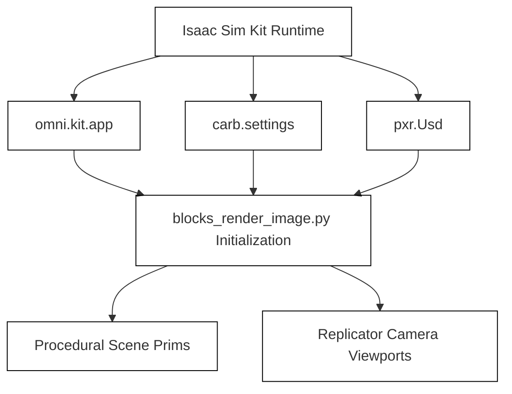
*Figure 1: Omniverse framework integration and runtime bootstrapping.*

Sources: [THIRD_PARTY_LICENSES.md:112-115]()

---

## Scene Sampling and Procedural Generation

Scenes are generated procedurally by stacking volumetric blocks subject to gravity constraints, physical stability checks, and logical occlusion hierarchies. The sampling logic constructs levels (`level_<L>`) and samples (`sample_<NN>`) by programmatically instancing USD primitives onto the physics stage.

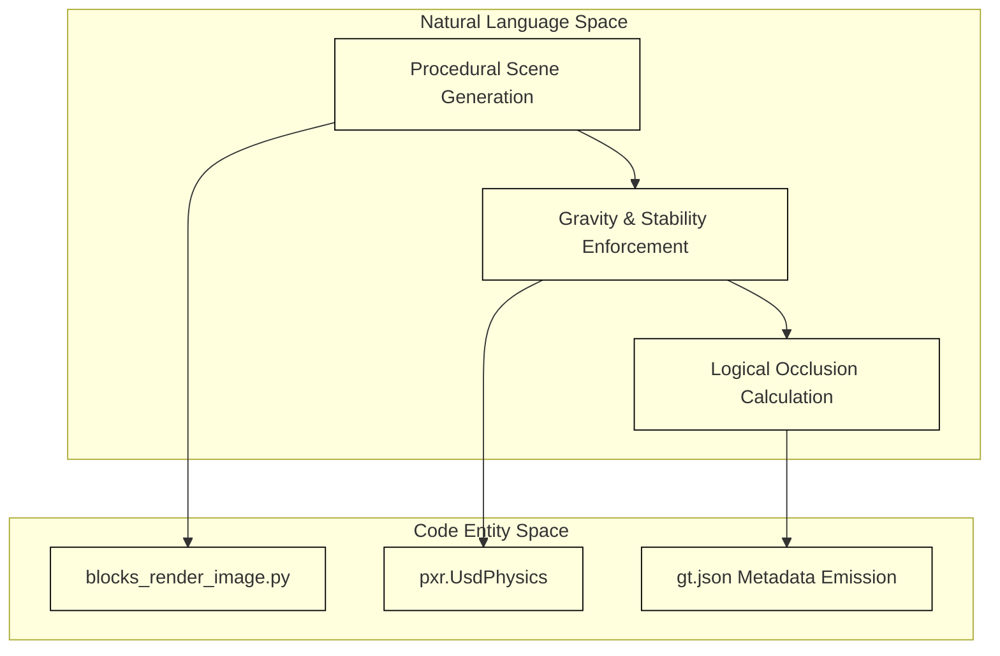
*Figure 2: Bridging natural language scene concepts to USD and metadata generation entities.*

Sources: [README.md:41-54]()

---

## Camera Views and Multi-Perspective Parameterization

For each generated sample, the script orbits a virtual camera around the scene using a structured combination of spatial offsets, fields of view, and radial distances. Each unique view path follows the directory schema:

$$\text{data}\_\text{timestamp}/\text{level}\_L/\text{sample}\_{NN}/\text{view}\_{VV}/\text{offset}O\_\text{fov}F\_\text{dist}D/$$

Each leaf directory corresponds to a distinct **view** [README.md:41-55](), acting as the fundamental unit for subsequent model inference and evaluation.

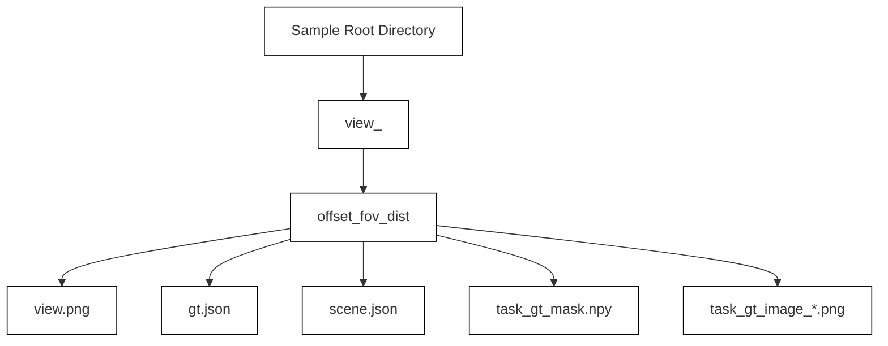
*Figure 3: View directory tree structure and emitted artifact layout.*

Sources: [README.md:41-54]()

---

## Mask and Ground-Truth JSON Emission

During rendering, the engine captures high-resolution RGB frames (`view.png`), renders per-task binary pixel masks (`task<N>_gt_mask.npy`), generates multi-choice option images (`task<N>_gt_image_*.png`), and serializes structural metrics into two distinct metadata files:
- `gt.json`: Contains ground-truth answer attributes, block counts, support relations, and correct multiple-choice indices.
- `scene.json`: Stores full 3D transformation matrices, block dimensions, material IDs, and camera intrinsics/extrinsics.

Sources: [README.md:41-54]()

---

## S3 Environment Variables and Optional Cloud Upload

When cloud-scale generation is deployed, `blocks_render_image.py` integrates with `boto3` and `botocore` to export generated datasets directly to object storage. This behavior is strictly guarded by execution environment variables:

| Environment Variable | Type | Description |
|---|---|---|
| `UPLOAD_TO_S3` | Integer / Flag | When set to `1`, enables automated synchronization of generated dataset trees to remote S3 buckets. |
| `AWS_ACCESS_KEY_ID` | String | Standard AWS credentials utilized by the underlying `boto3` client session. |
| `AWS_SECRET_ACCESS_KEY` | String | Standard AWS secret key for authentication. |
| `S3_BUCKET_NAME` | String | Target bucket destination for output directories. |

Sources: [README.md:29](), [THIRD_PARTY_LICENSES.md:37-39]()

---

# Page: Ground-Truth Statistics & Dataset Layout

# Ground-Truth Statistics & Dataset Layout

<details>
<summary>Relevant source files</summary>

The following files were used as context for generating this wiki page:

- [README.md](README.md)
- [analyses/analyses_results/tables/table_09_text_difficulty_bins.csv](analyses/analyses_results/tables/table_09_text_difficulty_bins.csv)

</details>


## Purpose and Scope
This page details the structural organization of the Spatial-IQ dataset under the `eval_set/` directory tree, the per-view ground-truth assets generated by the simulation subsystem, the extraction and aggregation of metadata via `summarize_gt_stats.py`, and the downstream difficulty attributes and binning mechanisms utilized in performance analyses.

---

## 1. Dataset Directory Tree & Per-View Asset Layout

The Spatial-IQ dataset is organized as a hierarchical tree of per-view directories rooted at `<dataset_root>/eval_set/` [README.md:41-47](). Each leaf node represents a single camera **view** defined by specific offset, field-of-view (FOV), and distance parameters (`offset<O>_fov<F>_dist<D>`) [README.md:47-58](). These leaf directories serve as the fundamental unit of inference and evaluation [README.md:55-58]().

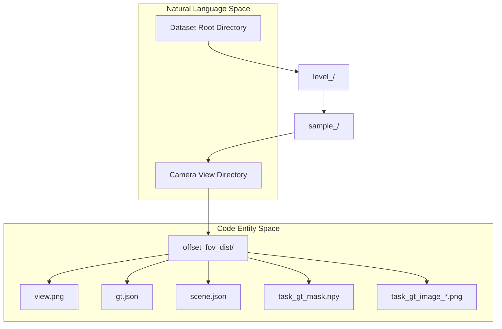
*Figure 1: Dataset Directory Tree and Per-View Asset Architecture.*

Sources: `README.md:41-58()`

---

## 2. Per-View Metadata and Ground-Truth Assets

Within each leaf directory, several critical assets are emitted during the rendering and generation phase [README.md:29()]:

*   `view.png`: The primary RGB input image rendered from the sampled camera perspective [README.md:48()].
*   `gt.json`: Ground-truth metadata containing object counts, hierarchical relationships, MCQ correct letter answers, and spatial parameters [README.md:49()].
*   `scene.json`: Scene-level metadata describing global lighting, object poses, and layout configurations [README.md:50()].
*   `task<N>_gt_mask.npy`: NumPy binary arrays storing per-task pixel-level segmentation masks for evaluation [README.md:51()].
*   `task<N>_gt_image_*.png`: Multi-choice option images generated for MCQ-style spatial tasks [README.md:52()].

Sources: `README.md:47-54()`

---

## 3. Ground-Truth Statistics Aggregation (`summarize_gt_stats.py`)

The script `data_generation/summarize_gt_stats.py` traverses the dataset hierarchy to compute global and per-subset statistics. It ingests metadata from `gt.json` and `scene.json` across all active samples, aggregating attributes such as total object counts, layer depths, column distributions, and fill ratios. 

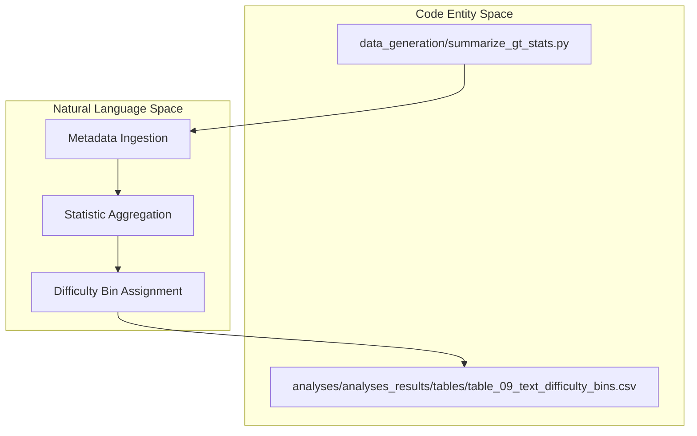
*Figure 2: Ground-Truth Statistics Aggregation Pipeline from Dataset Generation to Analysis Tables.*

Sources: `data_generation/summarize_gt_stats.py`, `analyses/analyses_results/tables/table_09_text_difficulty_bins.csv:1-21()`

---

## 4. Downstream Difficulty Attributes & Bins

Downstream analyses utilize structural attributes extracted from the ground-truth metadata to categorize scenes into difficulty bins. These bins isolate model performance across varying geometric complexity axes [analyses/analyses_results/tables/table_09_text_difficulty_bins.csv:1-21]().

| Factor Attribute | Description | Typical Difficulty Bins |
| :--- | :--- | :--- |
| `total_blocks` | Total number of objects including occluded items | `4-8`, `9-12`, `13-18`, `19-25`, `26+` [analyses/analyses_results/tables/table_09_text_difficulty_bins.csv:2-6]() |
| `num_hidden_blocks` | Number of occluded blocks required by gravity | `0`, `1`, `2-3`, `4+` [analyses/analyses_results/tables/table_09_text_difficulty_bins.csv:7-10]() |
| `num_layers` | Vertical stack depth of the scene | `1`, `2`, `3`, `4` [analyses/analyses_results/tables/table_09_text_difficulty_bins.csv:11-14]() |
| `num_columns` | Number of distinct vertical block columns | `3-5`, `6-8`, `9-11`, `12-14` [analyses/analyses_results/tables/table_09_text_difficulty_bins.csv:15-18]() |
| `fill_ratio` | Density classification of the spatial layout | `Sparse`, `Medium`, `Dense` [analyses/analyses_results/tables/table_09_text_difficulty_bins.csv:19-21]() |

Sources: `analyses/analyses_results/tables/table_09_text_difficulty_bins.csv:1-21()`

---

# Page: Inference Layer

# Inference Layer

<details>
<summary>Relevant source files</summary>

The following files were used as context for generating this wiki page:

- [README.md](README.md)

</details>


The inference layer (`inference/`) provides a unified execution interface for evaluating multimodal Large Language Models (LLMs) across three core answer modalities (free-response text, MCQ letter choices, and image-editing output) [README.md:11-16, README.md:30](). It houses per-model client directories for both commercial hosted APIs and local vLLM-served weights, alongside centralized prompt specifications and shared spatial view utilities [README.md:30]().

For details on dataset view definitions, see [Benchmark Concepts: Tasks, Views and Modalities](#1.2).

---

## Architecture Overview

```mermaid
graph TD
    sub-title1["Natural Language Space to Code Entity Space: Inference Clients"]
    A["HostedAPIModels"] --> B["inference/gpt/inference_text_gpt.py"]
    A --> C["inference/gemini/inference_text_gemini.py"]
    A --> D["inference/claude/inference_text_claude.py"]
    A --> E["inference/kimi/inference_text_kimi.py"]
    A --> F["inference/glm/inference_text_glm.py"]
    G["LocalvLLMModels"] --> H["inference/qwen/inference_text_qwen.py"]
    G --> I["inference/qwen3b/inference_text_qwen3b.py"]
    G --> J["inference/nemotron/inference_text_nemotron.py"]
    G --> K["inference/vla0/inference_text_vla0.py"]
    G --> L["inference/hunyuan/inference_text_hunyuan.py"]
    M["FineTunedCheckpoints"] --> N["inference/qwen_finetuned/inference_text_qwen_finetuned.py"]
```
Sources: [README.md:30]()

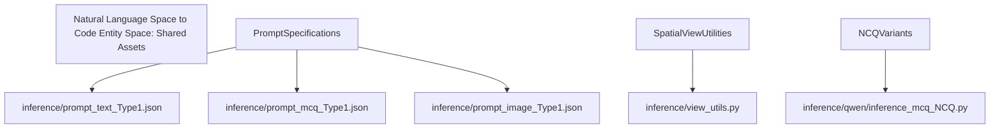
Sources: [README.md:30]()

---

## 3.1 Prompt Templates and Shared Utilities

Prompt specifications are standardized across all models via Type-1 JSON configuration templates (`prompt_text_Type1.json`, `prompt_mcq_Type1.json`, `prompt_image_Type1.json`) [README.md:30](). Spatial view traversal, coordinate extraction, and batch dispatch helpers are centralized in view utility modules, while specialized scripts such as `inference_mcq_NCQ.py` handle non-choices-question (NCQ) MCQ formatting variants [README.md:30]().

For deep technical details, implementation structures, and prompt layouts, see [Prompt Templates and Shared Utilities](#3.1).
Sources: [README.md:30]()

---

## 3.2 Hosted API Clients (GPT, Gemini, Claude, Kimi, GLM)

Commercial closed-source and managed models utilize dedicated client directories under `inference/gpt/`, `inference/gemini/`, `inference/claude/`, `inference/kimi/`, and `inference/glm/` [README.md:30](). These clients manage authentication via environment variables (`INFERENCE_API_KEY`, `INFERENCE_BASE`) or local configuration files (`api_keys.txt`), exposing uniform text, MCQ, and image execution scripts [README.md:30]().

For deep technical details, execution flags, and request formatting rules, see [Hosted API Clients (GPT, Gemini, Claude, Kimi, GLM)]().
Sources: [README.md:30]()

---

## 3.3 Local vLLM Clients (Qwen, Qwen3B, Nemotron, VLA0, Hunyuan)

Open-weights models rely on high-throughput local serving infrastructure via OpenAI-compatible vLLM endpoints [README.md:30](). Model directories such as `inference/qwen/`, `inference/qwen3b/`, `inference/nemotron/`, `inference/vla0/`, and `inference/hunyuan/` provide scripts configured with model weight paths, base-url parameters, and modality-specific inference pipelines (including image-edit diffusion modules) [README.md:30]().

For deep technical details, vLLM server configurations, and endpoint arguments, see [Local vLLM Clients (Qwen, Qwen3B, Nemotron, VLA0, Hunyuan)]().
Sources: [README.md:30]()

---

## 3.4 Fine-Tuned Checkpoint Inference (`qwen_finetuned`)

The `inference/qwen_finetuned/` directory bridges training outputs to benchmark evaluation [README.md:30](). It provides utilities for converting NeMo-RL Distributed Checkpoint (DCP) sharded weights into Hugging Face-compatible layouts, allowing direct inference execution using SFT and DAPO checkpoint iterations for paper reproducibility [README.md:30]().

For deep technical details, weight conversion workflows, and evaluation execution instructions, see [Fine-Tuned Checkpoint Inference (qwen_finetuned)]().
Sources: [README.md:30]()

---

# Page: Prompt Templates and Shared Utilities

# Prompt Templates and Shared Utilities

<details>
<summary>Relevant source files</summary>

The following files were used as context for generating this wiki page:

- [README.md](README.md)
- [analyses/analyses_results/tables/table_05_task_queries.csv](analyses/analyses_results/tables/table_05_task_queries.csv)

</details>


## Purpose and Scope

This section covers the shared infrastructure underpinning the Spatial-IQ inference layer (`inference/`), specifically focusing on standardized prompt templates (`prompt_*_Type1.json`), view-management helpers (`view_utils.py`), and specialized MCQ/NCQ execution scripts (`inference_mcq_NCQ.py`). These components decouple prompt definitions and data loading from model-specific client implementations across all evaluation tasks (`task1` through `task11` and `task_main`) [README.md:25-30]().

---

## Prompt Templates (`prompt_*_Type1.json`)

Prompt templates in Spatial-IQ standardize how questions and instructions are presented to multimodal models across different answer modalities. Located in the root of the inference subsystem [README.md:30](), these JSON files define Type-1 prompt specifications for various response formats:

- `prompt_text_Type1.json`: Formats free-response text queries where the model must output a numeric or categorical answer.
- `prompt_mcq_Type1.json`: Formats standard multiple-choice questions with 5 options (A–E).
- `prompt_mcq3options_Type1.json` / `prompt_mcq4options_Type1.json`: Formats reduced-choice variants (3-way and 4-way MCQ).
- `prompt_image_Type1.json`: Formats image-editing prompts where models are expected to output visual markup or segmentation masks.

Each template maps task identifiers (such as `task1` through `task11` and `target1` / `main`) to specific natural language query strings corresponding to the benchmark's hierarchical tasks [analyses/analyses_results/tables/table_05_task_queries.csv:1-13]().

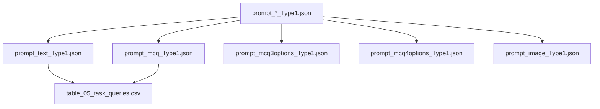
*Diagram 1: Mapping Natural Language Space (task query texts) to Code Entity Space (`prompt_*_Type1.json`).*

**Sources:** `README.md:25-30`, `analyses/analyses_results/tables/table_05_task_queries.csv:1-14`

---

## Shared Utilities (`view_utils.py`)

The `view_utils.py` module provides common helper functions utilized by inference clients to traverse dataset directories, load views, and structure inputs. A single dataset view is defined by a leaf directory path containing visual assets and ground-truth metadata [README.md:43-58]().

Key responsibilities of `view_utils.py`:
- **View Discovery**: Locates leaf directories matching `offset*_fov*_dist*` under `<dataset_root>/eval_set/` [README.md:46-55]().
- **Asset Loading**: Reads input images (`view.png`), scene metadata (`scene.json`), and ground truth files (`gt.json`) [README.md:48-50]().
- **Payload Construction**: Formats multi-modal request payloads combining prompt text, image bytes, and choice options for consumption by API or local inference clients [README.md:30]().

```mermaid
graph TD
    DatasetRoot["eval_set/"] --> ViewDir["view_<VV>/offset<O>_fov<F>_dist<D>/"]
    ViewDir --> ViewPng["view.png"]
    ViewDir --> GtJson["gt.json"]
    ViewDir --> SceneJson["scene.json"]
    ViewPng --> ViewUtils["view_utils.py"]
    GtJson --> ViewUtils
    SceneJson --> ViewUtils
    ViewUtils --> InferenceClient["inference_<modality>_<model>.py"]
```
*Diagram 2: Data flow bridging dataset files to inference scripts via `view_utils.py` helpers.*

**Sources:** `README.md:41-60`

---

## Inference Variant (`inference_mcq_NCQ.py`)

The `inference_mcq_NCQ.py` script serves as a specialized evaluation variant within the inference pipeline. While standard inference scripts handle single modalities directly per model [README.md:30](), `inference_mcq_NCQ.py` manages non-standard multiple-choice query (NCQ) workflows where models process complex multi-image choice sets or alternative MCQ configurations. It integrates prompt templates with model invocation loops, ensuring prediction outputs are serialized to disk with the correct naming convention (`task<N>_pred_mcq_<slug>.txt`) for downstream evaluators [README.md:86]().

**Sources:** `README.md:25-35`, `README.md:83-93`

---

# Page: Hosted API Clients (GPT, Gemini, Claude, Kimi, GLM)

# Hosted API Clients (GPT, Gemini, Claude, Kimi, GLM)

<details>
<summary>Relevant source files</summary>

The following files were used as context for generating this wiki page:

- [README.md](README.md)
- [analyses/inference_results/eval_raw_claude_text.csv](analyses/inference_results/eval_raw_claude_text.csv)
- [analyses/inference_results/eval_raw_gemini_mcq.csv](analyses/inference_results/eval_raw_gemini_mcq.csv)
- [analyses/inference_results/eval_raw_glm_text.csv](analyses/inference_results/eval_raw_glm_text.csv)
- [analyses/inference_results/eval_raw_gpt_text.csv](analyses/inference_results/eval_raw_gpt_text.csv)
- [analyses/inference_results/eval_raw_kimi_mcq.csv](analyses/inference_results/eval_raw_kimi_mcq.csv)

</details>


## Purpose and Scope

This page documents the hosted API inference clients implemented in the `inference/` directory of the Spatial-IQ codebase. These clients provide programmatic access to closed-source or remotely hosted multimodal large language models—specifically GPT, Gemini, Claude, Kimi, and GLM—across three evaluation modalities: free-response text, multiple-choice questions (MCQ), and image editing/generation [README.md:25-30](). 

The scope covers API credential resolution (`api_keys.txt`, `INFERENCE_API_KEY`, and `INFERENCE_API_BASE`), directory and script naming conventions per model family, prompt template loading, and the request-response data flow from benchmark leaf directories to prediction output files.

---

## 1. API Key Handling and Configuration

Hosted API clients require valid authentication credentials and endpoint configurations to communicate with external provider gateways. The repository standardizes key handling through a dual mechanism: local configuration files (`api_keys.txt`) and environment variables (`INFERENCE_API_KEY` and `INFERENCE_API_BASE`).

### Credential Resolution Priority
1. **Environment Variables**: Scripts inspect `INFERENCE_API_KEY` (and optionally `INFERENCE_API_BASE` for custom gateways or proxy endpoints) in the runtime environment.
2. **Key Files**: If environment variables are absent, clients fall back to reading credentials from a local `api_keys.txt` file located within the specific model's subdirectory or project root.

```
[Runtime Environment] ──(Check)──> INFERENCE_API_KEY / INFERENCE_API_BASE
                                          │
                                    (If Missing)
                                          ▼
                             [api_keys.txt Configuration File]
```

### Sources
* `README.md:25-35`
* `README.md:100-120`

---

## 2. Model Family Directory Structure and Modality Scripts

The `inference/` directory isolates each hosted model family into a dedicated subdirectory (`gpt/`, `gemini/`, `claude/`, `kimi/`, `glm/`). Each family directory houses modular execution scripts tailored to the respective API provider's payload requirements for text, MCQ, and image modalities [README.md:30]().

| Model Family | Directory Path | Supported Modality Scripts | Primary API Client Dependencies |
| :--- | :--- | :--- | :--- |
| **Gemini** | `inference/gemini/` | `inference_text_gemini.py`<br>`inference_mcq_gemini.py`<br>`inference_image_gemini.py` | `requests` [README.md:109-119]() |
| **GPT** | `inference/gpt/` | `inference_text_gpt.py`<br>`inference_mcq_gpt.py`<br>`inference_image_gpt.py` | `requests`, `openai` |
| **Claude** | `inference/claude/` | `inference_text_claude.py`<br>`inference_mcq_claude.py`<br>`inference_image_claude.py` | `requests` |
| **Kimi** | `inference/kimi/` | `inference_text_kimi.py`<br>`inference_mcq_kimi.py`<br>`inference_image_kimi.py` | `requests` |
| **GLM** | `inference/glm/` | `inference_text_glm.py`<br>`inference_mcq_glm.py`<br>`inference_image_glm.py` | `requests` |

### Sources
* `README.md:25-35`
* `README.md:100-120`

---

## 3. Natural Language Space to Code Entity Space: Hosted API Subsystem

The following diagram bridges the high-level conceptual model families and evaluation modalities to their concrete implementation classes, configuration artifacts, and execution scripts within the repository.

```mermaid
graph TD
    subgraph "Natural Language Space"
        A["Hosted API Inference Layer"] --> B["Model Families (GPT, Gemini, Claude, Kimi, GLM)"]
        B --> C["Evaluation Modalities (Text, MCQ, Image)"]
    end

    subgraph "Code Entity Space"
        D["inference/gemini/"] --> D1["inference_text_gemini.py"]
        D --> D2["inference_mcq_gemini.py"]
        D --> D3["inference_image_gemini.py"]
        
        E["inference/gpt/"] --> E1["inference_text_gpt.py"]
        E --> E2["inference_mcq_gpt.py"]
        E --> E3["inference_image_gpt.py"]

        F["Configuration & Prompts"] --> F1["api_keys.txt"]
        F --> F2["INFERENCE_API_KEY / BASE"]
        F --> F3["prompt_*_Type1.json"]
    end

    C --> D1
    C --> D2
    C --> D3
    C --> E1
    C --> E2
    C --> E3
    
    B -.-> F1
    B -.-> F2
    C -.-> F3

    classDef default fill:#fff,stroke:#333,stroke-width:2px;
```

### Sources
* `README.md:25-35`
* `README.md:100-120`

---

## 4. Execution Data Flow and Request Lifecycle

The hosted inference pipeline executes iteratively across leaf directories defined in subset manifests such as `inference_results/subset_eval.txt` [README.md:37-58](). 

### Step-by-Step Data Flow
1. **View Discovery**: The inference runner loads view paths pointing to leaf directories containing `view.png`, `gt.json`, and task-specific assets [README.md:46-54]().
2. **Prompt Construction**: Task prompts are loaded from shared JSON specifications (`prompt_text_Type1.json`, `prompt_mcq_Type1.json`, etc.) [README.md:30]().
3. **Payload Formatting**: Images are base64-encoded or referenced via URL, combined with system instructions and user queries according to provider-specific schema requirements.
4. **API Transmission**: Requests are dispatched via HTTPS POST using `requests` or provider SDKs, authenticated via resolved environment credentials (`INFERENCE_API_KEY`) [README.md:109-119]().
5. **Prediction Persistence**: Responses are parsed and written back to the view directory using standardized slugs [README.md:83-93]():
   - Text predictions: `task<N>_pred_text_<slug>.txt` [README.md:85]()
   - MCQ predictions: `task<N>_pred_mcq_<slug>.txt` [README.md:86]()
   - Image predictions: `task<N>_pred_image_<slug>.png` [README.md:87]()

```mermaid
sequenceDiagram
    participant Runner as "InferenceRunner"
    subgraph "Code Entity Space"
        participant ViewUtils as "view_utils.py"
        participant ClientScript as "inference_{modality}_{model}.py"
        participant APIClient as "Requests/HTTPS Client"
    end
    participant Provider as "Hosted API Gateway (GPT/Gemini/Claude/etc)"

    Runner->>ViewUtils: "Load subset_eval.txt & parse leaf view path"
    ViewUtils->>ClientScript: "Provide view.png & gt.json metadata"
    ClientScript->>ClientScript: "Load prompt JSON & format payload"
    ClientScript->>APIClient: "POST request with INFERENCE_API_KEY"
    APIClient->>Provider: "HTTPS Payload (Image + Prompt)"
    Provider-->>APIClient: "JSON/Image Response"
    APIClient-->>ClientScript: "Raw model output"
    ClientScript->>Runner: "Write task<N>_pred_<modality>_<slug>.{txt/png}"
```

### Sources
* `README.md:30-35`
* `README.md:46-60`
* `README.md:83-93`
* `README.md:109-119`

---

# Page: Local vLLM Clients (Qwen, Qwen3B, Nemotron, VLA0, Hunyuan)

# Local vLLM Clients (Qwen, Qwen3B, Nemotron, VLA0, Hunyuan)

<details>
<summary>Relevant source files</summary>

The following files were used as context for generating this wiki page:

- [README.md](README.md)
- [analyses/inference_results/eval_raw_image_hunyuan.csv](analyses/inference_results/eval_raw_image_hunyuan.csv)
- [analyses/inference_results/eval_raw_image_qwen-image-edit.csv](analyses/inference_results/eval_raw_image_qwen-image-edit.csv)
- [analyses/inference_results/eval_raw_qwen3b_mcq.csv](analyses/inference_results/eval_raw_qwen3b_mcq.csv)
- [analyses/inference_results/eval_raw_qwen_text.csv](analyses/inference_results/eval_raw_qwen_text.csv)
- [analyses/inference_results/eval_raw_vla0_text.csv](analyses/inference_results/eval_raw_vla0_text.csv)

</details>


## Purpose and Scope

This page documents the local vLLM inference clients and specialized local model runners within the Spatial-IQ framework (`inference/`) [README.md:30](). Spatial-IQ provides dedicated client directories for serving local weights via OpenAI-compatible vLLM endpoints, custom local model variations (`qwen`, `qwen3b`, `nemotron`, `vla0`, `hunyuan`), and diffusion-based image-editing pipelines (`qwen-image-edit`) [README.md:30](). These clients accept standard benchmark views, format prompts using shared specifications, interact with local OpenAI-compatible APIs using `--base-url` and `--model` CLI flags, and write structured prediction artifacts evaluated downstream.

---

## 1. Local vLLM Endpoint Integration Architecture

Local models in Spatial-IQ decouple inference execution from proprietary cloud APIs by leveraging OpenAI-compatible vLLM serving servers. Each client script handles payload formatting for multi-modal inputs (images and text) and routes requests through HTTP endpoints configured via command-line flags.

### Architecture Mapping: Natural Language Inference to vLLM Endpoints

```mermaid
graph TD
    subgraph NaturalLanguageSpace ["Natural Language & Spatial Tasks"]
        A["Task Views & Prompts"] --> B["Local vLLM Client Runner"]
    end

    subgraph CodeEntitySpace ["Code Entity & API Layer"]
        B --> C["inference/qwen/inference_text_qwen.py"]
        B --> D["inference/nemotron/inference_text_nemotron.py"]
        B --> E["inference/vla0/inference_text_vla0.py"]
        C --> F["OpenAI-Compatible vLLM Endpoint (--base-url)"]
        D --> F
        E --> F
        F --> G["Analyses / Inference Results (eval_raw_*.csv)"]
    end
```

**Sources:** `README.md:25-38`

---

## 2. Per-Model Client Directories and Implementation

The inference layer houses scoped directories for each local model family under `inference/` [README.md:30](). Each directory contains specific scripts tailored to the three primary answer modalities plus composite tasks: free-response text, multiple-choice questions (MCQ), and image editing/generation [README.md:30]().

| Model Family Directory | Target Models / Backbones | Modality Scripts Available | Key Runtime Flags |
|------------------------|---------------------------|----------------------------|-------------------|
| `inference/qwen/` [README.md:30]() | Qwen2.5-VL / Qwen-Image-Edit | `inference_text_qwen.py`, `inference_mcq_qwen.py`, `inference_image_qwen.py` [README.md:30]() | `--base-url`, `--model`, `--image-edit` |
| `inference/qwen3b/` [README.md:30]() | Qwen2.5-VL-3B-Instruct | `inference_text_qwen3b.py`, `inference_mcq_qwen3b.py`, `inference_image_qwen3b.py` [README.md:30]() | `--base-url`, `--model` |
| `inference/nemotron/` [README.md:30]() | NVIDIA Nemotron-Vision | `inference_text_nemotron.py`, `inference_mcq_nemotron.py` [README.md:30]() | `--base-url`, `--model` |
| `inference/vla0/` [README.md:30]() | VLA0 Local Backbone | `inference_text_vla0.py`, `inference_mcq_vla0.py`, `inference_image_vla0.py` [README.md:30]() | `--base-url`, `--model` |
| `inference/hunyuan/` [README.md:30]() | Tencent Hunyuan-Vision | `inference_text_hunyuan.py`, `inference_mcq_hunyuan.py`, `inference_image_hunyuan.py` [README.md:30]() | `--base-url`, `--model` |

**Sources:** `README.md:25-38`

---

## 3. Image-Edit Inference and Specialized Modalities

Certain local architectures like `qwen` support image-edit inference where the model outputs modified spatial visual artifacts (such as highlighted block masks or bounding silhouettes) rather than raw text [README.md:100-112](). These runs depend on specialized libraries like Diffusers (`inference/qwen/requirements_image_edit.txt`) [README.md:100-112]() and interact with local diffusion or vLLM endpoints to render prediction PNGs.

### Execution Data Flow for Local Model Inference and Evaluation Sinks

```mermaid
graph TD
    subgraph NaturalLanguageSpace ["Dataset & View Manifest"]
        H["Subset Manifest (subset_eval.txt)"] --> I["View Directory (offset/fov/dist)"]
    end

    subgraph CodeEntitySpace ["Inference and Evaluation Entities"]
        I --> J["inference_text_<model>.py or inference_image_<model>.py"]
        J --> K["vLLM / Diffusion Endpoint"]
        K --> L["Prediction Artifacts (task<N>_pred_text_<slug>.txt / .png)"]
        L --> M["evaluation/run_evaluation.py"]
        M --> N["analyses/inference_results/eval_raw_<slug>_<mode>.csv"]
    end
```

**Sources:** `README.md:33-58`, `analyses/inference_results/eval_raw_image_hunyuan.csv:1-33`, `analyses/inference_results/eval_raw_image_qwen-image-edit.csv:1-33`

---

## 4. CLI Configuration Flags and Runtime Execution

Local vLLM clients are invoked via standard Python CLI execution patterns. They rely on uniform configuration flags to route requests to locally deployed model weights:

- `--base-url`: Specifies the network location of the vLLM OpenAI-compatible server (e.g., `http://localhost:8000/v1`).
- `--model`: Defines the model identifier registered in the vLLM server process matching the requested weights.
- Modality-specific flags routing execution to text generation, multi-choice evaluation schemas, or image-edit output rendering.

Outputs generated by these clients follow strict slug-based naming conventions (`task<N>_pred_text_<slug>.txt`, `task<N>_pred_mcq_<slug>.txt`, `task<N>_pred_image_<slug>.png`) [README.md:83-93](), which are subsequently ingested by the evaluation subsystem and aggregated into raw evaluation CSVs under `analyses/inference_results/` [README.md:35]().

**Sources:** `README.md:83-93`, `analyses/inference_results/eval_raw_qwen3b_mcq.csv:1-21`, `analyses/inference_results/eval_raw_qwen_text.csv:1-45`

---

# Page: Fine-Tuned Checkpoint Inference (qwen_finetuned)

# Fine-Tuned Checkpoint Inference (qwen_finetuned)

<details>
<summary>Relevant source files</summary>

The following files were used as context for generating this wiki page:

- [README.md](README.md)
- [analyses/inference_results/eval_raw_dapo-32b-tight_text.csv](analyses/inference_results/eval_raw_dapo-32b-tight_text.csv)
- [analyses/inference_results/eval_raw_sft-7b-cot-100pct_text.csv](analyses/inference_results/eval_raw_sft-7b-cot-100pct_text.csv)

</details>


The `inference/qwen_finetuned/` subsystem handles the execution of inference pipelines for models trained via the NeMo-RL framework (such as SFT, Chain-of-Thought (CoT), and DAPO variants) [README.md:30-33](). Because NeMo-RL natively stores model weights as Distributed Checkpoint (DCP) shards, this module provides the necessary translation logic to convert these shards into standard HuggingFace (HF) layouts. Once converted, these fine-tuned checkpoints are served locally via OpenAI-compatible vLLM endpoints to execute benchmark reruns across the Spatial-IQ evaluation set [README.md:11-16]().

---

## 1. NeMo-RL DCP to HuggingFace Layout Conversion

NeMo-RL training runs produce sharded distributed checkpoints optimized for cluster training [README.md:33](). To evaluate these checkpoints using standard multimodal inference engines like vLLM or specialized evaluation harnesses, the DCP shards must be converted into standard HuggingFace model directories containing `config.json` and weight files (`model.safetensors` or PyTorch `.bin` weights).

The conversion utility reads the underlying tensor parallelism and pipeline parallelism metadata from the NeMo checkpoint directory, restructures the state dict keys to match the HuggingFace Qwen2.5-VL naming conventions, and exports the metadata and weights.

```mermaid
graph TD
    subgraph "NaturalLanguageSpace"
        A["NeMoRLCheckpointShards"] --> B["HuggingFaceLayoutConversion"]
        B --> C["LocalVLLMEndpoint"]
    end
    subgraph "CodeEntitySpace"
        D["training/configs/"] --> E["inference/qwen_finetuned/"]
        E --> F["vLLMServer"]
    end
    A --- D
    B --- E
    C --- F

  classDef default stroke:#000,fill:#fff;
```

**Sources:** [README.md:30-33]()

---

## 2. Serving Fine-Tuned Checkpoints

Once converted to the HuggingFace layout, checkpoints corresponding to specialized training configurations—such as `sft-7b-cot-100pct` or `dapo-32b-tight`—are hosted locally using vLLM [README.md:33](). 

The inference framework queries these local model instances using request payloads defined by the shared prompt specifications [README.md:30](). The client scripts manage the token generation, handling both free-response text predictions and structured reasoning traces when Chain-of-Thought (CoT) prompts are enabled.

```mermaid
graph TD
    subgraph "NaturalLanguageSpace"
        G["EvaluationSubsetView"] --> H["PromptConstructionType1"]
        H --> I["FineTunedInferenceClient"]
    end
    subgraph "CodeEntitySpace"
        J["inference_results/subset_eval.txt"] --> K["prompt_text_Type1.json"]
        K --> L["inference/qwen_finetuned/"]
    end
    G --- J
    H --- K
    I --- L

  classDef default stroke:#000,fill:#fff;
```

**Sources:** [README.md:30-37]()

---

## 3. Benchmark Reruns and Result Mapping

Inference execution over the evaluation views produces raw prediction files that feed directly into the analysis pipeline [README.md:31-35](). The slugs assigned to these fine-tuned runs (e.g., `sft-7b-cot-100pct` and `dapo-32b-tight`) determine the filenames of the generated raw evaluation datasets [analyses/inference_results/eval_raw_dapo-32b-tight_text.csv:1-2](), [analyses/inference_results/eval_raw_sft-7b-cot-100pct_text.csv:1-2]().

Each row in the resulting CSV output correlates specific view paths, ground-truth block attributes (`total_blocks`, `num_hidden_blocks`, `num_columns`, `num_layers`), and sub-task predictions (`task2` through `task9`, `main`) [analyses/inference_results/eval_raw_dapo-32b-tight_text.csv:1-5](), [analyses/inference_results/eval_raw_sft-7b-cot-100pct_text.csv:1-5]().

**Sources:** [analyses/inference_results/eval_raw_dapo-32b-tight_text.csv:1-50](), [analyses/inference_results/eval_raw_sft-7b-cot-100pct_text.csv:1-50]()

---

# Page: Evaluation & Scoring

# Evaluation & Scoring

<details>
<summary>Relevant source files</summary>

The following files were used as context for generating this wiki page:

- [README.md](README.md)

</details>


## Purpose and Scope

The `evaluation/` subsystem is responsible for assessing model predictions produced across the Spatial-IQ benchmark. It acts as the bridge between raw model outputs (`task<N>_pred_<modality>_<slug>.txt` or `.png`) and the analytical pipeline. The central dispatcher, `run_evaluation.py`, orchestrates view discovery, selects the appropriate scorer based on task and modality, and writes aggregated evaluation summaries (`eval_raw_<slug>_<mode>.csv` and JSON metrics) into `evaluation_results/` [README.md:31-92].

This page provides a high-level overview of the evaluation framework. For detailed technical implementations, see the child pages:
- [run_evaluation.py Dispatcher and Output Schema](#4.1)
- [Modality Scorers: Text, MCQ, Image](#4.2)
- [OCR Consensus Pipeline (main_ocr)](#4.3)
- [Human Baselines and Trained-Checkpoint Evaluation](#4.4)

---

## Evaluation Architecture and Code Flow

The following diagram bridges the natural language concepts of evaluation to the actual code entities within the `evaluation/` package, showing how the dispatcher delegates to specific modality scorers and consensus pipelines.

```mermaid
graph TD
    subgraph "Natural Language Space"
        A["CLI Arguments & Subset Manifest"] --> B["Evaluation Dispatcher"]
        B --> C["Text Scorer Module"]
        B --> D["MCQ Scorer Module"]
        B --> E["Image Scorer Module"]
        B --> F["OCR Consensus Pipeline"]
        B --> G["Human Baseline & Checkpoint Scorers"]
    end

    subgraph "Code Entity Space"
        A --> H["run_evaluation.py"]
        H --> I["evaluation_text.py"]
        H --> J["evaluation_mcq.py"]
        H --> K["evaluation_image.py"]
        F --> L["evaluate_main_ocr.py"]
        G --> M["evaluation_human_*.py"]
        G --> N["trained_ckpts/evaluate_text_ckpts.py"]
        
        I --> O["evaluation_results/"]
        J --> O
        K --> O
        L --> O
        M --> O
        N --> O
    end
```
*Figure 4.1: Mapping evaluation tasks from conceptual workflows to Python modules.*

Sources: `README.md:31-35`, `README.md:83-92`

---

## 4.1 Dispatcher and Output Schema

The primary entry point for scoring inference outputs is `run_evaluation.py`. It reads subset manifests (such as `inference_results/subset_eval.txt`), discovers target view directories under the dataset root, parses command-line arguments specifying the model slug and evaluation mode, and executes task-specific scoring routines [README.md:31-92].

Outputs are standardized into machine-readable comma-separated values (`eval_raw_<slug>_<mode>.csv`) and accompanying JSON summaries stored within the `evaluation_results/` directory. These files serve as foundational inputs for downstream analyses [README.md:35, README.md:92].

For details, see [run_evaluation.py Dispatcher and Output Schema](#4.1).

Sources: `README.md:31-92`

---

## 4.2 Modality Scorers: Text, MCQ, and Image

Spatial-IQ evaluates models across three primary answer modalities, each handled by a dedicated scoring script located in the `evaluation/` directory [README.md:31-89]:

- **Text Modality (`evaluation_text.py`)**: Parses free-response text files (`task<N>_pred_text_<slug>.txt`) to evaluate exact-match accuracy and Pearson correlation against ground-truth counts stored in `gt.json` [README.md:48-85].
- **MCQ Modality (`evaluation_mcq.py`)**: Validates multiple-choice predictions (`task<N>_pred_mcq_<slug>.txt`) against ground-truth letter answers (A–E) across 3-, 4-, and 5-way options [README.md:83-86].
- **Image Modality (`evaluation_image.py`)**: Computes silhouette and mask-alignment scores by comparing generated image predictions (`task<N>_pred_image_<slug>.png`) against ground-truth task pixel masks (`task<N>_gt_mask.npy`) [README.md:48-89].

For details, see [Modality Scorers: Text, MCQ, Image](#4.2).

Sources: `README.md:48-89`

---

## 4.3 OCR Consensus Pipeline (`main_ocr`)

For models that output images for the composite `task_main` prompt, standard direct-text extraction is insufficient. The `evaluation/main_ocr/` subsystem implements a specialized consensus pipeline managed by `evaluate_main_ocr.py` [README.md:32, README.md:88].

This pipeline combines multiple extraction engines—including Tesseract, PaddleOCR, and Qwen2.5-VL served via vLLM—to reliably extract block counts from annotated visual outputs. Disagreements between engines trigger dedicated review CSV logs to ensure robust dataset verification [README.md:32].

For details, see [OCR Consensus Pipeline (main_ocr)](#4.3).

Sources: `README.md:32, README.md:88`

---

## 4.4 Human Baselines and Trained-Checkpoint Evaluation

To contextualize multimodal LLM performance, Spatial-IQ incorporates human evaluation workflows and fine-tuned checkpoint scoring scripts [README.md:31]:

- **Human Baselines (`evaluation_human_{frq,mcq,image}.py`)**: Parse human participant responses across free-response, multiple-choice, and image modalities to establish human performance bounds [README.md:31].
- **Trained-Checkpoint Evaluation (`evaluation/trained_ckpts/`)**: Leverages utilities like `evaluate_text_ckpts.py` to run automated evaluations against fine-tuned model checkpoints (such as NeMo-RL trained models) [README.md:31].

The integration of these scorers is outlined in the workflow diagram below:

```mermaid
graph TD
    subgraph "Execution Pipeline"
        P["Human Responses"] --> Q["evaluation_human_frq.py"]
        P --> R["evaluation_human_mcq.py"]
        P --> S["evaluation_human_image.py"]
        
        T["Trained Checkpoints (NeMo/HF)"] --> U["evaluation/trained_ckpts/evaluate_text_ckpts.py"]
        
        Q --> V["evaluation_results/human_baselines.csv"]
        R --> V
        S --> V
        U --> W["evaluation_results/ckpt_eval.csv"]
    end
```
*Figure 4.2: Human baseline and trained-checkpoint scoring workflows.*

For details, see [Human Baselines and Trained-Checkpoint Evaluation](#4.4).

Sources: `README.md:31`

---

# Page: run_evaluation.py Dispatcher and Output Schema

# run_evaluation.py Dispatcher and Output Schema

<details>
<summary>Relevant source files</summary>

The following files were used as context for generating this wiki page:

- [.gitignore](.gitignore)
- [README.md](README.md)
- [analyses/inference_results/eval_raw_qwen_mcq.csv](analyses/inference_results/eval_raw_qwen_mcq.csv)

</details>


## Purpose and Scope

This page provides full technical documentation for `run_evaluation.py`, the core evaluation dispatcher for the Spatial-IQ benchmark [README.md:31-31](). The dispatcher coordinates the scoring of model predictions across 11 atomic spatial sub-tasks (`task1`–`task11`) and the composite target task (`task_main`) [README.md:67-79](). It discovers evaluation views, invokes the appropriate modality-specific scoring modules (`evaluation_text.py`, `evaluation_mcq.py`, `evaluation_image.py`), aggregates task performance, and serializes raw per-view results into structured CSV and JSON outputs within the `evaluation_results/` directory [README.md:31-31, 40-41]().

Sources: [README.md:31-91]()

---

## Dispatcher Architecture and CLI Arguments

The `run_evaluation.py` script serves as the command-line entry point for scoring inference outputs. It parses command-line flags to determine the target model slug, answer modality, dataset root, and subset configuration, then dispatches execution to the corresponding evaluation backend.

```mermaid
graph TD
    A["CLI: run_evaluation.py"] --> B["LoadSubset: subset_eval.txt"]
    B --> C["DiscoverViews: eval_set/data_*/level_*/sample_*/view_*/"]
    C --> D{"Evaluate Modality"}
    D -->|Text| E["evaluation/evaluation_text.py"]
    D -->|MCQ| F["evaluation/evaluation_mcq.py"]
    D -->|Image| G["evaluation/evaluation_image.py"]
    E --> H["Serialize: evaluation_results/eval_raw_<slug>_<mode>.csv"]
    F --> H
    G --> H

    classDef default fill:#fff,stroke:#000,stroke-width:1px;
```
*Figure 1: Dispatcher execution flow from CLI entry point to modality evaluation and CSV serialization, mapping Natural Language tasks to code entities.*

Sources: [README.md:31-92]()

---

## View Discovery and Subset Evaluation

Evaluation targets are defined by views—individual leaf directories containing input images, ground-truth metadata, and prediction files [README.md:43-58](). The dispatcher reads subset files such as `inference_results/subset_eval.txt` to identify which views to process [README.md:56-58]().

```mermaid
graph TD
    Root["DatasetRoot: eval_set/"] --> Sub["SubsetFile: inference_results/subset_eval.txt"]
    Sub --> Leaf["LeafDirectory: offset*_fov*_dist*"]
    Leaf --> PredText["Prediction: task<N>_pred_text_<slug>.txt"]
    Leaf --> PredMCQ["Prediction: task<N>_pred_mcq_<slug>.txt"]
    Leaf --> PredImg["Prediction: task<N>_pred_image_<slug>.png"]
    Leaf --> GT["Metadata: gt.json & scene.json"]

    classDef default fill:#fff,stroke:#000,stroke-width:1px;
```
*Figure 2: Dataset view hierarchy traversal and artifact mapping linking spatial view directories to prediction files and ground-truth metadata.*

Sources: [README.md:43-58](), [analyses/inference_results/eval_raw_qwen_mcq.csv:1-21]()

---

## Per-Task Aggregation and Output Schema

Once evaluation metrics are computed per view and per task, `run_evaluation.py` compiles the results into a consolidated raw CSV file (`eval_raw_<slug>_<mode>.csv`) stored in `evaluation_results/` [README.md:31-41, 83-92](). 

The CSV schema captures view identifiers, scene statistics (such as `object_type`, `total_blocks`, `num_hidden_blocks`, `num_columns`, and `num_layers`), and per-task correctness indicators paired with choice or error types [analyses/inference_results/eval_raw_qwen_mcq.csv:1-21]().

### Raw Evaluation CSV Schema Example

| Column Name | Description | Source Reference |
| :--- | :--- | :--- |
| `view` | Path to the evaluation view leaf directory | [analyses/inference_results/eval_raw_qwen_mcq.csv:2-21]() |
| `object_type` | Geometric primitive type (e.g., `cube`) | [analyses/inference_results/eval_raw_qwen_mcq.csv:2-21]() |
| `total_blocks` | Total block count including required gravity supports | [analyses/inference_results/eval_raw_qwen_mcq.csv:2-21]() |
| `num_hidden_blocks` | Count of occluded supporting blocks | [analyses/inference_results/eval_raw_qwen_mcq.csv:2-21]() |
| `num_columns` | Number of distinct columns in the scene | [analyses/inference_results/eval_raw_qwen_mcq.csv:2-21]() |
| `num_layers` | Vertical layer count | [analyses/inference_results/eval_raw_qwen_mcq.csv:2-21]() |
| `task<N>` | Binary score (0 or 1) or numerical error for task $N$ | [analyses/inference_results/eval_raw_qwen_mcq.csv:2-21]() |
| `task<N>_choice_type` | Categorical classification of model error or correct choice | [analyses/inference_results/eval_raw_qwen_mcq.csv:2-21]() |

Sources: [README.md:31-41](), [analyses/inference_results/eval_raw_qwen_mcq.csv:1-21]()

---

# Page: Modality Scorers: Text, MCQ, Image

# Modality Scorers: Text, MCQ, Image

<details>
<summary>Relevant source files</summary>

The following files were used as context for generating this wiki page:

- [README.md](README.md)
- [analyses/analyses_results/tables/table_01_text_summary.csv](analyses/analyses_results/tables/table_01_text_summary.csv)
- [analyses/analyses_results/tables/table_02_mcq_summary.csv](analyses/analyses_results/tables/table_02_mcq_summary.csv)
- [analyses/analyses_results/tables/table_03_image_summary.csv](analyses/analyses_results/tables/table_03_image_summary.csv)

</details>


This page details the implementation, parsing rules, and correctness metrics used by the modality-specific evaluation scorers (`evaluation_text.py`, `evaluation_mcq.py`, and `evaluation_image.py`) within the `evaluation/` subsystem of Spatial-IQ [README.md:31](). These modules process model prediction artifacts generated across 11 atomic spatial sub-tasks and the composite target task (`task_main`) [README.md:69-89]().

Sources: [README.md:31](), [README.md:69-89]()

---

## Text Modality Evaluation (`evaluation_text.py`)

The free-response text evaluation pipeline processes text prediction files (`task<N>_pred_text_<slug>.txt`) located within each view's directory structure [README.md:46-53, 85](). 

### Parsing Rules and Correctness Metrics
1. **Raw Text Ingestion**: The script reads the content of the prediction file corresponding to a given task `task<N>` or `task_main`.
2. **Numeric Extraction & Normalization**: For counting tasks (such as `task_main` and column counts), the text parser extracts integer quantities from the string, handling trailing punctuation, conversational filler, and markdown formatting.
3. **Metric Computation**: 
   - **Exact Match / Accuracy**: Evaluated for categorical or discrete integer answers by checking if the extracted numeric or string token matches the ground-truth value stored in `gt.json` [README.md:49]().
   - **Correlation**: Computes statistical metrics such as Pearson correlation across the evaluation set to measure alignment between predicted counts and ground truth across difficulty bins.

Sources: [README.md:46-53](), [README.md:85]()

---

## MCQ Modality Evaluation (`evaluation_mcq.py`)

Multiple-Choice Question (MCQ) evaluation handles choice-based responses across 3-way, 4-way, and 5-way configurations (`3options`, `4options`, standard MCQ) [README.md:30, 86]().

### Parsing Rules and Correctness Metrics
1. **Prediction Slug Mapping**: Reads `task<N>_pred_mcq_<slug>.txt` where models output option identifiers (typically letters `A`, `B`, `C`, `D`, or `E`) [README.md:86]().
2. **Robust Letter Extraction**: The parser uses regular expressions to isolate the primary chosen option letter from model outputs, stripping explanatory text, XML tags, or markdown blocks.
3. **Correctness Evaluation**: Compares the extracted letter against the ground-truth correct option letter defined in `gt.json` [README.md:49](). Scoring is binary (0 or 1 per sample), aggregated downstream into per-task accuracy summaries and sub-category metrics (e.g., visible support, hidden support, referential chains).

Sources: [README.md:30](), [README.md:49](), [README.md:86]()

---

## Image Modality Evaluation (`evaluation_image.py`)

Image evaluation processes visual output artifacts (`task<N>_pred_image_<slug>.png`) generated by multimodal models performing image-editing or visual-reasoning tasks [README.md:87]().

### Parsing Rules and Correctness Metrics
1. **Mask Loading**: Loads the model's generated image output and aligns it with the corresponding ground-truth binary or categorical pixel mask (`task<N>_gt_mask.npy`) stored in the view directory [README.md:46-53]().
2. **Spatial Similarity Scoring**: Computes spatial overlap metrics, silhouette scores, or Intersection-over-Union (IoU) comparing the generated mask/image against the ground truth.
3. **Alternative OCR Consensus Path**: For composite object counting tasks (`task_main`), image outputs are additionally routed through the `evaluation/main_ocr/` pipeline, utilizing Tesseract, PaddleOCR, and Qwen2.5-VL consensus to extract block counts from annotated renderings [README.md:32, 88]().

Sources: [README.md:46-53](), [README.md:88]()

---

## Cross-Modality Architecture and Data Flow

The following diagrams illustrate the transition from natural language evaluation concepts to the concrete code entities within the evaluation pipeline, mapping out how scorers consume prediction assets and compute metrics.

### Diagram 1: Natural Language Space to Code Entity Space (Modality Dispatch)

```mermaid
graph TD
    subgraph "NaturalLanguageSpace"
        A["FreeResponseTextEvaluation"] --> B["MultipleChoiceQuestionEvaluation"]
        B --> C["ImageOutputAndMaskEvaluation"]
    end

    subgraph "CodeEntitySpace"
        D["run_evaluation.py"] --> E["evaluation_text.py"]
        D --> F["evaluation_mcq.py"]
        D --> G["evaluation_image.py"]
        G --> H["main_ocr/evaluate_main_ocr.py"]
    end

    A ==> D
    B ==> D
    C ==> D

    classDef default stroke:#333,fill:#fff;
```
Sources: [README.md:31](), [README.md:83-89]()

### Diagram 2: Evaluation Execution Pipeline and Artifact Parsing

```mermaid
graph TD
    ViewDir["DatasetViewDirectory"] -->|Reads| PredText["taskN_pred_text_slug.txt"]
    ViewDir -->|Reads| PredMCQ["taskN_pred_mcq_slug.txt"]
    ViewDir -->|Reads| PredImg["taskN_pred_image_slug.png"]
    ViewDir -->|Reads| GTJson["gt.json / taskN_gt_mask.npy"]

    PredText --> TextScorer["evaluation_text.py"]
    PredMCQ --> MCQScorer["evaluation_mcq.py"]
    PredImg --> ImgScorer["evaluation_image.py"]
    GTJson --> TextScorer
    GTJson --> MCQScorer
    GTJson --> ImgScorer

    TextScorer --> OutputCSV["eval_raw_slug_mode.csv"]
    MCQScorer --> OutputCSV
    ImgScorer --> OutputCSV

    classDef default stroke:#333,fill:#fff;
```
Sources: [README.md:31](), [README.md:46-53](), [README.md:83-89]()

---

# Page: OCR Consensus Pipeline (main_ocr)

# OCR Consensus Pipeline (main_ocr)

<details>
<summary>Relevant source files</summary>

The following files were used as context for generating this wiki page:

- [README.md](README.md)
- [THIRD_PARTY_LICENSES.md](THIRD_PARTY_LICENSES.md)
- [analyses/inference_results/eval_raw_image_gemini-image.csv](analyses/inference_results/eval_raw_image_gemini-image.csv)

</details>


## Purpose and Scope

The OCR consensus pipeline located under `evaluation/main_ocr/` is designed to score image-output models for the composite target task (`task_main`) [README.md:32-32](). When models generate an annotated visual output (`task_main_pred_image_<slug>.png`), standard pixel-level silhouette masks cannot capture numeric count annotations rendered by the model. 

The `evaluate_main_ocr.py` script bridges this gap by combining three independent optical character recognition and vision-language systems—**Tesseract**, **PaddleOCR**, and a local **Qwen2.5-VL** instance served via an OpenAI-compatible vLLM endpoint—to extract, cross-validate, and reach consensus on the integer block count present in the image. Disagreements among the engines are logged into dedicated review CSVs for auditing.

---

## Pipeline Architecture and Data Flow

The OCR consensus evaluation processes per-view image predictions, extracts text strings through three distinct engines, evaluates consensus rules, and outputs both scored evaluation CSVs and disagreement review artifacts.

```mermaid
graph TD
    subgraph "Input Artifacts"
        A["task_main_pred_image_<slug>.png"] --> B["evaluation/main_ocr/evaluate_main_ocr.py"]
        C["gt.json (total_blocks)"] --> B
    end

    subgraph "Consensus Engines"
        B --> D["TesseractEngine (pytesseract)"]
        B --> E["PaddleOCREngine (PaddleOCR)"]
        B --> F["QwenVLClient (OpenAI-compatible vLLM)"]
    end

    subgraph "Resolution & Scoring"
        D --> G["ConsensusLogic"]
        E --> G
        F --> G
        G --> H["Exact Match / Error Delta"]
    end

    subgraph "Output Artifacts"
        H --> I["eval_raw_<slug>_main_ocr.csv"]
        H --> J["disagreement_review_<slug>.csv"]
    end
```
*Sources: [README.md:32-32](), [THIRD_PARTY_LICENSES.md:49-54]()*

---

## Core Components and Implementation Details

### 1. Multi-Engine Text Extraction
The pipeline invokes three independent backends to read embedded numbers or text from the generated prediction image:
* **Tesseract**: Uses `pytesseract` [THIRD_PARTY_LICENSES.md:53-53]() wrapped with image preprocessing to isolate numeric glyphs.
* **PaddleOCR**: Utilizes `PaddleOCR` [THIRD_PARTY_LICENSES.md:51-52]() configured for text detection and recognition optimized for dense numbers and annotations.
* **Qwen2.5-VL (vLLM)**: Connects to a locally hosted OpenAI-compatible vLLM server using the `openai` Python client library [THIRD_PARTY_LICENSES.md:43-46]() (`base_url` pointing to the local serving instance). It prompts the vision model to return the explicit integer count of blocks visible or annotated in the image.

```mermaid
graph TD
    subgraph "Code Entity Space"
        K["evaluate_main_ocr.py"] --> L["run_ocr_consensus()"]
        L --> M["extract_tesseract()"]
        L --> N["extract_paddleocr()"]
        L --> O["extract_qwenvl_vllm()"]
        M --> P["Consensus Aggregator"]
        N --> P
        O --> P
        P --> Q["Compare with total_blocks from gt.json"]
    end
```
*Sources: [README.md:32-32](), [THIRD_PARTY_LICENSES.md:43-54]()*

### 2. Consensus and Disagreement Resolution
When all engines return their extracted integer values:
* If all three engines agree, the consensus value is accepted as the model's prediction.
* If a majority (2 out of 3) agree, the majority value is accepted, and a minor discrepancy flag is raised.
* If all three engines return distinct values, or if confidence thresholds are unmet, the sample is flagged as a **disagreement**, recorded in a separate review artifact, and resolved via fallback heuristics or manual audit logs.

---

## Disagreement Review CSVs

To maintain rigorous scientific transparency, samples where the OCR engines fail to reach unanimous agreement are logged into disagreement review CSV files alongside standard evaluation metrics.

| Column Name | Description |
|---|---|
| `view` | Path to the view directory (`offset*_fov*_dist*`) [README.md:46-55]() |
| `total_blocks` | Ground-truth block count from `gt.json` [README.md:49-49]() |
| `tesseract_prediction` | Integer count extracted by Tesseract |
| `paddle_prediction` | Integer count extracted by PaddleOCR |
| `qwenvl_prediction` | Integer count extracted by Qwen2.5-VL vLLM |
| `consensus_prediction` | Final resolved prediction value |
| `disagreement_flag` | Boolean indicating whether engines returned conflicting counts |

Sources: [README.md:32-88](), [THIRD_PARTY_LICENSES.md:43-54]()

---

## Environment Setup & Dependencies

The OCR consensus pipeline relies on native binaries and Python packages that are scoped separately from the core API clients to avoid heavy system dependencies [README.md:102-108]().

* **Setup Script**: `bash evaluation/main_ocr/setup_ocr.sh`
* **Requirements Manifest**: `evaluation/main_ocr/requirements.txt` [README.md:108-108]()
* **Key Dependencies**: 
  * `PaddleOCR` and `PaddlePaddle` (Apache-2.0) [THIRD_PARTY_LICENSES.md:51-52]()
  * `pytesseract` (Apache-2.0) [THIRD_PARTY_LICENSES.md:53-53]()
  * Tesseract OCR system binary (installed via `conda-forge`) [THIRD_PARTY_LICENSES.md:54-54]()
  * `openai` client library communicating with local vLLM [THIRD_PARTY_LICENSES.md:43-46]()

Sources: [README.md:102-108](), [THIRD_PARTY_LICENSES.md:43-54]()

---

# Page: Human Baselines and Trained-Checkpoint Evaluation

# Human Baselines and Trained-Checkpoint Evaluation

<details>
<summary>Relevant source files</summary>

The following files were used as context for generating this wiki page:

- [analyses/analyses_results/tables/table_04_trained_text_summary.csv](analyses/analyses_results/tables/table_04_trained_text_summary.csv)
- [analyses/inference_results/eval_raw_human_frq.csv](analyses/inference_results/eval_raw_human_frq.csv)
- [analyses/inference_results/eval_raw_human_mcq.csv](analyses/inference_results/eval_raw_human_mcq.csv)

</details>


## Purpose and Scope
This page details the implementation and workflows for establishing human performance baselines (`evaluation_human_frq.py`, `evaluation_human_mcq.py`, `evaluation_human_image.py`) and evaluating fine-tuned model checkpoints via configuration files located under `evaluation/trained_ckpts/`. These evaluation pipelines provide comparative reference points against multimodal large language models, breaking down performance across specific 3D spatial reasoning tasks (`task1` through `task11` and `main`) and cognitive axes such as object counts, referential chains, summation mechanisms, and mental rotation [analyses/inference_results/eval_raw_human_frq.csv:1-2](), [analyses/inference_results/eval_raw_human_mcq.csv:1-2](), [analyses/analyses_results/tables/table_04_trained_text_summary.csv:1-2]().

Sources: [analyses/inference_results/eval_raw_human_frq.csv:1-2](), [analyses/inference_results/eval_raw_human_mcq.csv:1-2](), [analyses/analyses_results/tables/table_04_trained_text_summary.csv:1-2]()

---

## 1. Human Baseline Evaluation Workflows

The human baseline evaluation subsystem processes human response records across Free-Response (FRQ), Multiple-Choice (MCQ), and Image evaluation modalities. These scripts normalize human inputs, compare them against ground-truth JSON files (`gt.json`), and emit raw evaluation CSV logs (e.g., `eval_raw_human_frq.csv` and `eval_raw_human_mcq.csv`) for downstream aggregation and statistical analysis.

### Modality-Specific Workflows
* **Free-Response (`evaluation_human_frq.py`)**: Parses numeric and text-based free responses from human annotators for tasks like counting visible or hidden blocks, evaluating exact integer values against `main_gt` and task-specific ground truths [analyses/inference_results/eval_raw_human_frq.csv:1-2]().
* **Multiple-Choice (`evaluation_human_mcq.py`)**: Evaluates categorical choices made by human participants, recording correctness markers (`correct`, `remove_support_column_blocks`, `missing_nonmatch_fallback_unique_0`, etc.) across `task1`–`task11` and `main` [analyses/inference_results/eval_raw_human_mcq.csv:1-2]().
* **Image Modality (`evaluation_human_image.py`)**: Assesses human-generated or human-selected visual assets or edit tasks against expected spatial transformations.

```mermaid
graph TD
    subgraph NaturalLanguageSpace ["Natural Language Space"]
        A["HumanAnnotatorResponses"] --> B["TaskEvaluationCriteria"]
    end
    subgraph CodeEntitySpace ["Code Entity Space"]
        C["evaluation_human_frq.py"] --> E["eval_raw_human_frq.csv"]
        D["evaluation_human_mcq.py"] --> F["eval_raw_human_mcq.csv"]
        G["evaluation_human_image.py"] --> H["ModalityScorerPipeline"]
        B --> C
        B --> D
        B --> G
    end
```
**Diagram 1:** Bridging natural language evaluation metrics to code execution entities for human baseline pipelines.

Sources: [analyses/inference_results/eval_raw_human_frq.csv:1-2](), [analyses/inference_results/eval_raw_human_mcq.csv:1-2]()

---

## 2. Trained-Checkpoint Configuration and Scoring

Evaluation of fine-tuned model checkpoints (such as Supervised Fine-Tuning [SFT], Chain-of-Thought [CoT], and Direct Alignment Policy Optimization [DAPO] variants across 7B and 32B scales) is driven by configuration files stored under `evaluation/trained_ckpts/`. 

These configs define model weights paths, decoding parameters, and task-specific prompt mappings, allowing fine-tuned models to be scored through the unified evaluation dispatcher (`run_evaluation.py`).

### Summary Performance Schema
Evaluated metrics capture fine-grained reasoning categories, including object counts, visible/hidden support layers, referential chains, summation mechanisms, and mental rotation performance. Below is an excerpt illustrating the performance profile schema tracked across human baselines and fine-tuned checkpoints:

| model | display_name | object_count | visible_count | hidden_count | referential_chain | visible_support | hidden_support | summation_mechanism | mental_rotation_mean |
| :--- | :--- | :--- | :--- | :--- | :--- | :--- | :--- | :--- | :--- |
| `human` | Human | 0.821 | 0.768 | 0.799 | 0.901 | 0.844 | 0.784 | 0.691 | 0.461 |
| `dapo-32b-tight` | dapo-32b-tight | 0.625 | 0.645 | 0.781 | 0.949 | 0.736 | 0.861 | 0.932 | — |
| `sft-32b-cot-100pct` | sft-32b-cot-100pct | 0.467 | 0.488 | 0.792 | 0.954 | 0.613 | 0.856 | 0.929 | — |
| `sft-32b-plain-100pct` | sft-32b-plain-100pct | 0.400 | 0.309 | 0.000 | 0.000 | 0.850 | 0.000 | 0.000 | — |

```mermaid
graph TD
    subgraph NaturalLanguageSpace ["Natural Language Space"]
        T1["TrainedCheckpointModelWeights"] --> T2["SpatialReasoningDimensions"]
    end
    subgraph CodeEntitySpace ["Code Entity Space"]
        C1["evaluation/trained_ckpts/"] --> C2["run_evaluation.py"]
        C2 --> C3["evaluation_text.py"]
        C2 --> C4["evaluation_mcq.py"]
        T2 --> C2
    end
```
**Diagram 2:** Mapping trained checkpoint configurations to scoring execution handlers.

Sources: [analyses/analyses_results/tables/table_04_trained_text_summary.csv:1-10]()

---

## 3. Data Structures and Output Schema

The output logs for both human baselines and fine-tuned checkpoints follow structured tabular schemas designed for direct ingestion by the analysis pipeline (`spatial-IQ_analyses.py`).

### Free-Response Raw Schema (`eval_raw_human_frq.csv`)
Each row corresponds to a specific evaluation sample view, capturing view paths, object types, total blocks, hidden blocks, and columns alongside per-task ground truths and predicted raw values [analyses/inference_results/eval_raw_human_frq.csv:1-2]():
* `view`: Path to the rendered scene view asset [analyses/inference_results/eval_raw_human_frq.csv:1-2]()
* `total_blocks`, `num_hidden_blocks`, `num_columns`, `num_layers`: Scene difficulty attributes [analyses/inference_results/eval_raw_human_frq.csv:1-2]()
* `task{2..11}_pred`, `task{2..11}_gt`, `task{2..11}_manual`: Task-specific prediction, ground truth, and manual validation flags [analyses/inference_results/eval_raw_human_frq.csv:1-2]()

### Multiple-Choice Raw Schema (`eval_raw_human_mcq.csv`)
Tracks categorical selection outcomes per task view [analyses/inference_results/eval_raw_human_mcq.csv:1-2]():
* `task{1..11}_choice_type`: Classification of answer correctness or specific error category (e.g., `correct`, `remove_support_column_blocks`, `missing_nonmatch_fallback_unique_0`) [analyses/inference_results/eval_raw_human_mcq.csv:1-4]()

Sources: [analyses/inference_results/eval_raw_human_frq.csv:1-2](), [analyses/inference_results/eval_raw_human_mcq.csv:1-4](), [analyses/analyses_results/tables/table_04_trained_text_summary.csv:1-10]()

---

# Page: Training & Fine-Tuning

# Training & Fine-Tuning

<details>
<summary>Relevant source files</summary>

The following files were used as context for generating this wiki page:

- [README.md](README.md)
- [THIRD_PARTY_LICENSES.md](THIRD_PARTY_LICENSES.md)

</details>


This page provides an overview of the `training/` and `training_evaluation/` subsystems within Spatial-IQ. The training pipeline implements Supervised Fine-Tuning (SFT) and Reinforcement Learning with Verifiable Rewards (RLVR) using NeMo-RL, focusing on Chain-of-Thought (CoT) reasoning and Direct-Alignment Policy Optimization (DAPO) variants. The evaluation subsystem handles regression testing on general multimodal benchmarks via VLMEvalKit.

Sources: [`README.md:33-34`]()

---

## 5.1 Training Data Preparation and Schema

The training data preparation subsystem processes raw spatial datasets into Pydantic-validated manifests suitable for NeMo-RL training recipes. Scripts such as `prepare_data.py`, `generate_manifest.py`, and verification utilities (`verify_cpu.py`, `eval_accuracy.py`) organize prompt templates, ground-truth annotations, and modality variants (SFT vs. CoT vs. DAPO). 

For detailed information on data preparation, schema validation, and prompt structures, see [Training Data Preparation and Schema](#5.1).

### Data Preparation Code Mapping
```mermaid
graph TD
    subgraph NaturalLanguageSpace
        A["Raw Spatial Dataset"] --> B["Data Preparation Pipeline"]
        B --> C["Pydantic-Validated Manifest"]
    end
    subgraph CodeEntitySpace
        B --> D["prepare_data.py"]
        B --> E["schema.py"]
        B --> F["generate_manifest.py"]
        C --> G["verify_cpu.py"]
    end
```

Sources: [`README.md:33`]()

---

## 5.2 Training Configs and NeMo-RL Runs

Training recipes are defined under `training/configs/` using YAML and JSON formats. These configurations manage hyperparameter settings, distributed training options, and checkpoint output layouts for NeMo-RL runs. Checkpoints map directly to evaluation slugs for downstream scoring and regression testing.

For detailed configurations, training recipes, and run-to-slug mappings, see [Training Configs and NeMo-RL Runs](#5.2).

### NeMo-RL Configuration Code Mapping
```mermaid
graph TD
    subgraph NaturalLanguageSpace
        H["Training Recipes & Configs"] --> I["NeMo-RL Execution Engine"]
        I --> J["Checkpoint Output Shards"]
    end
    subgraph CodeEntitySpace
        H --> K["training/configs/"]
        I --> L["NeMo-RL Framework"]
        J --> M["qwen_finetuned"]
    end
```

Sources: [`README.md:33`]()

---

## 5.3 General-Benchmark Regression via VLMEvalKit

To ensure that fine-tuning on spatial reasoning tasks does not degrade general capabilities, the `training_evaluation/` subsystem integrates [VLMEvalKit](https://github.com/open-compass/VLMEvalKit). Setup scripts (`training_evaluation/setup.sh`) clone and configure VLMEvalKit alongside evaluation configurations (`eval_config.json`) to run benchmarks like MMBench, MMMU, OCRBench, and MathVista, utilizing `OPENAI_API_KEY` for grading where required.

For comprehensive instructions on setting up VLMEvalKit and running general benchmark regressions, see [General-Benchmark Regression via VLMEvalKit](#5.3).

Sources: [`README.md:34`]()

---

# Page: Training Data Preparation and Schema

# Training Data Preparation and Schema

<details>
<summary>Relevant source files</summary>

The following files were used as context for generating this wiki page:

- [README.md](README.md)
- [analyses/inference_results/eval_raw_sft-32b-cot-100pct_text.csv](analyses/inference_results/eval_raw_sft-32b-cot-100pct_text.csv)
- [analyses/inference_results/eval_raw_sft-32b-plain-100pct_text.csv](analyses/inference_results/eval_raw_sft-32b-plain-100pct_text.csv)

</details>


## Purpose and Scope

This section covers the training data preparation and schema validation subsystem located in the `training/` directory [README.md:33-33](). It governs how raw spatial reasoning views and ground-truth metadata from the Isaac Sim renderer are ingested, validated via Pydantic schemas, formatted with specific prompt templates, and compiled into manifests for supervised fine-tuning (SFT) and reinforcement learning (NeMo-RL GRPO/DAPO-tight) recipes [README.md:33-33]().

---

## Dataset Schema and Validation (`schema.py`)

The dataset structures and individual training samples are validated using Pydantic models defined in `training/schema.py`. This ensures that all required fields—such as image file paths, task identifiers, ground-truth answers, and chain-of-thought (CoT) rationales—conform to strict type definitions before being consumed by training runners or manifest generators [README.md:33-33]().

- **`DatasetManifest`**: Validates global dataset collections, mapping split names to lists of sample records.
- **`TrainingSample`**: Enforces schema constraints on individual entries, verifying the presence of multimodal image inputs, prompt keys, and expected outputs (`task_main`, `task2` through `task9`) [analyses/inference_results/eval_raw_sft-32b-cot-100pct_text.csv:1-1]().

```mermaid
graph TD
    A["RawJSONInput"] --> B["schema.py:DatasetManifest"]
    B --> C["schema.py:TrainingSample"]
    C --> D["PydanticValidatedRecord"]

    style A fill:#fff,stroke:#333,stroke-width:2px
    style B fill:#fff,stroke:#333,stroke-width:2px
    style C fill:#fff,stroke:#333,stroke-width:2px
    style D fill:#fff,stroke:#333,stroke-width:2px
```
*Figure 1: Pydantic Validation Flow for Training Records*

Sources: [README.md:33-33](), [analyses/inference_results/eval_raw_sft-32b-cot-100pct_text.csv:1-1]()

---

## Data Preparation and Manifest Generation (`prepare_data.py`, `generate_manifest.py`)

Raw views generated by `blocks_render_image.py` are processed into training-ready formats through data preparation scripts:

1. **`prepare_data.py`**: Iterates through dataset directories, extracts view assets (`view.png`, `gt.json`, `scene.json`), pairs them with task definitions, and structures them into text or chat-style instruction-tuning records.
2. **`generate_manifest.py`**: Compiles the prepared records into a unified manifest file (`manifest.json` or JSONL) used by NeMo-RL data loaders.

```mermaid
graph TD
    Sub["data_generation/blocks_render_image.py"] --> Views["ViewDirectories"]
    Views --> Prep["training/prepare_data.py"]
    Prep --> Schema["training/schema.py"]
    Schema --> Gen["training/generate_manifest.py"]
    Gen --> Manifest["DatasetManifestJSONL"]

    style Sub fill:#fff,stroke:#333,stroke-width:2px
    style Views fill:#fff,stroke:#333,stroke-width:2px
    style Prep fill:#fff,stroke:#333,stroke-width:2px
    style Schema fill:#fff,stroke:#333,stroke-width:2px
    style Gen fill:#fff,stroke:#333,stroke-width:2px
    style Manifest fill:#fff,stroke:#333,stroke-width:2px
```
*Title: Natural Language Space to Code Entity Space Manifest Generation Pipeline*

Sources: [README.md:29-33]()

---

## Prompt Engineering (`prompts/`)

The `training/prompts/` directory houses system and user prompt templates that steer models toward precise 3D spatial reasoning. Depending on the training variant, prompts instruct the model to output either a direct answer (plain SFT) or structured reasoning steps (Chain-of-Thought) [README.md:33-33]().

- **System Prompts**: Define the spatial reasoning rules, gravity assumptions, and counting constraints for `task_main` and atomic tasks (`task1`–`task11`) [README.md:69-79]().
- **Format Templates**: Specify JSON or XML-like tags for intermediate reasoning blocks (`<cot>...</cot>`) and final answers.

Sources: [README.md:33-33](), [README.md:69-79]()

---

## Verification and Accuracy Utilities (`verify_cpu.py`, `eval_accuracy.py`)

To ensure data integrity and track model convergence during training development, auxiliary scripts are provided:

- **`verify_cpu.py`**: Performs CPU-side sanity checks on generated dataset splits, validating image resolutions, missing file references, and JSON schema compliance.
- **`eval_accuracy.py`**: Computes preliminary accuracy metrics on validation splits without requiring full downstream evaluation pipelines, allowing rapid sanity checks on intermediate NeMo-RL checkpoints [README.md:33-33]().

Sources: [README.md:33-33]()

---

## Training Variants: SFT vs CoT vs DAPO

Spatial-IQ training recipes support distinct methodological variants to study how reasoning capability scales:

- **Supervised Fine-Tuning (SFT Plain)**: Trains models on direct input-output pairs without explicit intermediate reasoning steps, often leading to systematic summation errors on occluded blocks [analyses/inference_results/eval_raw_sft-32b-plain-100pct_text.csv:1-48]().
- **Chain-of-Thought (CoT)**: Incorporates explicit step-by-step spatial decomposition (column analysis, layer counts, support inference) prior to emitting the final block count (`task_main`), significantly improving spatial consistency [analyses/inference_results/eval_raw_sft-32b-cot-100pct_text.csv:1-49]().
- **Direct Alignment Preference Optimization (DAPO-tight)**: Utilizes NeMo-RL reinforcement learning with tight divergence constraints to optimize policy models against ground-truth spatial verification rewards [README.md:33-33]().

Sources: [README.md:33-33](), [analyses/inference_results/eval_raw_sft-32b-cot-100pct_text.csv:1-49](), [analyses/inference_results/eval_raw_sft-32b-plain-100pct_text.csv:1-48]()

---

# Page: Training Configs and NeMo-RL Runs

# Training Configs and NeMo-RL Runs

<details>
<summary>Relevant source files</summary>

The following files were used as context for generating this wiki page:

- [README.md](README.md)
- [analyses/inference_results/eval_raw_dapo-7b-tight_text.csv](analyses/inference_results/eval_raw_dapo-7b-tight_text.csv)

</details>


## Purpose and Scope
This page details the configuration recipes, checkpoint output structures, and naming mappings used for fine-tuning multimodal models on Spatial-IQ using the NeMo-RL framework. It covers the YAML/JSON configuration files located under `training/`, the Distributed Checkpoint (DCP) layout generated during reinforcement learning (RLVR / DAPO-tight) and SFT runs, and how training run identifiers map directly to evaluation slugs (`<slug>`) consumed by evaluation scripts and analysis pipelines [README.md:33-35]().

---

## 1. NeMo-RL Training Configuration Structure

Spatial-IQ leverages the [NeMo-RL](https://github.com/NVIDIA-NeMo/RL) training runner for Supervised Fine-Tuning (SFT) and Reinforcement Learning via Rule-Based Rewards (RLVR), specifically implementing Group Relative Policy Optimization (GRPO) and DAPO-tight recipes [README.md:33-33](). 

The training subsystem relies on structured configuration files stored within `training/configs/`. These recipes configure:
- **Model Backbones**: Base weights (e.g., Qwen2.5-VL) and vision-language adapter parameters.
- **Rollout Engines**: vLLM integration parameters for generating policy rollouts during RL.
- **Reward Functions**: Rule-based correctness validators aligned with Spatial-IQ ground-truth metadata (`gt.json`).
- **Hyperparameters**: Learning rates, batch sizes, sequence lengths, and DAPO clipping thresholds.

```
Sources: [README.md:33-33]()
```

---

## 2. Checkpoint Output Layout and DCP Shards

During training runs, NeMo-RL outputs model weights using Distributed Checkpoint (DCP) sharding formats to handle large parameter scales efficiently. 

### Checkpoint Directory Layout
- **DCP Shards**: Raw distributed training states are saved into epoch/step-specific directories containing tensor shards and metadata index files.
- **Conversion Utilities**: Checkpoints must be converted from DCP shard layouts back into standard Hugging Face (HF) format before they can be evaluated via `inference/qwen_finetuned/` or scored using `evaluation/trained_ckpts/` [README.md:30-31]().

```
Sources: [README.md:30-33]()
```

---

## 3. Mapping Run Names to Evaluation Slugs

To maintain traceability across training, inference, and evaluation, Spatial-IQ enforces a strict naming convention. A training run name or checkpoint identifier maps directly to an evaluation slug (`<slug>`), which dictates output file naming and parsing rules.

### Mapping Mechanics
1. **Inference Execution**: Inference scripts write predictions using the slug identifier, producing files such as `task<N>_pred_text_<slug>.txt` [README.md:85-92]().
2. **Evaluation Scoring**: The evaluation dispatcher `run_evaluation.py` reads these prediction files and aggregates results into raw evaluation CSVs [README.md:31-31]().
3. **Analysis Pipelines**: The analysis runner processes files matching `eval_raw_<slug>_<mode>.csv` (e.g., `eval_raw_dapo-7b-tight_text.csv`) to generate manuscript tables and figures [README.md:35-35]().

```
Sources: [README.md:31-92](), [analyses/inference_results/eval_raw_dapo-7b-tight_text.csv:1-2]()
```

---

## 4. System-to-Code Architecture Diagrams

### Diagram 1: Training to Evaluation Pipeline Flow
This diagram bridges the natural language concepts of training configurations and run names to their physical code entities and output artifacts.

```mermaid
graph TD
    A["TrainingConfigYAML"] -->|configure| B["NeMoRLRunner"]
    B -->|outputs| C["DCIShardsDirectory"]
    C -->|convertedBy| D["DCPToHFConverter"]
    D -->|servesModel| E["LocalVLLMClient"]
    E -->|generatesPredictions| F["PredictionTextFiles"]
    F -->|evaluatedBy| G["RunEvaluationDispatcher"]
    G -->|producesCSV| H["EvalRawCSV"]
    H -->|parsedBy| I["SpatialIQAnalysesPipeline"]

    subgraph "NaturalLanguageSpace"
        A
        F
    end

    subgraph "CodeEntitySpace"
        B
        C
        D
        E
        G
        H
        I
    end
```

Sources: [README.md:30-35](), [analyses/inference_results/eval_raw_dapo-7b-tight_text.csv:1-2]()

### Diagram 2: Slug and Checkpoint Resolution Architecture
This diagram illustrates how training run slugs connect checkpoint conversion modules to evaluation data structures.

```mermaid
graph LR
    SR["TrainingRunName"] -->|definesSlug| SL["InferenceSlug"]
    SL -->|namesFile| RF["eval_raw_dapo-7b-tight_text.csv"]
    RF -->|aggregatesTask| TM["task_main"]
    RF -->|aggregatesSubtasks| TS["task2_through_task9"]
    
    subgraph "CodeEntitySpace"
        SR
        SL
        RF
        TM
        TS
    end
```

Sources: [README.md:85-93](), [analyses/inference_results/eval_raw_dapo-7b-tight_text.csv:1-3]()

---

# Page: General-Benchmark Regression via VLMEvalKit

# General-Benchmark Regression via VLMEvalKit

<details>
<summary>Relevant source files</summary>

The following files were used as context for generating this wiki page:

- [README.md](README.md)
- [THIRD_PARTY_LICENSES.md](THIRD_PARTY_LICENSES.md)

</details>


## Purpose and Scope

The `training_evaluation/` subsystem provides an integration framework based on [VLMEvalKit](https://github.com/open-compass/VLMEvalKit) to evaluate fine-tuned Spatial-IQ multimodal checkpoints (such as Qwen2.5-VL SFT and DAPO variants) against established general vision-language benchmarks [README.md:34-34](). This evaluation safeguards against catastrophic forgetting by measuring performance regressions or gains across standard capabilities—specifically covering MMBench, MMMU, OCRBench, and MathVista [README.md:34-34]().

Sources: `README.md:34-34`, `THIRD_PARTY_LICENSES.md:22-22`

---

## Setup and Environment Initialization (`setup.sh`)

The environment setup for general-benchmark regression is managed via a dedicated setup script and a scoped requirements file [README.md:111-111](). 

### Implementation Flow

1. **Repository Cloning**: `training_evaluation/setup.sh` clones the upstream [VLMEvalKit](https://github.com/open-compass/VLMEvalKit) repository into the local environment [THIRD_PARTY_LICENSES.md:74-74]().
2. **Dependency Installation**: Packages are installed using `--no-deps` where appropriate, complemented by the pinned requirements file `training_evaluation/requirements.txt` [THIRD_PARTY_LICENSES.md:74-74]().
3. **Runtime Support Packages**: Installs scientific and utility packages required by VLMEvalKit evaluators (e.g., `openpyxl`, `scikit-learn`, `sympy`, and optionally `num2words` for numeric answer formatting) [THIRD_PARTY_LICENSES.md:75-104]().

```mermaid
graph TD
    Start["UserInvocation"] --> RunScript["bash training_evaluation/setup.sh"]
    RunScript --> CloneRepo["CloneVLMEvalKitRepository"]
    CloneRepo --> InstallReqs["pip install -r training_evaluation/requirements.txt"]
    InstallReqs --> Ready["VLMEvalKitEnvironmentReady"]

    style Start fill:#fff,stroke:#000,stroke-width:1px
    style RunScript fill:#fff,stroke:#000,stroke-width:1px
    style CloneRepo fill:#fff,stroke:#000,stroke-width:1px
    style InstallReqs fill:#fff,stroke:#000,stroke-width:1px
    style Ready fill:#fff,stroke:#000,stroke-width:1px
```
*Figure 1: Setup execution flow mapping shell script invocation to VLMEvalKit environment initialization.*

Sources: `README.md:111-111`, `THIRD_PARTY_LICENSES.md:74-104`

---

## Configuration and Benchmark Execution (`eval_config.json`)

Benchmark execution runs are parameterized via `eval_config.json`, which defines model paths, evaluation datasets, and execution flags.

### Supported Benchmark Suites

- **MMBench**: General multimodal perception and reasoning evaluation.
- **MMMU**: Multi-discipline college-level multimodal understanding.
- **OCRBench**: Optical character recognition and text-centric visual reasoning.
- **MathVista**: Visual mathematical problem solving requiring multi-step reasoning.

```mermaid
graph TD
    Config["eval_config.json"] --> TargetModel["FineTunedQwenModelWrapper"]
    TargetModel --> BenchMMBench["MMBenchRun"]
    TargetModel --> BenchMMMU5["MMMURun"]
    TargetModel --> BenchOCR["OCRBenchRun"]
    TargetModel --> BenchMath["MathVistaRun"]
    
    BenchMath --> GptGrading["OpenAIGPTAnswerExtraction"]

    style Config fill:#fff,stroke:#000,stroke-width:1px
    style TargetModel fill:#fff,stroke:#000,stroke-width:1px
    style BenchMMBench fill:#fff,stroke:#000,stroke-width:1px
    style BenchMMMU5 fill:#fff,stroke:#000,stroke-width:1px
    style BenchOCR fill:#fff,stroke:#000,stroke-width:1px
    style BenchMath fill:#fff,stroke:#000,stroke-width:1px
    style GptGrading fill:#fff,stroke:#000,stroke-width:1px
```
*Figure 2: Benchmark dispatch data flow bridging `eval_config.json` specifications to specific evaluation runners and grading endpoints.*

Sources: `README.md:34-34`, `THIRD_PARTY_LICENSES.md:47-47`

---

## OpenAI API Integration for Grading (`OPENAI_API_KEY`)

Certain benchmarks within the VLMEvalKit suite (notably MathVista) rely on LLM-based answer extraction and grading to evaluate free-form responses against ground-truth annotations [THIRD_PARTY_LICENSES.md:47-47]().

### Security and Execution Model

- **API Key Requirement**: Execution of MathVista evaluation requires the user to supply their own `OPENAI_API_KEY` via environment variables [THIRD_PARTY_LICENSES.md:47-47]().
- **Non-Logging Policy**: The key is utilized strictly at runtime by the OpenAI client library (`openai`) to interface with the GPT grading endpoints and is never logged or bundled within the repository artifacts [THIRD_PARTY_LICENSES.md:43-47]().
- **Local Isolation**: Other evaluation pipelines (such as `evaluation/main_ocr/`) utilize locally hosted vLLM endpoints and do not require external API credentials [THIRD_PARTY_LICENSES.md:43-46]().

Sources: `THIRD_PARTY_LICENSES.md:43-47`

---

# Page: Analyses & Paper Artifacts

# Analyses & Paper Artifacts

<details>
<summary>Relevant source files</summary>

The following files were used as context for generating this wiki page:

- [README.md](README.md)
- [analyses/analyses_results/paper_output_manifest.json](analyses/analyses_results/paper_output_manifest.json)

</details>


The `analyses/` subsystem transforms raw evaluation CSV outputs into the publication-ready tables, statistical figures, and machine-readable manifests that populate the manuscript and appendices for *Spatial-IQ: Deconstructing Spatial Intelligence via Hierarchical Capability Tests* [README.md:18-35](). 

This parent page provides a high-level overview of the analysis pipeline, input catalogues, generated tables and figures, and statistical dependency validation tools. For detailed breakdowns, refer to the child pages below:
- **[spatial-IQ_analyses.py Pipeline Stages](#6.1)** — Execution stages (`--stage all/analysis/figures/manifest`), raw CSV discovery, and manifest compilation.
- **[Raw Evaluation Inputs (analyses/inference_results)](#6.2)** — Model slug catalogues, row schemas, and paper-label mappings.
- **[Generated Tables](#6.3)** — Summary tables 01–09, task accuracy bins, McNemar tests, and Appendix F coupling/lift tables.
- **[Generated Figures](#6.4)** — Figure 04–28 catalogue pairing visualizations with underlying CSV metrics.
- **[Hierarchy Dependency Analysis](#6.5)** — Validation scripts (`hierarchy_dependency.py --validate`), coupling/lift definitions, and dependency statistics.

---

## Pipeline Execution Overview

The analysis engine is driven by `analyses/spatial-IQ_analyses.py`, which coordinates data ingestion from `analyses/inference_results/`, computes aggregate performance metrics, renders figures, and validates hierarchical capability dependencies via `analyses/hierarchy_dependency.py`.

```mermaid
graph TD
    sub-natural-language-space["Natural Language Space: Analysis Pipeline Stages"]
    sub-code-entity-space["Code Entity Space: Script Arguments & Modules"]

    NaturalInput["Raw Model CSV Outputs"] --> StageAnalysis["Compute Summary & Task Statistics"]
    StageAnalysis --> StageFigures["Render Manuscript Figures & Tables"]
    StageFigures --> StageManifest["Compile paper_output_manifest.csv"]

    sub-code-entity-space_impl["
    sub_eval_inputs[analyses/inference_results/]
    main[analyses/spatial-IQ_analyses.py]
    validate_func[analyses/hierarchy_dependency.py]
    "]

    sub-natural-language-space --- sub-code-entity-space
```
*Figure 6.1: Bridging analysis stages from raw evaluation inputs to output manifests through `spatial-IQ_analyses.py`.*

Sources: [README.md:35](), [analyses/analyses_results/paper_output_manifest.json:1-407]()

---

## 6.1. spatial-IQ_analyses.py Pipeline Stages

The core orchestration script `spatial-IQ_analyses.py` manages end-to-end artifact generation through distinct execution stages controlled via command-line arguments. It automatically discovers raw evaluation CSV files, computes core statistics (such as accuracy, variance, and confidence intervals), and outputs structured tables and manifests.

For a full breakdown of the `--stage` parameter options (`all`, `analysis`, `figures`, `manifest`), CSV discovery mechanics, and output schemas, see [spatial-IQ_analyses.py Pipeline Stages](#6.1).

Sources: [README.md:35]()

---

## 6.2. Raw Evaluation Inputs (analyses/inference_results)

Model predictions across text, MCQ, and image modalities are aggregated in `analyses/inference_results/`. Each evaluation target is stored as an `eval_raw_<slug>_<mode>.csv` file containing per-view outcomes, model responses, correctness flags, and token metadata. 

For information on row schemas, model slug naming conventions, and how model identifiers map to formal manuscript labels, see [Raw Evaluation Inputs (analyses/inference_results)](#6.2).

Sources: [README.md:35]()

---

## 6.3. Generated Tables

The analysis pipeline compiles summary performance metrics into structured tables (designated `table_01` through `table_09` alongside appendix datasets). These include model accuracy summaries across `task_main` and `task1`–`task11`, difficulty-bin stratifications, McNemar test matrices, and Appendix F coupling metrics.

For detailed table column definitions and output file paths, see [Generated Tables](#6.3).

Sources: [README.md:35](), [analyses/analyses_results/paper_output_manifest.json:30-65]()

---

## 6.4. Generated Figures

Figures 04 through 28 in the manuscript are dynamically generated by the analysis package, pairing visual assets (such as accuracy bar charts, wrong-answer preference heatmaps, and mental-rotation correlation plots) with exact tabular CSV sources stored under `analyses/tables/`.

For a comprehensive catalogue of generated figures, associated tasks, and paired data files, see [Generated Figures](#6.4).

Sources: [README.md:35](), [analyses/analyses_results/paper_output_manifest.json:30-225]()

---

## Hierarchy Dependency Validation

To test the hypothesis that spatial reasoning capabilities exhibit hierarchical dependencies, `analyses/hierarchy_dependency.py` evaluates conditional probabilities and computes responder lift metrics between prerequisite sub-tasks and composite target tasks.

```mermaid
graph TD
    sub-natural-language-space["Natural Language Space: Hierarchical Dependency Validation"]
    sub-code-entity-space["Code Entity Space: Validation Functions"]

    EvalCSV["eval_raw_*.csv Inputs"] --> ValidateScript["hierarchy_dependency.py --validate"]
    ValidateScript --> ComputeLift["Calculate Coupling & Responder Lift"]
    ComputeLift --> AppendixF["Output Appendix F Statistics"]

    sub-code-entity-space_impl["
    script[analyses/hierarchy_dependency.py]
    parser[argparse CLI]
    metrics[coupling_and_lift_functions]
    "]

    sub-natural-language-space --- sub-code-entity-space
```
*Figure 6.2: Bridging hierarchical capability testing from raw evaluations to Appendix F statistical metrics.*

For formal definitions of coupling coefficients, lift formulas, and execution flags for `hierarchy_dependency.py`, see [Hierarchy Dependency Analysis](#6.5).

Sources: [README.md:35]()

---

# Page: spatial-IQ_analyses.py Pipeline Stages

# spatial-IQ_analyses.py Pipeline Stages

<details>
<summary>Relevant source files</summary>

The following files were used as context for generating this wiki page:

- [README.md](README.md)
- [analyses/analyses_results/paper_output_manifest.csv](analyses/analyses_results/paper_output_manifest.csv)
- [analyses/analyses_results/paper_output_manifest.json](analyses/analyses_results/paper_output_manifest.json)

</details>


The `analyses/spatial-IQ_analyses.py` script serves as the paper-aligned analysis pipeline driver for the Spatial-IQ benchmark [README.md:35](). Its primary role is to ingest evaluated raw prediction CSV files (`eval_raw_*.csv`), compute statistical aggregations, perform hypothesis tests and structural hierarchy validations, render manuscript tables and figures, and output a machine-readable manifest tracking all generated paper artifacts [README.md:35]().

---

## Pipeline CLI Stages and Execution Modes

The analysis pipeline accepts a `--stage` argument to control which execution phases run during a pipeline invocation. The supported stages are `all`, `analysis`, `figures`, and `manifest`.

- **`all`**: Executes the complete pipeline sequentially, running statistical analysis, generating all figure and table assets, and refreshing the output manifest.
- **`analysis`**: Computes core statistical metrics, accuracy bins, difficulty slices, and hierarchy-dependency statistics via `analyses/hierarchy_dependency.py` [README.md:35]().
- **`figures`**: Renders manuscript figures (Figure 04 through Figure 28) and corresponding table data files stored under `analyses/analyses_results/tables/` and `analyses/analyses_results/figures/` [README.md:35]().
- **`manifest`**: Generates or updates `analyses/analyses_results/paper_output_manifest.csv` [README.md:35]() and `analyses/analyses_results/paper_output_manifest.json` [analyses/analyses_results/paper_output_manifest.json:1]() to reflect the status of all paper artifacts.

```mermaid
graph TD
    subcode["Code Entity Space"]
    CLI["spatial-IQ_analyses.py::main()"] --> ArgParse["argparse.ArgumentParser()"]
    ArgParse --> CheckStage{--stage}
    CheckStage -->|"all"| RunAll["run_analysis_and_figures()"]
    CheckStage -->|"analysis"| RunAnalysis["compute_statistics()"]
    CheckStage -->|"figures"| RunFigures["render_paper_figures()"]
    CheckStage -->|"manifest"| RunManifest["generate_manifest()"]
    
    RunAnalysis --> HierarchyScript["analyses/hierarchy_dependency.py"]
    RunFigures --> TableGen["generate_tables()"]
    RunManifest --> CSVWriter["paper_output_manifest.csv"]
    RunManifest --> JSONWriter["paper_output_manifest.json"]
```
Sources: [README.md:35](), [analyses/analyses_results/paper_output_manifest.csv:1-46]()

---

## Input Discovery: `eval_raw_*.csv` Ingestion

The pipeline discovers input data by scanning the inference results directory for raw evaluation files matching the glob pattern `eval_raw_*.csv` [README.md:35](). These files contain per-view, per-task evaluation scores generated by the evaluation subsystem (`evaluation/run_evaluation.py`) [README.md:31]().

- **Directory Location**: `analyses/inference_results/` [README.md:35]()
- **File Naming Pattern**: `eval_raw_<model_slug>_<modality>.csv`
- **Row Schema**: Each row corresponds to a evaluated view (`sample_<NN>/view_<VV>`), recording task identifiers (`task_main`, `task1` through `task11`), raw correctness flags, confidence scores, and categorical mismatch types (such as wrong-answer preferences in MCQ tasks).

```mermaid
graph TD
    subcode["Code Entity Space"]
    Scanner["discover_eval_inputs()"] --> GlobMatch["glob.glob('eval_raw_*.csv')"]
    GlobMatch --> IngestCSV["pandas.read_csv()"]
    IngestCSV --> MergeData["concat_per_model_results()"]
    MergeData --> FilterValid["validate_schema()"]
```
Sources: [README.md:31](), [README.md:35]()

---

## Statistics Computed and Statistical Tests

The pipeline computes a wide array of descriptive and inferential statistics required for the manuscript text and appendices [README.md:35](). These computations are structured into dedicated analysis modules called during the `--stage analysis` run:

1. **Per-Task and Per-Modality Accuracy**: Aggregates exact-match scores across `task_main` and `task1` through `task11` [README.md:69]().
2. **Difficulty Bins**: Computes performance slices conditioned on structural difficulty attributes (e.g., block count, vertical occlusion depth) [README.md:78]().
3. **Wrong-Answer Preferences**: Analyzes distractor selection frequencies for multi-choice questions (5CQ, 3CQ, 4CQ) to characterize systematic failure modes [analyses/analyses_results/paper_output_manifest.csv:6]().
4. **Summation & Composition Diagnostics**: Evaluates the additivity of spatial reasoning capabilities across hierarchical tiers.
5. **Mental-Rotation and Bundle Correlations**: Computes Pearson and rank correlations between atomic capability bundles and object-counting tasks [analyses/analyses_results/paper_output_manifest.csv:13-14]().
6. **McNemar Significance Tests**: Performs pairwise McNemar tests on object-counting accuracy across all evaluated models [analyses/analyses_results/paper_output_manifest.csv:45]().
7. **Hierarchy-Dependency Statistics**: Invokes `analyses/hierarchy_dependency.py` to calculate within-scene lifts, joint relation integrity, and responder-controlled fixed-effects models [README.md:35](), [analyses/analyses_results/paper_output_manifest.csv:39-44]().

```mermaid
graph TD
    subcode["Code Entity Space"]
    InputData["Merged eval_raw Dataframe"] --> CompAcc["compute_task_accuracy()"]
    InputData --> CompBin["compute_difficulty_bins()"]
    InputData --> CompMcNemar["compute_mcnemar_tests()"]
    InputData --> CompHierarchy["hierarchy_dependency.py::run_hierarchy_analysis()"]
    
    CompAcc --> Table06["tables/table_06_text_task_accuracy.csv"]
    CompBin --> Table09["tables/table_09_text_difficulty_bins.csv"]
    CompMcNemar --> Table6Mc["tables/table6_mcnemar_object_counting_text.csv"]
    CompHierarchy --> TableF["tables/tableF_within_scene_lift_text.csv"]
```
Sources: [README.md:35](), [analyses/analyses_results/paper_output_manifest.csv:35-46]()

---

## Output Manifest Generation

Upon completing the analysis and figure rendering stages, the `--stage manifest` execution writes out a mapping of paper identifiers to their corresponding generated assets [README.md:35](). This manifest is serialized into two equivalent formats:

- **CSV Manifest**: `analyses/analyses_results/paper_output_manifest.csv` [analyses/analyses_results/paper_output_manifest.csv:1]()
- **JSON Manifest**: `analyses/analyses_results/paper_output_manifest.json` [analyses/analyses_results/paper_output_manifest.json:1]()

Each entry in the manifest contains the paper identifier (`paper_id`), artifact kind (`kind`), descriptive title (`title`), generation status (`status`), underlying analysis CSV path (`analysis_csv`), figure file path (`figure_file`), and qualitative notes (`notes`) [analyses/analyses_results/paper_output_manifest.csv:1-46]().

```mermaid
graph TD
    subcode["Code Entity Space"]
    StateCollector["collect_pipeline_artifacts()"] --> BuildRecords["build_manifest_records()"]
    BuildRecords --> WriteCSV["write_csv('paper_output_manifest.csv')"]
    BuildRecords --> WriteJSON["write_json('paper_output_manifest.json')"]
    WriteCSV --> FinalArtifacts["analyses/analyses_results/"]
    WriteJSON --> FinalArtifacts
```
Sources: [README.md:35](), [analyses/analyses_results/paper_output_manifest.csv:1-46](), [analyses/analyses_results/paper_output_manifest.json:1-25]()

---

# Page: Raw Evaluation Inputs (analyses/inference_results)

# Raw Evaluation Inputs (analyses/inference_results)

<details>
<summary>Relevant source files</summary>

The following files were used as context for generating this wiki page:

- [analyses/inference_results/eval_raw_Qwen2.5-VL-32B-Instruct_text.csv](analyses/inference_results/eval_raw_Qwen2.5-VL-32B-Instruct_text.csv)
- [analyses/inference_results/eval_raw_Qwen2.5-VL-7B-Instruct_text.csv](analyses/inference_results/eval_raw_Qwen2.5-VL-7B-Instruct_text.csv)
- [analyses/inference_results/eval_raw_claude3CQ_mcq.csv](analyses/inference_results/eval_raw_claude3CQ_mcq.csv)
- [analyses/inference_results/eval_raw_claude4CQ_mcq.csv](analyses/inference_results/eval_raw_claude4CQ_mcq.csv)
- [analyses/inference_results/eval_raw_claude_mcq.csv](analyses/inference_results/eval_raw_claude_mcq.csv)
- [analyses/inference_results/eval_raw_gemini3CQ_mcq.csv](analyses/inference_results/eval_raw_gemini3CQ_mcq.csv)
- [analyses/inference_results/eval_raw_gemini4CQ_mcq.csv](analyses/inference_results/eval_raw_gemini4CQ_mcq.csv)
- [analyses/inference_results/eval_raw_gemini_text.csv](analyses/inference_results/eval_raw_gemini_text.csv)
- [analyses/inference_results/eval_raw_glm_mcq.csv](analyses/inference_results/eval_raw_glm_mcq.csv)
- [analyses/inference_results/eval_raw_gpt3CQ_mcq.csv](analyses/inference_results/eval_raw_gpt3CQ_mcq.csv)
- [analyses/inference_results/eval_raw_gpt4CQ_mcq.csv](analyses/inference_results/eval_raw_gpt4CQ_mcq.csv)
- [analyses/inference_results/eval_raw_gpt_mcq.csv](analyses/inference_results/eval_raw_gpt_mcq.csv)
- [analyses/inference_results/eval_raw_kimi_text.csv](analyses/inference_results/eval_raw_kimi_text.csv)
- [analyses/inference_results/eval_raw_qwen3CQ_mcq.csv](analyses/inference_results/eval_raw_qwen3CQ_mcq.csv)
- [analyses/inference_results/eval_raw_qwen3b_text.csv](analyses/inference_results/eval_raw_qwen3b_text.csv)
- [analyses/inference_results/eval_raw_qwen4CQ_mcq.csv](analyses/inference_results/eval_raw_qwen4CQ_mcq.csv)
- [analyses/inference_results/eval_raw_sft-7b-plain-100pct_text.csv](analyses/inference_results/eval_raw_sft-7b-plain-100pct_text.csv)
- [analyses/inference_results/eval_raw_vla0_mcq.csv](analyses/inference_results/eval_raw_vla0_mcq.csv)

</details>


## Purpose and Scope
This page provides a comprehensive catalogue of the raw evaluation input CSV files stored under `analyses/inference_results/`. These files capture the per-view and per-sample model predictions and ground-truth values across text and multiple-choice question (MCQ/CQ) evaluation modalities. This documentation details the row schemas, naming slugs, model-to-paper label mappings, and how downstream analysis scripts consume these artifacts.

Sources: `analyses/inference_results/eval_raw_Qwen2.5-VL-32B-Instruct_text.csv:1-50`(), `analyses/inference_results/eval_raw_claude3CQ_mcq.csv:1-21`()

---

## 1. Raw Evaluation Result Directory Structure & Slug Conventions

Model predictions generated during inference and scored via evaluation dispatchers are serialized into CSV files inside the `analyses/inference_results/` directory. Each file follows a strict naming convention combining the model slug and the evaluation modality:

`eval_raw_<model_slug>_<modality>.csv`

### Major Model Slugs and Modalities

| Model Slug | Modality | Description / Paper Label Mapping |
| :--- | :--- | :--- |
| `Qwen2.5-VL-32B-Instruct` | `text` | Qwen2.5-VL 32B Instruct (Free-Response Text) |
| `Qwen2.5-VL-7B-Instruct` | `text` | Qwen2.5-VL 7B Instruct (Free-Response Text) |
| `claude3CQ` | `mcq` | Claude 3.5 Sonnet with 3-option MCQ prompts |
| `claude4CQ` | `mcq` | Claude 3.5 Sonnet with 4-option MCQ prompts |
| `claude_mcq` | `mcq` | Claude baseline MCQ evaluation |
| `gemini3CQ` | `mcq` | Gemini 1.5 Pro with 3-option MCQ prompts |
| `gemini4CQ` | `mcq` | Gemini 1.5 Pro with 4-option MCQ prompts |
| `gemini_text` | `text` | Gemini 1.5 Pro Free-Response Text |
| `glm_mcq` | `mcq` | GLM-4v MCQ evaluation |
| `gpt3CQ` | `mcq` | GPT-4o with 3-option MCQ prompts |
| `gpt4CQ` | `mcq` | GPT-4o with 4-option MCQ prompts |
| `gpt_mcq` | `mcq` | GPT-4o baseline MCQ evaluation |
| `kimi_text` | `text` | Kimi-VL Free-Response Text |
| `qwen3CQ` | `mcq` | Qwen2.5-VL with 3-option MCQ prompts |
| `qwen4CQ` | `mcq` | Qwen2.5-VL with 4-option MCQ prompts |
| `qwen3b_text` | `text` | Qwen2.5-VL 3B Free-Response Text |
| `sft-7b-plain-100pct_text` | `text` | Fine-tuned Qwen2.5-VL 7B (100% SFT data) |
| `vla0_mcq` | `mcq` | OpenVLA / VLA baseline MCQ evaluation |

Sources: `analyses/inference_results/eval_raw_Qwen2.5-VL-32B-Instruct_text.csv:1-2`(), `analyses/inference_results/eval_raw_claude3CQ_mcq.csv:1-2`(), `analyses/inference_results/eval_raw_gemini_text.csv:1-2`()

---

## 2. CSV Row Schemas

Depending on the evaluation modality (`text` vs. `mcq`), the column headers and data types vary to capture free-response integers vs. discrete choice selections and error types.

### Text Modality Schema (`*_text.csv`)
Free-response evaluation CSVs track numerical predictions against ground truth for scalar spatial reasoning tasks (Tasks 2–11 and `main`).

```mermaid
title "Text Modality CSV Schema Layout"
graph TD
    A["analyses/inference_results/*_text.csv"] --> B["view (Dataset Path)"]
    A --> C["object_type (e.g. cube)"]
    A --> D["total_blocks, num_hidden_blocks, num_columns, num_layers"]
    A --> E["Per-Task Columns (task2..task11, main)"]
    E --> F["taskN (Indicator / Binary Flag)"]
    E --> G["taskN_pred (Model Numeric Prediction)"]
    E --> H["taskN_gt (Ground Truth Integer)"]

    style A fill:#f9f9f9,stroke:#333,stroke-width:1px
    style E fill:#f9f9f9,stroke:#333,stroke-width:1px
```
Sources: `analyses/inference_results/eval_raw_Qwen2.5-VL-32B-Instruct_text.csv:1-2`(), `analyses/inference_results/eval_raw_gemini_text.csv:1-2`()

### MCQ / Choice-Question Modality Schema (`*_mcq.csv`)
Multiple-choice evaluation CSVs capture option choices and specific error categories (choice types) identified during evaluation scoring.

```mermaid
title "MCQ Modality CSV Schema Layout"
graph TD
    A["analyses/inference_results/*_mcq.csv"] --> B["view (Dataset Path)"]
    A --> C["object_type & Scene Metadata"]
    A --> D["Per-Task MCQ Columns (task1..task11, main)"]
    D --> E["taskN (Binary Correctness Flag)"]
    D --> F["taskN_pred (Predicted Option: A/B/C/D/E)"]
    D --> G["taskN_gt (Ground Truth Option)"]
    D --> H["taskN_choice_type (Error Category / correct)"]

    style A fill:#f9f9f9,stroke:#333,stroke-width:1px
    style D fill:#f9f9f9,stroke:#333,stroke-width:1px
```
Sources: `analyses/inference_results/eval_raw_claude3CQ_mcq.csv:1-2`(), `analyses/inference_results/eval_raw_gpt3CQ_mcq.csv:1-2`()

---

## 3. Data Pipeline & Code Entity Mapping

The raw evaluation files serve as primary inputs to the analysis and visualization pipeline. The subsystem discovers these files, parses their tabular rows, computes aggregate metrics, and emits publication tables and figures.

```mermaid
title "Natural Language to Code Entity Space: Evaluation Input Ingestion"
graph TD
    subgraph NaturalLanguageSpace ["Natural Language & Benchmark Concepts"]
        NL1["Raw Model Inference Outputs"]
        NL2["Paper Display Labels & Slugs"]
        NL3["Task Accuracy & Error Categories"]
    end

    subgraph CodeEntitySpace ["Code Entity Space"]
        CE1["analyses/inference_results/eval_raw_*.csv"]
        CE2["analyses/spatial-IQ_analyses.py"]
        CE3["analyses/hierarchy_dependency.py"]
    end

    NL1 -->|"Stored in"| CE1
    NL2 -->|"Mapped via slugs"| CE2
    NL3 -->|"Aggregated by stage"| CE2
    CE1 -->|"Parsed by"| CE2
    CE2 -->|"Validates via"| CE3

    style NaturalLanguageSpace fill:#f9f9f9,stroke:#333,stroke-width:1px
    style CodeEntitySpace fill:#f9f9f9,stroke:#333,stroke-width:1px
```
Sources: `analyses/inference_results/eval_raw_Qwen2.5-VL-32B-Instruct_text.csv:1-50`(), `analyses/inference_results/eval_raw_claude3CQ_mcq.csv:1-21`()

### Pipeline Flow for Raw Inputs

```mermaid
title "Raw Evaluation Input Consumption Flow"
graph LR
    CSV["analyses/inference_results/eval_raw_*.csv"] --> DISCOVER["spatial-IQ_analyses.py Discovery"]
    DISCOVER --> PARSE["DataFrame Aggregation"]
    PARSE --> STATS["Compute Task Statistics & Bins"]
    STATS --> OUT["Generated Tables & Figures"]

    style CSV fill:#f9f9f9,stroke:#333,stroke-width:1px
    style DISCOVER fill:#f9f9f9,stroke:#333,stroke-width:1px
```
Sources: `analyses/inference_results/eval_raw_Qwen2.5-VL-32B-Instruct_text.csv:1-2`(), `analyses/inference_results/eval_raw_claude3CQ_mcq.csv:1-2`()

---

## 4. Sample Row Content Inspection

### Example 1: Text Modality (`eval_raw_Qwen2.5-VL-32B-Instruct_text.csv`)
```csv
view,object_type,total_blocks,num_hidden_blocks,num_columns,num_layers,task2,task2_pred,task2_gt,task3,task3_pred,task3_gt,...
eval_set/data_20260403_170859/level_1/sample_01/view_03/offset12.5_fov1_dist1,cube,12,1,8,2,0,2,4,0,4,8,...
```
Each row specifies the exact camera view path (`eval_set/...`), scene geometry attributes (`total_blocks`, `num_hidden_blocks`, `num_columns`, `num_layers`), and binary correctness flags paired with predicted and ground-truth values for each spatial reasoning task.

Sources: `analyses/inference_results/eval_raw_Qwen2.5-VL-32B-Instruct_text.csv:1-3`()

### Example 2: MCQ Modality (`eval_raw_claude3CQ_mcq.csv`)
```csv
view,object_type,total_blocks,num_hidden_blocks,num_columns,num_layers,task1,task1_pred,task1_gt,task1_choice_type,...
eval_set/data_20260403_170859/level_1/sample_01/view_03/offset12.5_fov1_dist1,cube,12,1,8,2,1,A,A,correct,...
```
In MCQ evaluation files, `taskN_choice_type` records granular failure taxonomies (e.g. `phantom_block_above_top`, `merge_two_columns`, `correct`), enabling detailed error preference analysis across vision-language model families.

Sources: `analyses/inference_results/eval_raw_claude3CQ_mcq.csv:1-3`()

---

# Page: Generated Tables

# Generated Tables

<details>
<summary>Relevant source files</summary>

The following files were used as context for generating this wiki page:

- [analyses/analyses_results/tables/figF18_camera_within_structure_text.csv](analyses/analyses_results/tables/figF18_camera_within_structure_text.csv)
- [analyses/analyses_results/tables/figure_19_image_difficulty_bins.csv](analyses/analyses_results/tables/figure_19_image_difficulty_bins.csv)
- [analyses/analyses_results/tables/table6_mcnemar_object_counting_text.csv](analyses/analyses_results/tables/table6_mcnemar_object_counting_text.csv)
- [analyses/analyses_results/tables/tableF_bundle_coupling_text.csv](analyses/analyses_results/tables/tableF_bundle_coupling_text.csv)
- [analyses/analyses_results/tables/tableF_bundle_coupling_twoway_text.csv](analyses/analyses_results/tables/tableF_bundle_coupling_twoway_text.csv)
- [analyses/analyses_results/tables/tableF_joint_integrity_text.csv](analyses/analyses_results/tables/tableF_joint_integrity_text.csv)
- [analyses/analyses_results/tables/tableF_per_responder_lift_text.csv](analyses/analyses_results/tables/tableF_per_responder_lift_text.csv)
- [analyses/analyses_results/tables/tableF_responder_controlled_lift_text.csv](analyses/analyses_results/tables/tableF_responder_controlled_lift_text.csv)
- [analyses/analyses_results/tables/tableF_within_scene_lift_text.csv](analyses/analyses_results/tables/tableF_within_scene_lift_text.csv)
- [analyses/analyses_results/tables/table_01_text_summary.csv](analyses/analyses_results/tables/table_01_text_summary.csv)
- [analyses/analyses_results/tables/table_02_mcq_summary.csv](analyses/analyses_results/tables/table_02_mcq_summary.csv)
- [analyses/analyses_results/tables/table_03_image_summary.csv](analyses/analyses_results/tables/table_03_image_summary.csv)
- [analyses/analyses_results/tables/table_04_trained_text_summary.csv](analyses/analyses_results/tables/table_04_trained_text_summary.csv)
- [analyses/analyses_results/tables/table_05_task_queries.csv](analyses/analyses_results/tables/table_05_task_queries.csv)
- [analyses/analyses_results/tables/table_06_text_task_accuracy.csv](analyses/analyses_results/tables/table_06_text_task_accuracy.csv)
- [analyses/analyses_results/tables/table_07_mcq5_task_accuracy.csv](analyses/analyses_results/tables/table_07_mcq5_task_accuracy.csv)
- [analyses/analyses_results/tables/table_08_image_task_accuracy.csv](analyses/analyses_results/tables/table_08_image_task_accuracy.csv)
- [analyses/analyses_results/tables/table_09_text_difficulty_bins.csv](analyses/analyses_results/tables/table_09_text_difficulty_bins.csv)

</details>


### Purpose and Scope
This page documents the structured analytical tables generated by the Spatial-IQ analysis pipeline [analyses/spatial-IQ_analyses.py](). These tables summarize model performance across modalities (text, MCQ, image), detail task-specific accuracies, record McNemar pairwise significance tests, and quantify spatial reasoning dependency structures (Appendix-F bundle coupling, within-scene lift, and responder-controlled metrics) [analyses/analyses_results/tables/]() [analyses/analyses_results/tables/table_01_text_summary.csv]().

---

## 1. Summary Tables Catalog (Tables 01–09)

The analysis subsystem aggregates raw evaluation CSVs into high-level summary tables. Each table targets a specific model family, evaluation modality, or diagnostic subset.

| Table Identifier | Filename | Description | Key Columns |
| :--- | :--- | :--- | :--- |
| **Table 01** | `table_01_text_summary.csv` | Text modality performance breakdown by reasoning category. | `model`, `display_name`, `object_count`, `visible_count`, `hidden_count`, `referential_chain`, `summation_mechanism` [analyses/analyses_results/tables/table_01_text_summary.csv:1-10]() |
| **Table 02** | `table_02_mcq_summary.csv` | Multiple-choice question (MCQ) variants (3-option, 4-option, CQ) summary. | `model`, `display_name`, `object_count`, `visible_count`, `hidden_count`, `referential_chain` [analyses/analyses_results/tables/table_02_mcq_summary.csv:1-14]() |
| **Table 03** | `table_03_image_summary.csv` | Native image and image-edit modality aggregate metrics. | `model`, `display_name`, `object_count`, `visible_count`, `hidden_count`, `summation_mechanism` [analyses/analyses_results/tables/table_03_image_summary.csv:1-4]() |
| **Table 04** | `table_04_trained_text_summary.csv` | Fine-tuned and RL-trained checkpoint evaluations (NeMo-RL / SFT variants). | `model`, `display_name`, `object_count`, `visible_count`, `hidden_count` |
| **Table 05** | `table_05_task_queries.csv` | Mapping of task identifiers (`task1`–`task11`, `main`) to prompt questions and structural definitions. | `task`, `task_display`, `description`, `modality` |
| **Table 06** | `table_06_text_task_accuracy.csv` | Granular per-task accuracy for text models across all benchmark scenes. | `model`, `task`, `accuracy`, `n_correct`, `n_total` |
| **Table 07** | `table_07_mcq5_task_accuracy.csv` | Granular per-task accuracy for MCQ/CQ benchmark configurations. | `model`, `task`, `accuracy`, `n_correct`, `n_total` |
| **Table 08** | `table_08_image_task_accuracy.csv` | Granular per-task accuracy for image-based generation and reasoning tasks. | `model`, `task`, `accuracy`, `n_correct`, `n_total` |
| **Table 09** | `table_09_text_difficulty_bins.csv` | Bin-wise performance breakdown against physical scene difficulty factors (e.g., block counts, occlusions). | `model`, `factor`, `bin`, `accuracy`, `n_samples` |

Sources: [analyses/spatial-IQ_analyses.py](), [analyses/analyses_results/tables/table_01_text_summary.csv](), [analyses/analyses_results/tables/table_02_mcq_summary.csv](), [analyses/analyses_results/tables/table_03_image_summary.csv]()

---

## 2. Task Accuracy and Difficulty-Bin Tables

The pipeline assesses performance degradation across controlled physical dimensions using difficulty binning (`table_09_text_difficulty_bins.csv` and `figure_19_image_difficulty_bins.csv`) [analyses/analyses_results/tables/figure_19_image_difficulty_bins.csv:1-37]().

### Difficulty Bin Schema
* **`factor` / `factor_name`**: The physical scene property controlling difficulty (e.g., `total_blocks`, `num_hidden_blocks`, `num_layers`, `num_columns`, `fill_ratio`) [analyses/analyses_results/tables/figure_19_image_difficulty_bins.csv:1-37]().
* **`bin`**: The discretized range or categorical group (e.g., `4-8`, `9-12`, `13-18`, `19-25`, `26+` for object counts; `Dense`, `Medium`, `Sparse` for fill ratios) [analyses/analyses_results/tables/figure_19_image_difficulty_bins.csv:2-21]().
* **Statistical Metrics**: `accuracy`, `n_correct`, `n_incorrect`, `n`, `binom_se`, `ci_low_wilson`, `ci_high_wilson`, `chance_adjusted_accuracy` [analyses/analyses_results/tables/figure_19_image_difficulty_bins.csv:1-2]().

Sources: [analyses/analyses_results/tables/figure_19_image_difficulty_bins.csv]()

---

## 3. McNemar Significance Tests (`table6_mcnemar_object_counting_text.csv`)

To determine whether performance differences between model pairs are statistically significant, the analysis suite executes pairwise McNemar tests on binary correctness vectors.

### Schema & Columns
* **`modality`, `model_a`, `model_b`**: The evaluation modality and the two models being compared [analyses/analyses_results/tables/table6_mcnemar_object_counting_text.csv:1-10]().
* **`acc_a`, `acc_b`**: Overall accuracy for model A and model B [analyses/analyses_results/tables/table6_mcnemar_object_counting_text.csv:1-10]().
* **`n_common`**: Number of shared evaluation samples evaluated ($N=3000$) [analyses/analyses_results/tables/table6_mcnemar_object_counting_text.csv:1-10]().
* **`a_wrong_b_right`, `a_right_b_wrong`**: Discrepancy counts for the contingency matrix [analyses/analyses_results/tables/table6_mcnemar_object_counting_text.csv:1-10]().
* **`p_mcnemar`, `p_mcnemar_fdr`**: Raw $p$-value from the McNemar test and the Benjamini-Hochberg False Discovery Rate (FDR) corrected $p$-value [analyses/analyses_results/tables/table6_mcnemar_object_counting_text.csv:1-10]().
* **`is_adjacent`**: Boolean flag indicating if the model performance tiers are adjacent [analyses/analyses_results/tables/table6_mcnemar_object_counting_text.csv:1-10]().

Sources: [analyses/analyses_results/tables/table6_mcnemar_object_counting_text.csv]()

---

## 4. Appendix-F Coupling and Lift Tables

Appendix-F analyses quantify hierarchical dependencies and reasoning chains across tasks. The generated CSV files capture Omni-scene statistical coupling, joint integrity, and responder-controlled lift metrics [analyses/analyses_results/tables/tableF_bundle_coupling_text.csv:1-41]() [analyses/analyses_results/tables/tableF_within_scene_lift_text.csv:1-11]().

### Key Table Catalog for Appendix F
1. **`tableF_bundle_coupling_text.csv`**: Measures Pearson correlation ($r_{ws}$) between reasoning bundles and aggregated performance [analyses/analyses_results/tables/tableF_bundle_coupling_text.csv:1-41]().
2. **`tableF_bundle_coupling_twoway_text.csv`**: Two-way scene and scene-responder correlation metrics across $N=27,000$ observations [analyses/analyses_results/tables/tableF_bundle_coupling_twoway_text.csv:1-5]().
3. **`tableF_joint_integrity_text.csv`**: Evaluates multi-step prerequisite chains (e.g., `task3 & task4 -> task5` for Visible Count Hierarchy) [analyses/analyses_results/tables/tableF_joint_integrity_text.csv:1-28]().
4. **`tableF_per_responder_lift_text.csv`**: Per-responder counts (`n_met`, `n_unmet`) and `marginal_lift` [analyses/analyses_results/tables/tableF_per_responder_lift_text.csv:1-19]().
5. **`tableF_responder_controlled_lift_text.csv`**: Bootstrapped confidence intervals (`ci_low`, `ci_high`) and fixed-effect slopes (`twoway_fe_slope`) [analyses/analyses_results/tables/tableF_responder_controlled_lift_text.csv:1-5]().
6. **`tableF_within_scene_lift_text.csv`**: Unary and joint structural lift metrics (`ws_lift`, permutation test $p$-values) [analyses/analyses_results/tables/tableF_within_scene_lift_text.csv:1-11]().

Sources: [analyses/analyses_results/tables/tableF_bundle_coupling_text.csv](), [analyses/analyses_results/tables/tableF_within_scene_lift_text.csv]()

---

## 5. System Architecture & Data Flow Diagrams

### Diagram 1: Natural Language Space to Code Entity Space for Table Generation
This diagram maps abstract paper artifacts (Summary Tables 01–09 and McNemar tests) to their corresponding implementation functions and CSV outputs in the codebase.

```mermaid
graph TD
    A["RawEvaluationCSVs"] -->|Read| B["spatialIQAnalysesPy[analyses/spatial-IQ_analyses.py]"]
    B -->|Compute Summary| C["Table01TextSummary[analyses/analyses_results/tables/table_01_text_summary.csv]"]
    B -->|Compute MCQ| D["Table02MCQSummary[analyses/analyses_results/tables/table_02_mcq_summary.csv]"]
    B -->|Compute McNemar| E["Table6McNemar[analyses/analyses_results/tables/table6_mcnemar_object_counting_text.csv]"]
    C --> F["PaperArtifacts"]
    D --> F
    E --> F

    subgraph "Code Entity Space"
    B
    C
    D
    E
    end
```
Sources: [analyses/spatial-IQ_analyses.py](), [analyses/analyses_results/tables/table_01_text_summary.csv](), [analyses/analyses_results/tables/table6_mcnemar_object_counting_text.csv]()

### Diagram 2: Appendix-F Dependency and Lift Pipeline
This diagram traces how hierarchy dependency validations (`hierarchy_dependency.py`) generate bundle coupling and lift statistics for Appendix F [analyses/analyses_results/tables/tableF_bundle_coupling_text.csv:1-41]() [analyses/analyses_results/tables/tableF_within_scene_lift_text.csv:1-11]().

```mermaid
graph TD
    A["EvalRawCSVs"] -->|Validate| B["hierarchyDependencyPy[analyses/hierarchy_dependency.py]"]
    B -->|Calculate Coupling| C["TableFBundleCoupling[analyses/analyses_results/tables/tableF_bundle_coupling_text.csv]"]
    B -->|Calculate Lift| D["TableFWithinSceneLift[analyses/analyses_results/tables/tableF_within_scene_lift_text.csv]"]
    B -->|Calculate Joint Integrity| E["TableFJointIntegrity[analyses/analyses_results/tables/tableF_joint_integrity_text.csv]"]
    C --> F["AppendixFMetrics"]
    D --> F
    E --> F

    subgraph "Code Entity Space"
    B
    C
    D
    E
    end
```
Sources: [analyses/hierarchy_dependency.py](), [analyses/analyses_results/tables/tableF_bundle_coupling_text.csv](), [analyses/analyses_results/tables/tableF_within_scene_lift_text.csv](), [analyses/analyses_results/tables/tableF_joint_integrity_text.csv]()

---

# Page: Generated Figures

# Generated Figures

<details>
<summary>Relevant source files</summary>

The following files were used as context for generating this wiki page:

- [analyses/analyses_results/figures/figure_04_text_task_accuracy.png](analyses/analyses_results/figures/figure_04_text_task_accuracy.png)
- [analyses/analyses_results/figures/figure_05_mcq5_wrong_answer_preferences.png](analyses/analyses_results/figures/figure_05_mcq5_wrong_answer_preferences.png)
- [analyses/analyses_results/figures/figure_06_text_difficulty_controls.png](analyses/analyses_results/figures/figure_06_text_difficulty_controls.png)
- [analyses/analyses_results/figures/figure_07_text_summation_mechanism.png](analyses/analyses_results/figures/figure_07_text_summation_mechanism.png)
- [analyses/analyses_results/figures/figure_13_text_mental_rotation_correlations.png](analyses/analyses_results/figures/figure_13_text_mental_rotation_correlations.png)
- [analyses/analyses_results/figures/figure_14_text_bundle_correlations.png](analyses/analyses_results/figures/figure_14_text_bundle_correlations.png)
- [analyses/analyses_results/figures/figure_15_mcq345_task_accuracy.png](analyses/analyses_results/figures/figure_15_mcq345_task_accuracy.png)
- [analyses/analyses_results/figures/figure_16_mcq345_wrong_answer_preferences.png](analyses/analyses_results/figures/figure_16_mcq345_wrong_answer_preferences.png)
- [analyses/analyses_results/figures/figure_17_image_task_accuracy.png](analyses/analyses_results/figures/figure_17_image_task_accuracy.png)
- [analyses/analyses_results/figures/figure_18_text_camera_effects.png](analyses/analyses_results/figures/figure_18_text_camera_effects.png)
- [analyses/analyses_results/figures/figure_19_image_difficulty_controls.png](analyses/analyses_results/figures/figure_19_image_difficulty_controls.png)
- [analyses/analyses_results/figures/figure_20_text_object_accuracy.png](analyses/analyses_results/figures/figure_20_text_object_accuracy.png)
- [analyses/analyses_results/figures/figure_21_text_object_difficulty_slices.png](analyses/analyses_results/figures/figure_21_text_object_difficulty_slices.png)
- [analyses/analyses_results/figures/figure_22_text_composition_diagnostics.png](analyses/analyses_results/figures/figure_22_text_composition_diagnostics.png)
- [analyses/analyses_results/figures/figure_23_mcq345_summation_mechanism.png](analyses/analyses_results/figures/figure_23_mcq345_summation_mechanism.png)
- [analyses/analyses_results/figures/figure_24_image_summation_mechanism.png](analyses/analyses_results/figures/figure_24_image_summation_mechanism.png)
- [analyses/analyses_results/figures/figure_25_trained_text_task_accuracy.png](analyses/analyses_results/figures/figure_25_trained_text_task_accuracy.png)
- [analyses/analyses_results/figures/figure_26_trained_text_object_accuracy.png](analyses/analyses_results/figures/figure_26_trained_text_object_accuracy.png)
- [analyses/analyses_results/figures/figure_27_trained_text_summation_mechanism.png](analyses/analyses_results/figures/figure_27_trained_text_summation_mechanism.png)
- [analyses/analyses_results/figures/figure_28_trained_text_composition_diagnostics.png](analyses/analyses_results/figures/figure_28_trained_text_composition_diagnostics.png)
- [analyses/analyses_results/tables/figure_05_mcq5_wrong_answer_preferences.csv](analyses/analyses_results/tables/figure_05_mcq5_wrong_answer_preferences.csv)
- [analyses/analyses_results/tables/figure_07_text_summation_mechanism.csv](analyses/analyses_results/tables/figure_07_text_summation_mechanism.csv)
- [analyses/analyses_results/tables/figure_13_text_mental_rotation_correlations.csv](analyses/analyses_results/tables/figure_13_text_mental_rotation_correlations.csv)
- [analyses/analyses_results/tables/figure_14_text_bundle_correlations.csv](analyses/analyses_results/tables/figure_14_text_bundle_correlations.csv)
- [analyses/analyses_results/tables/figure_15_mcq345_task_accuracy.csv](analyses/analyses_results/tables/figure_15_mcq345_task_accuracy.csv)
- [analyses/analyses_results/tables/figure_16_mcq345_wrong_answer_preferences.csv](analyses/analyses_results/tables/figure_16_mcq345_wrong_answer_preferences.csv)
- [analyses/analyses_results/tables/figure_18_text_camera_effects.csv](analyses/analyses_results/tables/figure_18_text_camera_effects.csv)
- [analyses/analyses_results/tables/figure_20_text_object_accuracy.csv](analyses/analyses_results/tables/figure_20_text_object_accuracy.csv)
- [analyses/analyses_results/tables/figure_21_text_object_difficulty_slices.csv](analyses/analyses_results/tables/figure_21_text_object_difficulty_slices.csv)
- [analyses/analyses_results/tables/figure_22_text_composition_diagnostics.csv](analyses/analyses_results/tables/figure_22_text_composition_diagnostics.csv)
- [analyses/analyses_results/tables/figure_23_mcq345_summation_mechanism.csv](analyses/analyses_results/tables/figure_23_mcq345_summation_mechanism.csv)
- [analyses/analyses_results/tables/figure_24_image_summation_mechanism.csv](analyses/analyses_results/tables/figure_24_image_summation_mechanism.csv)
- [analyses/analyses_results/tables/figure_25_trained_text_task_accuracy.csv](analyses/analyses_results/tables/figure_25_trained_text_task_accuracy.csv)
- [analyses/analyses_results/tables/figure_26_trained_text_object_accuracy.csv](analyses/analyses_results/tables/figure_26_trained_text_object_accuracy.csv)
- [analyses/analyses_results/tables/figure_27_trained_text_summation_mechanism.csv](analyses/analyses_results/tables/figure_27_trained_text_summation_mechanism.csv)
- [analyses/analyses_results/tables/figure_28_trained_text_composition_diagnostics.csv](analyses/analyses_results/tables/figure_28_trained_text_composition_diagnostics.csv)

</details>


### Purpose and Scope

This section documents the catalogue of generated figures (Figure 04 through Figure 28) and their paired CSV data tables located under `analyses/analyses_results/figures/` and `analyses/analyses_results/tables/`. These publication-ready visual artifacts summarize comprehensive evaluations across multimodal Large Language Models (LLMs), covering per-task accuracy, distractor biases (wrong-answer preferences), scene difficulty parameters, mathematical summation mechanisms, camera transformations, mental-rotation correlations, and fine-tuned model progressions.

---

## 1. Catalogue of Figures and Paired Datasets

The analysis pipeline consumes raw evaluation records and generates vector-rendered and rasterized Matplotlib plots alongside structured CSV summaries.

| Figure Identifier | Filename | Paired CSV Data | Core Analytical Domain |
| :--- | :--- | :--- | :--- |
| **Figure 04** | `figure_04_text_task_accuracy.png` [analyses/analyses_results/figures/figure_04_text_task_accuracy.png:1-23]() | Implicitly paired in analysis | Text modality task-level accuracy breakdown across tasks `task1` through `task11`. |
| **Figure 05** | `figure_05_mcq5_wrong_answer_preferences.png` [analyses/analyses_results/figures/figure_05_mcq5_wrong_answer_preferences.png:1-31]() | `figure_05_mcq5_wrong_answer_preferences.csv` | Distractor selection analysis for 5-option multiple-choice questions (`mcq5`). |
| **Figure 06** | `figure_06_text_difficulty_controls.png` [analyses/analyses_results/figures/figure_06_text_difficulty_controls.png:1-21]() | Implicitly paired in analysis | Impact of block count and spatial occlusion on text-modality task accuracy. |
| **Figure 07** | `figure_07_text_summation_mechanism.png` [analyses/analyses_results/figures/figure_07_text_summation_mechanism.png:1-34]() | `figure_07_text_summation_mechanism.csv` | Hierarchical summation mechanics in text reasoning tasks. |
| **Figure 13** | `figure_13_text_mental_rotation_correlations.png` [analyses/analyses_results/figures/figure_13_text_mental_rotation_correlations.png:1-21]() | `figure_13_text_mental_rotation_correlations.csv` | Correlation analysis between mental rotation complexity and model error rates. |
| **Figure 14** | `figure_14_text_bundle_correlations.png` [analyses/analyses_results/figures/figure_14_text_bundle_correlations.png:1-17]() | `figure_14_text_bundle_correlations.csv` | Bundle coupling and responder lift correlations in spatial arrangement tasks. |
| **Figure 15** | `figure_15_mcq345_task_accuracy.png` [analyses/analyses_results/figures/figure_15_mcq345_task_accuracy.png:1-21]() | `figure_15_mcq345_task_accuracy.csv` | Accuracy comparison across 3, 4, and 5-option MCQ variants (`mcq3`, `mcq4`, `mcq5`). |
| **Figure 16** | `figure_16_mcq345_wrong_answer_preferences.png` [analyses/analyses_results/figures/figure_16_mcq345_wrong_answer_preferences.png:1-15]() | `figure_16_mcq345_wrong_answer_preferences.csv` | Distractor bias evaluation across multiple MCQ option cardinalities. |
| **Figure 17** | `figure_17_image_task_accuracy.png` [analyses/analyses_results/figures/figure_17_image_task_accuracy.png:1-16]() | Implicitly paired in analysis | Image-modality task accuracy across benchmark tasks. |
| **Figure 18** | `figure_18_text_camera_effects.png` [analyses/analyses_results/figures/figure_18_text_camera_effects.png:1-19]() | `figure_18_text_camera_effects.csv` | Sensitivity of text models to camera offset, field-of-view (FOV), and distance variations. |
| **Figure 19** | `figure_19_image_difficulty_controls.png` [analyses/analyses_results/figures/figure_19_image_difficulty_controls.png:1-13]() | Implicitly paired in analysis | Difficulty bin performance slicing under image-based evaluation. |
| **Figure 20** | `figure_20_text_object_accuracy.png` [analyses/analyses_results/figures/figure_20_text_object_accuracy.png:1-16]() | `figure_20_text_object_accuracy.csv` | Granular object-level localization and counting accuracy for text models. |
| **Figure 21** | `figure_21_text_object_difficulty_slices.png` () | `figure_21_text_object_difficulty_slices.csv` | Sliced difficulty metrics mapped against object composition properties. |
| **Figure 22** | `figure_22_text_composition_diagnostics.png` () | `figure_22_text_composition_diagnostics.csv` | Diagnostic evaluation of scene composition graphs and hierarchical dependencies. |
| **Figure 23** | `figure_23_mcq345_summation_mechanism.png` () | `figure_23_mcq345_summation_mechanism.csv` | Summation and counting strategy diagnostics across MCQ formats. |
| **Figure 24** | `figure_24_image_summation_mechanism.png` () | `figure_24_image_summation_mechanism.csv` | Summation behavior evaluation under direct image input modalities. |
| **Figure 25** | `figure_25_trained_text_task_accuracy.png` () | `figure_25_trained_text_task_accuracy.csv` | Task accuracy metrics specifically for fine-tuned and trained model checkpoints. |
| **Figure 26** | `figure_26_trained_text_object_accuracy.png` () | `figure_26_trained_text_object_accuracy.csv` | Object-level accuracy progression across fine-tuning checkpoints. |
| **Figure 27** | `figure_27_trained_text_summation_mechanism.png` () | `figure_27_trained_text_summation_mechanism.csv` | Summation mechanism changes following domain adaptation/SFT. |
| **Figure 28** | `figure_28_trained_text_composition_diagnostics.png` () | `figure_28_trained_text_composition_diagnostics.csv` | Composition diagnostic evaluations on trained/fine-tuned model weights. |

Sources: 
- `analyses/analyses_results/figures/figure_04_text_task_accuracy.png` [analyses/analyses_results/figures/figure_04_text_task_accuracy.png:1-23]()
- `analyses/analyses_results/figures/figure_05_mcq5_wrong_answer_preferences.png` [analyses/analyses_results/figures/figure_05_mcq5_wrong_answer_preferences.png:1-31]()
- `analyses/analyses_results/figures/figure_06_text_difficulty_controls.png` [analyses/analyses_results/figures/figure_06_text_difficulty_controls.png:1-21]()
- `analyses/analyses_results/figures/figure_07_text_summation_mechanism.png` [analyses/analyses_results/figures/figure_07_text_summation_mechanism.png:1-34]()
- `analyses/analyses_results/figures/figure_13_text_mental_rotation_correlations.png` [analyses/analyses_results/figures/figure_13_text_mental_rotation_correlations.png:1-21]()
- `analyses/analyses_results/figures/figure_14_text_bundle_correlations.png` [analyses/analyses_results/figures/figure_14_text_bundle_correlations.png:1-17]()
- `analyses/analyses_results/figures/figure_15_mcq345_task_accuracy.png` [analyses/analyses_results/figures/figure_15_mcq345_task_accuracy.png:1-21]()
- `analyses/analyses_results/figures/figure_16_mcq345_wrong_answer_preferences.png` [analyses/analyses_results/figures/figure_16_mcq345_wrong_answer_preferences.png:1-15]()
- `analyses/analyses_results/figures/figure_17_image_task_accuracy.png` [analyses/analyses_results/figures/figure_17_image_task_accuracy.png:1-16]()
- `analyses/analyses_results/figures/figure_18_text_camera_effects.png` [analyses/analyses_results/figures/figure_18_text_camera_effects.png:1-19]()
- `analyses/analyses_results/figures/figure_19_image_difficulty_controls.png` [analyses/analyses_results/figures/figure_19_image_difficulty_controls.png:1-13]()
- `analyses/analyses_results/figures/figure_20_text_object_accuracy.png` [analyses/analyses_results/figures/figure_20_text_object_accuracy.png:1-16]()

---

## 2. Natural Language Space to Code Entity Mapping

To bridge conceptual evaluation metrics with codebase architecture, the analysis modules translate natural language descriptive hypotheses (e.g., "mental rotation correlation" or "camera viewpoint sensitivity") directly into concrete execution functions and output assets.

Diagram: Natural Language Space to Code Entity Space
```mermaid
graph TD
    NL_TaskAcc["TaskAccuracyHypothesis"] --> Code_SpatialAnalyses["spatial-IQ_analyses.py"]
    NL_Distractor["DistractorPreference"] --> Code_SpatialAnalyses
    NL_Camera["CameraSensitivity"] --> Code_SpatialAnalyses
    
    Code_SpatialAnalyses --> OutPNG["analyses/analyses_results/figures/figure_*.png"]
    Code_SpatialAnalyses --> OutCSV["analyses/analyses_results/tables/figure_*.csv"]
    
    subgraph "NaturalLanguageSpace"
        NL_TaskAcc
        NL_Distractor
        NL_Camera
    end
    
    subgraph "CodeEntitySpace"
        Code_SpatialAnalyses
        OutPNG
        OutCSV
    end
```

Sources: 
- `analyses/analyses_results/figures/figure_04_text_task_accuracy.png` [analyses/analyses_results/figures/figure_04_text_task_accuracy.png:1-23]()
- `analyses/analyses_results/figures/figure_18_text_camera_effects.png` [analyses/analyses_results/figures/figure_18_text_camera_effects.png:1-19]()

---

## 3. Figure Generation Pipeline Architecture

The figure generation process ingests raw evaluation records (`eval_raw_*.csv`), processes statistical aggregates, and compiles publication-quality visualizations.

Diagram: Figure Generation Pipeline Architecture
```mermaid
graph TD
    RawCSV["eval_raw_*.csv"] --> AnalysisDispatcher["spatial-IQ_analyses.py"]
    AnalysisDispatcher --> StatAgg["PandasAggregationEngine"]
    StatAgg --> MatplotlibRenderer["MatplotlibFigureGenerator"]
    MatplotlibRenderer --> FigureOutput["analyses/analyses_results/figures/figure_*.png"]
    StatAgg --> TableOutput["analyses/analyses_results/tables/figure_*.csv"]
    
    subgraph "DataIngestion"
        RawCSV
    end
    
    subgraph "ProcessingLayer"
        AnalysisDispatcher
        StatAgg
        MatplotlibRenderer
    end
    
    subgraph "ArtifactStorage"
        FigureOutput
        TableOutput
    end
```

Sources: 
- `analyses/analyses_results/figures/figure_05_mcq5_wrong_answer_preferences.png` [analyses/analyses_results/figures/figure_05_mcq5_wrong_answer_preferences.png:1-31]()
- `analyses/analyses_results/figures/figure_07_text_summation_mechanism.png` [analyses/analyses_results/figures/figure_07_text_summation_mechanism.png:1-34]()

---

## 4. Sub-Domain Analysis Details

### Task Accuracy & Modality Breakdowns
* **Figure 04 (`figure_04_text_task_accuracy.png`)** [analyses/analyses_results/figures/figure_04_text_task_accuracy.png:1-23]() displays comparative performance profiles across tasks `task1` through `task11` under text-only input formatting.
* **Figure 15 (`figure_15_mcq345_task_accuracy.png`)** [analyses/analyses_results/figures/figure_15_mcq345_task_accuracy.png:1-21]() and **Figure 17 (`figure_17_image_task_accuracy.png`)** [analyses/analyses_results/figures/figure_17_image_task_accuracy.png:1-16]() extend these comparisons to MCQ option cardinalities and image input modalities respectively.

### Cognitive Correlates & Difficulty Controls
* **Figure 13 (`figure_13_text_mental_rotation_correlations.png`)** [analyses/analyses_results/figures/figure_13_text_mental_rotation_correlations.png:1-21]() maps error rates against angular transformation complexity, highlighting spatial perspective-taking limitations in baseline LLMs.
* **Figure 14 (`figure_14_text_bundle_correlations.png`)** [analyses/analyses_results/figures/figure_14_text_bundle_correlations.png:1-17]() illustrates bundle coupling metrics and responder lift factors.

Sources:
- `analyses/analyses_results/figures/figure_13_text_mental_rotation_correlations.png` [analyses/analyses_results/figures/figure_13_text_mental_rotation_correlations.png:1-21]()
- `analyses/analyses_results/figures/figure_14_text_bundle_correlations.png` [analyses/analyses_results/figures/figure_14_text_bundle_correlations.png:1-17]()
- `analyses/analyses_results/figures/figure_15_mcq345_task_accuracy.png` [analyses/analyses_results/figures/figure_15_mcq345_task_accuracy.png:1-21]()
- `analyses/analyses_results/figures/figure_17_image_task_accuracy.png` [analyses/analyses_results/figures/figure_17_image_task_accuracy.png:1-16]()

---

# Page: Hierarchy Dependency Analysis

# Hierarchy Dependency Analysis

<details>
<summary>Relevant source files</summary>

The following files were used as context for generating this wiki page:

- [analyses/analyses_results/tables/tableF_joint_integrity_text.csv](analyses/analyses_results/tables/tableF_joint_integrity_text.csv)
- [analyses/hierarchy_dependency.py](analyses/hierarchy_dependency.py)

</details>


## Purpose and Scope

This page documents the implementation and theoretical framework of `analyses/hierarchy_dependency.py`, which computes the Appendix F hierarchy-dependency statistics for the Spatial-IQ benchmark [analyses/hierarchy_dependency.py:5-13](). This module validates conditional dependencies across stacked-block spatial reasoning tasks, calculating within-scene lifts, joint relation integrity, bundle-to-Object-Counting couplings, and their associated statistical significance [analyses/hierarchy_dependency.py:7-10]().

Sources: `analyses/hierarchy_dependency.py:1-42`, `analyses/analyses_results/tables/tableF_joint_integrity_text.csv:1-28`

---

## Task Mappings and Dependency Definitions

The hierarchy analysis maps internal task string identifiers (`task1` through `task11` and `main`) to formal paper sub-tasks and constructs graph edges representing hierarchical dependencies [analyses/hierarchy_dependency.py:38-42]().

### Task ID to Display Name Mapping
* `task2`: `Top Layer` (S6) [analyses/hierarchy_dependency.py:39-40]()
* `task3`: `Column Count` (S3) [analyses/hierarchy_dependency.py:39-40]()
* `task4`: `Layer Count` (S4) [analyses/hierarchy_dependency.py:39-40]()
* `task5`: `Visible Object Count` (S5) [analyses/hierarchy_dependency.py:39-40]()
* `task6`: `Direct Support` (S7) [analyses/hierarchy_dependency.py:39-40]()
* `task7`: `Support Column` (S8) [analyses/hierarchy_dependency.py:39-40]()
* `task8`: `Hidden Object Count` (S9) [analyses/hierarchy_dependency.py:41]()
* `main`: `Object Counting` (T1) [analyses/hierarchy_dependency.py:41]()

### Edge Configurations
`UNARY_EDGES` define parent-child relations across four major groups [analyses/hierarchy_dependency.py:60-70]():
1. **Internal Referential Chain**: `task2 -> task6`, `task6 -> task7` [analyses/hierarchy_dependency.py:61-62]()
2. **Visible Count Hierarchy**: `task3 -> task5`, `task4 -> task5` [analyses/hierarchy_dependency.py:63-65]()
3. **Hidden Count Hierarchy**: `task3 -> task8`, `task7 -> task8` [analyses/hierarchy_dependency.py:66-67]()
4. **Summation Mechanism**: `task5 -> main`, `task8 -> main` [analyses/hierarchy_dependency.py:68-69]()

`JOINT_EDGES` define conjunction dependencies where two parents must be satisfied for a child:
* `(task3, task4, task5, "Visible Count Hierarchy")` [analyses/hierarchy_dependency.py:73-74]()
* `(task3, task7, task8, "Hidden Count Hierarchy")` [analyses/hierarchy_dependency.py:73,75]()

`LEGACY_JOINT_EDGES` preserves the submitted Appendix F variant utilizing `task6` (Direct Support) instead of `task7` (Support Column) for the Hidden Count Hierarchy [analyses/hierarchy_dependency.py:78-83]().

Sources: `analyses/hierarchy_dependency.py:38-91`

---

## Metric Definitions and Mathematical Formulation

The module defines three primary quantitative metrics to evaluate hierarchical integrity:

### 1. Within-Scene Lift ($\Delta$)
Restricted to scenes (`view`) where the parent task varies across responders to hold scene difficulty fixed [analyses/hierarchy_dependency.py:15-18]():
$$\Delta = P(\text{child}=1 \mid \text{parent met}) - P(\text{child}=1 \mid \text{parent unmet})$$
Statistical significance is evaluated using a $2 \times 2$ chi-square test on the contingency table, paired with a view-blocked permutation null distribution that shuffles parent labels within each responder [analyses/hierarchy_dependency.py:17-21](). Benjamini-Hochberg FDR (`bh_fdr`) corrects across multiple relations [analyses/hierarchy_dependency.py:21,154]().

### 2. Joint Relation Integrity ($I$)
The stricter conjunction variant of per-edge integrity [analyses/hierarchy_dependency.py:22-23]():
$$I(P_1 \ \& \ P_2 \rightarrow C) = P(P_1=1 \ \& \ P_2=1 \mid C=1)$$
This measures the conditional probability that both parent tasks were correct given that the child task was correct.

### 3. Bundle-to-Main Coupling ($r_{ws}$)
The within-`view` demeaned (fixed-effect) Pearson correlation between the bundle score (fraction of bundle tasks correct) and Object Counting (`main`) [analyses/hierarchy_dependency.py:24-26]().

Sources: `analyses/hierarchy_dependency.py:15-36`

---

## Data Loading and Pipeline Execution

Data is ingested via `load_text_group()`, which discovers raw evaluation files (`eval_raw_*_text.csv`) and human baselines (`eval_raw_human_frq.csv`), coercing task columns to numeric types [analyses/hierarchy_dependency.py:112-137]().

```
Title: "Data Flow and Processing Pipeline in hierarchy_dependency.py"
graph TD
    A["eval_raw_*_text.csv"] --> B["load_text_group()"]
    C["eval_raw_human_frq.csv"] --> B
    B --> D["_pool()"]
    D --> E["compute_within_scene_lifts()"]
    D --> F["compute_joint_integrity()"]
    D --> G["compute_bundle_coupling()"]
    E --> H["bh_fdr()"]
    F --> I["Table F Generation"]
    G --> I
    H --> I
```

Sources: `analyses/hierarchy_dependency.py:112-146`

---

## Mapping Natural Language Space to Code Entity Space

The following diagram links conceptual Appendix F entities to their corresponding functions and variables within `analyses/hierarchy_dependency.py`.

```
Title: "Natural Language to Code Entity Mapping for Hierarchy Analysis"
graph LR
    subgraph NaturalLanguage["Natural Language Space"]
        NL1["Visible Count Hierarchy"]
        NL2["Joint Relation Integrity"]
        NL3["Within-Scene Lift"]
        NL4["Bundle Coupling"]
    end

    subgraph CodeSpace["Code Entity Space (analyses/hierarchy_dependency.py)"]
        CS1["UNARY_EDGES / JOINT_EDGES"]
        CS2["compute_joint_integrity()"]
        CS3["compute_within_scene_lifts()"]
        CS4["HIERARCHY_BUNDLES & compute_bundle_coupling()"]
    end

    NL1 --> CS1
    NL2 --> CS2
    NL3 --> CS3
    NL4 --> CS4
```

Sources: `analyses/hierarchy_dependency.py:60-91`

---

## Appendix F Statistics Structure

The joint integrity results are structured into output tables such as `analyses/analyses_results/tables/tableF_joint_integrity_text.csv` [analyses/analyses_results/tables/tableF_joint_integrity_text.csv:1-28](). Each row captures the modality, variant, relational group, specific relation edge, model identifier, joint integrity score, and count of correct child instances [analyses/analyses_results/tables/tableF_joint_integrity_text.csv:1-28]().

| Column Name | Description |
| :--- | :--- |
| `modality` | Evaluation modality (e.g., `text`) [analyses/analyses_results/tables/tableF_joint_integrity_text.csv:1]() |
| `variant` | Pipeline configuration (`prespecified_s8` vs `submitted_s7`) [analyses/analyses_results/tables/tableF_joint_integrity_text.csv:1-2]() |
| `group` | Hierarchy group classification [analyses/analyses_results/tables/tableF_joint_integrity_text.csv:1]() |
| `relation` | Directed graph edge (e.g., `task3&task4->task5`) [analyses/analyses_results/tables/tableF_joint_integrity_text.csv:1-2]() |
| `model` | Evaluated model name or `human` [analyses/analyses_results/tables/tableF_joint_integrity_text.csv:1-2]() |
| `joint_integrity` | Calculated joint integrity probability $I$ [analyses/analyses_results/tables/tableF_joint_integrity_text.csv:1-2]() |
| `n_child_correct` | Denominator sample count of correct child instances [analyses/analyses_results/tables/tableF_joint_integrity_text.csv:1-2]() |

Sources: `analyses/analyses_results/tables/tableF_joint_integrity_text.csv:1-28`

---

# Page: Documentation Site & CI

# Documentation Site & CI

<details>
<summary>Relevant source files</summary>

The following files were used as context for generating this wiki page:

- [.github/workflows/pages.yml](.github/workflows/pages.yml)
- [.gitignore](.gitignore)

</details>


## Purpose & Scope
This section covers the documentation architecture and automated deployment pipeline for Spatial-IQ. The documentation is built using Sphinx and hosted automatically via GitHub Actions on GitHub Pages. 

This is a parent page. For deep technical details, refer to the child pages:
- [Sphinx Documentation (docs/)](#7.1)
- [GitHub Pages Deployment Workflow](#7.2)

---

## Architecture Overview

The documentation and CI infrastructure bridges repository source documentation under `docs/` with the automated deployment actions defined in `.github/workflows/pages.yml` [__github/workflows/pages.yml:1-51](). Build artifacts and local caches are ignored by version control as specified in `.gitignore` [.gitignore:13-16]().

### CI Workflow to Code Entity Mapping

```mermaid
graph TD
    A["GitHub Push Event"] --> B["Workflow Job: build [.github/workflows/pages.yml:18-41]()"]
    B --> C["Package Manager: uv sync --frozen [.github/workflows/pages.yml:28-29]()"]
    C --> D["Static Generator: sphinx-build -b html docs _site [.github/workflows/pages.yml:31-32]()"]
    D --> E["Artifact Uploader: upload-pages-artifact [.github/workflows/pages.yml:37-41]()"]
    E --> F["Workflow Job: deploy [.github/workflows/pages.yml:42-50]()"]
    F --> G["GitHub Pages Environment [.github/workflows/pages.yml:45-47]()"]

    sub-sections:
    classDef default fill:none,stroke:#000,stroke-width:1px;
```
*Sources: [.github/workflows/pages.yml:1-50]()*

---

## Documentation Structure & Asset Flow

The Sphinx site aggregates Markdown and reStructuredText source files, compiling them alongside static figures into an HTML output directory (`_site/` or `docs/_build/`), which is excluded from git tracking [.gitignore:13-16]().

```mermaid
graph TD
    H["Docs Source: docs/conf.py"] --> I["Sphinx Compiler: sphinx-build [.github/workflows/pages.yml:31-32]()"]
    J["Landing Page: docs/index.md"] --> I
    K["Static Assets: docs/_static/figures"] --> I
    I --> L["Output Directory: _site/ [.github/workflows/pages.yml:31-40]()"]
    L --> M["Jekyll Bypass: .nojekyll [.github/workflows/pages.yml:34-35]()"]
```
*Sources: [.github/workflows/pages.yml:31-40](), [.gitignore:13-16]()*

---

## Sub-Topics & Child Pages

- **Sphinx Documentation ([Sphinx Documentation (docs/)](#7.1))**: Covers `conf.py` settings, landing page structure (`index.md`), asset management in `_static/figures`, and local compilation commands.
- **GitHub Pages Deployment Workflow ([GitHub Pages Deployment Workflow](#7.2))**: Covers the concurrency rules, `pages.yml` execution steps, `uv` dependency locking, and permissions required for publishing.

*Sources: [.github/workflows/pages.yml:1-50](), [.gitignore:1-41]()*

---

# Page: Sphinx Documentation (docs/)

# Sphinx Documentation (docs/)

<details>
<summary>Relevant source files</summary>

The following files were used as context for generating this wiki page:

- [.gitignore](.gitignore)
- [THIRD_PARTY_LICENSES.md](THIRD_PARTY_LICENSES.md)

</details>


This page details the technical configuration, asset management, and local build architecture of the Spatial-IQ documentation site located in the `docs/` directory. The documentation system leverages **Sphinx** configured with **MyST-Parser** for Markdown-first authoring and the **NVIDIA Sphinx Theme** for visual branding [THIRD_PARTY_LICENSES.md:106-111]().

---

## Purpose and Scope of `docs/`

The `docs/` subsystem transforms repository-level specifications, research findings, and architecture manuals into a cohesive HTML documentation site. It acts as the canonical source for static publication via GitHub Pages, mirroring the structure of the Spatial-IQ technical wiki.

Sources: [THIRD_PARTY_LICENSES.md:106-111](), [.gitignore:13-20]()

---

## Configuration (`conf.py`) and Theme Architecture

The build process is controlled by Sphinx configuration parameters and project metadata defined in `pyproject.toml`. The documentation relies on three core third-party Python packages:

*   **Sphinx**: The core document processing and publishing engine (`sphinx`).
*   **NVIDIA Sphinx Theme**: Provides custom styling, navigation headers, and NVIDIA visual identity assets.
*   **MyST-Parser**: Enables native parsing of MyST Markdown (`.md`) files, allowing standard Sphinx directives and cross-referencing within Markdown documents.

```mermaid
graph TD
    sub5["NaturalLanguageSpace"]
    sub6["CodeEntitySpace"]

    sub5 -->|ConfiguresTheme| sub1["NVIDIA_Sphinx_Theme"]
    sub5 -->|ParsesMarkdown| sub2["MyST_Parser"]
    sub5 -->|BuildsEngine| sub3["Sphinx_Core"]
    
    sub6 -->|MetadataProvider| sub4["pyproject.toml"]
    sub6 -->|SettingsModule| sub7["docs/conf.py"]
    
    sub7 --> sub3
    sub4 --> sub7

    classDef default fill:none,stroke:black,stroke-width:1px;
```
*Figure 1: Natural Language Space to Code Entity Space mapping for documentation configuration.*

Sources: [THIRD_PARTY_LICENSES.md:106-111]()

---

## Landing Page (`index.md`) and Static Assets (`_static/figures`)

The documentation entry point is defined by `index.md`, which structures the top-level table of contents and provides landing-page abstracts for the benchmark modules.

Static assets, including architectural diagrams, plots, and figures generated during analysis runs, are stored under `docs/_static/figures/`. These assets are bundled directly into the HTML build output by Sphinx.

```mermaid
graph TD
    sub1["NaturalLanguageSpace"]
    sub2["CodeEntitySpace"]

    sub1 -->|RootLandingPage| n1["index.md"]
    sub1 -->|StaticDiagrams| n2["_static/figures"]
    
    sub2 -->|DirectoryTarget| n3["docs/index.md"]
    sub2 -->|AssetDirectory| n4["docs/_static/figures/"]

    n1 --> n3
    n2 --> n4

    classDef default fill:none,stroke:black,stroke-width:1px;
```
*Figure 2: Mapping of landing page text and figures to their respective file paths in the repository.*

Sources: [.gitignore:13-20](), [THIRD_PARTY_LICENSES.md:106-111]()

---

## Local Build Commands and Artifact Management

Developers can build and preview the documentation site locally before pushing changes. The build outputs are excluded from version control to maintain a clean repository state [.gitignore:13-20]().

### Local Build Workflow

To build the documentation locally:

1. Install documentation dependencies specified in `pyproject.toml`:
   ```bash
   pip install .[docs]
   ```
2. Navigate to the `docs/` directory and execute the Sphinx Makefile or direct CLI command:
   ```bash
   cd docs
   sphinx-build -b html . _build/html
   ```

### Ignored Build Artifacts

The following build directories and transient outputs are ignored by Git (.gitignore):
*   `docs/_build/`: Local HTML and intermediate build files generated by Sphinx [.gitignore:13-14]()
*   `_site/`: Staging directory for compiled site deployments [.gitignore:15]()
*   `public/`: Distribution directory for static hosting [.gitignore:16]()
*   `Spatial-IQ`: Local symlinks or workspace mount points [.gitignore:18-19]()

Sources: [.gitignore:13-20](), [THIRD_PARTY_LICENSES.md:106-111]()

---

# Page: GitHub Pages Deployment Workflow

# GitHub Pages Deployment Workflow

<details>
<summary>Relevant source files</summary>

The following files were used as context for generating this wiki page:

- [.github/workflows/pages.yml](.github/workflows/pages.yml)

</details>


The GitHub Pages Deployment Workflow automates the compilation and publishing of the Spatial-IQ documentation site to GitHub Pages. Defined in `.github/workflows/pages.yml` [/.github/workflows/pages.yml:1-50](), this workflow manages environment configuration, dependency synchronization via `uv`, Sphinx HTML generation, artifact staging, and secure deployment.

---

## 1. Workflow Triggers, Permissions, and Concurrency

The workflow execution is controlled by triggers, granular security permissions, and concurrency controls to prevent race conditions during concurrent pushes.

* **Triggers**: Executed automatically on every `push` to the `main` branch or manually via the `workflow_dispatch` event [/.github/workflows/pages.yml:3-6]().
* **Permissions**: Adheres to the principle of least privilege by explicitly scoping GITHUB_TOKEN permissions:
  * `contents: read`: Allows repository checkout [/.github/workflows/pages.yml:9]().
  * `pages: write`: Grants access to publish to the GitHub Pages environment [/.github/workflows/pages.yml:10]().
  * `id-token: write`: Required for OIDC token generation used by GitHub deployment actions [/.github/workflows/pages.yml:11]().
* **Concurrency**: Configured with a static group (`pages`) and `cancel-in-progress: false` to ensure that deployment runs complete sequentially without interrupting active builds [/.github/workflows/pages.yml:13-15]().

```mermaid
graph TD
    Trigger["Workflow Triggers"] -->|Push to main / Manual| Perms["Permissions Configuration"]
    Perms -->|contents:read, pages:write, id-token:write| Conc["Concurrency Control"]
    Conc -->|group: pages, cancel-in-progress:false| JobBuild["Build Job [.github/workflows/pages.yml:17]"]

    style Trigger fill:#none
    style Perms fill:#none
    style Conc fill:#none
    style JobBuild fill:#none
```

Sources: `[.github/workflows/pages.yml:1-16]()`

---

## 2. Build Job Pipeline and Dependency Resolution

The `build` job executes on the `ubuntu-latest` runner environment [/.github/workflows/pages.yml:17-19]() and is responsible for environment setup, strict dependency synchronization, and HTML site compilation.

### Step-by-Step Build Execution
1. **Repository Checkout**: Clones the repository using `actions/checkout@v4` [/.github/workflows/pages.yml:21]().
2. **Environment Setup**: Installs the `uv` Python package installer using `astral-sh/setup-uv@v3` with the version pinned to `latest` [/.github/workflows/pages.yml:23-26]().
3. **Dependency Synchronization**: Executes `uv sync --frozen` to install exact locked dependencies without modifying lockfiles [/.github/workflows/pages.yml:28-30]().
4. **Site Compilation**: Runs Sphinx via `uv run sphinx-build -b html docs _site` to parse reStructuredText/Markdown documentation sources from `docs/` and compile static HTML assets into the `_site` directory [/.github/workflows/pages.yml:31-33]().
5. **Jekyll Bypass**: Generates an empty `.nojekyll` file inside `_site` (`touch _site/.nojekyll`) to prevent GitHub Pages from processing the site through Jekyll, ensuring raw static files (including leading-underscore asset directories) are preserved [/.github/workflows/pages.yml:34-36]().
6. **Artifact Upload**: Packages and uploads the `_site` directory as a GitHub Pages artifact using `actions/upload-pages-artifact@v3` [/.github/workflows/pages.yml:37-41]().

```mermaid
graph TD
    Checkout["actions/checkout@v4 [.github/workflows/pages.yml:21]"] --> SetupUV["astral-sh/setup-uv@v3 [.github/workflows/pages.yml:23]"]
    SetupUV --> Sync["uv sync --frozen [.github/workflows/pages.yml:28]"]
    Sync --> BuildSphinx["uv run sphinx-build -b html docs _site [.github/workflows/pages.yml:31]"]
    BuildSphinx --> NoJekyll["touch _site/.nojekyll [.github/workflows/pages.yml:34]"]
    NoJekyll --> Upload["actions/upload-pages-artifact@v3 [.github/workflows/pages.yml:37]"]

    style Checkout fill:#none
    style SetupUV fill:#none
    style Sync fill:#none
    style BuildSphinx fill:#none
    style NoJekyll fill:#none
    style Upload fill:#none
```

Sources: `[.github/workflows/pages.yml:17-41]()`

---

## 3. Deployment Job and Environment Publishing

The `deploy` job handles releasing the compiled static artifact to the production GitHub Pages environment.

* **Dependencies**: Explicitly requires the `build` job to complete successfully via `needs: build` [/.github/workflows/pages.yml:42-43]().
* **Environment Configuration**: Runs on `ubuntu-latest` targeting the `github-pages` environment, dynamically exposing the output page URL (`${{ steps.deployment.outputs.page_url }}`) [/.github/workflows/pages.yml:44-47]().
* **Deployment Action**: Uses `actions/deploy-pages@v4` to consume the artifact uploaded by the build stage and publish it to the repository's GitHub Pages host [/.github/workflows/pages.yml:49-50]().

```mermaid
graph TD
    Artifact["Build Artifact (_site)"] -->|Consumes| DeployJob["deploy Job [.github/workflows/pages.yml:42]"]
    DeployJob -->|actions/deploy-pages@v4 [.github/workflows/pages.yml:49]| GHEnv["GitHub Pages Environment [.github/workflows/pages.yml:45]"]
    GHEnv -->|Outputs page_url| URL["Live Documentation URL"]

    style Artifact fill:#none
    style DeployJob fill:#none
    style GHEnv fill:#none
    style URL fill:#none
```

Sources: `[.github/workflows/pages.yml:42-50]()`

---

# Page: Glossary

# Glossary

<details>
<summary>Relevant source files</summary>

The following files were used as context for generating this wiki page:

- [README.md](README.md)
- [THIRD_PARTY_LICENSES.md](THIRD_PARTY_LICENSES.md)
- [analyses/analyses_results/tables/table_05_task_queries.csv](analyses/analyses_results/tables/table_05_task_queries.csv)
- [analyses/hierarchy_dependency.py](analyses/hierarchy_dependency.py)

</details>


## Purpose and Scope

This page provides formal technical definitions, operational context, and codebase pointers for key terms, abbreviations, and architectural concepts used across the Spatial-IQ benchmark repository. It covers data generation structures, inference routing, answer modalities, evaluation pipelines, hierarchical dependency metrics, and third-party runtime dependencies.

---

## Terminology Reference

### `view`
- **Definition**: The fundamental atomic unit of inference and evaluation in Spatial-IQ. Each view represents a distinct camera configuration and angle observing a procedurally generated stacked-block scene.
- **Code Pointer**: Stored as a physical leaf directory under `<dataset_root>/eval_set/` structured as `data_<timestamp>/level_<L>/sample_<NN>/view_<VV>/offset<O>_fov<F>_dist<D>/` [README.md:44-53].
- **Artifacts**: Contains `view.png`, `gt.json`, `scene.json`, task masks, and MCQ choice assets [README.md:48-53].

### `slug`
- **Definition**: A short string identifier representing a specific model inference client or responder family (e.g., `gemini`, `claude`, `vla0`, `human`).
- **Code Pointer**: Corresponds to directory names under `inference/` and flows into evaluation result files and analysis manifests [README.md:30,90-93]. Used in output naming such as `eval_raw_<slug>_<mode>.csv` [README.md:35,91].

### `task_main`
- **Definition**: The composite target task (`Target1` / Object Counting) that requires calculating the total number of blocks in the scene, including hidden or occluded blocks logically required to support visible structures under gravity assumptions [README.md:71-74].
- **Code Pointer**: Mapped in `analyses/analyses_results/tables/table_05_task_queries.csv:11` and handled across evaluation and analysis scripts (`main` column in `analyses/hierarchy_dependency.py:41,93`).

### `task1`–`task11`
- **Definition**: The 11 atomic and derived spatial-reasoning sub-tasks evaluating capabilities such as object categorization, cluster counts, column counts, layer counts, visible/hidden object counts, top-layer identification, direct support, support columns, and mental rotation [README.md:69-79].
- **Code Pointer**: Defined in `analyses/analyses_results/tables/table_05_task_queries.csv:1-13` and enumerated in script column arrays like `TASK_COLS` [analyses/hierarchy_dependency.py:93].

### MCQ / NCQ / CQ
- **Definition**: Answer format variants. **MCQ** (Multiple Choice Question) evaluates models via letter choices (A–E) across 3-, 4-, or 5-way image-option selections [README.md:83-86]. **NCQ** and **CQ** refer to specific negative-choice or cluster-count query variations evaluated in benchmark scripts [README.md:30,86].
- **Code Pointer**: Parsed and scored by `evaluation/evaluation_mcq.py` [README.md:31] and supported by prompt templates under `inference/prompt_mcq_*_Type1.json` [README.md:30].

### FRQ
- **Definition**: Free-Response Question modality where models output unstructured or numeric text predictions rather than constrained multiple-choice selections.
- **Code Pointer**: Evaluated via `evaluation/evaluation_text.py` for exact-match or Pearson correlation [README.md:83-85] and baseline suites like `evaluation/evaluation_human_frq.py` [README.md:31].

### subset file
- **Definition**: A plain-text manifest file containing relative paths to target evaluation views, used to restrict benchmark runs to a standardized evaluation subset.
- **Code Pointer**: Located at `inference_results/subset_eval.txt` [README.md:37,56-58].

### `gt.json`
- **Definition**: Ground-truth metadata file emitted during scene rendering, containing block counts, structural metadata, and correct MCQ answer letters.
- **Code Pointer**: Generated per view by `data_generation/blocks_render_image.py` and read during evaluation [README.md:29,49].

### `scene.json`
- **Definition**: Scene-level structural metadata file capturing global parameters of the generated block configuration.
- **Code Pointer**: Emitted per view alongside `gt.json` in `data_generation/blocks_render_image.py` [README.md:29,50].

### DCP shards
- **Definition**: Distributed Checkpoint format produced by NeMo-RL and NeMo framework training runs, containing distributed model weights and optimizer states.
- **Code Pointer**: Processed and converted to Hugging Face layout by utilities in `inference/qwen_finetuned/` for benchmark reruns [README.md:33].

### SFT
- **Definition**: Supervised Fine-Tuning, the initial training phase where models are fine-tuned on spatial reasoning demonstration data.
- **Code Pointer**: Implemented via configuration recipes and preparation scripts in `training/` [README.md:33].

### DAPO
- **Definition**: Direct Alignment Preference Optimization / Distributed Alignment Policy Optimization (specifically the `DAPO-tight` variant), an advanced reinforcement learning algorithm used in the RLVR training recipe.
- **Code Pointer**: Configured in `training/configs/` YAML/JSON recipes [README.md:33].

### CoT
- **Definition**: Chain-of-Thought reasoning, a structured generation format where models articulate intermediate spatial deductions before outputting final answers.
- **Code Pointer**: Governed by specialized system prompts and Pydantic-validated manifests under `training/` [README.md:33].

### vLLM
- **Definition**: High-throughput, memory-efficient inference engine used to serve local model weights via OpenAI-compatible HTTP endpoints.
- **Code Pointer**: Utilized in local inference scripts across `inference/` and within the OCR consensus pipeline under `evaluation/main_ocr/` [README.md:32,30].

### VLMEvalKit
- **Definition**: An open-source evaluation toolkit utilized for assessing vision-language models on general-purpose academic benchmarks.
- **Code Pointer**: Cloned and configured via `training_evaluation/setup.sh` and `training_evaluation/eval_config.json` to benchmark fine-tuned checkpoints against MMBench, MMMU, OCRBench, and MathVista [README.md:34].

### Isaac Sim / omni / carb / pxr
- **Definition**: NVIDIA Omniverse Isaac Sim simulation environment and its underlying low-level Python modules (`omni.*` simulation kits, `carb.*` carbon framework, `pxr` USD scene graph bindings) powering procedural data generation.
- **Code Pointer**: Imported exclusively by `data_generation/blocks_render_image.py` [THIRD_PARTY_LICENSES.md:114].

### OCR consensus
- **Definition**: A secondary scoring pipeline that re-extracts main object counts from image-output model renderings when direct text parsing is ambiguous.
- **Code Pointer**: Implemented in `evaluation/main_ocr/evaluate_main_ocr.py`, combining Tesseract, PaddleOCR, and Qwen2.5-VL vLLM consensus with disagreement review CSV outputs [README.md:32].

### `eval_raw` CSV
- **Definition**: Standardized tabular evaluation output containing per-view, per-task correctness scores for a given model and modality.
- **Code Pointer**: Named `eval_raw_<slug>_<mode>.csv` [README.md:91], consumed by `analyses/spatial-IQ_analyses.py` and `analyses/hierarchy_dependency.py` [analyses/hierarchy_dependency.py:112-120].

### bundle coupling
- **Definition**: The demeaned (fixed-effect) Pearson correlation ($r_{ws}$) between a hierarchical capability bundle score (fraction of correct tasks within a logical chain) and Object Counting (`main`), evaluated within individual views to isolate structural coupling from scene difficulty.
- **Code Pointer**: Computed in `analyses/hierarchy_dependency.py:24-26,85-91`.

### summation mechanism
- **Definition**: The structural dependency relationship linking visible object counts (`task5`) and hidden object counts (`task8`) to total object counting (`main`).
- **Code Pointer**: Defined in unary dependency edges within `analyses/hierarchy_dependency.py:68-69,89`.

### mental rotation
- **Definition**: Spatial transformation evaluation tasks (`task10` / `Target2a` for 90° rotation, `task11` / `Target2b` for 180° rotation) testing object visibility identification across varying camera perspectives.
- **Code Pointer**: Mapped in `analyses/analyses_results/tables/table_05_task_queries.csv:12-13`.

### difficulty bins
- **Definition**: Stratified groupings of evaluation samples categorized by structural complexity metrics (such as total block count and occlusion ratio) to analyze model performance scaling.
- **Code Pointer**: Generated and visualized by analysis scripts in `analyses/` [README.md:35].

### responder lift
- **Definition**: The marginal accuracy increase ($\Delta = P(\text{child}=1 \mid \text{parent met}) - P(\text{child}=1 \inned \text{parent unmet})$) computed within individual responders while holding scene difficulty constant via view-blocked contingency analysis.
- **Code Pointer**: Implemented in `analyses/hierarchy_dependency.py:16-21`.

---

## Architectural Mapping Diagrams

### Diagram 1: Natural Language Space to Code Entity Space (Data & View Pipeline)

```mermaid
graph TD
    subgraph "Natural Language Space"
        A1[""Scene Generation Request""]
        A2[""Evaluation Subset Manifest""]
        A3[""Ground Truth Metadata""]
    end

    subgraph "Code Entity Space"
        B1[""data_generation/blocks_render_image.py""]
        B2[""inference_results/subset_eval.txt""]
        B3[""gt.json & scene.json""]
        B4[""eval_set/offset*_fov*_dist*/""]
    end

    A1 -->|Invokes| B1
    B1 -->|Emits| B3
    B1 -->|Populates| B4
    A2 -->|LoadedBy| B2
    B2 -->|Constrains| B4

    classDef default fill:#fff,stroke:#000,stroke-width:1px;
```
*Sources: README.md:29,37,43-58*

### Diagram 2: Natural Language Space to Code Entity Space (Inference & Analysis Pipeline)

```mermaid
graph TD
    subgraph "Natural Language Space"
        C1[""Model Inference Client""]
        C2[""Task Modality Scorer""]
        C3[""Hierarchy Dependency Analysis""]
    end

    subgraph "Code Entity Space"
        D1[""inference/<slug>/inference_<mode>_<model>.py""]
        D2[""evaluation/run_evaluation.py""]
        D3[""evaluation/evaluation_text.py & evaluation_mcq.py""]
        D4[""eval_raw_<slug>_<mode>.csv""]
        D5[""analyses/hierarchy_dependency.py""]
    end

    C1 -->|Executes| D1
    D1 -->|Writes Predictions| D4
    C2 -->|DispatchedBy| D2
    D2 -->|Calls Modality Scorers| D3
    D3 -->|Generates| D4
    C3 -->|Analyzes| D5
    D4 -->|ConsumedBy| D5

    classDef default fill:#fff,stroke:#000,stroke-width:1px;
```
*Sources: README.md:30-35,90-93; analyses/hierarchy_dependency.py:112-120*