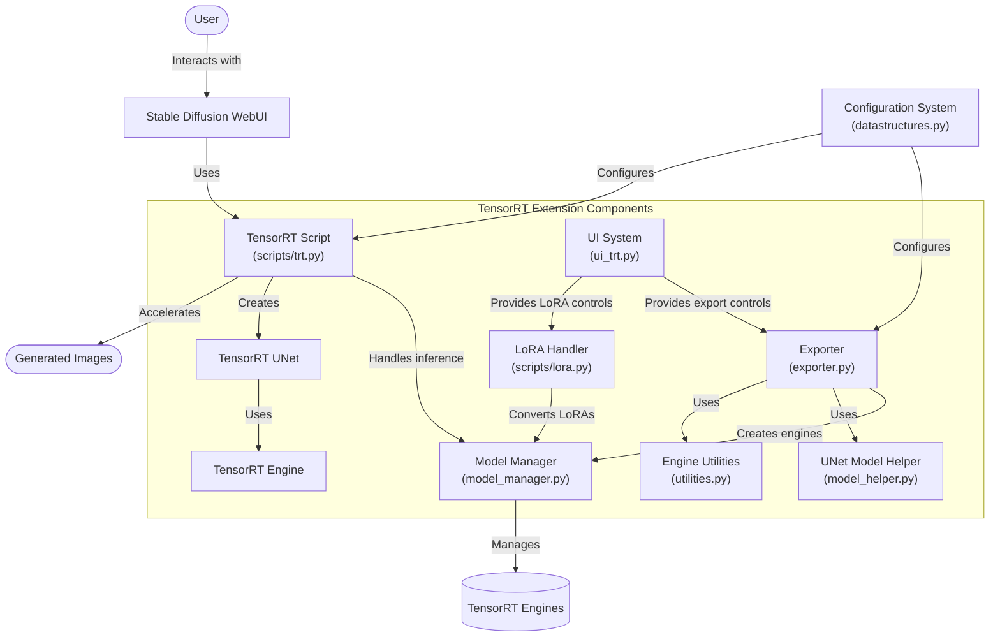
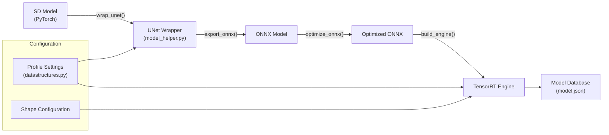
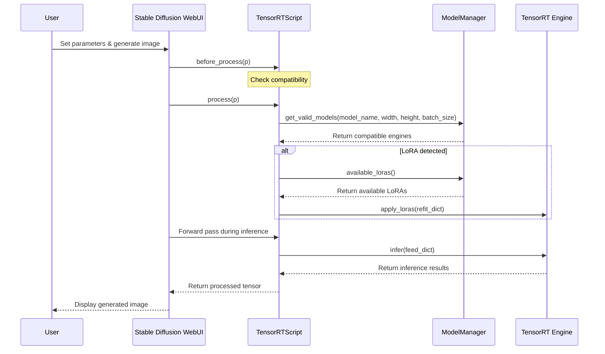

<!-- source: DeepWiki mcp.deepwiki.com · repo NVIDIA/Stable-Diffusion-WebUI-TensorRT · page 1 Overview · fetched 2026-10-26 -->

# Overview

Relevant source files

The following files were used as context for generating this wiki page:

- [README.md](README.md)
- [info.md](info.md)

The TensorRT Extension for Stable Diffusion WebUI provides accelerated image generation on NVIDIA RTX GPUs by leveraging NVIDIA's TensorRT optimization framework. This extension converts Stable Diffusion models into highly optimized TensorRT engines, resulting in significantly faster inference speeds while maintaining image quality.

This page provides a high-level overview of the extension's architecture, components, and workflows. For detailed installation instructions, see [Installation and Setup](#1.1). For usage instructions, see [User Guide](#1.2).

## Supported Models and Capabilities

The extension supports:
- Stable Diffusion 1.5 and 2.1
- Stable Diffusion XL and SDXL Turbo
- LCM (Latent Consistency Models)
- LoRA and LyCORIS fine-tuning models (requires conversion)

Sources: [README.md:4-5](), [README.md:26-32]()

## System Architecture

The TensorRT extension consists of several interconnected components that handle model export, engine management, runtime integration, and user interface interactions.

Sources: [README.md:3-5](), [info.md:1-3]()

### Key Components

1. **TensorRT Script (`scripts/trt.py`)**: Integrates with Stable Diffusion WebUI's inference pipeline, replacing the default UNet with optimized TensorRT implementations.

2. **Model Manager (`model_manager.py`)**: Manages the TensorRT engines and provides an interface for finding and loading appropriate engines based on model name, dimensions, and batch size.

3. **Exporter (`exporter.py`)**: Handles the conversion of Stable Diffusion models to optimized TensorRT engines through a multi-stage pipeline.

4. **LoRA Handler (`scripts/lora.py`)**: Manages the conversion of LoRA weights to a format compatible with TensorRT engines.

5. **UI System (`ui_trt.py`)**: Provides the user interface for engine generation, model selection, and configuration.

6. **Configuration System (`datastructures.py`)**: Defines data structures for configuring engine generation profiles, shape dimensions, and optimization settings.

## Engine Generation and Export Pipeline

The core functionality of the extension is converting Stable Diffusion models to optimized TensorRT engines. This process follows a defined pipeline:

Sources: [README.md:36-40](), [info.md:24-28]()

## Workflow Overview

### Engine Generation Workflow

1. User selects a model and engine configuration (static or dynamic)
2. Exporter wraps the UNet model component
3. The wrapped model is exported to ONNX format
4. The ONNX model is optimized
5. TensorRT builds an optimized engine from the ONNX model
6. The engine is saved and registered in the model database

### Inference Workflow

Sources: [README.md:17-24](), [info.md:5-11]()

## Engine Types and Configuration

The extension supports two types of TensorRT engines:

| Engine Type | Description | Use Case |
|-------------|-------------|----------|
| Static | Optimized for a single resolution and batch size | Maximum performance for specific dimensions |
| Dynamic | Supports a range of resolutions and batch sizes | Flexibility with a small performance cost |

The default engine generation creates:
- For SD 1.5 and 2.1: Engines supporting resolutions from 512×512 to 768×768 with batch sizes 1-4
- For SDXL: An engine supporting 1024×1024 resolution with batch size 1

Sources: [README.md:36-40](), [info.md:24-28]()

## LoRA Integration

LoRA models require conversion before use with the TensorRT extension:

1. User selects a LoRA checkpoint from the dropdown in the Export LoRA tab
2. The extension converts the weights to a TensorRT-compatible format
3. Converted LoRAs can be used normally through the prompt embedding interface
4. At runtime, the TensorRT engine applies the LoRA weights through a refit operation

Sources: [README.md:26-32](), [info.md:14-19]()

## Limitations and Requirements

- Resolution must be a multiple of 64 pixels
- When using hires.fix, both low and high resolutions must be multiples of 64
- For hires.fix, a single dynamic engine must cover both the initial and upscaled resolutions
- SDXL models recommend 12GB+ VRAM for optimal performance
- Incompatible with `medvram` and `lowvram` command-line options

Sources: [README.md:44-54](), [README.md:56-62]()

---

