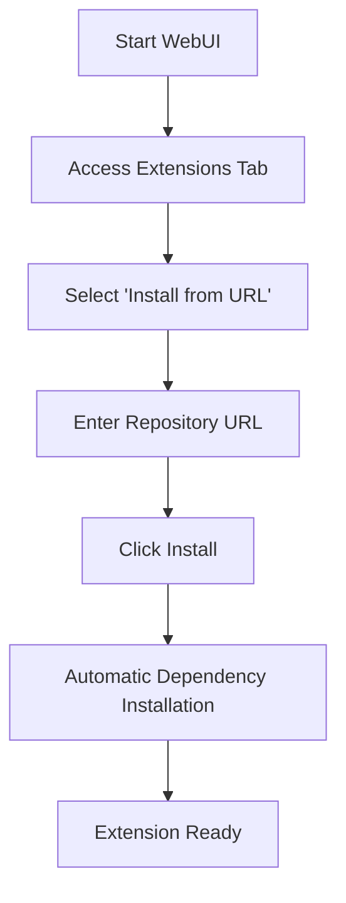
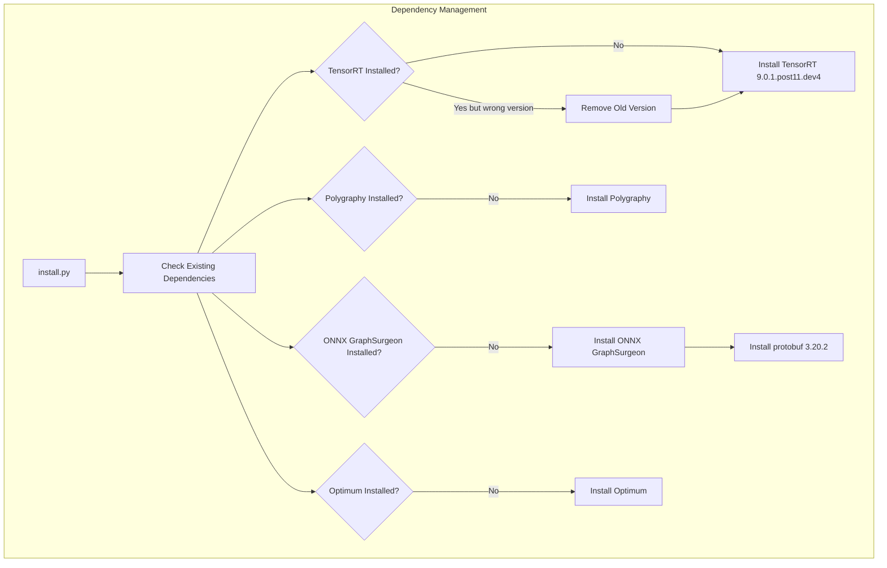
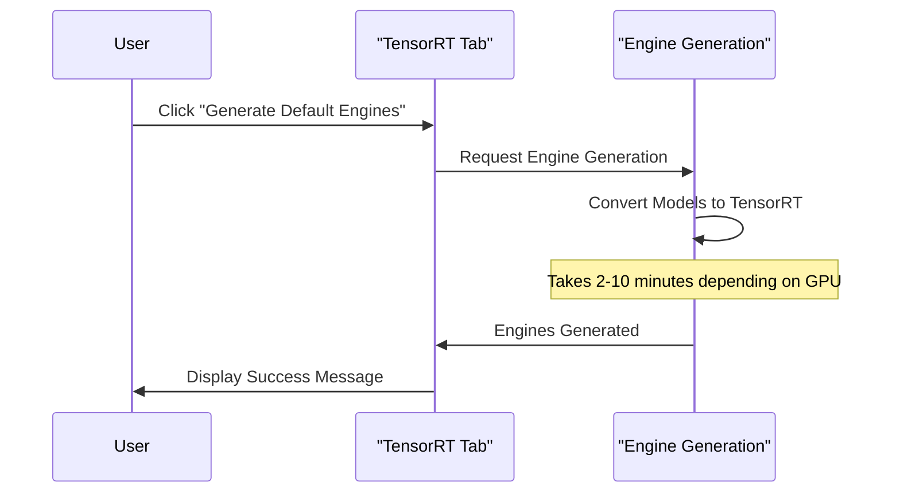
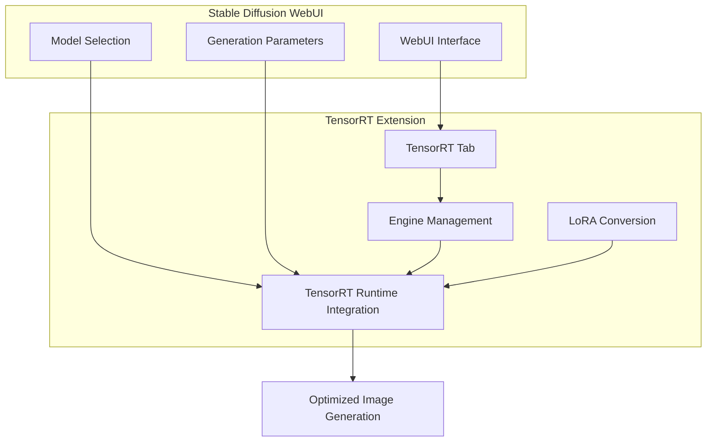

<!-- source: DeepWiki mcp.deepwiki.com · repo NVIDIA/Stable-Diffusion-WebUI-TensorRT · page 1.1 Installation and Setup · fetched 2026-10-26 -->

# Installation and Setup

Relevant source files

The following files were used as context for generating this wiki page:

- [README.md](README.md)
- [info.md](info.md)
- [install.py](install.py)

This document provides instructions for installing and setting up the TensorRT Extension for Stable Diffusion WebUI. The extension enables optimized performance on NVIDIA RTX GPUs by leveraging TensorRT acceleration. For information about using the extension after installation, please see [User Guide](#1.2).

## System Requirements

Before installing the extension, ensure your system meets the following requirements:

| Component | Minimum Requirement |
|-----------|---------------------|
| GPU       | NVIDIA RTX series   |
| Driver    | Linux: ≥ 450.80.02 Windows: ≥ 452.39 |
| VRAM      | 8GB minimum 12GB+ recommended for SDXL |

Sources: [README.md:56-62]()

## Installation Process

The TensorRT extension integrates seamlessly with the Stable Diffusion WebUI as an extension. Here's the installation flow:

### Step-by-Step Installation

1. Start the Stable Diffusion WebUI (typically by running `webui.bat` on Windows)
2. Navigate to the **Extensions** tab
3. Click on **Install from URL**
4. Enter the repository URL: `https://github.com/NVIDIA/Stable-Diffusion-WebUI-TensorRT`
5. Click **Install**
6. The extension will automatically install the required dependencies

Sources: [README.md:7-15]()

## Dependency Management

The extension relies on several NVIDIA libraries and components for TensorRT acceleration. These dependencies are automatically installed by the extension's `install.py` script.

The dependency installation process includes:

| Dependency | Purpose | Installation Source |
|------------|---------|---------------------|
| TensorRT   | Core acceleration library | NVIDIA PyPI (`https://pypi.nvidia.com`) |
| Polygraphy | Network optimization toolkit | NVIDIA NGC (`https://pypi.ngc.nvidia.com`) |
| ONNX GraphSurgeon | ONNX model manipulation | NVIDIA NGC (`https://pypi.ngc.nvidia.com`) |
| Optimum | Model optimization framework | PyPI |

Sources: [install.py:7-70]()

### Technical Details

The installation script performs several important functions:

1. **Version Management**: Ensures specific versions of libraries are installed (e.g., TensorRT 9.0.1.post11.dev4)
2. **Dependency Cleanup**: Removes conflicting or outdated dependencies
3. **Prerequisite Handling**: Installs required components in the correct order

The script uses the WebUI's `launch` module to manage pip installations and check for existing packages.

Sources: [install.py:7-70]()

## Post-Installation Setup

After installing the extension, additional setup is required before you can use TensorRT acceleration:

### 1. Generate TensorRT Engines

The first step is to generate optimized TensorRT engines for your models:

1. Go to the **TensorRT** tab in the WebUI
2. Click the **Generate Default Engines** button
3. Wait for the process to complete (typically 2-10 minutes depending on your GPU)

This process creates optimized engines for standard resolutions and batch sizes:
- For SD 1.5/2.1: Resolutions between 512×512 and 768×768 with batch sizes 1-4
- For SDXL: Resolution of 1024×1024 with batch size of 1

Sources: [README.md:17-22](), [info.md:6-10](), [info.md:24-28]()

### 2. Configure Quick Settings

To enable easy switching between standard and TensorRT acceleration:

1. Go to **Settings → User Interface → Quick Settings List**
2. Add `sd_unet` to the list
3. Apply the settings and reload the UI
4. Back in the main UI, select "Automatic" from the `sd_unet` dropdown (if not already selected)

Sources: [README.md:17-22](), [info.md:6-10]()

## Troubleshooting Common Installation Issues

| Issue | Cause | Solution |
|-------|-------|----------|
| TensorRT tab missing | Failed installation | [Manual installation](https://github.com/NVIDIA/Stable-Diffusion-WebUI-TensorRT/issues/27#issuecomment-1767570566) |
| Installation errors with command arguments | Compatibility issues with `medvram`, `lowvram`, or `api` flags | Remove these flags when starting WebUI |
| LoRA models not working | LoRAs need conversion to TensorRT format | Use the "Export LoRA" tab to convert LoRAs |

If the installation fails automatically, you may need to manually install the dependencies as specified in the `install.py` script.

Sources: [README.md:50-54]()

## System Integration

After successful installation and setup, the TensorRT Extension integrates with the Stable Diffusion WebUI as shown:

The extension replaces the standard UNet implementation with an optimized TensorRT version, while maintaining compatibility with the WebUI's features.

Sources: [README.md:16-32](), [info.md:5-19]()

## Next Steps

After completing the installation and initial setup:

1. Generate additional engines for specific resolutions if needed
2. Convert any LoRA models you want to use
3. Begin generating images with TensorRT acceleration

For detailed usage instructions, see [User Guide](#1.2).

---

