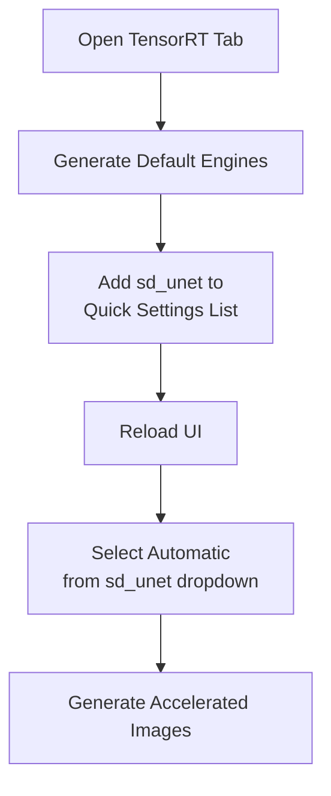
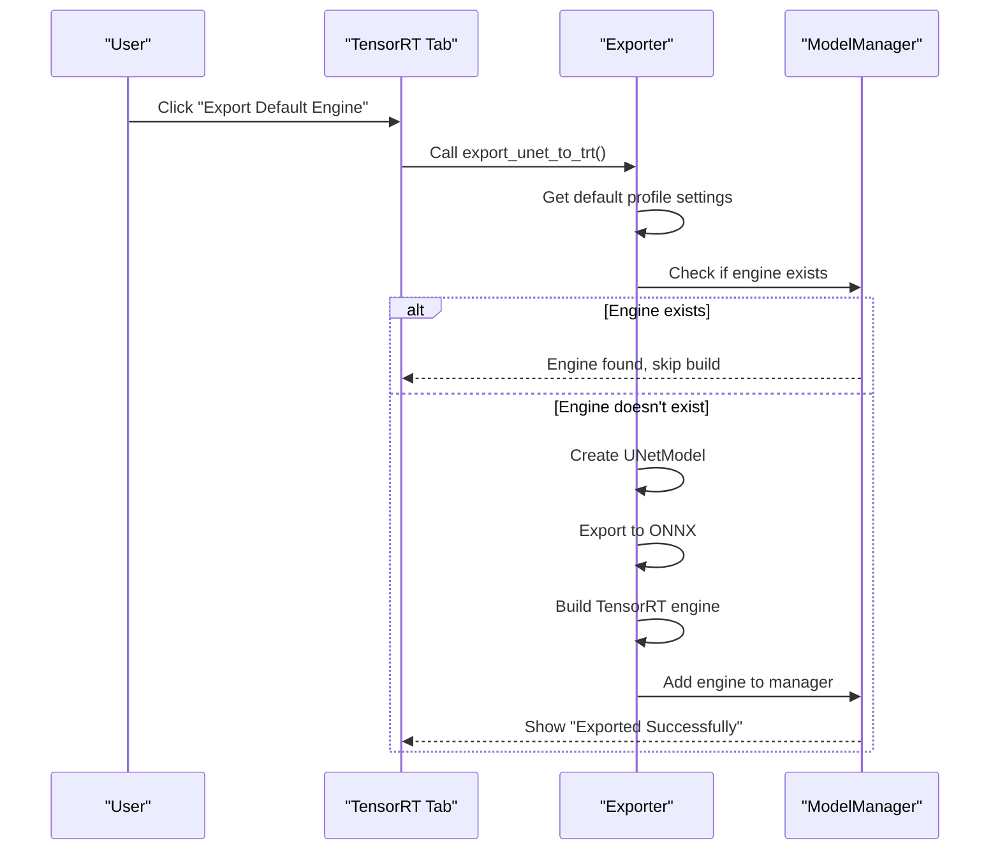
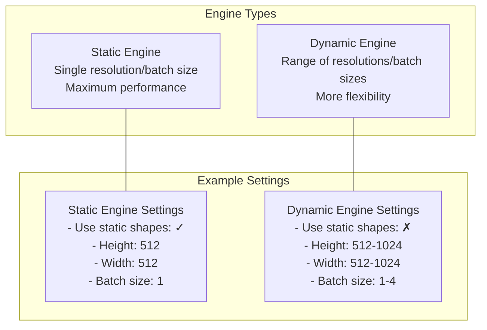
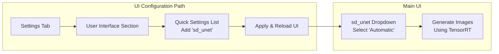
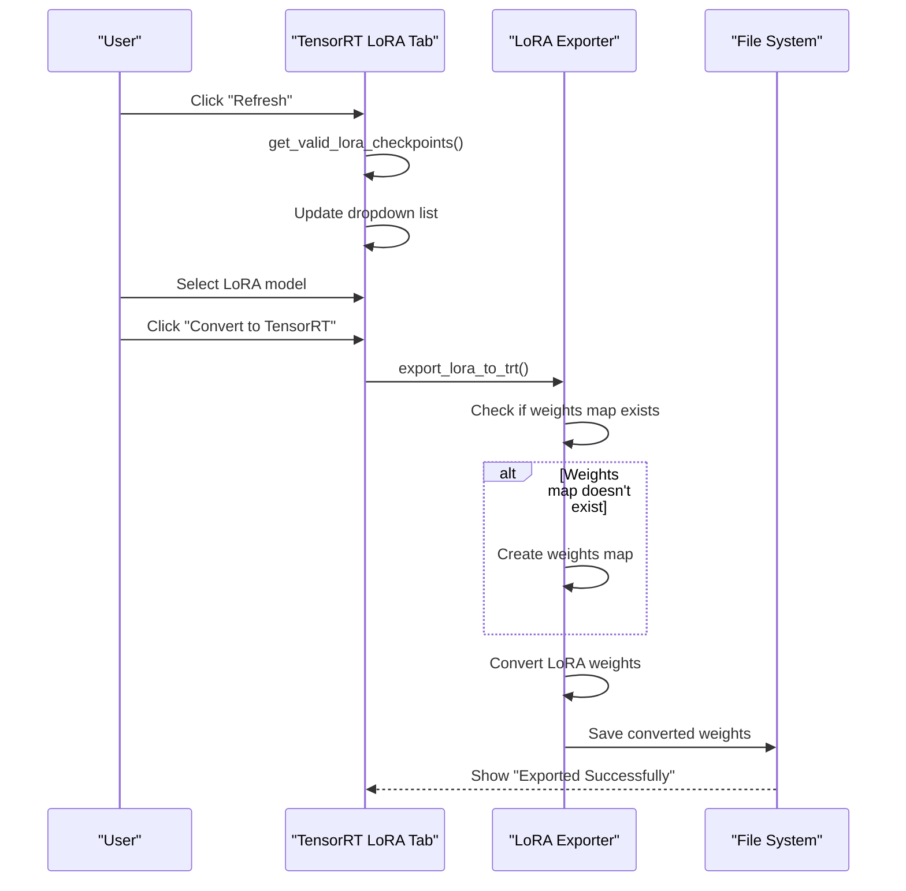
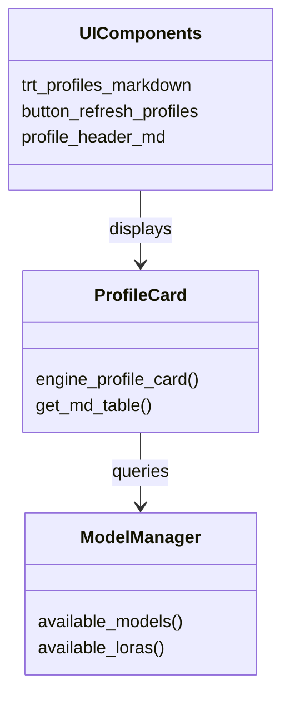
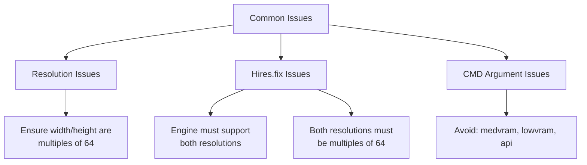

<!-- source: DeepWiki mcp.deepwiki.com · repo NVIDIA/Stable-Diffusion-WebUI-TensorRT · page 1.2 User Guide · fetched 2026-10-26 -->

# User Guide

Relevant source files

The following files were used as context for generating this wiki page:

- [README.md](README.md)
- [info.md](info.md)
- [ui_trt.py](ui_trt.py)

This document provides instructions for using the TensorRT Extension for Stable Diffusion WebUI. It covers the basic usage workflow, engine generation, LoRA model conversion, and troubleshooting steps. For information about installation, see [Installation and Setup](#1.1). For details about the system architecture, see [System Architecture](#2).

## Basic Usage Workflow

The TensorRT extension accelerates Stable Diffusion image generation on NVIDIA GPUs by using optimized TensorRT engines. Follow these steps to use the extension:

1. Generate TensorRT engines for your models
2. Configure the WebUI to use TensorRT
3. Generate images with accelerated performance

Sources: [README.md:16-23](), [info.md:5-11](), [ui_trt.py:404-411]()

## Generating TensorRT Engines

TensorRT engines are optimized for specific models, resolutions, and batch sizes. You must generate engines before you can use them for image generation.

### Default Engines

The simplest approach is to generate default engines that work for common use cases:

1. Go to the TensorRT tab in the WebUI
2. Click "Export Default Engine"
3. Wait for the export process to complete (typically 2-10 minutes depending on your GPU)

For Stable Diffusion 1.5 and 2.1, default engines support resolutions between 512×512 and 768×768 with batch sizes 1 to 4. For SDXL, default engines support 1024×1024 resolution with batch size 1.

Sources: [ui_trt.py:45-157](), [ui_trt.py:549-559](), [info.md:24-28]()

### Custom Engines

You can create custom engines with specific settings:

1. Go to the TensorRT tab
2. Select a preset from the "Preset" dropdown or choose "Custom" for full control
3. For custom engines, click "Advanced Settings" to configure:
   - Static/dynamic shapes
   - Batch size ranges
   - Height/width ranges
   - Token count ranges
4. Click "Export Engine"

#### Static vs Dynamic Engines

- **Static engines**: Optimized for a single resolution and batch size
- **Dynamic engines**: Support a range of resolutions and batch sizes with slightly lower performance

Sources: [ui_trt.py:422-546](), [info.md:24-28](), [README.md:36-41]()

## Enabling TensorRT in the WebUI

After generating engines, you need to configure the WebUI to use them:

1. Go to Settings → User Interface → Quick Settings List
2. Add `sd_unet` to the list
3. Apply settings and reload the UI
4. In the main UI, select "Automatic" from the sd_unet dropdown at the top of the page

Sources: [README.md:19-22](), [info.md:7-10]()

## Working with LoRA Models

To use LoRA models with TensorRT, they must first be converted to a compatible format:

1. Go to the TensorRT tab, then select the "TensorRT LoRA" sub-tab
2. Click "Refresh" to see available LoRA models
3. Select a LoRA model from the dropdown
4. Click "Convert to TensorRT"
5. Wait for the conversion to complete (typically around 20 seconds)

After conversion, you can use the LoRA models normally by including them in your prompts with the standard syntax.

Sources: [ui_trt.py:160-227](), [ui_trt.py:606-641](), [README.md:26-32](), [info.md:14-19]()

## Available Engines and Profiles

You can view all available engines and their profiles:

1. Go to the TensorRT tab
2. Scroll down to the "Available TensorRT Engine Profiles" section
3. Click the refresh button if needed
4. Expand model entries to see detailed profile information

Each profile shows:
- Height range (min, optimal, max)
- Width range (min, optimal, max)
- Batch size range (min, optimal, max)
- Text length range (min, optimal, max)

Sources: [ui_trt.py:658-691](), [ui_trt.py:325-399]()

## Advanced Configuration

The TensorRT extension provides several advanced configuration options:

### Engine Profile Settings

When creating custom engines, you can configure:

| Setting | Description | Default | Range |
|---------|-------------|---------|-------|
| Batch size | Number of images to generate in parallel | 1-4 | 1-16 |
| Height | Image height in pixels | 512-768 | 256-4096 |
| Width | Image width in pixels | 512-768 | 256-4096 |
| Token count | Maximum prompt length | 75-150 | 75-750 |

Note: All dimensions must be multiples of 64 for both generation and hires.fix.

### Force Rebuild

Enable the "Force Rebuild" option to regenerate an engine even if one already exists with the same settings. This is useful when:
- Your engine has become corrupted
- You've updated your GPU driver and want to take advantage of new optimizations
- You're experiencing issues with an existing engine

Sources: [ui_trt.py:422-546](), [README.md:46-48]()

## Limitations and Common Issues

### Resolution Requirements

- Image dimensions (width and height) must be multiples of 64
- This applies to both the base resolution and the hires.fix resolution

### Hires.fix Compatibility

When using hires.fix, you must have an engine that covers both resolutions:
- If using 512×512 initial and 1024×1024 final resolution, you need a dynamic engine that covers the full range
- Both the low and high resolutions must be multiples of 64

### Conflicting Command Line Arguments

Certain command line arguments may cause issues:
- `medvram` and `lowvram` can cause engine compilation failures
- `api` may prevent model.json from being updated correctly

Sources: [README.md:44-54]()

## Performance Tips

For best performance:

1. **Use static engines** when possible for maximum performance
2. **Keep dynamic ranges narrow** for better performance when using dynamic engines
3. **Match engine settings to your common use case**:
   - If you generally use 512×512, prioritize optimizing for that size
   - If you use batch sizes of 1, don't waste VRAM on larger batch sizes
4. **Keep your GPU drivers up to date** for system-wide performance improvements

Sources: [README.md:36-41](), [README.md:62-63]()

---

