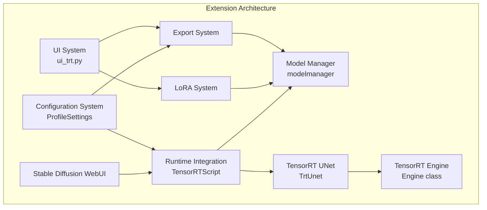
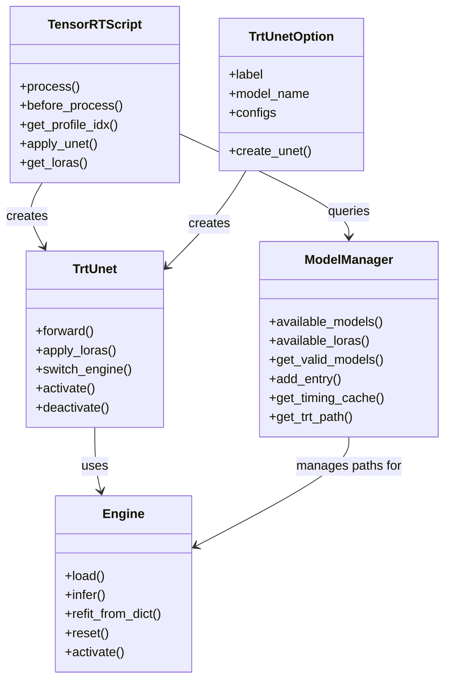
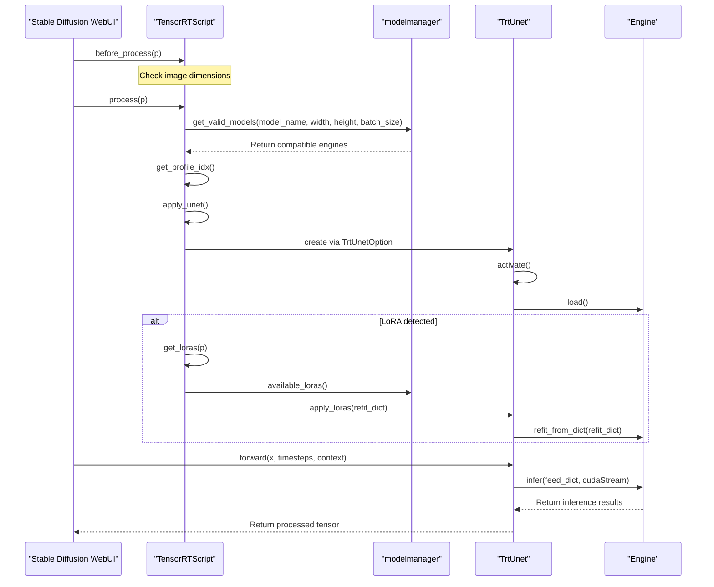
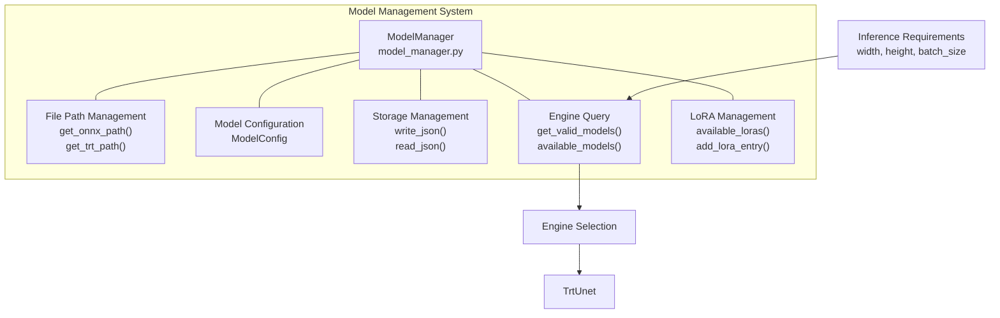
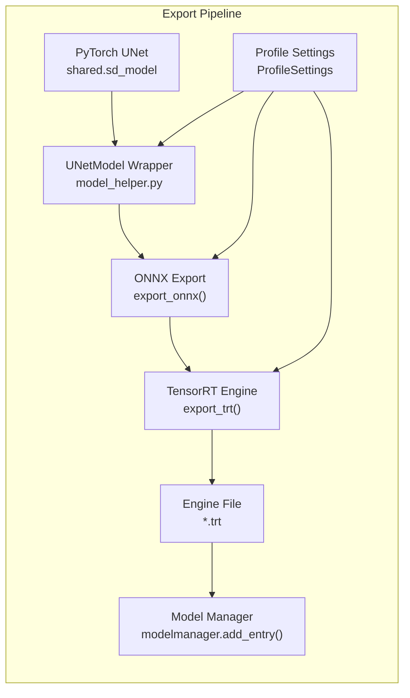
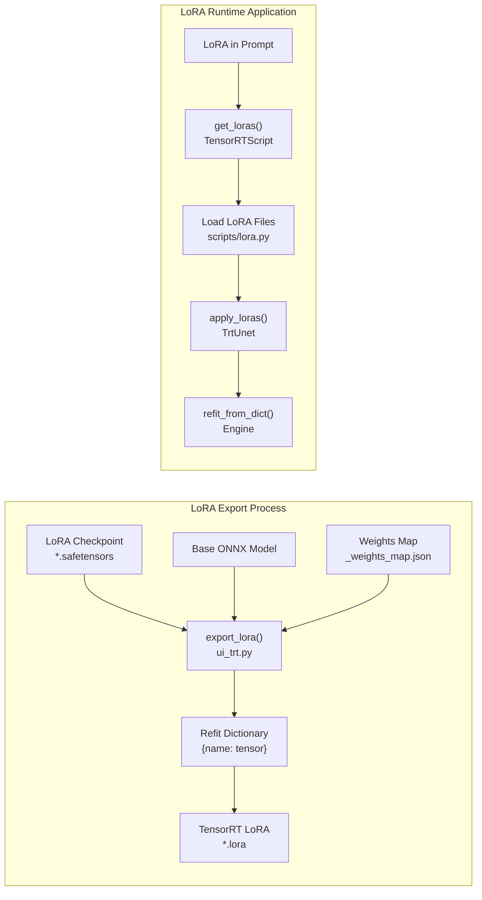
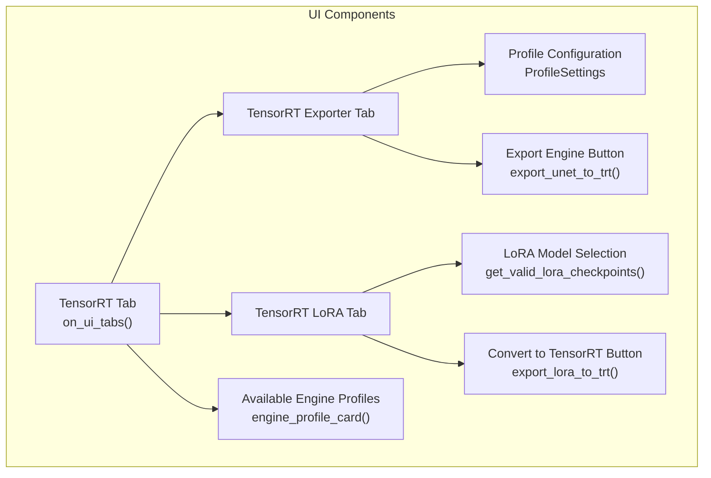
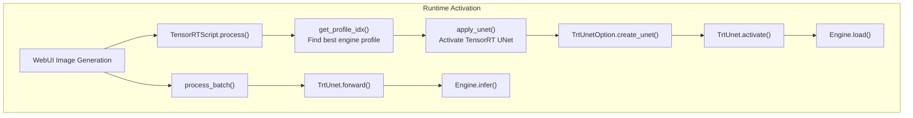
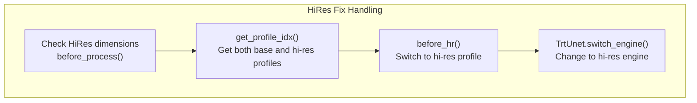

<!-- source: DeepWiki mcp.deepwiki.com · repo NVIDIA/Stable-Diffusion-WebUI-TensorRT · page 2 System Architecture · fetched 2026-10-26 -->

# System Architecture

Relevant source files

The following files were used as context for generating this wiki page:

- [model_manager.py](model_manager.py)
- [scripts/trt.py](scripts/trt.py)
- [ui_trt.py](ui_trt.py)

## Purpose and Scope

This document describes the high-level architecture of the TensorRT Extension for Stable Diffusion WebUI. It outlines the key components, their relationships, and how they work together to accelerate Stable Diffusion inference using NVIDIA's TensorRT optimization. For installation instructions, see [Installation and Setup](#1.1), and for information about using the extension, see [User Guide](#1.2).

## Core Components Overview

The TensorRT Extension consists of several key components that work together to provide accelerated inference capabilities:

Sources: [ui_trt.py:1-744](), [scripts/trt.py:1-330](), [model_manager.py:1-238]()

The architecture follows a clear separation of concerns:

1. **UI System**: Provides the user interface for exporting models and configuring the extension
2. **Model Manager**: Manages TensorRT engine files and their configuration metadata
3. **Runtime Integration**: Integrates with Stable Diffusion WebUI to intercept and accelerate the UNet forward pass
4. **Engine Utilities**: Handles the loading and execution of TensorRT engines

## Code Structure and Class Relationships

The following diagram shows the primary class relationships and their responsibilities:

Sources: [scripts/trt.py:22-104](), [scripts/trt.py:107-317](), [model_manager.py:33-235]()

## Runtime Integration Flow

The following sequence diagram shows how the extension integrates with the Stable Diffusion WebUI runtime:

Sources: [scripts/trt.py:107-317](), [scripts/trt.py:48-76]()

## Model Management System

The Model Manager is responsible for tracking available TensorRT engines, matching engines to requirements, and managing file paths.

Sources: [model_manager.py:33-235]()

The Model Manager stores metadata about each exported engine, including:

1. Supported dimensions (height, width)
2. Batch size ranges
3. Whether it supports static or dynamic shapes
4. Whether the engine is FP32 or FP16
5. Whether it supports inpainting
6. Whether it supports LoRA refitting

## Export Pipeline

The model export pipeline converts PyTorch UNet models to optimized TensorRT engines:

Sources: [ui_trt.py:45-157]()

The export process starts from the UI when a user requests a model export:

1. The current PyTorch model is wrapped in a `UNetModel` object that prepares it for ONNX export
2. Profile settings define the dimension ranges the engine will support
3. The model is exported to ONNX format
4. The ONNX model is converted to a TensorRT engine
5. The engine is registered with the Model Manager

## LoRA Integration

The extension supports LoRA models by converting them to a format that can be applied to TensorRT engines at runtime:

Sources: [ui_trt.py:160-227](), [scripts/trt.py:198-241](), [scripts/trt.py:77-84]()

The LoRA integration has two phases:
1. **Export Phase**: Converting a LoRA checkpoint to a TensorRT-compatible format
2. **Runtime Phase**: Applying the LoRA to a loaded TensorRT engine

## UI System

The UI system provides interfaces for users to:

Sources: [ui_trt.py:403-743]()

The UI components register with the Stable Diffusion WebUI through the `script_callbacks.on_ui_tabs()` mechanism.

## Runtime Activation Flow

When a user selects a TensorRT UNet for inference, the following activation flow occurs:

Sources: [scripts/trt.py:242-266](), [scripts/trt.py:267-296]()

## HiRes Fix Support

The extension supports HiRes Fix by potentially using different engine profiles for the initial generation and the high-resolution refinement:

Sources: [scripts/trt.py:126-140](), [scripts/trt.py:141-196](), [scripts/trt.py:306-311]()

## TensorRT Script Lifecycle

The `TensorRTScript` class hooks into various stages of the Stable Diffusion generation process:

| Method | Called When | Purpose |
|--------|-------------|---------|
| `before_process()` | Before any processing starts | Check image dimensions |
| `process()` | Before U-Net is initialized | Select and prepare TensorRT engines |
| `process_batch()` | For each batch count | Switch engine profile if needed |
| `before_hr()` | Before high-resolution phase | Switch to high-resolution engine profile |
| `after_extra_networks_activate()` | After networks activate | Apply LoRA weights if needed |

Sources: [scripts/trt.py:107-317]()

## Summary

The TensorRT Extension's architecture provides a modular, flexible system for accelerating Stable Diffusion models with NVIDIA TensorRT. The system handles model management, runtime integration, and LoRA support while maintaining compatibility with the Stable Diffusion WebUI ecosystem.

Key technical strengths of this architecture include:
1. **Separation of concerns** between model management, export, and runtime
2. **Profile-based engine selection** to handle different image dimensions
3. **Runtime LoRA integration** without requiring re-export of models
4. **HiRes Fix support** through profile switching

For more detailed information about specific components, refer to the [Runtime Integration](#2.1), [Model Management](#2.2), and [UI Components](#2.3) pages.

---

