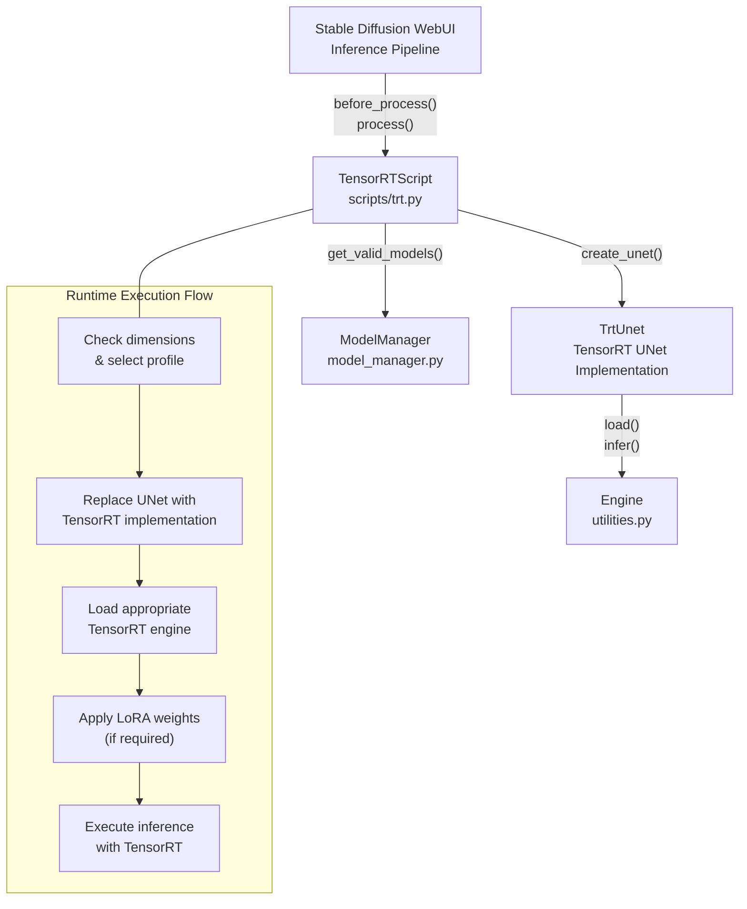
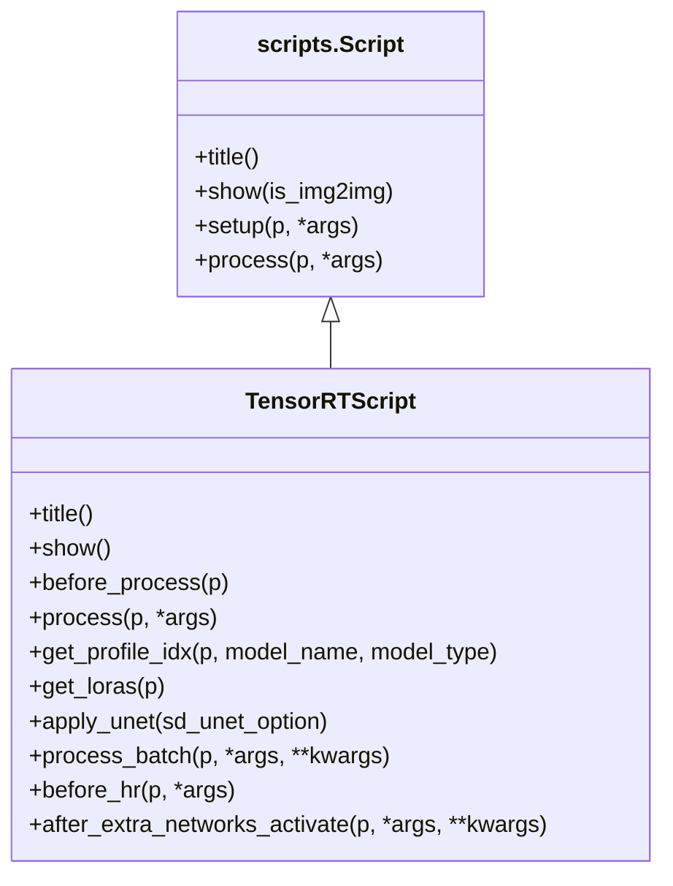
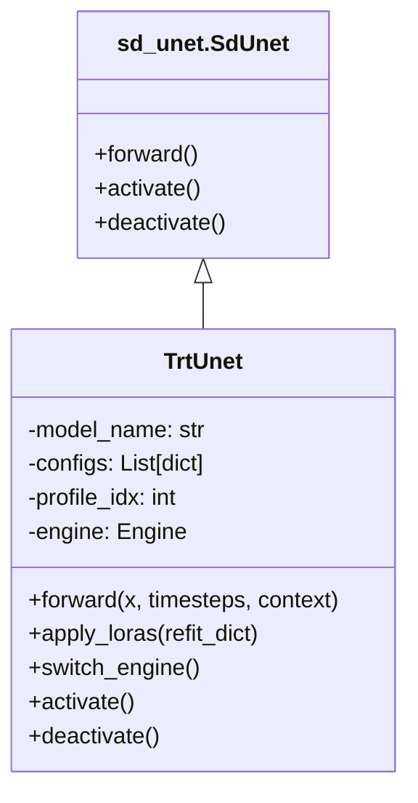
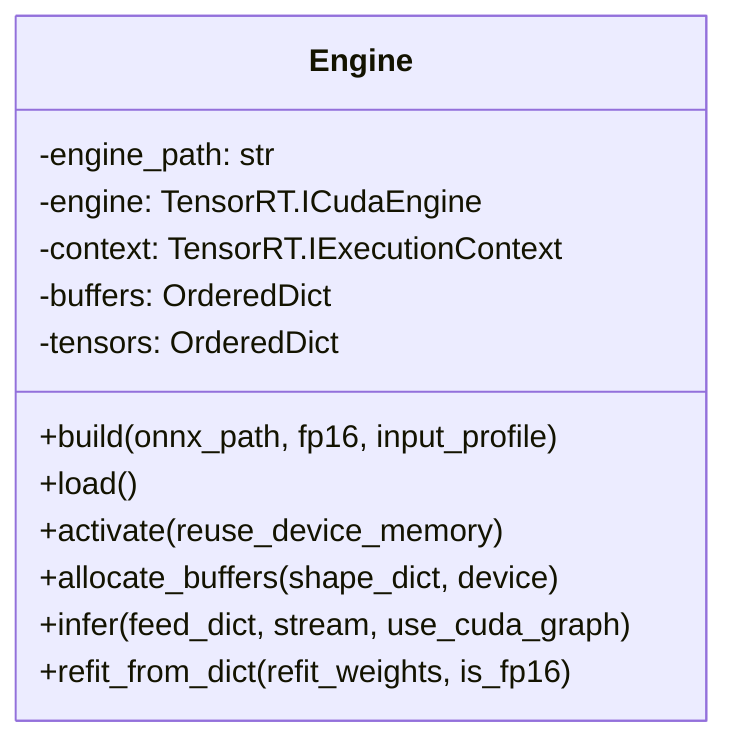
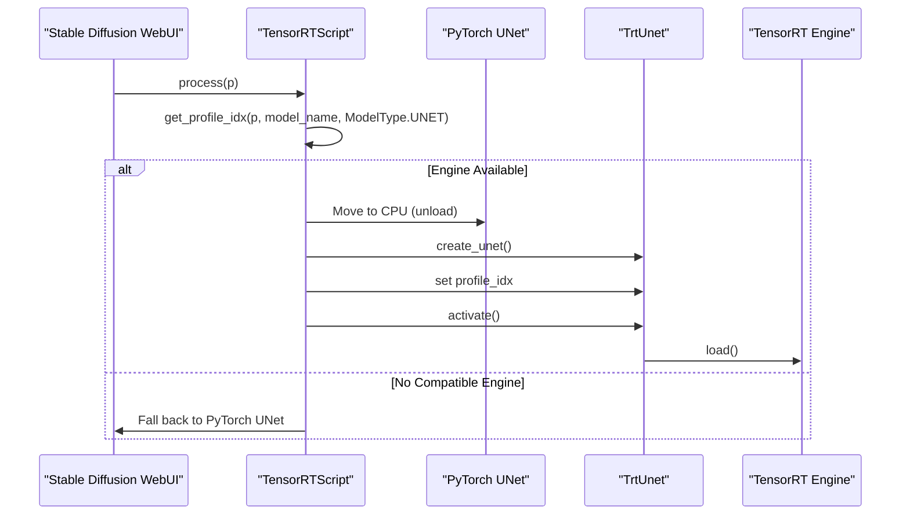
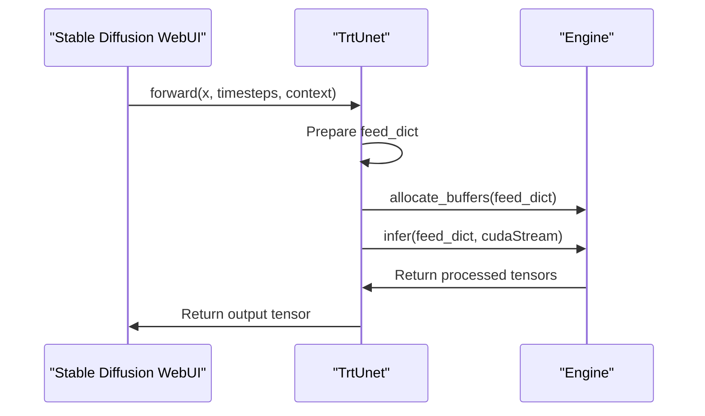

<!-- source: DeepWiki mcp.deepwiki.com · repo NVIDIA/Stable-Diffusion-WebUI-TensorRT · page 2.1 Runtime Integration · fetched 2026-10-26 -->

# Runtime Integration

<details>
<summary>Relevant source files</summary>

The following files were used as context for generating this wiki page:

- [scripts/trt.py](scripts/trt.py)
- [utilities.py](utilities.py)

</details>


## Purpose and Scope

This document explains how the TensorRT Extension integrates with Stable Diffusion WebUI at runtime to accelerate inference using NVIDIA's TensorRT engines. It covers the process of intercepting calls to the standard UNet during inference, substituting them with optimized TensorRT engines, and handling dynamic engine switching for different resolutions and LoRA models.

For information about the engine generation process, see [Engine Generation](#3), and for details on the underlying model management, see [Model Management](#2.2).

## Architecture Overview

The runtime integration system is designed to seamlessly replace PyTorch's UNet implementation with TensorRT-optimized versions while maintaining compatibility with the Stable Diffusion WebUI pipeline.



Sources: [scripts/trt.py:107-142](), [scripts/trt.py:22-106]()

## Core Components

### TensorRT Script

The `TensorRTScript` class serves as the entry point that integrates with the Stable Diffusion WebUI's script system. It inherits from the WebUI's `scripts.Script` class and implements several callback methods to intercept the image generation process.



Sources: [scripts/trt.py:107-317]()

### TensorRT UNet Implementation

The `TrtUnet` class implements a TensorRT-accelerated version of the UNet model used in Stable Diffusion.



Sources: [scripts/trt.py:32-105]()

### TensorRT Engine

The `Engine` class in `utilities.py` is responsible for the low-level TensorRT operations:



Sources: [utilities.py:134-331]()

## Integration Workflow

The runtime integration follows these key steps during image generation:

### 1. Script Initialization and Model Selection

When the WebUI starts a generation process, the `TensorRTScript` is activated:

1. `before_process()` verifies that the image dimensions are compatible
2. `process()` checks if a suitable TensorRT engine is available
3. `get_profile_idx()` selects the most appropriate engine profile for the current dimensions

Sources: [scripts/trt.py:126-140](), [scripts/trt.py:141-196](), [scripts/trt.py:242-265]()

### 2. UNet Replacement

Once the appropriate engine is identified, the PyTorch UNet is replaced with a TensorRT implementation:



Sources: [scripts/trt.py:267-296]()

### 3. LoRA Integration

If LoRA models are detected in the prompt, they are applied to the TensorRT engine:

1. `get_loras()` extracts LoRA models from the prompt
2. The system checks if the LoRAs are available in TensorRT format
3. `apply_loras()` is called to refit the TensorRT engine with the LoRA weights

Sources: [scripts/trt.py:198-240](), [scripts/trt.py:313-316]()

### 4. Engine Switching for High-Resolution

For high-resolution generation (Hires.fix), the system switches to an appropriate engine profile:

1. `before_hr()` is called when high-resolution generation starts
2. The script switches the engine to one optimized for the high-resolution dimensions
3. `switch_engine()` is used to load the new engine

Sources: [scripts/trt.py:306-311](), [scripts/trt.py:86-89]()

### 5. Inference Execution

During the actual inference, the TensorRT engine performs the computation:



Sources: [scripts/trt.py:48-75](), [utilities.py:292-322]()

## Error Handling

The system includes several error-handling mechanisms:

1. Checks for compatible engines before attempting to use TensorRT
2. Fallback to PyTorch UNet when no suitable engine is found
3. Validation of image dimensions to ensure compatibility with TensorRT engines
4. Verification that the selected TensorRT engine matches the current Stable Diffusion model

Sources: [scripts/trt.py:128-139](), [scripts/trt.py:248-254](), [scripts/trt.py:160-164](), [scripts/trt.py:178-182]()

## Integration with Stable Diffusion WebUI

The extension integrates with the WebUI through two main callback mechanisms:

1. `script_callbacks.on_list_unets()` - Registers available TensorRT UNet implementations
2. `script_callbacks.on_ui_tabs()` - Adds the TensorRT configuration UI to the WebUI

```python
script_callbacks.on_list_unets(list_unets)
script_callbacks.on_ui_tabs(ui_trt.on_ui_tabs)
```

The `list_unets()` function populates the UNet dropdown in the WebUI with TensorRT options by creating `TrtUnetOption` objects for each available model.

Sources: [scripts/trt.py:319-329]()

## Performance Considerations

The TensorRT runtime integration includes several optimizations:

1. **Memory Management**: The PyTorch UNet is moved to CPU when the TensorRT engine is active, freeing GPU memory
2. **CUDA Streams**: The system uses CUDA streams for asynchronous execution
3. **Buffer Reuse**: Buffers are allocated once and reused to minimize memory operations
4. **Dynamic Profile Selection**: The system selects the optimal engine profile based on image dimensions

Sources: [scripts/trt.py:285-286](), [scripts/trt.py:69](), [utilities.py:292-307]()

## Summary

The TensorRT Runtime Integration system provides a seamless way to accelerate Stable Diffusion inference by:

1. Intercepting calls to the UNet model during the generation process
2. Replacing the standard PyTorch implementation with optimized TensorRT engines
3. Supporting dynamic engine switching for different resolutions
4. Maintaining compatibility with LoRA models through engine refitting
5. Providing automatic fallback to PyTorch when needed

This architecture allows users to benefit from significant performance improvements while maintaining all the functionality of the original Stable Diffusion WebUI.

---

