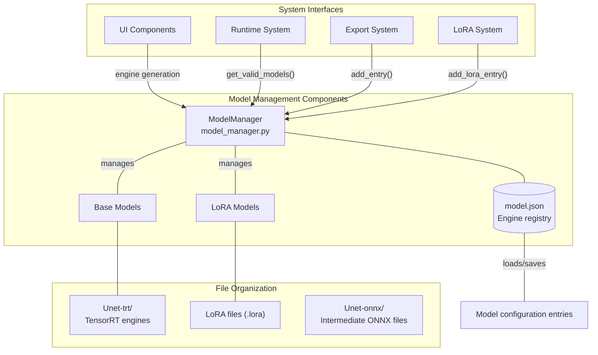
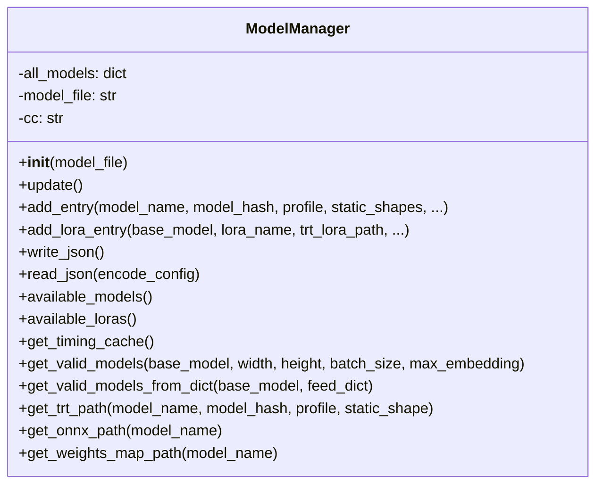
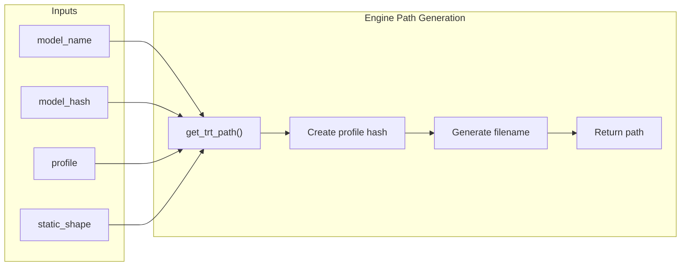
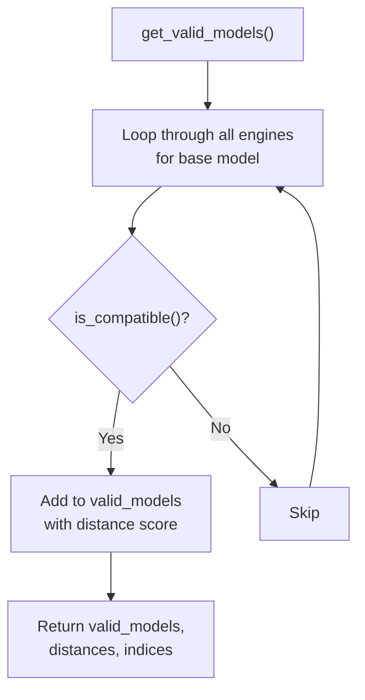

<!-- source: DeepWiki mcp.deepwiki.com · repo NVIDIA/Stable-Diffusion-WebUI-TensorRT · page 2.2 Model Management · fetched 2026-10-26 -->

# Model Management

<details>
<summary>Relevant source files</summary>

The following files were used as context for generating this wiki page:

- [model_manager.py](model_manager.py)
- [timing_caches/timing_cache_win_cc75.cache](timing_caches/timing_cache_win_cc75.cache)
- [timing_caches/timing_cache_win_cc75.cache.lock](timing_caches/timing_cache_win_cc75.cache.lock)

</details>


## Purpose and Scope

This document explains how the TensorRT Extension manages TensorRT engine files and LoRA models. Model Management serves as a central registry for tracking, organizing, and retrieving optimized models for inference. This system enables the runtime components to select the appropriate TensorRT engines based on inference parameters such as batch size, image dimensions, and LoRA configurations.

For information about the actual process of converting models to TensorRT engines, see [Engine Generation](#3).

Sources: [model_manager.py:33-236]()

## System Overview

The Model Management system provides a registry for TensorRT engines and LoRA models, maintaining metadata about each engine's capabilities and compatibility requirements. It facilitates runtime model selection by matching inference parameters with compatible engines.



Sources: [model_manager.py:33-237]()

## Directory Structure

The Model Management system organizes files in the following directory structure:

| Directory | Path | Purpose |
|-----------|------|---------|
| ONNX Models | `models/Unet-onnx/` | Stores intermediate ONNX format models |
| TensorRT Engines | `models/Unet-trt/` | Stores optimized TensorRT engine files |
| LoRA Models | `models/Lora/` | Reference directory for original LoRA models |
| Model Registry | `models/Unet-trt/model.json` | JSON file tracking all available models |

The system automatically creates the necessary directories if they don't exist during initialization.

Sources: [model_manager.py:11-21]()

## Core Functionality

### ModelManager Class

The `ModelManager` class is the central component responsible for tracking and managing TensorRT engines:



The `modelmanager` is instantiated as a singleton at the module level, providing a shared interface for all components to access model management functionality.

Sources: [model_manager.py:33-237]()

### Initialization and Discovery

Upon initialization, the `ModelManager`:

1. Determines the compute capability of the current NVIDIA GPU
2. Loads the existing model registry from `model.json` if available
3. Verifies that registered models actually exist on disk
4. Removes stale entries for missing engine files

Sources: [model_manager.py:33-44](), [model_manager.py:71-98]()

## Model Registry

### Structure

The model registry uses a hierarchical structure:

```
{
    "cc75": {                    # GPU compute capability
        "sd-v1-5": [             # Base model name
            {
                "filepath": "sd-v1-5_hash_cc75_profile-details.trt",  # Engine filename
                "config": {       # Engine configuration parameters
                    "profile": [...],
                    "static_shapes": true,
                    "fp32": false,
                    "inpaint": false,
                    "refit": true,
                    "lora": false,
                    "vram": 123456,
                    "unet_hidden_dim": 4
                }
            },
            ...more engine variants...
        ],
        ...more base models...
    },
    ...more compute capabilities...
}
```

This structure allows the system to:
- Organize engines by GPU compatibility
- Group variants of the same base model
- Store detailed configuration for each engine variant

Sources: [model_manager.py:155-172]()

### Model Configuration

Each engine is associated with a `ModelConfig` object that stores:

1. Input shape profiles (for dynamic shapes)
2. Whether the engine uses static shapes
3. Precision (FP16 or FP32)
4. Whether it supports inpainting
5. Whether it supports refitting (for LoRA)
6. VRAM requirements
7. Model architecture parameters (UNet hidden dimensions)

This configuration is used to determine which engines are compatible with specific inference requests.

Sources: [model_manager.py:116-118](), [model_manager.py:141-143]()

## Engine Naming and Path Generation

The system uses a structured naming convention for TensorRT engines:

```
<model_name>_<hash>_cc<compute_capability>_<profile_details>.trt
```

The `profile_details` encodes the shape constraints supported by the engine, making each filename unique to its configuration.



Sources: [model_manager.py:51-66]()

## Model Selection

### Finding Compatible Models

A key function of the Model Management system is to find engines compatible with specific inference requirements. The `get_valid_models()` method:

1. Takes parameters like image width, height, batch size
2. Checks each engine for the specified base model
3. Tests compatibility using the engine's configuration
4. Returns all compatible engines along with a "distance" metric indicating how well they match



The system can select the optimal engine if multiple are compatible, typically choosing the one with the smallest "distance" from the requested parameters.

Sources: [model_manager.py:213-234](), [model_manager.py:199-211]()

## LoRA Integration

The Model Management system handles LoRA models specially:

1. `add_lora_entry()` registers LoRA-enabled engines
2. `available_loras()` discovers all `.lora` files in the TensorRT directory
3. LoRA engines are linked to their parent base model

This enables the runtime system to apply the appropriate LoRA weights during inference.

Sources: [model_manager.py:138-153](), [model_manager.py:178-185]()

## Singleton Instance

The module creates a singleton instance `modelmanager` that provides a global access point to the model management functionality:

```python
modelmanager = ModelManager()
```

This instance is used by other components in the system to interact with the model registry.

Sources: [model_manager.py:237]()

## Integration with Other Components

### Interaction with Runtime System

The Runtime System uses the Model Manager to:
1. Find compatible engines for specific inference parameters
2. Retrieve available LoRA models
3. Access engine file paths for loading

### Interaction with Export System

The Export System uses the Model Manager to:
1. Register newly created engines with `add_entry()`
2. Obtain paths for storing ONNX and TensorRT files
3. Access timing cache for optimizing engine building

Sources: [model_manager.py:103-136]()

---

