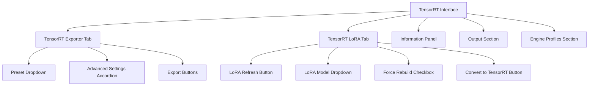
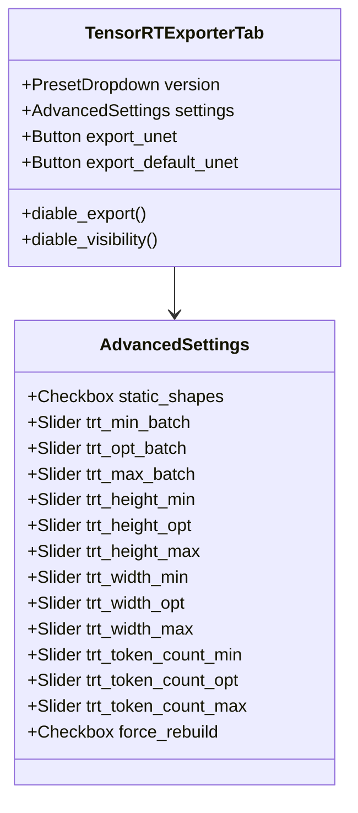
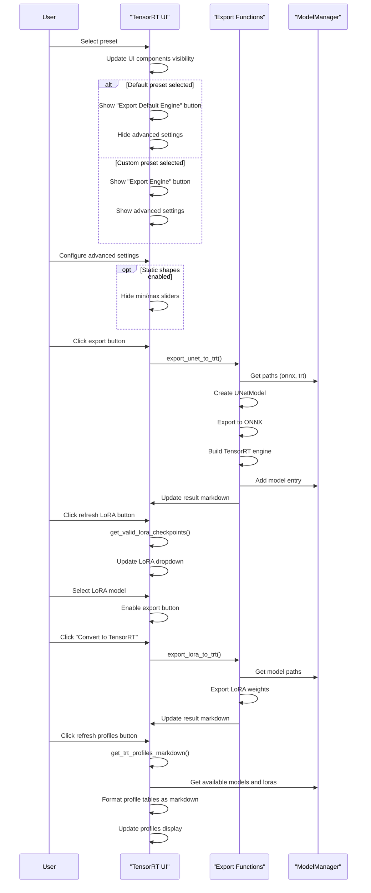

<!-- source: DeepWiki mcp.deepwiki.com · repo NVIDIA/Stable-Diffusion-WebUI-TensorRT · page 2.3 UI Components · fetched 2026-10-26 -->

# UI Components

<details>
<summary>Relevant source files</summary>

The following files were used as context for generating this wiki page:

- [info.md](info.md)
- [ui_trt.py](ui_trt.py)

</details>


This page documents the user interface components of the TensorRT extension for Stable Diffusion WebUI. These components allow users to interact with the extension, configure TensorRT engine settings, export models, and manage LoRA integrations. For information about the runtime integration of TensorRT, see [Runtime Integration](#2.1), and for details on model management, see [Model Management](#2.2).

## UI Component Overview

The TensorRT extension adds a dedicated tab to the Stable Diffusion WebUI with several key interface components organized for different functionalities.



Sources: [ui_trt.py:403-743]()

## Main UI Tabs

The extension creates a new tab in the Stable Diffusion WebUI called "TensorRT" that contains the following interface elements:

### TensorRT Exporter Tab

This tab allows users to export Stable Diffusion models to optimized TensorRT engines.

#### Components:

1. **Preset Dropdown** - Selects predefined engine configuration profiles
2. **Advanced Settings Accordion** - Contains detailed configuration options:
   - Batch size controls (min, optimal, max)
   - Height controls (min, optimal, max)
   - Width controls (min, optimal, max)
   - Token count controls (min, optimal, max)
   - Static shapes toggle
   - Force rebuild toggle
3. **Export Buttons**:
   - "Export Default Engine" - Visible when "Default" preset is selected
   - "Export Engine" - Visible when a custom preset is selected



Sources: [ui_trt.py:408-604]()

### TensorRT LoRA Tab

This tab enables users to convert LoRA models to TensorRT-compatible format.

#### Components:

1. **Refresh Button** - Updates the list of available LoRA models
2. **LoRA Model Dropdown** - Displays and selects available LoRA checkpoints
3. **Force Rebuild Checkbox** - Forces regeneration of existing LoRA exports
4. **Convert to TensorRT Button** - Initiates the LoRA conversion process

Sources: [ui_trt.py:606-644]()

### Information Panel

Displays general information about the TensorRT extension, including installation steps, usage instructions, and engine types.

Sources: [ui_trt.py:647-652](), [info.md:1-32]()

### Output Section

Displays the results of export operations with status messages and error information.

Sources: [ui_trt.py:654-656]()

### Engine Profiles Section

Shows available TensorRT engine profiles with detailed information.

#### Components:

1. **Refresh Button** - Updates the list of available engine profiles
2. **Profile Header** - Section title
3. **Profiles Markdown** - Collapsible details for each model and its profiles

Sources: [ui_trt.py:675-686]()

## UI Component Data Flow

The following diagram illustrates how data flows between UI components and backend functions during export operations:



Sources: [ui_trt.py:693-741]()

## Engine Profile Card Display

The Engine Profiles section displays a card for each available engine with the following information:

| Parameter | Min | Opt | Max |
|-----------|:---:|:---:|:---:|
| Height    | H   | H   | H   |
| Width     | W   | W   | W   |
| Batch Size| B   | B   | B   |
| Text-length| T  | T   | T   |

This format shows the operating ranges for each engine, helping users understand the capabilities and limitations of their exported engines.

Sources: [ui_trt.py:325-400]()

## UI Component Integration with WebUI

The TensorRT UI components are integrated into the Stable Diffusion WebUI through the `on_ui_tabs()` function, which is a WebUI extension point. This function returns a list containing the TensorRT interface, its display name, and its element ID:

```
return [(trt_interface, "TensorRT", "tensorrt")]
```

This integration allows the TensorRT extension to appear as a tab within the main WebUI interface.

Sources: [ui_trt.py:743]()

## UI Event Handlers

The extension implements several event handlers to update the UI based on user interactions:

1. **Preset Dropdown Change**:
   - Updates all configuration sliders with preset values
   - Controls visibility of export buttons and advanced settings

2. **Static Shapes Toggle**:
   - Hides or shows min/max sliders for batch size, height, width, and token count

3. **LoRA Dropdown Change**:
   - Enables or disables the LoRA export button based on selection

4. **Button Click Handlers**:
   - Connect export buttons to their respective export functions
   - Refresh buttons update the UI with current data

Sources: [ui_trt.py:562-644](), [ui_trt.py:688-741]()

## UI Component Configuration and Default Values

The UI components use default values from the `profile_presets` object, which contains predefined configurations for different Stable Diffusion model versions. These presets define recommended values for engine parameters such as batch size, image dimensions, and token counts.

The `ProfilePrests` class (referenced from `datastructures.py`) provides methods to retrieve appropriate default settings based on the selected model type (SD 1.5, 2.1, or XL).

Sources: [ui_trt.py:23](), [ui_trt.py:64-86]()

## Relation to Other Components

The UI components interact with several other parts of the TensorRT extension:

- **Model Management**: UI requests available models and adds new entries through the `modelmanager` object
- **Export System**: UI triggers export operations through the `export_onnx`, `export_trt`, and `export_lora` functions
- **Configuration System**: UI uses the `ProfileSettings` class to structure engine parameters
- **UNet Model Helper**: UI creates `UNetModel` instances to handle the export process

These connections tie the user interface to the core functionality of the TensorRT extension.

---

