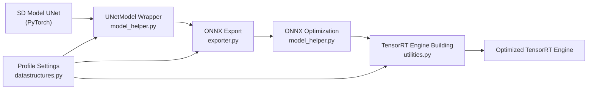
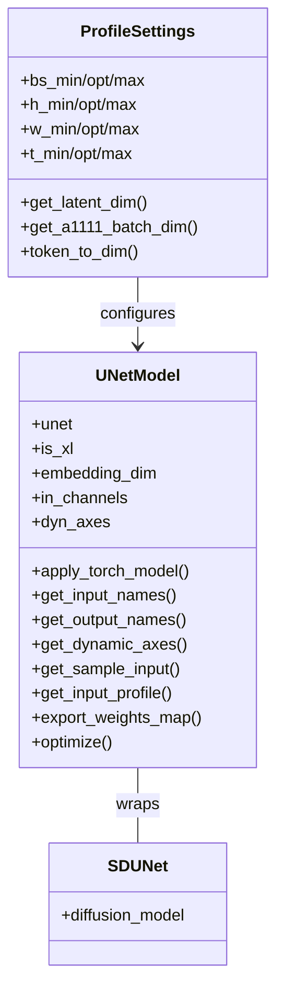
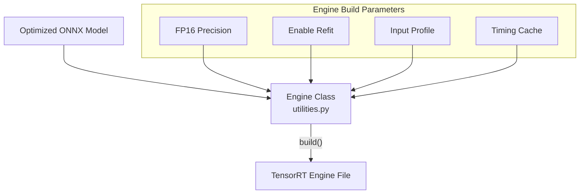
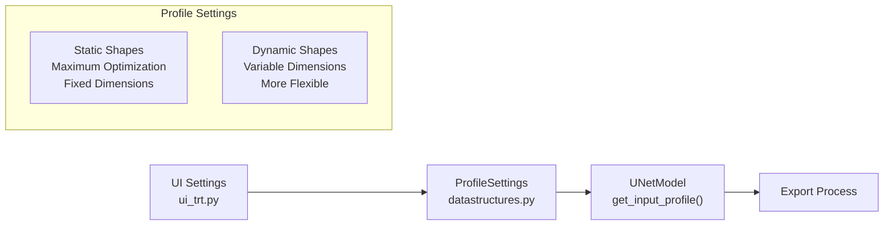
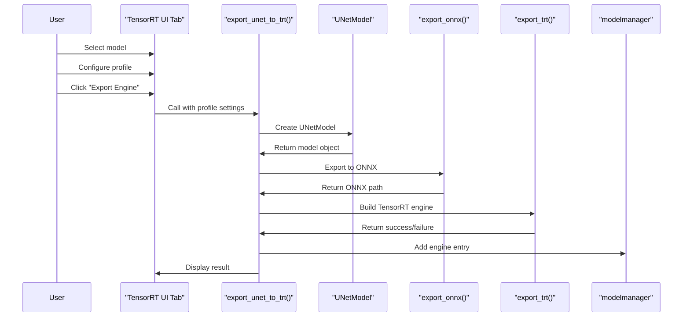
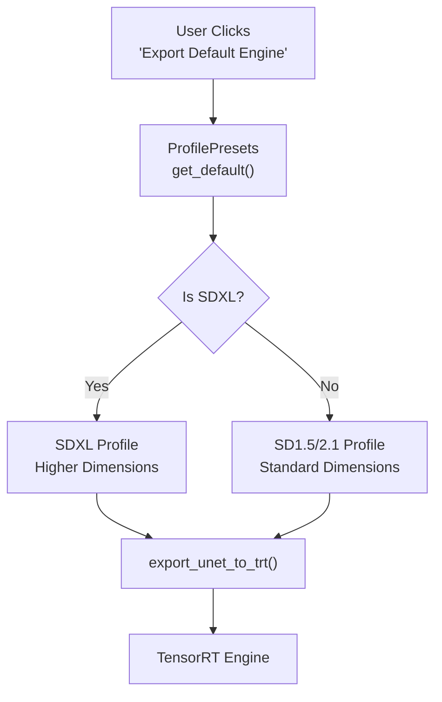

<!-- source: DeepWiki mcp.deepwiki.com · repo NVIDIA/Stable-Diffusion-WebUI-TensorRT · page 3 Engine Generation · fetched 2026-10-26 -->

# Engine Generation

<details>
<summary>Relevant source files</summary>

The following files were used as context for generating this wiki page:

- [exporter.py](exporter.py)
- [model_helper.py](model_helper.py)
- [ui_trt.py](ui_trt.py)

</details>


This page documents the process of converting Stable Diffusion models to optimized TensorRT engines. The engine generation process is a critical step that enables accelerated inference with TensorRT in the WebUI. For information about using these engines at runtime, see [Runtime Integration](#2.1).

## Process Overview

Engine generation is the process of converting PyTorch UNet models through ONNX to optimized TensorRT engines. This conversion enables significant performance improvements for inference on NVIDIA GPUs.



Sources: [exporter.py:139-221](), [model_helper.py:35-148](), [ui_trt.py:45-157]()

## UNetModel Wrapper

The engine generation process begins with wrapping the Stable Diffusion UNet in a specialized `UNetModel` class that prepares it for export.



The `UNetModel` wrapper provides several key functions:

1. **Model preparation** - Disables checkpoint functionality and applies necessary optimizations
2. **Input/output specification** - Defines the names and dynamic axes for inputs and outputs
3. **Sample input generation** - Creates appropriate tensor inputs for export
4. **Profile configuration** - Generates input profiles based on user settings

Sources: [model_helper.py:35-148]()

## Export Pipeline

The export pipeline converts the wrapped UNet model to an optimized TensorRT engine in multiple stages.

### 1. ONNX Export

First, the model is exported to ONNX format. This process:

1. Creates sample inputs based on profile settings
2. Exports the PyTorch model to ONNX with dynamic axes
3. Handles external data for large models

```python
# Key parameters for ONNX export
export_params = True
opset_version = 17
do_constant_folding = True
dynamic_axes = model.get_dynamic_axes()
```

Sources: [exporter.py:139-165](), [exporter.py:167-221]()

### 2. ONNX Optimization

The ONNX model is then optimized using the `Optimizer` class, which:

1. Cleans up the graph
2. Folds constants
3. Performs shape inference

This results in a more efficient ONNX model ready for TensorRT conversion.

Sources: [model_helper.py:216-282]()

### 3. TensorRT Engine Building

Finally, the optimized ONNX model is converted to a TensorRT engine:



The engine building process includes:

1. Creating an `Engine` instance
2. Moving the model to CPU to free VRAM
3. Building the TensorRT engine with optimized settings
4. Saving the engine to disk

Sources: [exporter.py:223-244]()

## Profile Settings

Profile settings are essential for defining the operating range of TensorRT engines. They specify the dimensions the engine can support during inference.

### Profile Components

| Parameter    | Description                                | Impact on Performance |
|--------------|--------------------------------------------|-----------------------|
| Batch Size   | Number of images to process simultaneously | Higher values use more VRAM but may improve throughput |
| Height       | Image height dimension                     | Larger ranges allow more flexibility but reduce optimization |
| Width        | Image width dimension                      | Larger ranges allow more flexibility but reduce optimization |
| Token Count  | Number of text tokens in the prompt        | Larger values support longer prompts but use more memory |

### Static vs. Dynamic Shapes

The extension supports two types of engine profiles:

1. **Static Shapes**: Fixed dimensions that maximize optimization but limit flexibility
2. **Dynamic Shapes**: Variable dimensions that provide flexibility at the cost of some performance



The UI allows users to select from preset profiles or configure custom dimensions.

Sources: [ui_trt.py:58-86](), [ui_trt.py:415-511]()

## Engine Generation Workflow

The typical engine generation workflow is:

1. **Model Selection**: Select a Stable Diffusion model in the WebUI
2. **Profile Configuration**: Choose a preset or configure custom profile settings
3. **Export Process**: Click "Export Engine" button to start the conversion
4. **Engine Storage**: The generated engine is saved with metadata for later use



Sources: [ui_trt.py:45-157](), [ui_trt.py:548-735]()

## Model Management

Generated engines are tracked by the `modelmanager` which maintains metadata about each engine, including:

1. Base model name and hash
2. Profile configuration
3. Whether static shapes are used
4. Precision (FP16/FP32)
5. Support for inpainting
6. Refit capability for LoRA

This metadata enables the extension to select the correct engine based on runtime parameters during image generation.

Sources: [ui_trt.py:115-117](), [ui_trt.py:137-148]()

## Default Engine Generation

For ease of use, the extension provides a "Default Engine" option that automatically configures appropriate settings based on the model type (SD1.5, SD2.1, or SDXL).



The default profiles provide optimized settings for different model types while balancing flexibility and performance.

Sources: [ui_trt.py:81-82](), [ui_trt.py:415-421](), [ui_trt.py:715-735]()

## Hardware Considerations

The extension automatically detects GPU capabilities and adjusts settings accordingly:

- For GPUs with compute capability < 7.0, FP32 is used instead of FP16
- Timing cache is used to speed up subsequent engine builds
- VRAM usage is managed by temporarily moving models to CPU during engine building

Sources: [ui_trt.py:37-42](), [exporter.py:226-228]()

---

