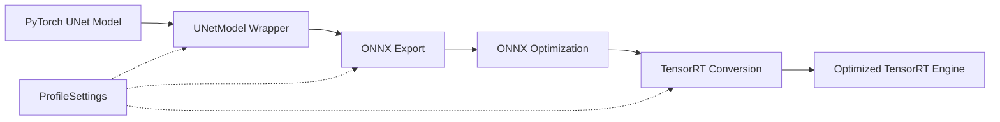
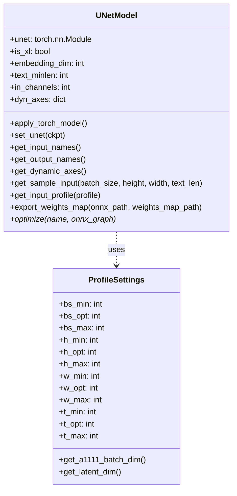
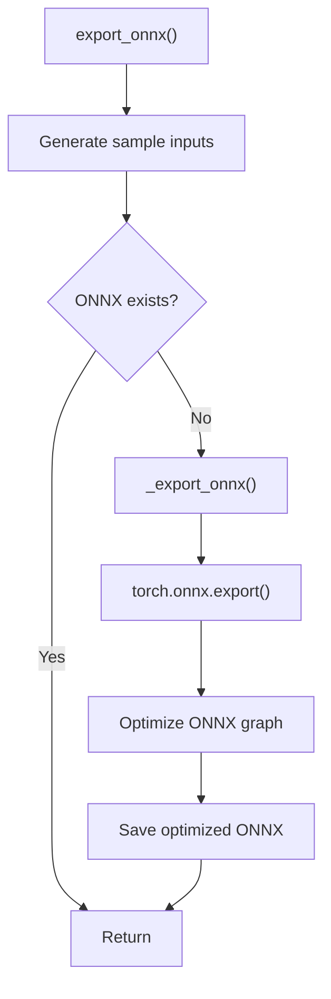
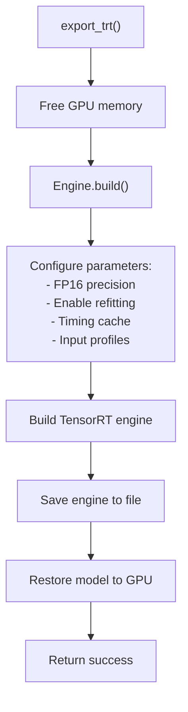
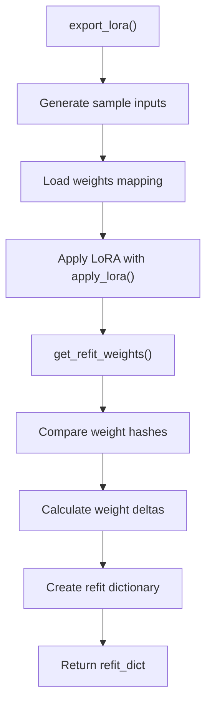

<!-- source: DeepWiki mcp.deepwiki.com · repo NVIDIA/Stable-Diffusion-WebUI-TensorRT · page 3.1 Export Pipeline · fetched 2026-10-26 -->

# Export Pipeline

Relevant source files

The following files were used as context for generating this wiki page:

- [exporter.py](exporter.py)
- [model_helper.py](model_helper.py)

This document details the process of converting PyTorch Stable Diffusion models to optimized TensorRT engines. The export pipeline is a critical component that transforms models through multiple stages to achieve maximum performance with NVIDIA GPUs.

For information about running inference with exported engines, see [Runtime Integration](#2.1). For details on configuring export profiles, see [Configuration System](#3.3).

## Overview

The Export Pipeline transforms Stable Diffusion's UNet model from PyTorch through ONNX to TensorRT engines. This multi-stage conversion enables optimized inference while preserving model accuracy.

Sources: [exporter.py:138-244](), [model_helper.py:35-50]()

## UNetModel Wrapper

The `UNetModel` class wraps the UNet component of Stable Diffusion to prepare it for export. This wrapper handles the configuration of dynamic shapes, input/output naming, and provides sample inputs for the export process.

### Key Features

- Manages dynamic axes for variable batch sizes and dimensions
- Provides sample inputs for ONNX export
- Configures input profiles for TensorRT optimization
- Exports weight mappings between PyTorch and ONNX models
- Disables checkpoint functionality for export compatibility

Sources: [model_helper.py:35-216]()

## ONNX Export Process

The ONNX export process converts the PyTorch UNet model to ONNX format with optimizations. This step is crucial for compatibility with TensorRT.

### Export Function

The `export_onnx` function handles the ONNX export process with the following steps:

1. Generate sample inputs based on profile settings
2. Export using `torch.onnx.export` with dynamic axes
3. Apply ONNX optimizations 
4. Save the optimized ONNX model

Sources: [exporter.py:138-164](), [exporter.py:167-221]()

### ONNX Optimization

The `Optimizer` class implements several optimization techniques:

1. Graph cleanup to remove unused nodes
2. Constant folding to collapse operations with constant inputs
3. Shape inference to propagate tensor dimensions
4. Final cleanup for the optimized graph

Sources: [model_helper.py:230-282]()

## TensorRT Engine Generation

The `export_trt` function converts the optimized ONNX model to a TensorRT engine using the `Engine` class from the utilities module.

### Engine Building Process

1. Free GPU memory by moving the model to CPU
2. Configure engine building parameters like precision and profiles
3. Build the TensorRT engine with optimization flags
4. Restore the model to GPU and return success status

Sources: [exporter.py:223-244]()

## LoRA Integration in Export Pipeline

The export pipeline supports LoRA models with specialized functions for extracting and applying LoRA weights.

### LoRA Export Process

1. Apply LoRA weights to the UNet model
2. Generate the weight mapping between PyTorch and ONNX
3. Calculate weight deltas between base and LoRA models
4. Create a refit dictionary for TensorRT engine updates

Sources: [exporter.py:88-119](), [exporter.py:28-48](), [exporter.py:51-85]()

## Weight Mapping and Refitting

To support LoRA and other model adaptations, the export pipeline includes functionality to map weights between PyTorch and ONNX/TensorRT formats.

### Weight Mapping Process

1. Extract ONNX initializers (weights) with their hash values
2. Match PyTorch weights to ONNX initializers by comparing hashes
3. Handle weight transformations like transposing
4. Create a mapping dictionary for future refitting operations

Sources: [model_helper.py:151-214](), [exporter.py:51-85]()

## Export Pipeline Utility Functions

The export pipeline includes several utility functions for special cases:

### `swap_sdpa` Decorator

This decorator temporarily disables PyTorch's scaled dot product attention (SDPA) during export for better compatibility with ONNX.

### External Data Handling

For large models, the export process can use external data storage to handle ONNX files exceeding size limits.

Sources: [exporter.py:122-135](), [exporter.py:167-221]()

## Export Pipeline Integration

The export pipeline integrates with other parts of the system through shared configuration and model management:

- Receives input profiles from `ProfileSettings` in the configuration system
- Updates the model manager with new engine information
- Interfaces with the UI components for user-triggered exports
- Supports the LoRA system for fine-tuned models

Sources: [exporter.py:21-26]()

This export pipeline transforms PyTorch models into optimized TensorRT engines, enabling significantly faster inference while maintaining model quality. The multi-stage approach provides both flexibility and performance optimization.

---

