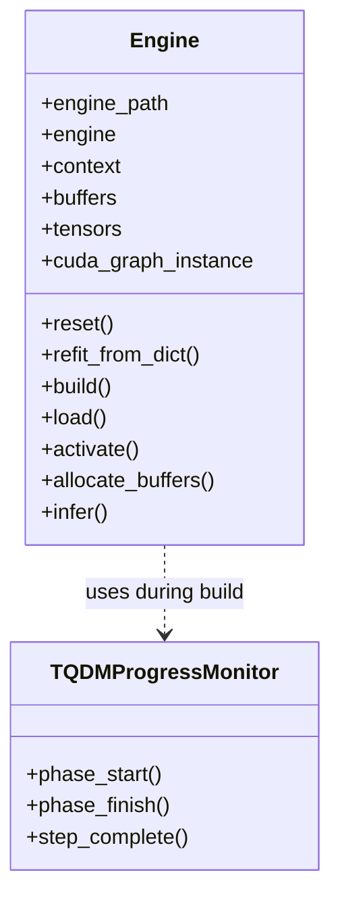
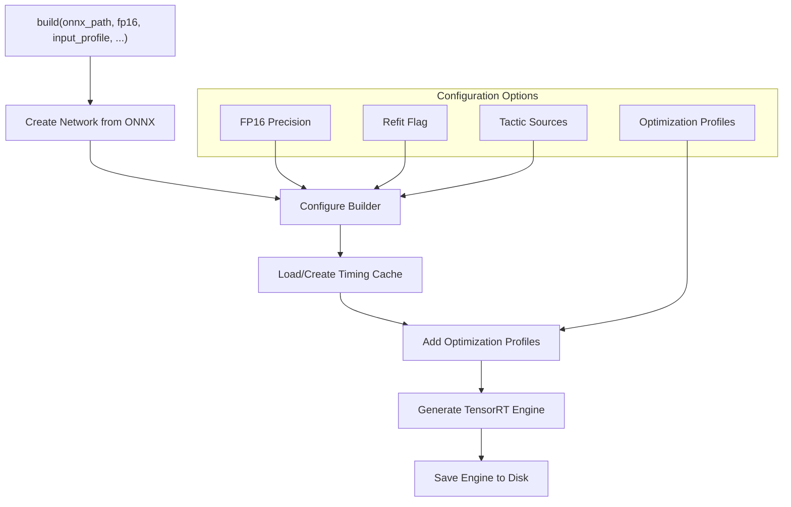
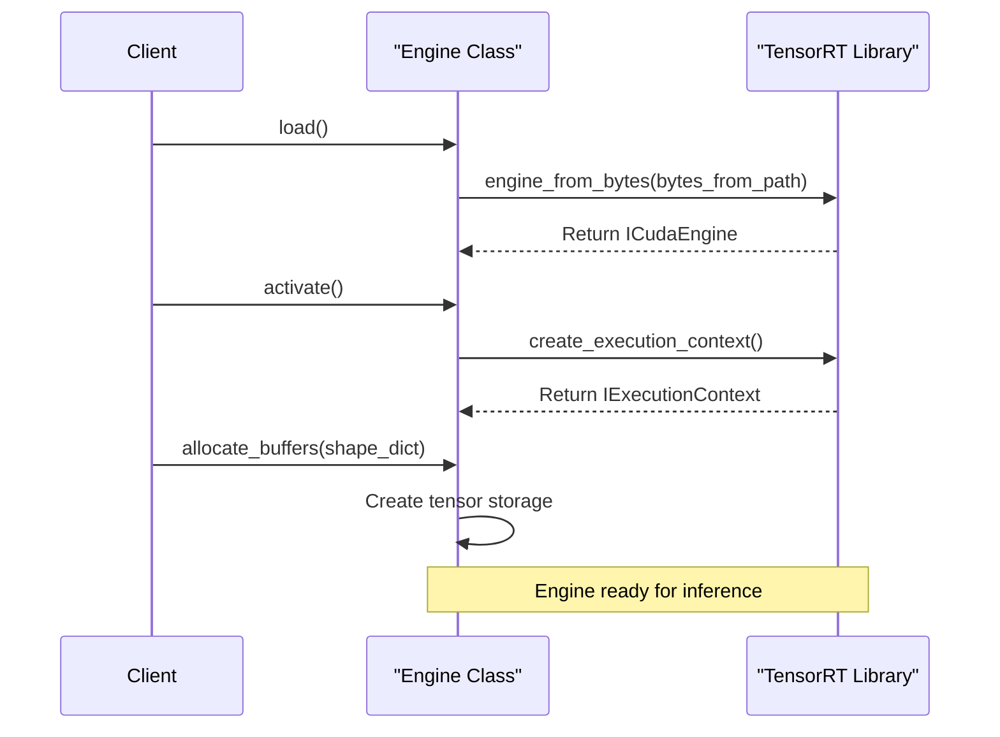
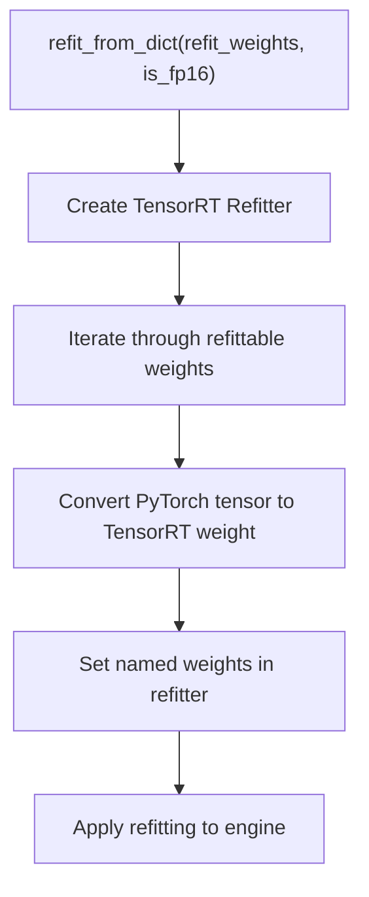
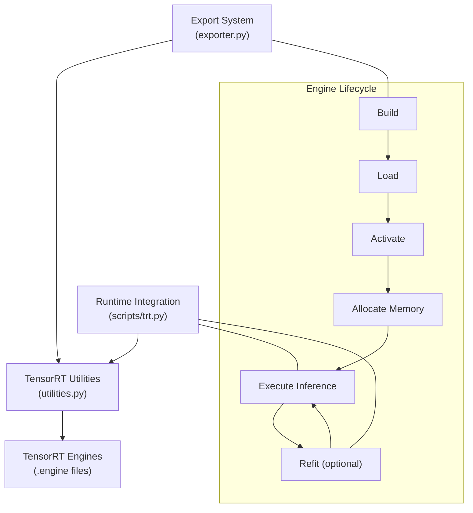

<!-- source: DeepWiki mcp.deepwiki.com · repo NVIDIA/Stable-Diffusion-WebUI-TensorRT · page 3.2 TensorRT Utilities · fetched 2026-10-26 -->

# TensorRT Utilities

<details>
<summary>Relevant source files</summary>

The following files were used as context for generating this wiki page:

- [utilities.py](utilities.py)

</details>


This page documents the utilities for building, loading, and running inference with TensorRT engines in the Stable Diffusion WebUI TensorRT extension. These utilities serve as the core infrastructure for working with TensorRT engines throughout the extension. For information about the overall export pipeline, see [Export Pipeline](#3.1), and for information about runtime integration, see [Runtime Integration](#2.1).

## Overview

The TensorRT Utilities provide essential functions and classes to handle the lifecycle of TensorRT engines, from creation to inference. The primary component is the `Engine` class, which encapsulates all operations related to TensorRT engines.



Sources: [utilities.py:134-331](), [utilities.py:63-132]()

## Engine Class

The `Engine` class is the central component for managing TensorRT engines. It handles building, loading, and executing TensorRT engines with appropriate memory management.

### Key Attributes

| Attribute | Type | Description |
|-----------|------|-------------|
| `engine_path` | string | Path to the serialized TensorRT engine file |
| `engine` | TensorRT.ICudaEngine | The loaded TensorRT engine |
| `context` | TensorRT.IExecutionContext | Context for engine execution |
| `buffers` | OrderedDict | Ordered dictionary of engine buffers |
| `tensors` | OrderedDict | Ordered dictionary of PyTorch tensors for I/O |
| `cuda_graph_instance` | CUDAGraph | CUDA graph for optimized execution (when enabled) |

Sources: [utilities.py:134-145]()

## Engine Building Process

The building process converts an ONNX model into an optimized TensorRT engine, serializes it, and saves it to disk for future use.



The `build` method handles the process of creating a TensorRT engine from an ONNX model:

```python
def build(self, onnx_path, fp16, input_profile=None, enable_refit=False, 
          enable_preview=False, enable_all_tactics=False, 
          timing_cache=None, update_output_names=None)
```

Key parameters include:
- `onnx_path`: Path to the ONNX model
- `fp16`: Whether to enable FP16 precision
- `input_profile`: Optimization profiles for dynamic shapes
- `enable_refit`: Enables engine refitting (updating weights without rebuilding)
- `timing_cache`: Path to a timing cache file for faster engine building

The building process uses a `TQDMProgressMonitor` to display a progress bar during the potentially lengthy engine building process.

Sources: [utilities.py:203-279](), [utilities.py:63-132]()

## Engine Loading and Activation

Once an engine is built and serialized, it can be loaded from disk and activated for inference.



The loading and activation process involves three main steps:

1. **Loading the engine** (`load()`) - Deserializes the engine from disk into memory
2. **Activating an execution context** (`activate()`) - Creates a context for executing inference
3. **Allocating memory** (`allocate_buffers()`) - Allocates memory for inputs and outputs

Sources: [utilities.py:281-307]()

## Inference Execution

The `infer` method executes inference with the loaded engine:


The method handles:
1. Copying input data from the feed dictionary to input tensors
2. Setting tensor addresses in the execution context
3. Executing inference asynchronously on the specified CUDA stream
4. Returning the output tensors containing inference results

This process is highly optimized with NVIDIA NVTX ranges for profiling and performance analysis.

Sources: [utilities.py:309-322]()

## Engine Refitting

A unique capability of TensorRT engines is the ability to update weights without rebuilding the entire engine, which is handled by the `refit_from_dict` method:



This functionality is particularly important for LoRA model integration, allowing quick switching between different LoRA models without rebuilding engines. For more details on LoRA integration, see [LoRA Integration](#4).

Sources: [utilities.py:164-202]()

## TQDMProgressMonitor

The `TQDMProgressMonitor` class implements TensorRT's `IProgressMonitor` interface to provide a user-friendly progress display during engine building.

Key features:
- Hierarchical progress tracking with nested progress bars
- Cancellation support via keyboard interrupt
- Proper handling of phase starts, completions, and step progress

This class significantly improves user experience during the potentially lengthy engine building process by providing visual feedback on progress.

Sources: [utilities.py:63-132]()

## Data Type Utilities

The module also includes utilities for mapping between numpy and PyTorch data types, which are essential for the correct handling of different precision formats during tensor operations:

```python
numpy_to_torch_dtype_dict = {
    np.uint8: torch.uint8,
    np.int8: torch.int8,
    # ... additional mappings
}

torch_to_numpy_dtype_dict = {
    value: key for (key, value) in numpy_to_torch_dtype_dict.items()
}
```

These mappings ensure consistent data type handling across the PyTorch-TensorRT boundary.

Sources: [utilities.py:40-61]()

## Integration with Other Components

The TensorRT Utilities form a core part of the extension's infrastructure, interfacing with several other components:



The utilities are used by:
- The Export System for building engines from ONNX models
- The Runtime Integration for loading engines and executing inference
- The LoRA Integration for refitting engines with new weights

Sources: [utilities.py:134-331]()

## Conclusion

The TensorRT Utilities provide a comprehensive framework for working with TensorRT engines in the context of Stable Diffusion. They handle the complete lifecycle of TensorRT engines from creation to execution, with optimizations for performance and flexibility. These utilities form a critical foundation for the acceleration capabilities of the extension.

---

