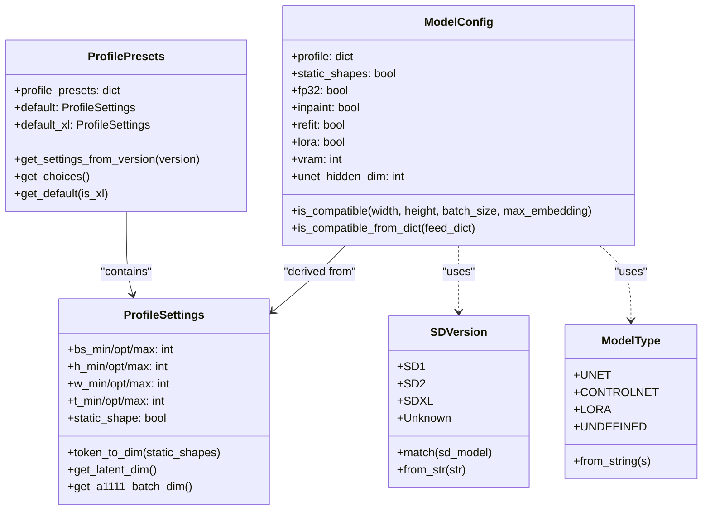
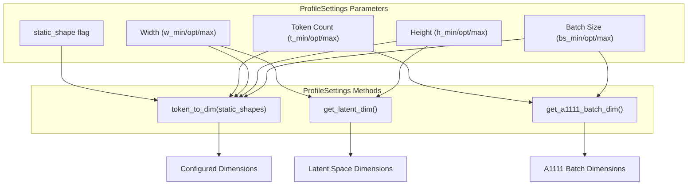
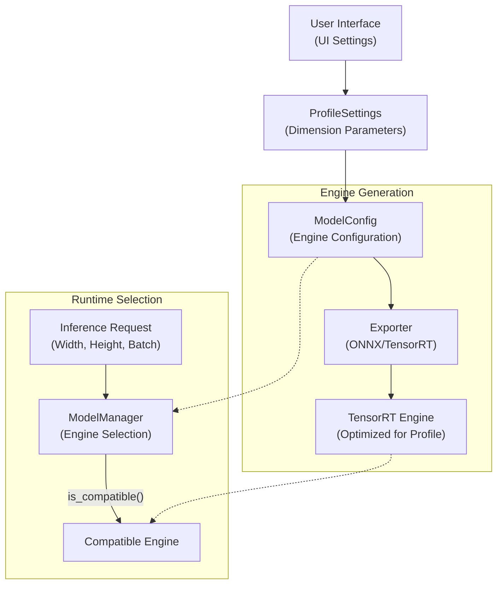

<!-- source: DeepWiki mcp.deepwiki.com · repo NVIDIA/Stable-Diffusion-WebUI-TensorRT · page 3.3 Configuration System · fetched 2026-10-26 -->

# Configuration System

<details>
<summary>Relevant source files</summary>

The following files were used as context for generating this wiki page:

- [datastructures.py](datastructures.py)

</details>


The Configuration System provides a framework for defining, managing, and validating settings that control TensorRT engine generation and usage in the Stable Diffusion WebUI TensorRT extension. This system defines how engines are optimized for different shapes, batch sizes, and model types, playing a crucial role in both engine generation and runtime selection.

For information about the actual process of engine generation, see [Export Pipeline](#3.1).

## Key Components

The configuration system consists of several core data structures defined in `datastructures.py` that work together to specify engine behavior:



Sources: [datastructures.py:7-53](), [datastructures.py:50-106](), [datastructures.py:112-194](), [datastructures.py:196-239]()

## Enumerations and Type System

The configuration system uses enumerations to categorize model types and versions:

### SDVersion Enum

This enum represents different versions of Stable Diffusion models:

```python
class SDVersion(Enum):
    SD1 = 1
    SD2 = 2
    SDXL = 3
    Unknown = -1
```

The `match` method in this enum checks if a provided model matches a specific version, enabling version-specific optimizations.

### ModelType Enum

This enum defines the different types of models that can be optimized:

```python
class ModelType(Enum):
    UNET = 0
    CONTROLNET = 1
    LORA = 2
    UNDEFINED = -1
```

Sources: [datastructures.py:7-34](), [datastructures.py:36-48]()

## Profile Settings

The `ProfileSettings` class is a foundational part of the configuration system, defining dimensional parameters for TensorRT optimization profiles:



Each profile includes:

- **Min/Opt/Max values** for batch size, height, width, and token length
- **Static shape flag** to indicate fixed dimensions

Sources: [datastructures.py:112-194]()

### Static vs. Dynamic Shapes

The configuration system supports two approaches to engine shape handling:

- **Static Shape Engines**: Fixed dimensions, generally faster but less flexible
- **Dynamic Shape Engines**: Support a range of dimensions, more adaptable

When static shapes are enabled via `token_to_dim(static_shapes=True)`, all min/max values are set equal to the optimal values:

```python
if static_shapes:
    self.t_min = self.t_max = self.t_opt
    self.bs_min = self.bs_max = self.bs_opt
    self.h_min = self.h_max = self.h_opt
    self.w_min = self.w_max = self.w_opt
    self.static_shape = True
```

Sources: [datastructures.py:160-170]()

### Dimension Calculations

The `ProfileSettings` class provides methods to handle various dimension calculations:

- `token_to_dim`: Adjusts token lengths to clip tokenizer requirements
- `get_latent_dim`: Converts pixel dimensions to latent space dimensions (dividing by 8)
- `get_a1111_batch_dim`: Handles special batch dimension requirements for WebUI compatibility

Sources: [datastructures.py:160-194]()

## Profile Presets

The `ProfilePresets` class provides predefined configurations for common use cases:

| Preset Name | Dimensions | Batch Size | Type |
|-------------|------------|------------|------|
| 512x512 \| Batch Size 1 | 512×512 | 1 | Static |
| 768x768 \| Batch Size 1 | 768×768 | 1 | Static |
| 1024x1024 \| Batch Size 1 | 1024×1024 | 1 | Static |
| 256x256 - 512x512 \| Batch Size 1-4 | 256×256 to 512×512 | 1-4 | Dynamic |
| 512x512 - 768x768 \| Batch Size 1-4 | 512×512 to 768×768 | 1-4 | Dynamic |
| 768x768 - 1024x1024 \| Batch Size 1-4 | 768×768 to 1024×1024 | 1-4 | Dynamic |

There are also default profiles for standard models and SDXL models, with the SDXL default using larger dimensions due to the model's design.

Sources: [datastructures.py:196-239]()

## Model Configuration

The `ModelConfig` dataclass represents the complete configuration for a TensorRT engine:

```python
@dataclass
class ModelConfig:
    profile: dict
    static_shapes: bool
    fp32: bool
    inpaint: bool
    refit: bool
    lora: bool
    vram: int
    unet_hidden_dim: int = 4
```

Key parameters include:
- **profile**: Dictionary of tensor shapes for inputs
- **static_shapes**: Whether fixed dimensions are used
- **fp32**: Whether to use full precision (FP32) or half precision (FP16)
- **inpaint**: Whether inpainting is supported
- **refit**: Whether engine supports refitting for LoRA
- **lora**: Whether LoRA support is enabled
- **vram**: Estimated VRAM usage
- **unet_hidden_dim**: Hidden dimension for UNet

Sources: [datastructures.py:50-106]()

### Compatibility Checking

One of the most important functions of `ModelConfig` is determining if an engine is compatible with requested dimensions through two methods:

1. `is_compatible`: Checks compatibility with width, height, batch size
2. `is_compatible_from_dict`: Checks compatibility against a tensor parameter dictionary

These methods return both a boolean compatibility result and a "distance" metric that helps select the optimal engine when multiple compatible engines exist.

Sources: [datastructures.py:61-104]()

## Configuration Flow in the System

The configuration components interact with other parts of the system in a specific flow:



1. **Configuration Definition**: User selects profile from UI or uses a preset
2. **Engine Generation**: The exporter uses the configuration to build optimized TensorRT engines
3. **Runtime Selection**: During inference, the model manager selects the appropriate engine based on compatibility with requested dimensions

Sources: [datastructures.py:61-104]()

## Example Workflow

To illustrate how the configuration system works in practice:

1. User selects "512x512 - 768x768 | Batch Size 1-4" profile from the UI
2. The system creates a `ProfileSettings` with parameters:
   - Batch size: min=1, opt=1, max=4
   - Height: min=512, opt=512, max=768
   - Width: min=512, opt=512, max=768
   - Token length: min=75, opt=75, max=150
3. These settings are processed into a `ModelConfig` for the engine generation
4. During inference with a 640×512 image at batch size 2:
   - The model manager calls `is_compatible(640, 512, 2, 77)`
   - The function confirms the dimensions fall within the engine's ranges
   - If multiple engines are compatible, it selects the one with the smallest "distance" from optimal parameters

Sources: [datastructures.py:198-217](), [datastructures.py:74-104]()

## Summary

The Configuration System is a critical component that:

1. Defines the parameters for TensorRT engine optimization
2. Provides flexible options for different use cases through presets
3. Enables precise engine selection at runtime based on compatibility
4. Handles dimension transformations between pixel space, latent space, and batch requirements
5. Balances performance optimization with flexibility through static and dynamic shape options

Its design allows users to create engines optimized for their specific workflow while maintaining compatibility with the WebUI's varying dimension requirements.

Sources: [datastructures.py]()

---

