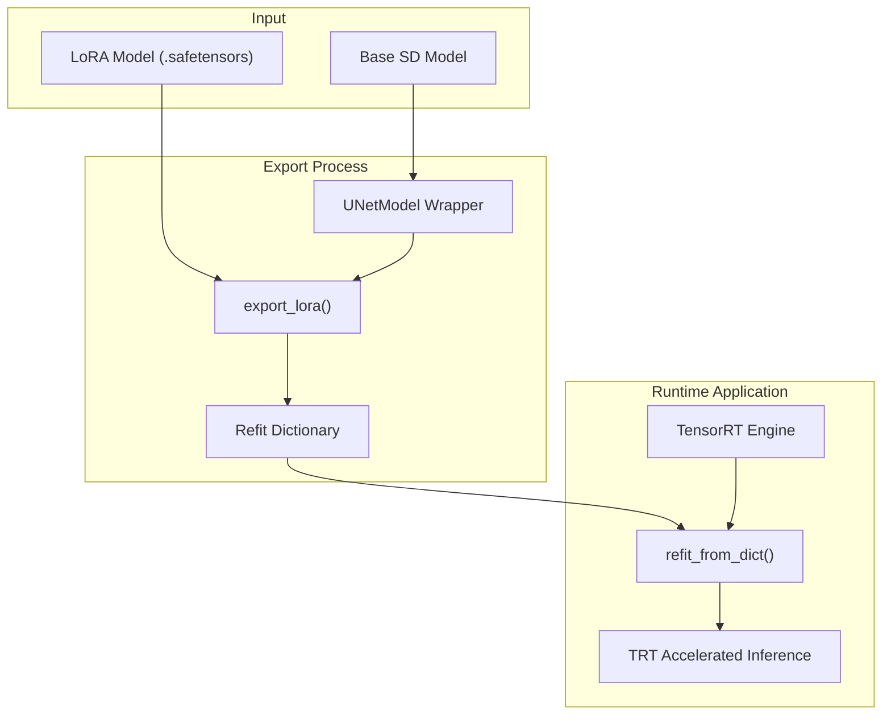
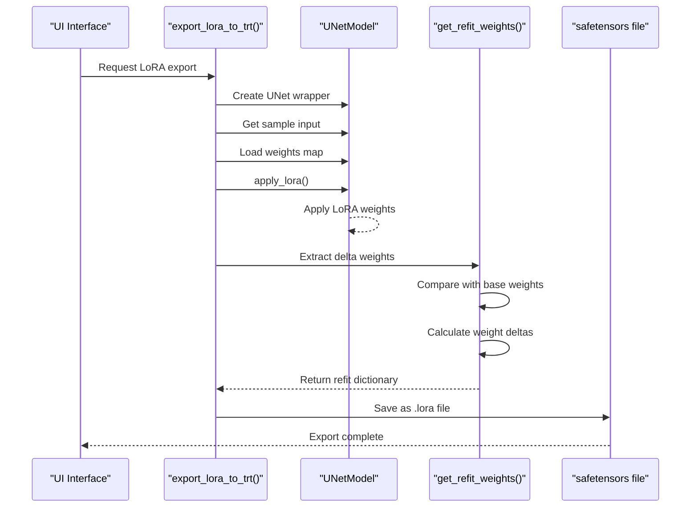
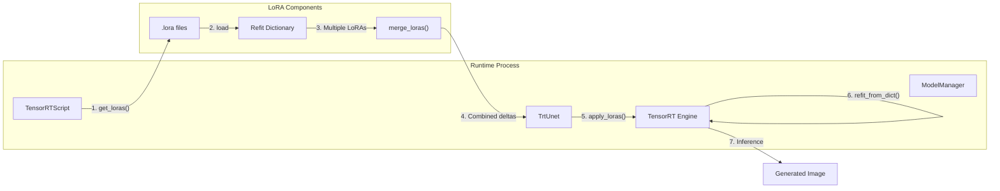
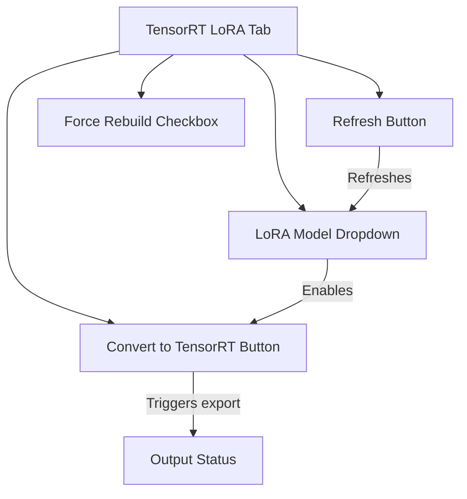

<!-- source: DeepWiki mcp.deepwiki.com · repo NVIDIA/Stable-Diffusion-WebUI-TensorRT · page 4 LoRA Integration · fetched 2026-10-26 -->

# LoRA Integration

<details>
<summary>Relevant source files</summary>

The following files were used as context for generating this wiki page:

- [exporter.py](exporter.py)
- [scripts/lora.py](scripts/lora.py)
- [ui_trt.py](ui_trt.py)

</details>


This document explains how the TensorRT extension integrates LoRA (Low-Rank Adaptation) models with TensorRT-accelerated Stable Diffusion inference. It covers the conversion process from standard LoRA models to TensorRT-compatible format and the runtime application of LoRA weights.

## Overview

LoRA is a parameter-efficient fine-tuning technique that dramatically reduces the number of trainable parameters by adding low-rank matrices to specific layers of the model. The TensorRT extension enables users to export their LoRA models for use with TensorRT-optimized Stable Diffusion, maintaining the quality of LoRA fine-tuning while benefiting from TensorRT acceleration.

### Key Features

- Convert standard Stable Diffusion LoRA models to TensorRT-compatible format
- Apply multiple LoRA models simultaneously with different weights
- Maintain LoRA quality while gaining TensorRT performance benefits
- Seamless integration with the Stable Diffusion WebUI workflow

## Architecture

The following diagram illustrates how LoRA integration fits into the TensorRT extension architecture:



Sources: [exporter.py:28-119](), [scripts/lora.py:1-45]()

The LoRA integration involves two main processes:
1. **Export Process**: Converting LoRA weights to a format compatible with TensorRT engines
2. **Runtime Application**: Applying LoRA weights to the TensorRT engine at inference time

## LoRA Export Process

The export process converts a standard LoRA model into a format that can be applied to TensorRT engines. The detailed workflow is shown below:



Sources: [ui_trt.py:160-227](), [exporter.py:51-119]()

### Key Components in the Export Process

1. **UNet Model Wrapper**: Wraps the UNet component of Stable Diffusion for export
2. **Weight Map**: Maps between PyTorch model weights and ONNX/TensorRT weights
3. **Refit Dictionary**: Contains only the weight deltas (differences) needed for the LoRA adaptation

### Technical Implementation Details

The export process follows these steps:

1. The process starts when a user selects a LoRA model and clicks "Convert to TensorRT" in the UI
2. The system first checks if the base model has been exported to TensorRT
3. A UNet model wrapper is created to handle the export process
4. Sample inputs are generated to match the profile settings
5. The LoRA weights are applied to the UNet model
6. The `get_refit_weights` function compares the modified weights to the original weights
7. Only the weight differences (deltas) are stored in a refit dictionary
8. The refit dictionary is saved as a `.lora` file in the TensorRT models directory

## LoRA Runtime Application

When running inference with LoRA models, the system applies the LoRA weight deltas to the TensorRT engine using the refitting mechanism:



Sources: [scripts/lora.py:11-45]()

### LoRA Weight Application

The runtime system supports applying multiple LoRA models with different weights:

1. When a generation is initiated with LoRA models, the system identifies which `.lora` files to load
2. For multiple LoRAs, the `merge_loras` function combines their weights based on user-specified scales
3. The TensorRT engine is refitted with the combined weight deltas using the `refit_from_dict` method
4. Inference proceeds with the modified weights, applying the LoRA adaptations with TensorRT performance

### Multi-LoRA Support

The system supports applying multiple LoRA models simultaneously, with each one assigned a scale factor:

```
merged_delta = (lora1_weight × scale1) + (lora2_weight × scale2) + ...
```

This implementation can be found in the `merge_loras` function in [scripts/lora.py:11-20]().

## User Interface

The extension provides a dedicated tab for managing LoRA models:



Sources: [ui_trt.py:606-644]()

### Using the LoRA Interface

1. Navigate to the "TensorRT LoRA" tab in the TensorRT interface
2. Click "Refresh" to update the list of available LoRA models
3. Select the LoRA model from the dropdown menu
4. Optionally check "Force Rebuild" to recreate the LoRA file even if it exists
5. Click "Convert to TensorRT" to start the export process
6. The output section will show the export status

## LoRA Model Detection and Compatibility

The system uses several methods to detect and ensure compatibility between LoRA models and base models:

| Detection Method | Implementation | Purpose |
|------------------|----------------|---------|
| File Extension Check | [ui_trt.py:244-248]() | Identifies candidate LoRA files by extension (.pt, .ckpt, .safetensors) |
| Metadata Extraction | [ui_trt.py:255-258]() | Extracts metadata from safetensors files |
| SD Version Matching | [ui_trt.py:176-182]() | Ensures compatibility between LoRA and base SD model |
| Config File Reading | [ui_trt.py:269-274]() | Reads additional configuration from accompanying JSON file |

### SD Version Compatibility

The system checks that the LoRA model's SD version (1.5, 2.1, XL) matches the currently loaded base model:

```python
if not version.match(shared.sd_model):
    print(f"LoRA SD version ({version}) does not match the current SD version ({model_name}).")
```

This check helps prevent applying incompatible LoRA models that could produce unexpected results.

## Technical Considerations

When working with LoRA models in the TensorRT extension, keep these technical details in mind:

1. **Base Model Requirement**: The base model must be exported to TensorRT before any LoRA models can be converted
2. **Storage Efficiency**: Only weight differences are stored, keeping the LoRA files relatively small
3. **Performance Impact**: Using LoRA models adds a small overhead during the engine initialization phase when weights are being refitted, but does not significantly impact inference speed
4. **Safetensors Format**: The system works best with LoRA models in the safetensors format, which also provides metadata about the associated base model

## Related Pages

- For general information about the TensorRT extension, see [Overview](#1)
- For details on the engine generation process, see [Engine Generation](#3)
- For runtime integration of TensorRT models, see [Runtime Integration](#2.1)

---

