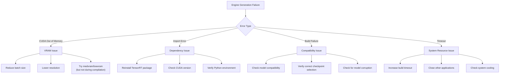
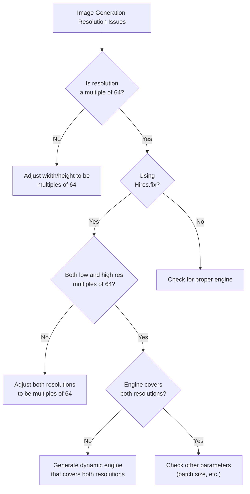
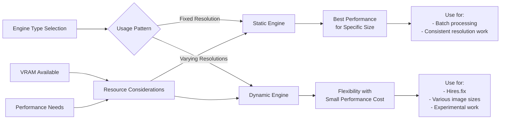
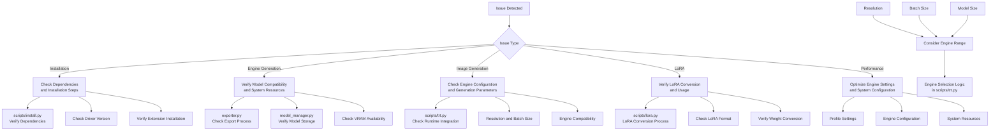

<!-- source: DeepWiki mcp.deepwiki.com · repo NVIDIA/Stable-Diffusion-WebUI-TensorRT · page 5 Troubleshooting and FAQ · fetched 2026-10-26 -->

# Troubleshooting and FAQ

<details>
<summary>Relevant source files</summary>

The following files were used as context for generating this wiki page:

- [.gitignore](.gitignore)
- [LICENSE](LICENSE)
- [README.md](README.md)
- [info.md](info.md)

</details>


This page provides solutions to common issues encountered when using the TensorRT Extension for Stable Diffusion WebUI, along with answers to frequently asked questions. For general usage instructions, see [User Guide](#1.2), and for technical details about engine generation, see [Engine Generation](#3).

## Common Installation Issues

### TensorRT Tab Not Appearing in UI

If the TensorRT tab doesn't appear in the WebUI interface after installation:

1. Check if the extension was properly installed and appears in the Extensions list
2. Verify that the installation process completed without errors
3. Try reinstalling the extension manually using these steps:

```
1. Stop the WebUI
2. Navigate to the extensions directory
3. Delete the TensorRT extension folder
4. Restart the WebUI and reinstall the extension
```

For manual installation troubleshooting, you may need to:
1. Install TensorRT Python package manually
2. Verify CUDA compatibility
3. Check for Python version conflicts

Sources: [README.md:52-54]()

### Driver Compatibility Issues

If you're experiencing crashes or the extension fails to work:

| Operating System | Minimum Driver Version |
|-----------------|------------------------|
| Linux           | 450.80.02 or later     |
| Windows         | 452.39 or later        |

It's always recommended to use the latest drivers for optimal performance.

Sources: [README.md:57-62]()

## Engine Generation Problems

### Engine Building Failures

Here's a troubleshooting flowchart for engine generation issues:



### CMD Arguments Incompatibility

Some command-line arguments that conflict with the TensorRT extension:

| Argument | Issue | Workaround |
|----------|-------|------------|
| `medvram` | Causes issues when compiling engines | Use only during inference, not during engine compilation |
| `lowvram` | Causes issues when compiling engines | Use only during inference, not during engine compilation |
| `api` | May prevent model.json updates | Avoid using with TensorRT extension |

Sources: [README.md:50-54]()

## Image Generation Issues

### Resolution Requirements



### Hires.fix Compatibility

When using Hires.fix, you must ensure:

1. Both initial and upscaled resolutions are multiples of 64
2. You have an engine that covers both resolutions (typically requires a dynamic engine)
3. The engine's batch size settings accommodate your generation parameters

**Example**: If generating at 512×512 and upscaling to 1024×1024, you need a dynamic engine covering the full range.

Sources: [README.md:46-48]()

## LoRA Integration Issues

### LoRA Conversion Problems

If you encounter issues with LoRA conversion:

1. Verify the LoRA checkpoint exists in the correct directory
2. Check that the model format is compatible (supported formats: LoRA, LyCORIS)
3. Ensure the base model type matches your LoRA
4. Look for error messages in the console output for specific issues

### Using Converted LoRAs

To properly use converted LoRAs with TensorRT:

1. LoRAs must first be converted through the "Export LoRA" tab before use
2. Converted LoRAs are used via prompt embedding like standard LoRAs
3. Multiple LoRAs can be used simultaneously

Sources: [README.md:26-32](), [info.md:14-19]()

## Engine Configuration Issues

### Static vs. Dynamic Engines



### Engine Selection Guidelines

| Engine Type | Pros | Cons | Best For |
|-------------|------|------|----------|
| Default (512-768) | Quick setup | Limited range | Getting started |
| Static | Maximum performance | Single resolution only | Dedicated batch work |
| Dynamic (small range) | Good flexibility | Slight performance hit | General use |
| Dynamic (wide range) | Maximum flexibility | Higher VRAM usage | Varied resolution workflows |

Sources: [README.md:36-41](), [info.md:24-28]()

## Frequently Asked Questions

### What are the performance benefits of TensorRT?

TensorRT optimizes Stable Diffusion models for NVIDIA GPUs, providing:
- Faster image generation (typically 1.5-2x speedup)
- More efficient memory usage in some cases
- Optimized performance for specific hardware

### Which models are supported?

The extension supports:
- Stable Diffusion 1.5
- Stable Diffusion 2.1
- SDXL
- SDXL Turbo
- LCM

For SDXL and SDXL Turbo, a GPU with 12GB or more VRAM is recommended.

Sources: [README.md:3-5]()

### Can I use multiple different engines?

Yes, you can generate as many optimized engines as needed for different:
- Models/checkpoints
- Resolution ranges
- Batch sizes

The system will automatically select the appropriate engine based on your current generation parameters.

### Why does the first engine generation take longer?

The first engine built for a specific checkpoint takes longer because:
1. The model weights need to be extracted and processed
2. The ONNX intermediate representation must be created
3. The TensorRT optimization process is more extensive

Subsequent engines for the same checkpoint will build faster as they can reuse some of the intermediate files.

Sources: [README.md:40](), [info.md:28]()

### What should I do if I get "CUDA out of memory" errors?

If you encounter VRAM limitations:
1. Reduce batch size
2. Lower image resolution
3. Use a smaller model
4. Generate a more memory-efficient engine with narrower dynamic ranges
5. Try closing other applications that use GPU memory

### How do I optimize for best performance?

For maximum performance:
1. Use static engines for specific resolutions you use frequently
2. Keep dynamic ranges narrow for dynamic engines
3. Update to the latest NVIDIA drivers
4. Use appropriate batch sizes for your hardware
5. Generate engines specifically optimized for your most common use cases

Sources: [README.md:62]()

### Does the extension work with other WebUI extensions?

The TensorRT extension is generally compatible with other WebUI extensions, but there may be conflicts with extensions that:
- Modify the UNet architecture
- Change the inference process
- Use competing optimization methods

Testing with your specific extension combination is recommended.

### How does this compare to other optimization methods like xFormers?

TensorRT provides more comprehensive optimization than memory-focused solutions like xFormers:
- TensorRT optimizes the entire computational graph, not just specific operations
- It includes kernel fusion, precision calibration, and other deep optimizations
- It's specifically tuned for NVIDIA hardware architecture

You may still use some memory optimizations alongside TensorRT for best results.

## Troubleshooting Pipeline

The following diagram illustrates the general troubleshooting flow when encountering issues with the TensorRT extension:



Sources: [README.md](), [info.md]()