# Page: Overview

# Overview

<details>
<summary>Relevant source files</summary>

The following files were used as context for generating this wiki page:

- [README.md](README.md)
- [info.md](info.md)

</details>


The TensorRT Extension for Stable Diffusion WebUI provides accelerated image generation on NVIDIA RTX GPUs by leveraging NVIDIA's TensorRT optimization framework. This extension converts Stable Diffusion models into highly optimized TensorRT engines, resulting in significantly faster inference speeds while maintaining image quality.

This page provides a high-level overview of the extension's architecture, components, and workflows. For detailed installation instructions, see [Installation and Setup](#1.1). For usage instructions, see [User Guide](#1.2).

## Supported Models and Capabilities

The extension supports:
- Stable Diffusion 1.5 and 2.1
- Stable Diffusion XL and SDXL Turbo
- LCM (Latent Consistency Models)
- LoRA and LyCORIS fine-tuning models (requires conversion)

Sources: [README.md:4-5](), [README.md:26-32]()

## System Architecture

The TensorRT extension consists of several interconnected components that handle model export, engine management, runtime integration, and user interface interactions.

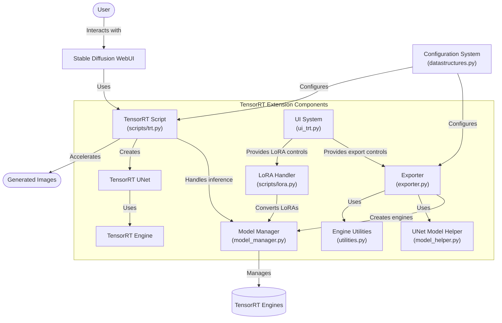

Sources: [README.md:3-5](), [info.md:1-3]()

### Key Components

1. **TensorRT Script (`scripts/trt.py`)**: Integrates with Stable Diffusion WebUI's inference pipeline, replacing the default UNet with optimized TensorRT implementations.

2. **Model Manager (`model_manager.py`)**: Manages the TensorRT engines and provides an interface for finding and loading appropriate engines based on model name, dimensions, and batch size.

3. **Exporter (`exporter.py`)**: Handles the conversion of Stable Diffusion models to optimized TensorRT engines through a multi-stage pipeline.

4. **LoRA Handler (`scripts/lora.py`)**: Manages the conversion of LoRA weights to a format compatible with TensorRT engines.

5. **UI System (`ui_trt.py`)**: Provides the user interface for engine generation, model selection, and configuration.

6. **Configuration System (`datastructures.py`)**: Defines data structures for configuring engine generation profiles, shape dimensions, and optimization settings.

## Engine Generation and Export Pipeline

The core functionality of the extension is converting Stable Diffusion models to optimized TensorRT engines. This process follows a defined pipeline:

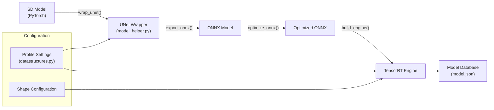

Sources: [README.md:36-40](), [info.md:24-28]()

## Workflow Overview

### Engine Generation Workflow

1. User selects a model and engine configuration (static or dynamic)
2. Exporter wraps the UNet model component
3. The wrapped model is exported to ONNX format
4. The ONNX model is optimized
5. TensorRT builds an optimized engine from the ONNX model
6. The engine is saved and registered in the model database

### Inference Workflow

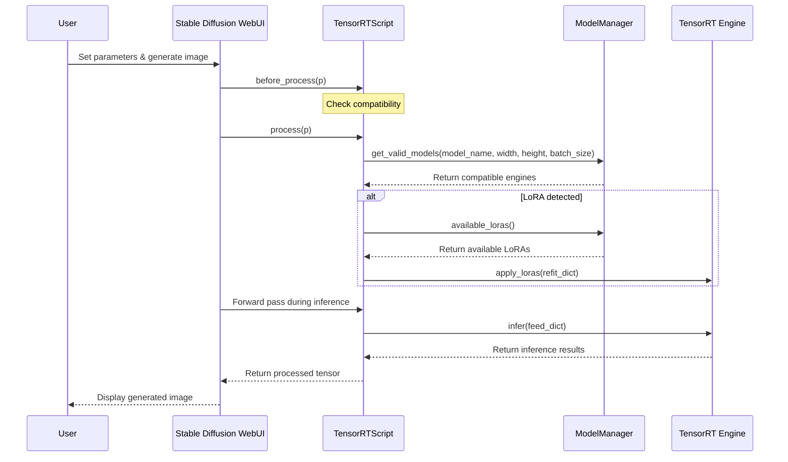

Sources: [README.md:17-24](), [info.md:5-11]()

## Engine Types and Configuration

The extension supports two types of TensorRT engines:

| Engine Type | Description | Use Case |
|-------------|-------------|----------|
| Static | Optimized for a single resolution and batch size | Maximum performance for specific dimensions |
| Dynamic | Supports a range of resolutions and batch sizes | Flexibility with a small performance cost |

The default engine generation creates:
- For SD 1.5 and 2.1: Engines supporting resolutions from 512×512 to 768×768 with batch sizes 1-4
- For SDXL: An engine supporting 1024×1024 resolution with batch size 1

Sources: [README.md:36-40](), [info.md:24-28]()

## LoRA Integration

LoRA models require conversion before use with the TensorRT extension:

1. User selects a LoRA checkpoint from the dropdown in the Export LoRA tab
2. The extension converts the weights to a TensorRT-compatible format
3. Converted LoRAs can be used normally through the prompt embedding interface
4. At runtime, the TensorRT engine applies the LoRA weights through a refit operation

Sources: [README.md:26-32](), [info.md:14-19]()

## Limitations and Requirements

- Resolution must be a multiple of 64 pixels
- When using hires.fix, both low and high resolutions must be multiples of 64
- For hires.fix, a single dynamic engine must cover both the initial and upscaled resolutions
- SDXL models recommend 12GB+ VRAM for optimal performance
- Incompatible with `medvram` and `lowvram` command-line options

Sources: [README.md:44-54](), [README.md:56-62]()

---

# Page: Installation and Setup

# Installation and Setup

<details>
<summary>Relevant source files</summary>

The following files were used as context for generating this wiki page:

- [README.md](README.md)
- [info.md](info.md)
- [install.py](install.py)

</details>


This document provides instructions for installing and setting up the TensorRT Extension for Stable Diffusion WebUI. The extension enables optimized performance on NVIDIA RTX GPUs by leveraging TensorRT acceleration. For information about using the extension after installation, please see [User Guide](#1.2).

## System Requirements

Before installing the extension, ensure your system meets the following requirements:

| Component | Minimum Requirement |
|-----------|---------------------|
| GPU       | NVIDIA RTX series   |
| Driver    | Linux: ≥ 450.80.02<br>Windows: ≥ 452.39 |
| VRAM      | 8GB minimum<br>12GB+ recommended for SDXL |

Sources: [README.md:56-62]()

## Installation Process

The TensorRT extension integrates seamlessly with the Stable Diffusion WebUI as an extension. Here's the installation flow:

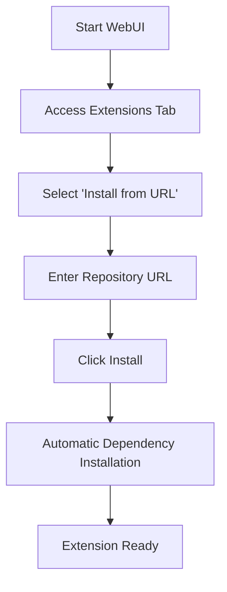

### Step-by-Step Installation

1. Start the Stable Diffusion WebUI (typically by running `webui.bat` on Windows)
2. Navigate to the **Extensions** tab
3. Click on **Install from URL**
4. Enter the repository URL: `https://github.com/NVIDIA/Stable-Diffusion-WebUI-TensorRT`
5. Click **Install**
6. The extension will automatically install the required dependencies

Sources: [README.md:7-15]()

## Dependency Management

The extension relies on several NVIDIA libraries and components for TensorRT acceleration. These dependencies are automatically installed by the extension's `install.py` script.

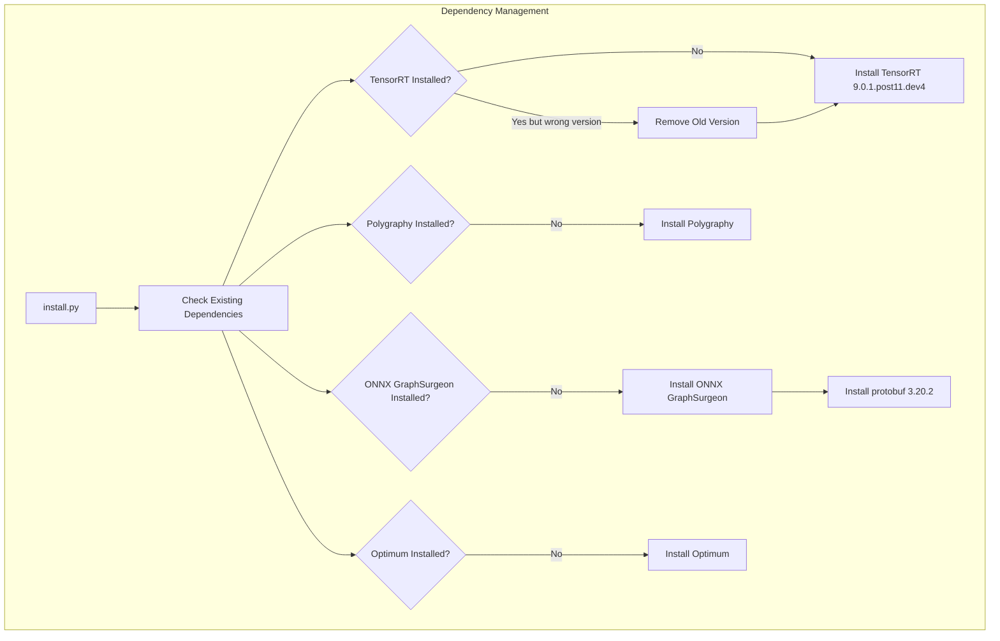

The dependency installation process includes:

| Dependency | Purpose | Installation Source |
|------------|---------|---------------------|
| TensorRT   | Core acceleration library | NVIDIA PyPI (`https://pypi.nvidia.com`) |
| Polygraphy | Network optimization toolkit | NVIDIA NGC (`https://pypi.ngc.nvidia.com`) |
| ONNX GraphSurgeon | ONNX model manipulation | NVIDIA NGC (`https://pypi.ngc.nvidia.com`) |
| Optimum | Model optimization framework | PyPI |

Sources: [install.py:7-70]()

### Technical Details

The installation script performs several important functions:

1. **Version Management**: Ensures specific versions of libraries are installed (e.g., TensorRT 9.0.1.post11.dev4)
2. **Dependency Cleanup**: Removes conflicting or outdated dependencies
3. **Prerequisite Handling**: Installs required components in the correct order

The script uses the WebUI's `launch` module to manage pip installations and check for existing packages.

Sources: [install.py:7-70]()

## Post-Installation Setup

After installing the extension, additional setup is required before you can use TensorRT acceleration:

### 1. Generate TensorRT Engines

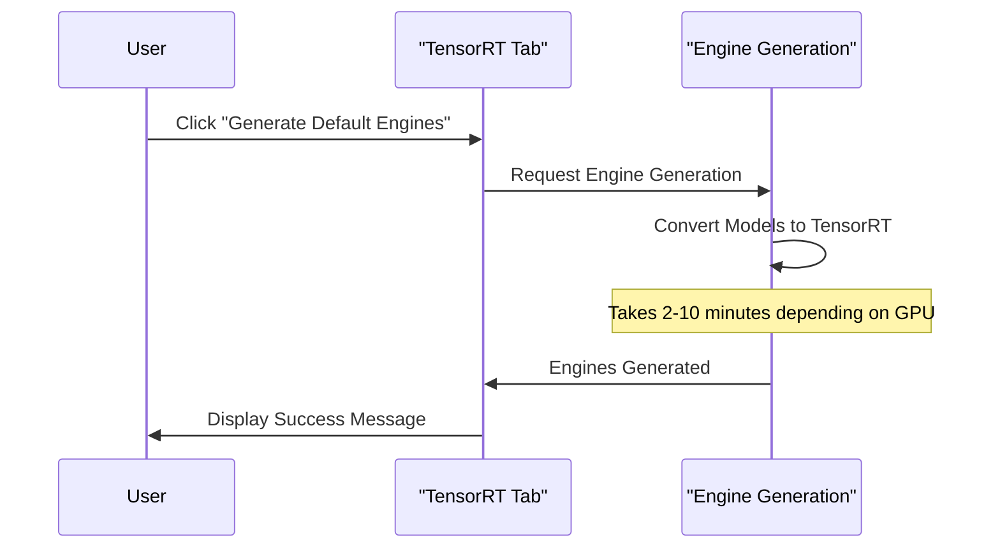

The first step is to generate optimized TensorRT engines for your models:

1. Go to the **TensorRT** tab in the WebUI
2. Click the **Generate Default Engines** button
3. Wait for the process to complete (typically 2-10 minutes depending on your GPU)

This process creates optimized engines for standard resolutions and batch sizes:
- For SD 1.5/2.1: Resolutions between 512×512 and 768×768 with batch sizes 1-4
- For SDXL: Resolution of 1024×1024 with batch size of 1

Sources: [README.md:17-22](), [info.md:6-10](), [info.md:24-28]()

### 2. Configure Quick Settings

To enable easy switching between standard and TensorRT acceleration:

1. Go to **Settings → User Interface → Quick Settings List**
2. Add `sd_unet` to the list
3. Apply the settings and reload the UI
4. Back in the main UI, select "Automatic" from the `sd_unet` dropdown (if not already selected)

Sources: [README.md:17-22](), [info.md:6-10]()

## Troubleshooting Common Installation Issues

| Issue | Cause | Solution |
|-------|-------|----------|
| TensorRT tab missing | Failed installation | [Manual installation](https://github.com/NVIDIA/Stable-Diffusion-WebUI-TensorRT/issues/27#issuecomment-1767570566) |
| Installation errors with command arguments | Compatibility issues with `medvram`, `lowvram`, or `api` flags | Remove these flags when starting WebUI |
| LoRA models not working | LoRAs need conversion to TensorRT format | Use the "Export LoRA" tab to convert LoRAs |

If the installation fails automatically, you may need to manually install the dependencies as specified in the `install.py` script.

Sources: [README.md:50-54]()

## System Integration

After successful installation and setup, the TensorRT Extension integrates with the Stable Diffusion WebUI as shown:

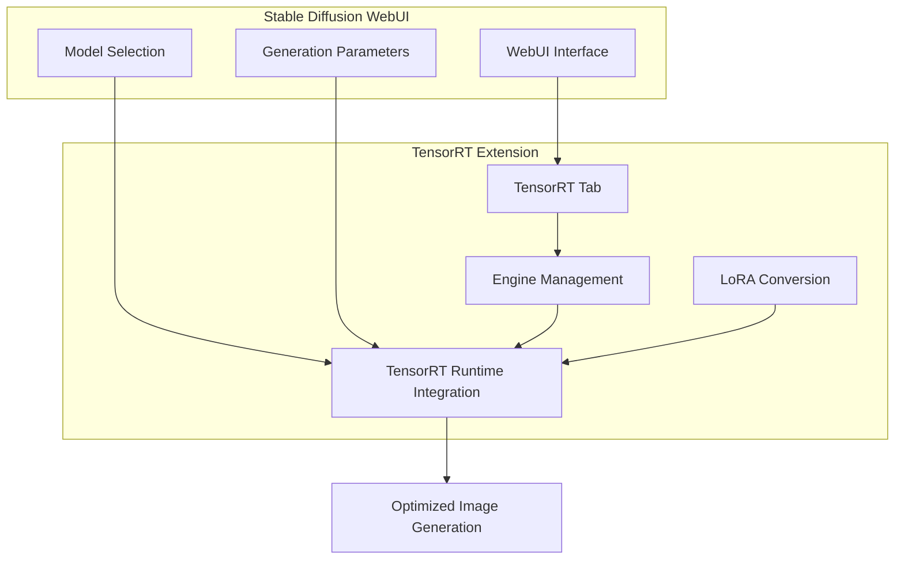

The extension replaces the standard UNet implementation with an optimized TensorRT version, while maintaining compatibility with the WebUI's features.

Sources: [README.md:16-32](), [info.md:5-19]()

## Next Steps

After completing the installation and initial setup:

1. Generate additional engines for specific resolutions if needed
2. Convert any LoRA models you want to use
3. Begin generating images with TensorRT acceleration

For detailed usage instructions, see [User Guide](#1.2).

---

# Page: User Guide

# User Guide

<details>
<summary>Relevant source files</summary>

The following files were used as context for generating this wiki page:

- [README.md](README.md)
- [info.md](info.md)
- [ui_trt.py](ui_trt.py)

</details>


This document provides instructions for using the TensorRT Extension for Stable Diffusion WebUI. It covers the basic usage workflow, engine generation, LoRA model conversion, and troubleshooting steps. For information about installation, see [Installation and Setup](#1.1). For details about the system architecture, see [System Architecture](#2).

## Basic Usage Workflow

The TensorRT extension accelerates Stable Diffusion image generation on NVIDIA GPUs by using optimized TensorRT engines. Follow these steps to use the extension:

1. Generate TensorRT engines for your models
2. Configure the WebUI to use TensorRT
3. Generate images with accelerated performance

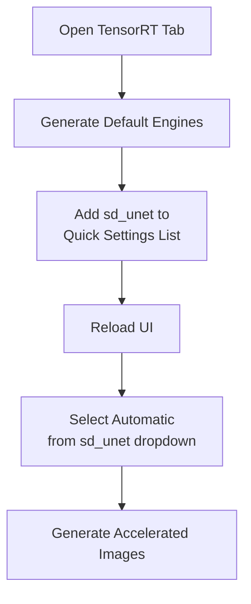

Sources: [README.md:16-23](), [info.md:5-11](), [ui_trt.py:404-411]()

## Generating TensorRT Engines

TensorRT engines are optimized for specific models, resolutions, and batch sizes. You must generate engines before you can use them for image generation.

### Default Engines

The simplest approach is to generate default engines that work for common use cases:

1. Go to the TensorRT tab in the WebUI
2. Click "Export Default Engine"
3. Wait for the export process to complete (typically 2-10 minutes depending on your GPU)

For Stable Diffusion 1.5 and 2.1, default engines support resolutions between 512×512 and 768×768 with batch sizes 1 to 4. For SDXL, default engines support 1024×1024 resolution with batch size 1.

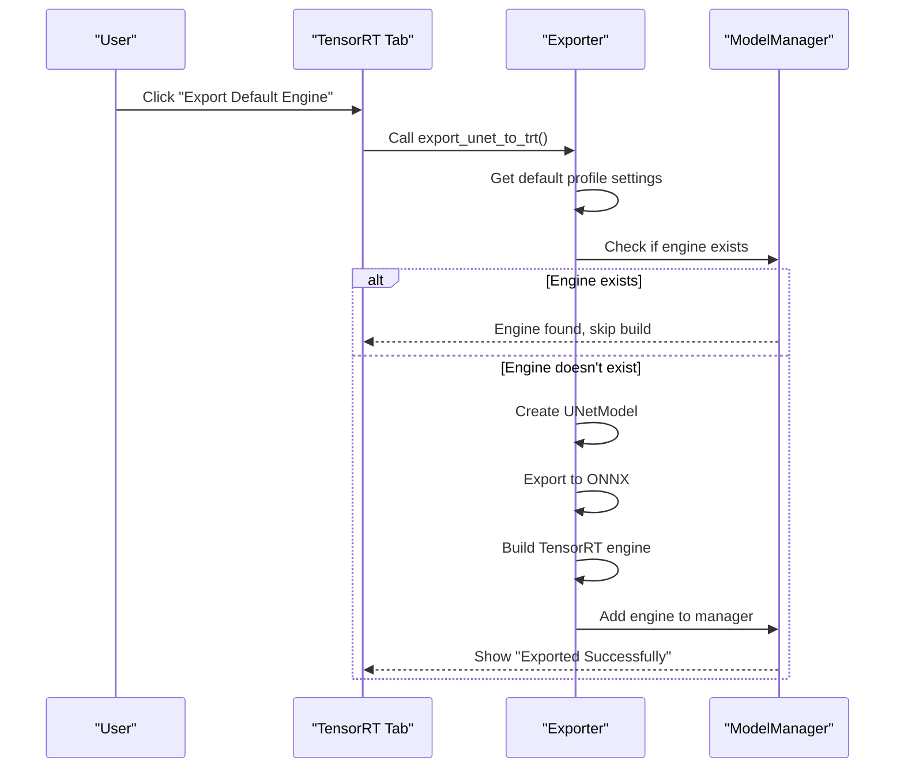

Sources: [ui_trt.py:45-157](), [ui_trt.py:549-559](), [info.md:24-28]()

### Custom Engines

You can create custom engines with specific settings:

1. Go to the TensorRT tab
2. Select a preset from the "Preset" dropdown or choose "Custom" for full control
3. For custom engines, click "Advanced Settings" to configure:
   - Static/dynamic shapes
   - Batch size ranges
   - Height/width ranges
   - Token count ranges
4. Click "Export Engine"

#### Static vs Dynamic Engines

- **Static engines**: Optimized for a single resolution and batch size
- **Dynamic engines**: Support a range of resolutions and batch sizes with slightly lower performance

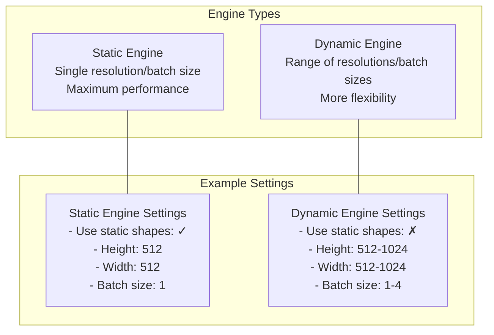

Sources: [ui_trt.py:422-546](), [info.md:24-28](), [README.md:36-41]()

## Enabling TensorRT in the WebUI

After generating engines, you need to configure the WebUI to use them:

1. Go to Settings → User Interface → Quick Settings List
2. Add `sd_unet` to the list
3. Apply settings and reload the UI
4. In the main UI, select "Automatic" from the sd_unet dropdown at the top of the page

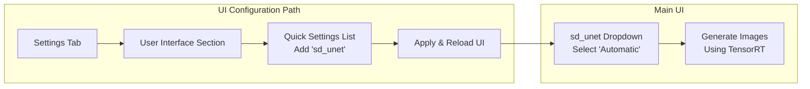

Sources: [README.md:19-22](), [info.md:7-10]()

## Working with LoRA Models

To use LoRA models with TensorRT, they must first be converted to a compatible format:

1. Go to the TensorRT tab, then select the "TensorRT LoRA" sub-tab
2. Click "Refresh" to see available LoRA models
3. Select a LoRA model from the dropdown
4. Click "Convert to TensorRT"
5. Wait for the conversion to complete (typically around 20 seconds)

After conversion, you can use the LoRA models normally by including them in your prompts with the standard syntax.

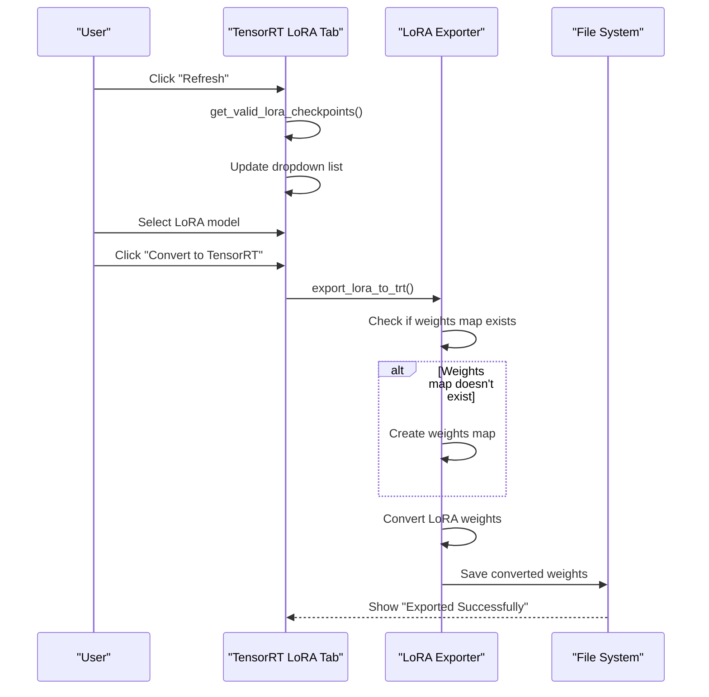

Sources: [ui_trt.py:160-227](), [ui_trt.py:606-641](), [README.md:26-32](), [info.md:14-19]()

## Available Engines and Profiles

You can view all available engines and their profiles:

1. Go to the TensorRT tab
2. Scroll down to the "Available TensorRT Engine Profiles" section
3. Click the refresh button if needed
4. Expand model entries to see detailed profile information

Each profile shows:
- Height range (min, optimal, max)
- Width range (min, optimal, max)
- Batch size range (min, optimal, max)
- Text length range (min, optimal, max)

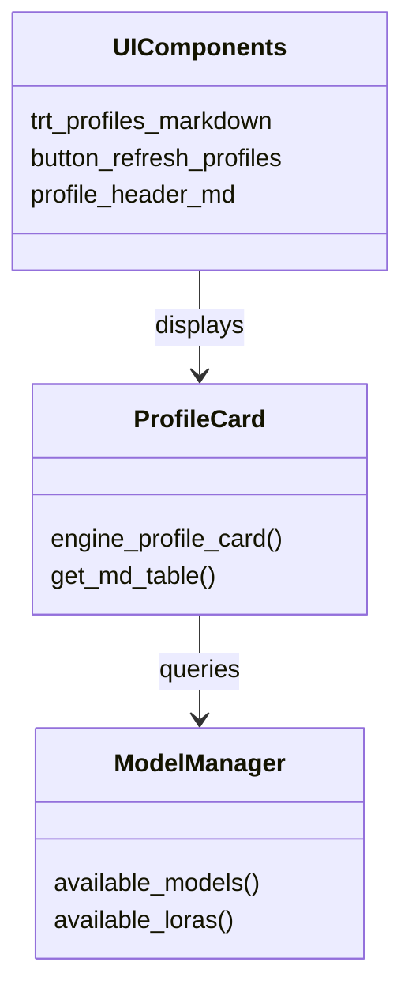

Sources: [ui_trt.py:658-691](), [ui_trt.py:325-399]()

## Advanced Configuration

The TensorRT extension provides several advanced configuration options:

### Engine Profile Settings

When creating custom engines, you can configure:

| Setting | Description | Default | Range |
|---------|-------------|---------|-------|
| Batch size | Number of images to generate in parallel | 1-4 | 1-16 |
| Height | Image height in pixels | 512-768 | 256-4096 |
| Width | Image width in pixels | 512-768 | 256-4096 |
| Token count | Maximum prompt length | 75-150 | 75-750 |

Note: All dimensions must be multiples of 64 for both generation and hires.fix.

### Force Rebuild

Enable the "Force Rebuild" option to regenerate an engine even if one already exists with the same settings. This is useful when:
- Your engine has become corrupted
- You've updated your GPU driver and want to take advantage of new optimizations
- You're experiencing issues with an existing engine

Sources: [ui_trt.py:422-546](), [README.md:46-48]()

## Limitations and Common Issues

### Resolution Requirements

- Image dimensions (width and height) must be multiples of 64
- This applies to both the base resolution and the hires.fix resolution

### Hires.fix Compatibility

When using hires.fix, you must have an engine that covers both resolutions:
- If using 512×512 initial and 1024×1024 final resolution, you need a dynamic engine that covers the full range
- Both the low and high resolutions must be multiples of 64

### Conflicting Command Line Arguments

Certain command line arguments may cause issues:
- `medvram` and `lowvram` can cause engine compilation failures
- `api` may prevent model.json from being updated correctly

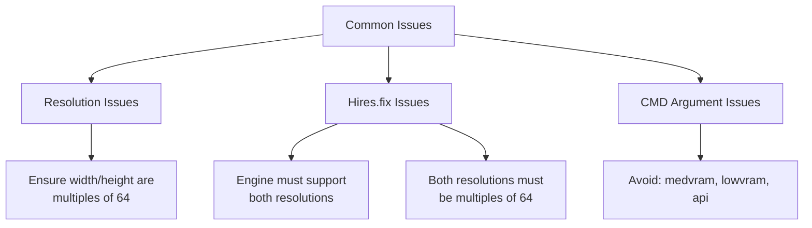

Sources: [README.md:44-54]()

## Performance Tips

For best performance:

1. **Use static engines** when possible for maximum performance
2. **Keep dynamic ranges narrow** for better performance when using dynamic engines
3. **Match engine settings to your common use case**:
   - If you generally use 512×512, prioritize optimizing for that size
   - If you use batch sizes of 1, don't waste VRAM on larger batch sizes
4. **Keep your GPU drivers up to date** for system-wide performance improvements

Sources: [README.md:36-41](), [README.md:62-63]()

---

# Page: System Architecture

# System Architecture

<details>
<summary>Relevant source files</summary>

The following files were used as context for generating this wiki page:

- [model_manager.py](model_manager.py)
- [scripts/trt.py](scripts/trt.py)
- [ui_trt.py](ui_trt.py)

</details>


## Purpose and Scope

This document describes the high-level architecture of the TensorRT Extension for Stable Diffusion WebUI. It outlines the key components, their relationships, and how they work together to accelerate Stable Diffusion inference using NVIDIA's TensorRT optimization. For installation instructions, see [Installation and Setup](#1.1), and for information about using the extension, see [User Guide](#1.2).

## Core Components Overview

The TensorRT Extension consists of several key components that work together to provide accelerated inference capabilities:

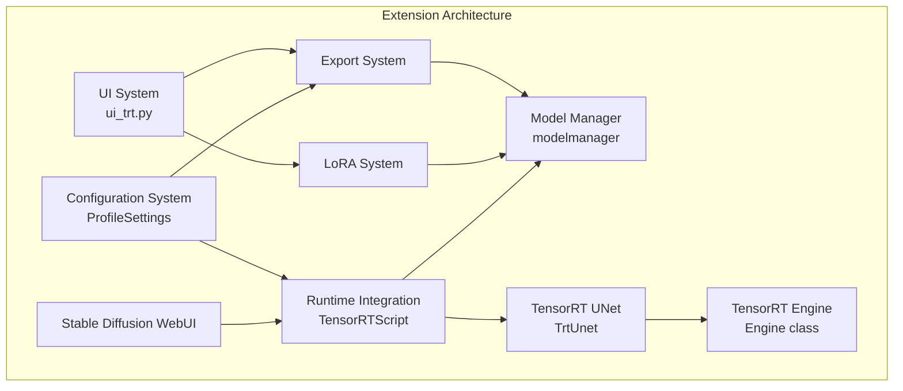

Sources: [ui_trt.py:1-744](), [scripts/trt.py:1-330](), [model_manager.py:1-238]()

The architecture follows a clear separation of concerns:

1. **UI System**: Provides the user interface for exporting models and configuring the extension
2. **Model Manager**: Manages TensorRT engine files and their configuration metadata
3. **Runtime Integration**: Integrates with Stable Diffusion WebUI to intercept and accelerate the UNet forward pass
4. **Engine Utilities**: Handles the loading and execution of TensorRT engines

## Code Structure and Class Relationships

The following diagram shows the primary class relationships and their responsibilities:

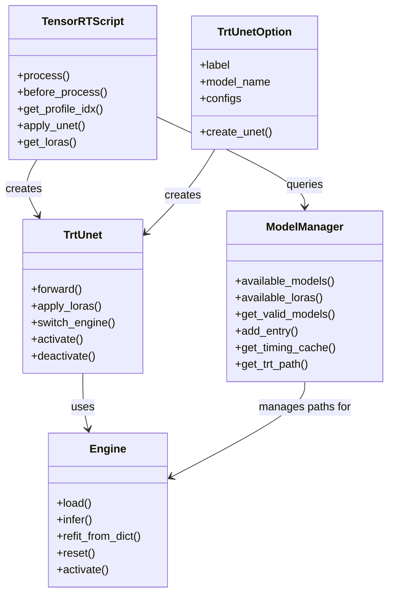

Sources: [scripts/trt.py:22-104](), [scripts/trt.py:107-317](), [model_manager.py:33-235]()

## Runtime Integration Flow

The following sequence diagram shows how the extension integrates with the Stable Diffusion WebUI runtime:

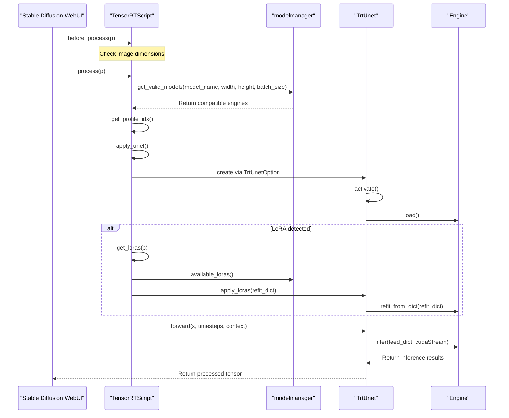

Sources: [scripts/trt.py:107-317](), [scripts/trt.py:48-76]()

## Model Management System

The Model Manager is responsible for tracking available TensorRT engines, matching engines to requirements, and managing file paths.

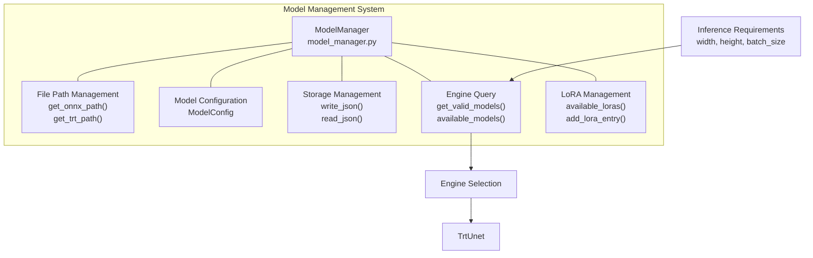

Sources: [model_manager.py:33-235]()

The Model Manager stores metadata about each exported engine, including:

1. Supported dimensions (height, width)
2. Batch size ranges
3. Whether it supports static or dynamic shapes
4. Whether the engine is FP32 or FP16
5. Whether it supports inpainting
6. Whether it supports LoRA refitting

## Export Pipeline

The model export pipeline converts PyTorch UNet models to optimized TensorRT engines:

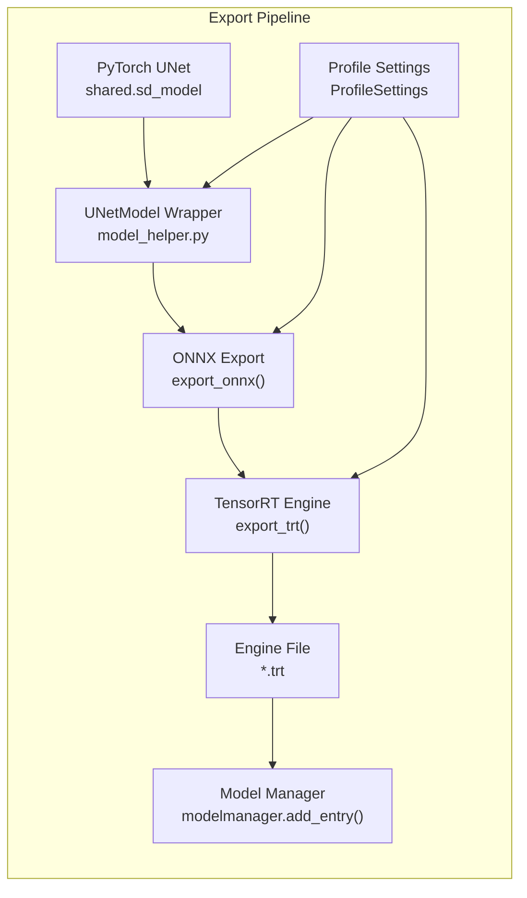

Sources: [ui_trt.py:45-157]()

The export process starts from the UI when a user requests a model export:

1. The current PyTorch model is wrapped in a `UNetModel` object that prepares it for ONNX export
2. Profile settings define the dimension ranges the engine will support
3. The model is exported to ONNX format
4. The ONNX model is converted to a TensorRT engine
5. The engine is registered with the Model Manager

## LoRA Integration

The extension supports LoRA models by converting them to a format that can be applied to TensorRT engines at runtime:

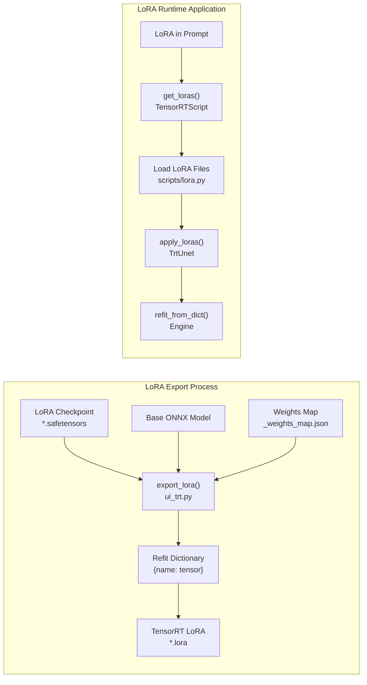

Sources: [ui_trt.py:160-227](), [scripts/trt.py:198-241](), [scripts/trt.py:77-84]()

The LoRA integration has two phases:
1. **Export Phase**: Converting a LoRA checkpoint to a TensorRT-compatible format
2. **Runtime Phase**: Applying the LoRA to a loaded TensorRT engine

## UI System

The UI system provides interfaces for users to:

```mermaid
graph TD
    subgraph "UI Components"
        UITabs["TensorRT Tab\non_ui_tabs()"] --> ExportTab["TensorRT Exporter Tab"]
        UITabs --> LoRATab["TensorRT LoRA Tab"]
        
        ExportTab --> ProfileSettings["Profile Configuration\nProfileSettings"]
        ExportTab --> ExportButton["Export Engine Button\nexport_unet_to_trt()"]
        
        LoRATab --> LoRADropdown["LoRA Model Selection\nget_valid_lora_checkpoints()"]
        LoRATab --> LoRAExport["Convert to TensorRT Button\nexport_lora_to_trt()"]
        
        UITabs --> ProfilesDisplay["Available Engine Profiles\nengine_profile_card()"]
    end
```

Sources: [ui_trt.py:403-743]()

The UI components register with the Stable Diffusion WebUI through the `script_callbacks.on_ui_tabs()` mechanism.

## Runtime Activation Flow

When a user selects a TensorRT UNet for inference, the following activation flow occurs:

```mermaid
flowchart TD
    subgraph "Runtime Activation"
        WebUI["WebUI Image Generation"] --> TRTScript["TensorRTScript.process()"]
        TRTScript --> ProfileIdx["get_profile_idx()\nFind best engine profile"]
        ProfileIdx --> ApplyUnet["apply_unet()\nActivate TensorRT UNet"]
        
        ApplyUnet --> CreateUnet["TrtUnetOption.create_unet()"]
        CreateUnet --> Activate["TrtUnet.activate()"]
        Activate --> LoadEngine["Engine.load()"]
        
        WebUI --> Process["process_batch()"]
        Process --> Forward["TrtUnet.forward()"]
        Forward --> Inference["Engine.infer()"]
    end
```

Sources: [scripts/trt.py:242-266](), [scripts/trt.py:267-296]()

## HiRes Fix Support

The extension supports HiRes Fix by potentially using different engine profiles for the initial generation and the high-resolution refinement:

```mermaid
flowchart TD
    subgraph "HiRes Fix Handling"
        Check["Check HiRes dimensions\nbefore_process()"] --> GetProfiles["get_profile_idx()\nGet both base and hi-res profiles"]
        GetProfiles --> BeforeHR["before_hr()\nSwitch to hi-res profile"]
        BeforeHR --> SwitchEngine["TrtUnet.switch_engine()\nChange to hi-res engine"]
    end
```

Sources: [scripts/trt.py:126-140](), [scripts/trt.py:141-196](), [scripts/trt.py:306-311]()

## TensorRT Script Lifecycle

The `TensorRTScript` class hooks into various stages of the Stable Diffusion generation process:

| Method | Called When | Purpose |
|--------|-------------|---------|
| `before_process()` | Before any processing starts | Check image dimensions |
| `process()` | Before U-Net is initialized | Select and prepare TensorRT engines |
| `process_batch()` | For each batch count | Switch engine profile if needed |
| `before_hr()` | Before high-resolution phase | Switch to high-resolution engine profile |
| `after_extra_networks_activate()` | After networks activate | Apply LoRA weights if needed |

Sources: [scripts/trt.py:107-317]()

## Summary

The TensorRT Extension's architecture provides a modular, flexible system for accelerating Stable Diffusion models with NVIDIA TensorRT. The system handles model management, runtime integration, and LoRA support while maintaining compatibility with the Stable Diffusion WebUI ecosystem.

Key technical strengths of this architecture include:
1. **Separation of concerns** between model management, export, and runtime
2. **Profile-based engine selection** to handle different image dimensions
3. **Runtime LoRA integration** without requiring re-export of models
4. **HiRes Fix support** through profile switching

For more detailed information about specific components, refer to the [Runtime Integration](#2.1), [Model Management](#2.2), and [UI Components](#2.3) pages.

---

# Page: Runtime Integration

# Runtime Integration

<details>
<summary>Relevant source files</summary>

The following files were used as context for generating this wiki page:

- [scripts/trt.py](scripts/trt.py)
- [utilities.py](utilities.py)

</details>


## Purpose and Scope

This document explains how the TensorRT Extension integrates with Stable Diffusion WebUI at runtime to accelerate inference using NVIDIA's TensorRT engines. It covers the process of intercepting calls to the standard UNet during inference, substituting them with optimized TensorRT engines, and handling dynamic engine switching for different resolutions and LoRA models.

For information about the engine generation process, see [Engine Generation](#3), and for details on the underlying model management, see [Model Management](#2.2).

## Architecture Overview

The runtime integration system is designed to seamlessly replace PyTorch's UNet implementation with TensorRT-optimized versions while maintaining compatibility with the Stable Diffusion WebUI pipeline.

```mermaid
flowchart TD
    WebUI["Stable Diffusion WebUI\nInference Pipeline"]
    TRTScript["TensorRTScript\nscripts/trt.py"]
    TrtUnet["TrtUnet\nTensorRT UNet Implementation"]
    ModelManager["ModelManager\nmodel_manager.py"]
    Engine["Engine\nutilities.py"]
    
    WebUI -->|"before_process()\nprocess()"| TRTScript
    TRTScript -->|"create_unet()"| TrtUnet
    TRTScript -->|"get_valid_models()"| ModelManager
    TrtUnet -->|"load()\ninfer()"| Engine
    
    subgraph "Runtime Execution Flow"
        direction TB
        Check["Check dimensions\n& select profile"]
        Replace["Replace UNet with\nTensorRT implementation"]
        LoadEngine["Load appropriate\nTensorRT engine"]
        ApplyLoRA["Apply LoRA weights\n(if required)"]
        Inference["Execute inference\nwith TensorRT"]
    end
    
    TRTScript --- Check
    Check --> Replace
    Replace --> LoadEngine
    LoadEngine --> ApplyLoRA
    ApplyLoRA --> Inference
```

Sources: [scripts/trt.py:107-142](), [scripts/trt.py:22-106]()

## Core Components

### TensorRT Script

The `TensorRTScript` class serves as the entry point that integrates with the Stable Diffusion WebUI's script system. It inherits from the WebUI's `scripts.Script` class and implements several callback methods to intercept the image generation process.

```mermaid
classDiagram
    class TensorRTScript {
        +title()
        +show()
        +before_process(p)
        +process(p, *args)
        +get_profile_idx(p, model_name, model_type)
        +get_loras(p)
        +apply_unet(sd_unet_option)
        +process_batch(p, *args, **kwargs)
        +before_hr(p, *args)
        +after_extra_networks_activate(p, *args, **kwargs)
    }

    class scripts.Script {
        +title()
        +show(is_img2img)
        +setup(p, *args)
        +process(p, *args)
    }

    scripts.Script <|-- TensorRTScript
```

Sources: [scripts/trt.py:107-317]()

### TensorRT UNet Implementation

The `TrtUnet` class implements a TensorRT-accelerated version of the UNet model used in Stable Diffusion.

```mermaid
classDiagram
    class TrtUnet {
        -model_name: str
        -configs: List[dict]
        -profile_idx: int
        -engine: Engine
        +forward(x, timesteps, context)
        +apply_loras(refit_dict)
        +switch_engine()
        +activate()
        +deactivate()
    }

    class sd_unet.SdUnet {
        +forward()
        +activate()
        +deactivate()
    }

    sd_unet.SdUnet <|-- TrtUnet
```

Sources: [scripts/trt.py:32-105]()

### TensorRT Engine

The `Engine` class in `utilities.py` is responsible for the low-level TensorRT operations:

```mermaid
classDiagram
    class Engine {
        -engine_path: str
        -engine: TensorRT.ICudaEngine
        -context: TensorRT.IExecutionContext
        -buffers: OrderedDict
        -tensors: OrderedDict
        +build(onnx_path, fp16, input_profile)
        +load()
        +activate(reuse_device_memory)
        +allocate_buffers(shape_dict, device)
        +infer(feed_dict, stream, use_cuda_graph)
        +refit_from_dict(refit_weights, is_fp16)
    }
```

Sources: [utilities.py:134-331]()

## Integration Workflow

The runtime integration follows these key steps during image generation:

### 1. Script Initialization and Model Selection

When the WebUI starts a generation process, the `TensorRTScript` is activated:

1. `before_process()` verifies that the image dimensions are compatible
2. `process()` checks if a suitable TensorRT engine is available
3. `get_profile_idx()` selects the most appropriate engine profile for the current dimensions

Sources: [scripts/trt.py:126-140](), [scripts/trt.py:141-196](), [scripts/trt.py:242-265]()

### 2. UNet Replacement

Once the appropriate engine is identified, the PyTorch UNet is replaced with a TensorRT implementation:

```mermaid
sequenceDiagram
    participant WebUI as "Stable Diffusion WebUI"
    participant Script as "TensorRTScript"
    participant PyTorch as "PyTorch UNet"
    participant TrtUnet as "TrtUnet"
    participant Engine as "TensorRT Engine"
    
    WebUI->>Script: process(p)
    Script->>Script: get_profile_idx(p, model_name, ModelType.UNET)
    
    alt Engine Available
        Script->>PyTorch: Move to CPU (unload)
        Script->>TrtUnet: create_unet()
        Script->>TrtUnet: set profile_idx
        Script->>TrtUnet: activate()
        TrtUnet->>Engine: load()
    else No Compatible Engine
        Script->>WebUI: Fall back to PyTorch UNet
    end
```

Sources: [scripts/trt.py:267-296]()

### 3. LoRA Integration

If LoRA models are detected in the prompt, they are applied to the TensorRT engine:

1. `get_loras()` extracts LoRA models from the prompt
2. The system checks if the LoRAs are available in TensorRT format
3. `apply_loras()` is called to refit the TensorRT engine with the LoRA weights

Sources: [scripts/trt.py:198-240](), [scripts/trt.py:313-316]()

### 4. Engine Switching for High-Resolution

For high-resolution generation (Hires.fix), the system switches to an appropriate engine profile:

1. `before_hr()` is called when high-resolution generation starts
2. The script switches the engine to one optimized for the high-resolution dimensions
3. `switch_engine()` is used to load the new engine

Sources: [scripts/trt.py:306-311](), [scripts/trt.py:86-89]()

### 5. Inference Execution

During the actual inference, the TensorRT engine performs the computation:

```mermaid
sequenceDiagram
    participant WebUI as "Stable Diffusion WebUI"
    participant TrtUnet as "TrtUnet"
    participant Engine as "Engine"
    
    WebUI->>TrtUnet: forward(x, timesteps, context)
    TrtUnet->>TrtUnet: Prepare feed_dict
    TrtUnet->>Engine: allocate_buffers(feed_dict)
    TrtUnet->>Engine: infer(feed_dict, cudaStream)
    Engine->>TrtUnet: Return processed tensors
    TrtUnet->>WebUI: Return output tensor
```

Sources: [scripts/trt.py:48-75](), [utilities.py:292-322]()

## Error Handling

The system includes several error-handling mechanisms:

1. Checks for compatible engines before attempting to use TensorRT
2. Fallback to PyTorch UNet when no suitable engine is found
3. Validation of image dimensions to ensure compatibility with TensorRT engines
4. Verification that the selected TensorRT engine matches the current Stable Diffusion model

Sources: [scripts/trt.py:128-139](), [scripts/trt.py:248-254](), [scripts/trt.py:160-164](), [scripts/trt.py:178-182]()

## Integration with Stable Diffusion WebUI

The extension integrates with the WebUI through two main callback mechanisms:

1. `script_callbacks.on_list_unets()` - Registers available TensorRT UNet implementations
2. `script_callbacks.on_ui_tabs()` - Adds the TensorRT configuration UI to the WebUI

```python
script_callbacks.on_list_unets(list_unets)
script_callbacks.on_ui_tabs(ui_trt.on_ui_tabs)
```

The `list_unets()` function populates the UNet dropdown in the WebUI with TensorRT options by creating `TrtUnetOption` objects for each available model.

Sources: [scripts/trt.py:319-329]()

## Performance Considerations

The TensorRT runtime integration includes several optimizations:

1. **Memory Management**: The PyTorch UNet is moved to CPU when the TensorRT engine is active, freeing GPU memory
2. **CUDA Streams**: The system uses CUDA streams for asynchronous execution
3. **Buffer Reuse**: Buffers are allocated once and reused to minimize memory operations
4. **Dynamic Profile Selection**: The system selects the optimal engine profile based on image dimensions

Sources: [scripts/trt.py:285-286](), [scripts/trt.py:69](), [utilities.py:292-307]()

## Summary

The TensorRT Runtime Integration system provides a seamless way to accelerate Stable Diffusion inference by:

1. Intercepting calls to the UNet model during the generation process
2. Replacing the standard PyTorch implementation with optimized TensorRT engines
3. Supporting dynamic engine switching for different resolutions
4. Maintaining compatibility with LoRA models through engine refitting
5. Providing automatic fallback to PyTorch when needed

This architecture allows users to benefit from significant performance improvements while maintaining all the functionality of the original Stable Diffusion WebUI.

---

# Page: Model Management

# Model Management

<details>
<summary>Relevant source files</summary>

The following files were used as context for generating this wiki page:

- [model_manager.py](model_manager.py)
- [timing_caches/timing_cache_win_cc75.cache](timing_caches/timing_cache_win_cc75.cache)
- [timing_caches/timing_cache_win_cc75.cache.lock](timing_caches/timing_cache_win_cc75.cache.lock)

</details>


## Purpose and Scope

This document explains how the TensorRT Extension manages TensorRT engine files and LoRA models. Model Management serves as a central registry for tracking, organizing, and retrieving optimized models for inference. This system enables the runtime components to select the appropriate TensorRT engines based on inference parameters such as batch size, image dimensions, and LoRA configurations.

For information about the actual process of converting models to TensorRT engines, see [Engine Generation](#3).

Sources: [model_manager.py:33-236]()

## System Overview

The Model Management system provides a registry for TensorRT engines and LoRA models, maintaining metadata about each engine's capabilities and compatibility requirements. It facilitates runtime model selection by matching inference parameters with compatible engines.

```mermaid
graph TD
    subgraph "Model Management Components"
        MM["ModelManager\nmodel_manager.py"] --- ModelFile[("model.json\nEngine registry")]
        MM --- |"manages"| BaseModels["Base Models"]
        MM --- |"manages"| LoRAModels["LoRA Models"]
    end

    subgraph "File Organization"
        BaseModels --- TRTDir["Unet-trt/\nTensorRT engines"]
        LoRAModels --- LoRADir["LoRA files (.lora)"]
        OnnxDir["Unet-onnx/\nIntermediate ONNX files"]
    end

    subgraph "System Interfaces"
        UI["UI Components"] -->|"engine generation"| MM
        Runtime["Runtime System"] -->|"get_valid_models()"| MM
        Export["Export System"] -->|"add_entry()"| MM
        LoRA["LoRA System"] -->|"add_lora_entry()"| MM
    end

    ModelFile --- |"loads/saves"| ConfigEntries["Model configuration entries"]
```

Sources: [model_manager.py:33-237]()

## Directory Structure

The Model Management system organizes files in the following directory structure:

| Directory | Path | Purpose |
|-----------|------|---------|
| ONNX Models | `models/Unet-onnx/` | Stores intermediate ONNX format models |
| TensorRT Engines | `models/Unet-trt/` | Stores optimized TensorRT engine files |
| LoRA Models | `models/Lora/` | Reference directory for original LoRA models |
| Model Registry | `models/Unet-trt/model.json` | JSON file tracking all available models |

The system automatically creates the necessary directories if they don't exist during initialization.

Sources: [model_manager.py:11-21]()

## Core Functionality

### ModelManager Class

The `ModelManager` class is the central component responsible for tracking and managing TensorRT engines:

```mermaid
classDiagram
    class ModelManager {
        -all_models: dict
        -model_file: str
        -cc: str
        +__init__(model_file)
        +update()
        +add_entry(model_name, model_hash, profile, static_shapes, ...)
        +add_lora_entry(base_model, lora_name, trt_lora_path, ...)
        +write_json()
        +read_json(encode_config)
        +available_models()
        +available_loras()
        +get_timing_cache()
        +get_valid_models(base_model, width, height, batch_size, max_embedding)
        +get_valid_models_from_dict(base_model, feed_dict)
        +get_trt_path(model_name, model_hash, profile, static_shape)
        +get_onnx_path(model_name)
        +get_weights_map_path(model_name)
    }
```

The `modelmanager` is instantiated as a singleton at the module level, providing a shared interface for all components to access model management functionality.

Sources: [model_manager.py:33-237]()

### Initialization and Discovery

Upon initialization, the `ModelManager`:

1. Determines the compute capability of the current NVIDIA GPU
2. Loads the existing model registry from `model.json` if available
3. Verifies that registered models actually exist on disk
4. Removes stale entries for missing engine files

Sources: [model_manager.py:33-44](), [model_manager.py:71-98]()

## Model Registry

### Structure

The model registry uses a hierarchical structure:

```
{
    "cc75": {                    # GPU compute capability
        "sd-v1-5": [             # Base model name
            {
                "filepath": "sd-v1-5_hash_cc75_profile-details.trt",  # Engine filename
                "config": {       # Engine configuration parameters
                    "profile": [...],
                    "static_shapes": true,
                    "fp32": false,
                    "inpaint": false,
                    "refit": true,
                    "lora": false,
                    "vram": 123456,
                    "unet_hidden_dim": 4
                }
            },
            ...more engine variants...
        ],
        ...more base models...
    },
    ...more compute capabilities...
}
```

This structure allows the system to:
- Organize engines by GPU compatibility
- Group variants of the same base model
- Store detailed configuration for each engine variant

Sources: [model_manager.py:155-172]()

### Model Configuration

Each engine is associated with a `ModelConfig` object that stores:

1. Input shape profiles (for dynamic shapes)
2. Whether the engine uses static shapes
3. Precision (FP16 or FP32)
4. Whether it supports inpainting
5. Whether it supports refitting (for LoRA)
6. VRAM requirements
7. Model architecture parameters (UNet hidden dimensions)

This configuration is used to determine which engines are compatible with specific inference requests.

Sources: [model_manager.py:116-118](), [model_manager.py:141-143]()

## Engine Naming and Path Generation

The system uses a structured naming convention for TensorRT engines:

```
<model_name>_<hash>_cc<compute_capability>_<profile_details>.trt
```

The `profile_details` encodes the shape constraints supported by the engine, making each filename unique to its configuration.

```mermaid
flowchart LR
    subgraph "Engine Path Generation"
        direction TB
        A["get_trt_path()"] --> B["Create profile hash"]
        B --> C["Generate filename"]
        C --> D["Return path"]
    end

    subgraph "Inputs"
        M["model_name"]
        H["model_hash"]
        P["profile"]
        S["static_shape"]
    end

    M --> A
    H --> A
    P --> A
    S --> A
```

Sources: [model_manager.py:51-66]()

## Model Selection

### Finding Compatible Models

A key function of the Model Management system is to find engines compatible with specific inference requirements. The `get_valid_models()` method:

1. Takes parameters like image width, height, batch size
2. Checks each engine for the specified base model
3. Tests compatibility using the engine's configuration
4. Returns all compatible engines along with a "distance" metric indicating how well they match

```mermaid
flowchart TD
    A["get_valid_models()"] --> B["Loop through all engines\nfor base model"]
    B --> C{"is_compatible()?"}
    C -->|"Yes"| D["Add to valid_models\nwith distance score"]
    C -->|"No"| E["Skip"]
    D --> F["Return valid_models,\ndistances, indices"]
    E --> B
```

The system can select the optimal engine if multiple are compatible, typically choosing the one with the smallest "distance" from the requested parameters.

Sources: [model_manager.py:213-234](), [model_manager.py:199-211]()

## LoRA Integration

The Model Management system handles LoRA models specially:

1. `add_lora_entry()` registers LoRA-enabled engines
2. `available_loras()` discovers all `.lora` files in the TensorRT directory
3. LoRA engines are linked to their parent base model

This enables the runtime system to apply the appropriate LoRA weights during inference.

Sources: [model_manager.py:138-153](), [model_manager.py:178-185]()

## Singleton Instance

The module creates a singleton instance `modelmanager` that provides a global access point to the model management functionality:

```python
modelmanager = ModelManager()
```

This instance is used by other components in the system to interact with the model registry.

Sources: [model_manager.py:237]()

## Integration with Other Components

### Interaction with Runtime System

The Runtime System uses the Model Manager to:
1. Find compatible engines for specific inference parameters
2. Retrieve available LoRA models
3. Access engine file paths for loading

### Interaction with Export System

The Export System uses the Model Manager to:
1. Register newly created engines with `add_entry()`
2. Obtain paths for storing ONNX and TensorRT files
3. Access timing cache for optimizing engine building

Sources: [model_manager.py:103-136]()

---

# Page: UI Components

# UI Components

<details>
<summary>Relevant source files</summary>

The following files were used as context for generating this wiki page:

- [info.md](info.md)
- [ui_trt.py](ui_trt.py)

</details>


This page documents the user interface components of the TensorRT extension for Stable Diffusion WebUI. These components allow users to interact with the extension, configure TensorRT engine settings, export models, and manage LoRA integrations. For information about the runtime integration of TensorRT, see [Runtime Integration](#2.1), and for details on model management, see [Model Management](#2.2).

## UI Component Overview

The TensorRT extension adds a dedicated tab to the Stable Diffusion WebUI with several key interface components organized for different functionalities.

```mermaid
graph TD
    A["TensorRT Interface"] --> B["TensorRT Exporter Tab"]
    A --> C["TensorRT LoRA Tab"]
    A --> D["Information Panel"]
    A --> E["Output Section"]
    A --> F["Engine Profiles Section"]
    
    B --> G["Preset Dropdown"]
    B --> H["Advanced Settings Accordion"]
    B --> I["Export Buttons"]
    
    C --> P["LoRA Refresh Button"]
    C --> Q["LoRA Model Dropdown"]
    C --> R["Force Rebuild Checkbox"]
    C --> S["Convert to TensorRT Button"]
```

Sources: [ui_trt.py:403-743]()

## Main UI Tabs

The extension creates a new tab in the Stable Diffusion WebUI called "TensorRT" that contains the following interface elements:

### TensorRT Exporter Tab

This tab allows users to export Stable Diffusion models to optimized TensorRT engines.

#### Components:

1. **Preset Dropdown** - Selects predefined engine configuration profiles
2. **Advanced Settings Accordion** - Contains detailed configuration options:
   - Batch size controls (min, optimal, max)
   - Height controls (min, optimal, max)
   - Width controls (min, optimal, max)
   - Token count controls (min, optimal, max)
   - Static shapes toggle
   - Force rebuild toggle
3. **Export Buttons**:
   - "Export Default Engine" - Visible when "Default" preset is selected
   - "Export Engine" - Visible when a custom preset is selected

```mermaid
classDiagram
    class TensorRTExporterTab {
        +PresetDropdown version
        +AdvancedSettings settings
        +Button export_unet
        +Button export_default_unet
        +diable_export()
        +diable_visibility()
    }
    
    class AdvancedSettings {
        +Checkbox static_shapes
        +Slider trt_min_batch
        +Slider trt_opt_batch
        +Slider trt_max_batch
        +Slider trt_height_min
        +Slider trt_height_opt
        +Slider trt_height_max
        +Slider trt_width_min
        +Slider trt_width_opt
        +Slider trt_width_max
        +Slider trt_token_count_min
        +Slider trt_token_count_opt
        +Slider trt_token_count_max
        +Checkbox force_rebuild
    }
    
    TensorRTExporterTab --> AdvancedSettings
```

Sources: [ui_trt.py:408-604]()

### TensorRT LoRA Tab

This tab enables users to convert LoRA models to TensorRT-compatible format.

#### Components:

1. **Refresh Button** - Updates the list of available LoRA models
2. **LoRA Model Dropdown** - Displays and selects available LoRA checkpoints
3. **Force Rebuild Checkbox** - Forces regeneration of existing LoRA exports
4. **Convert to TensorRT Button** - Initiates the LoRA conversion process

Sources: [ui_trt.py:606-644]()

### Information Panel

Displays general information about the TensorRT extension, including installation steps, usage instructions, and engine types.

Sources: [ui_trt.py:647-652](), [info.md:1-32]()

### Output Section

Displays the results of export operations with status messages and error information.

Sources: [ui_trt.py:654-656]()

### Engine Profiles Section

Shows available TensorRT engine profiles with detailed information.

#### Components:

1. **Refresh Button** - Updates the list of available engine profiles
2. **Profile Header** - Section title
3. **Profiles Markdown** - Collapsible details for each model and its profiles

Sources: [ui_trt.py:675-686]()

## UI Component Data Flow

The following diagram illustrates how data flows between UI components and backend functions during export operations:

```mermaid
sequenceDiagram
    participant User
    participant UI as "TensorRT UI"
    participant Export as "Export Functions"
    participant Manager as "ModelManager"
    
    User->>UI: Select preset
    UI->>UI: Update UI components visibility
    
    alt Default preset selected
        UI->>UI: Show "Export Default Engine" button
        UI->>UI: Hide advanced settings
    else Custom preset selected
        UI->>UI: Show "Export Engine" button
        UI->>UI: Show advanced settings
    end
    
    User->>UI: Configure advanced settings
    opt Static shapes enabled
        UI->>UI: Hide min/max sliders
    end
    
    User->>UI: Click export button
    UI->>Export: export_unet_to_trt()
    Export->>Manager: Get paths (onnx, trt)
    Export->>Export: Create UNetModel
    Export->>Export: Export to ONNX
    Export->>Export: Build TensorRT engine
    Export->>Manager: Add model entry
    Export->>UI: Update result markdown
    
    User->>UI: Click refresh LoRA button
    UI->>UI: get_valid_lora_checkpoints()
    UI->>UI: Update LoRA dropdown
    
    User->>UI: Select LoRA model
    UI->>UI: Enable export button
    
    User->>UI: Click "Convert to TensorRT"
    UI->>Export: export_lora_to_trt()
    Export->>Manager: Get model paths
    Export->>Export: Export LoRA weights
    Export->>UI: Update result markdown
    
    User->>UI: Click refresh profiles button
    UI->>UI: get_trt_profiles_markdown()
    UI->>Manager: Get available models and loras
    UI->>UI: Format profile tables as markdown
    UI->>UI: Update profiles display
```

Sources: [ui_trt.py:693-741]()

## Engine Profile Card Display

The Engine Profiles section displays a card for each available engine with the following information:

| Parameter | Min | Opt | Max |
|-----------|:---:|:---:|:---:|
| Height    | H   | H   | H   |
| Width     | W   | W   | W   |
| Batch Size| B   | B   | B   |
| Text-length| T  | T   | T   |

This format shows the operating ranges for each engine, helping users understand the capabilities and limitations of their exported engines.

Sources: [ui_trt.py:325-400]()

## UI Component Integration with WebUI

The TensorRT UI components are integrated into the Stable Diffusion WebUI through the `on_ui_tabs()` function, which is a WebUI extension point. This function returns a list containing the TensorRT interface, its display name, and its element ID:

```
return [(trt_interface, "TensorRT", "tensorrt")]
```

This integration allows the TensorRT extension to appear as a tab within the main WebUI interface.

Sources: [ui_trt.py:743]()

## UI Event Handlers

The extension implements several event handlers to update the UI based on user interactions:

1. **Preset Dropdown Change**:
   - Updates all configuration sliders with preset values
   - Controls visibility of export buttons and advanced settings

2. **Static Shapes Toggle**:
   - Hides or shows min/max sliders for batch size, height, width, and token count

3. **LoRA Dropdown Change**:
   - Enables or disables the LoRA export button based on selection

4. **Button Click Handlers**:
   - Connect export buttons to their respective export functions
   - Refresh buttons update the UI with current data

Sources: [ui_trt.py:562-644](), [ui_trt.py:688-741]()

## UI Component Configuration and Default Values

The UI components use default values from the `profile_presets` object, which contains predefined configurations for different Stable Diffusion model versions. These presets define recommended values for engine parameters such as batch size, image dimensions, and token counts.

The `ProfilePrests` class (referenced from `datastructures.py`) provides methods to retrieve appropriate default settings based on the selected model type (SD 1.5, 2.1, or XL).

Sources: [ui_trt.py:23](), [ui_trt.py:64-86]()

## Relation to Other Components

The UI components interact with several other parts of the TensorRT extension:

- **Model Management**: UI requests available models and adds new entries through the `modelmanager` object
- **Export System**: UI triggers export operations through the `export_onnx`, `export_trt`, and `export_lora` functions
- **Configuration System**: UI uses the `ProfileSettings` class to structure engine parameters
- **UNet Model Helper**: UI creates `UNetModel` instances to handle the export process

These connections tie the user interface to the core functionality of the TensorRT extension.

---

# Page: Engine Generation

# Engine Generation

<details>
<summary>Relevant source files</summary>

The following files were used as context for generating this wiki page:

- [exporter.py](exporter.py)
- [model_helper.py](model_helper.py)
- [ui_trt.py](ui_trt.py)

</details>


This page documents the process of converting Stable Diffusion models to optimized TensorRT engines. The engine generation process is a critical step that enables accelerated inference with TensorRT in the WebUI. For information about using these engines at runtime, see [Runtime Integration](#2.1).

## Process Overview

Engine generation is the process of converting PyTorch UNet models through ONNX to optimized TensorRT engines. This conversion enables significant performance improvements for inference on NVIDIA GPUs.

```mermaid
flowchart LR
    PyTorchModel["SD Model UNet\n(PyTorch)"] --> UNetWrapper["UNetModel Wrapper\nmodel_helper.py"]
    UNetWrapper --> ONNXExport["ONNX Export\nexporter.py"]
    ONNXExport --> ONNXOptimize["ONNX Optimization\nmodel_helper.py"]
    ONNXOptimize --> TRTBuild["TensorRT Engine Building\nutilities.py"]
    TRTBuild --> TRTEngine["Optimized TensorRT Engine"]
    
    ProfileSettings["Profile Settings\ndatastructures.py"] --> UNetWrapper
    ProfileSettings --> ONNXExport
    ProfileSettings --> TRTBuild
```

Sources: [exporter.py:139-221](), [model_helper.py:35-148](), [ui_trt.py:45-157]()

## UNetModel Wrapper

The engine generation process begins with wrapping the Stable Diffusion UNet in a specialized `UNetModel` class that prepares it for export.

```mermaid
classDiagram
    class UNetModel {
        +unet
        +is_xl
        +embedding_dim
        +in_channels
        +dyn_axes
        +apply_torch_model()
        +get_input_names()
        +get_output_names()
        +get_dynamic_axes()
        +get_sample_input()
        +get_input_profile()
        +export_weights_map()
        +optimize()
    }
    
    UNetModel -- SDUNet : wraps
    
    class SDUNet {
        +diffusion_model
    }
    
    class ProfileSettings {
        +bs_min/opt/max
        +h_min/opt/max
        +w_min/opt/max
        +t_min/opt/max
        +get_latent_dim()
        +get_a1111_batch_dim()
        +token_to_dim()
    }
    
    ProfileSettings --> UNetModel : configures
```

The `UNetModel` wrapper provides several key functions:

1. **Model preparation** - Disables checkpoint functionality and applies necessary optimizations
2. **Input/output specification** - Defines the names and dynamic axes for inputs and outputs
3. **Sample input generation** - Creates appropriate tensor inputs for export
4. **Profile configuration** - Generates input profiles based on user settings

Sources: [model_helper.py:35-148]()

## Export Pipeline

The export pipeline converts the wrapped UNet model to an optimized TensorRT engine in multiple stages.

### 1. ONNX Export

First, the model is exported to ONNX format. This process:

1. Creates sample inputs based on profile settings
2. Exports the PyTorch model to ONNX with dynamic axes
3. Handles external data for large models

```python
# Key parameters for ONNX export
export_params = True
opset_version = 17
do_constant_folding = True
dynamic_axes = model.get_dynamic_axes()
```

Sources: [exporter.py:139-165](), [exporter.py:167-221]()

### 2. ONNX Optimization

The ONNX model is then optimized using the `Optimizer` class, which:

1. Cleans up the graph
2. Folds constants
3. Performs shape inference

This results in a more efficient ONNX model ready for TensorRT conversion.

Sources: [model_helper.py:216-282]()

### 3. TensorRT Engine Building

Finally, the optimized ONNX model is converted to a TensorRT engine:

```mermaid
flowchart TB
    ONNXModel["Optimized ONNX Model"] --> TRTEngine["Engine Class\nutilities.py"]
    TRTEngine -- "build()" --> EngineFile["TensorRT Engine File"]
    
    subgraph "Engine Build Parameters"
        FP16["FP16 Precision"] 
        Refit["Enable Refit"]
        Profile["Input Profile"]
        Cache["Timing Cache"]
    end
    
    FP16 --> TRTEngine
    Refit --> TRTEngine
    Profile --> TRTEngine
    Cache --> TRTEngine
```

The engine building process includes:

1. Creating an `Engine` instance
2. Moving the model to CPU to free VRAM
3. Building the TensorRT engine with optimized settings
4. Saving the engine to disk

Sources: [exporter.py:223-244]()

## Profile Settings

Profile settings are essential for defining the operating range of TensorRT engines. They specify the dimensions the engine can support during inference.

### Profile Components

| Parameter    | Description                                | Impact on Performance |
|--------------|--------------------------------------------|-----------------------|
| Batch Size   | Number of images to process simultaneously | Higher values use more VRAM but may improve throughput |
| Height       | Image height dimension                     | Larger ranges allow more flexibility but reduce optimization |
| Width        | Image width dimension                      | Larger ranges allow more flexibility but reduce optimization |
| Token Count  | Number of text tokens in the prompt        | Larger values support longer prompts but use more memory |

### Static vs. Dynamic Shapes

The extension supports two types of engine profiles:

1. **Static Shapes**: Fixed dimensions that maximize optimization but limit flexibility
2. **Dynamic Shapes**: Variable dimensions that provide flexibility at the cost of some performance

```mermaid
flowchart LR
    subgraph "Profile Settings"
        Static["Static Shapes\nMaximum Optimization\nFixed Dimensions"]
        Dynamic["Dynamic Shapes\nVariable Dimensions\nMore Flexible"]
    end

    UI["UI Settings\nui_trt.py"] --> ProfileSettings["ProfileSettings\ndatastructures.py"]
    ProfileSettings --> ModelObj["UNetModel\nget_input_profile()"]
    ModelObj --> ExportProcess["Export Process"]
```

The UI allows users to select from preset profiles or configure custom dimensions.

Sources: [ui_trt.py:58-86](), [ui_trt.py:415-511]()

## Engine Generation Workflow

The typical engine generation workflow is:

1. **Model Selection**: Select a Stable Diffusion model in the WebUI
2. **Profile Configuration**: Choose a preset or configure custom profile settings
3. **Export Process**: Click "Export Engine" button to start the conversion
4. **Engine Storage**: The generated engine is saved with metadata for later use

```mermaid
sequenceDiagram
    participant User
    participant UI as "TensorRT UI Tab"
    participant Exporter as "export_unet_to_trt()"
    participant ModelHelper as "UNetModel"
    participant ONNX as "export_onnx()"
    participant TRT as "export_trt()"
    participant Manager as "modelmanager"
    
    User->>UI: Select model
    User->>UI: Configure profile
    User->>UI: Click "Export Engine"
    UI->>Exporter: Call with profile settings
    
    Exporter->>ModelHelper: Create UNetModel
    ModelHelper->>Exporter: Return model object
    
    Exporter->>ONNX: Export to ONNX
    ONNX->>Exporter: Return ONNX path
    
    Exporter->>TRT: Build TensorRT engine
    TRT->>Exporter: Return success/failure
    
    Exporter->>Manager: Add engine entry
    Exporter->>UI: Display result
```

Sources: [ui_trt.py:45-157](), [ui_trt.py:548-735]()

## Model Management

Generated engines are tracked by the `modelmanager` which maintains metadata about each engine, including:

1. Base model name and hash
2. Profile configuration
3. Whether static shapes are used
4. Precision (FP16/FP32)
5. Support for inpainting
6. Refit capability for LoRA

This metadata enables the extension to select the correct engine based on runtime parameters during image generation.

Sources: [ui_trt.py:115-117](), [ui_trt.py:137-148]()

## Default Engine Generation

For ease of use, the extension provides a "Default Engine" option that automatically configures appropriate settings based on the model type (SD1.5, SD2.1, or SDXL).

```mermaid
flowchart TB
    UserClick["User Clicks\n'Export Default Engine'"] --> ProfilePresets["ProfilePresets\nget_default()"]
    ProfilePresets --> IsXL{"Is SDXL?"}
    IsXL -- "Yes" --> XLProfile["SDXL Profile\nHigher Dimensions"]
    IsXL -- "No" --> SDProfile["SD1.5/2.1 Profile\nStandard Dimensions"]
    XLProfile --> ExportProcess["export_unet_to_trt()"]
    SDProfile --> ExportProcess
    ExportProcess --> Result["TensorRT Engine"]
```

The default profiles provide optimized settings for different model types while balancing flexibility and performance.

Sources: [ui_trt.py:81-82](), [ui_trt.py:415-421](), [ui_trt.py:715-735]()

## Hardware Considerations

The extension automatically detects GPU capabilities and adjusts settings accordingly:

- For GPUs with compute capability < 7.0, FP32 is used instead of FP16
- Timing cache is used to speed up subsequent engine builds
- VRAM usage is managed by temporarily moving models to CPU during engine building

Sources: [ui_trt.py:37-42](), [exporter.py:226-228]()

---

# Page: Export Pipeline

# Export Pipeline

<details>
<summary>Relevant source files</summary>

The following files were used as context for generating this wiki page:

- [exporter.py](exporter.py)
- [model_helper.py](model_helper.py)

</details>


This document details the process of converting PyTorch Stable Diffusion models to optimized TensorRT engines. The export pipeline is a critical component that transforms models through multiple stages to achieve maximum performance with NVIDIA GPUs.

For information about running inference with exported engines, see [Runtime Integration](#2.1). For details on configuring export profiles, see [Configuration System](#3.3).

## Overview

The Export Pipeline transforms Stable Diffusion's UNet model from PyTorch through ONNX to TensorRT engines. This multi-stage conversion enables optimized inference while preserving model accuracy.

```mermaid
flowchart LR
    PyTorch["PyTorch UNet Model"] --> UNetWrapper["UNetModel Wrapper"]
    UNetWrapper --> ONNX["ONNX Export"]
    ONNX --> ONNXOpt["ONNX Optimization"]
    ONNXOpt --> TRT["TensorRT Conversion"]
    TRT --> Engine["Optimized TensorRT Engine"]
    
    Profile["ProfileSettings"] -.-> UNetWrapper
    Profile -.-> ONNX
    Profile -.-> TRT
```

Sources: [exporter.py:138-244](), [model_helper.py:35-50]()

## UNetModel Wrapper

The `UNetModel` class wraps the UNet component of Stable Diffusion to prepare it for export. This wrapper handles the configuration of dynamic shapes, input/output naming, and provides sample inputs for the export process.

### Key Features

- Manages dynamic axes for variable batch sizes and dimensions
- Provides sample inputs for ONNX export
- Configures input profiles for TensorRT optimization
- Exports weight mappings between PyTorch and ONNX models
- Disables checkpoint functionality for export compatibility

```mermaid
classDiagram
    class UNetModel {
        +unet: torch.nn.Module
        +is_xl: bool
        +embedding_dim: int
        +text_minlen: int
        +in_channels: int
        +dyn_axes: dict
        +apply_torch_model()
        +set_unet(ckpt)
        +get_input_names()
        +get_output_names()
        +get_dynamic_axes()
        +get_sample_input(batch_size, height, width, text_len)
        +get_input_profile(profile)
        +export_weights_map(onnx_path, weights_map_path)
        +optimize(name, onnx_graph)*
    }
    
    class ProfileSettings {
        +bs_min: int
        +bs_opt: int
        +bs_max: int
        +h_min: int
        +h_opt: int
        +h_max: int
        +w_min: int
        +w_opt: int
        +w_max: int
        +t_min: int
        +t_opt: int
        +t_max: int
        +get_a1111_batch_dim()
        +get_latent_dim()
    }
    
    UNetModel ..> ProfileSettings: uses
```

Sources: [model_helper.py:35-216]()

## ONNX Export Process

The ONNX export process converts the PyTorch UNet model to ONNX format with optimizations. This step is crucial for compatibility with TensorRT.

### Export Function

The `export_onnx` function handles the ONNX export process with the following steps:

1. Generate sample inputs based on profile settings
2. Export using `torch.onnx.export` with dynamic axes
3. Apply ONNX optimizations 
4. Save the optimized ONNX model

```mermaid
flowchart TD
    Start["export_onnx()"] --> PrepInputs["Generate sample inputs"]
    PrepInputs --> CheckExists{"ONNX exists?"}
    
    CheckExists -- "No" --> Export["_export_onnx()"]
    Export --> TorchExport["torch.onnx.export()"]
    TorchExport --> ONNXOptimize["Optimize ONNX graph"]
    ONNXOptimize --> SaveONNX["Save optimized ONNX"]
    
    CheckExists -- "Yes" --> End["Return"]
    SaveONNX --> End
```

Sources: [exporter.py:138-164](), [exporter.py:167-221]()

### ONNX Optimization

The `Optimizer` class implements several optimization techniques:

1. Graph cleanup to remove unused nodes
2. Constant folding to collapse operations with constant inputs
3. Shape inference to propagate tensor dimensions
4. Final cleanup for the optimized graph

```mermaid
flowchart LR
    ONNXGraph["ONNX Graph"] --> Cleanup["Cleanup()"]
    Cleanup --> FoldConstants["Fold Constants()"]
    FoldConstants --> InferShapes["Infer Shapes()"]
    InferShapes --> FinalCleanup["Final Cleanup()"]
    FinalCleanup --> OptimizedGraph["Optimized ONNX Graph"]
```

Sources: [model_helper.py:230-282]()

## TensorRT Engine Generation

The `export_trt` function converts the optimized ONNX model to a TensorRT engine using the `Engine` class from the utilities module.

### Engine Building Process

1. Free GPU memory by moving the model to CPU
2. Configure engine building parameters like precision and profiles
3. Build the TensorRT engine with optimization flags
4. Restore the model to GPU and return success status

```mermaid
flowchart TD
    Start["export_trt()"] --> FreeMem["Free GPU memory"]
    FreeMem --> BuildEngine["Engine.build()"]
    
    BuildEngine --> ConfigParams["Configure parameters:
    - FP16 precision
    - Enable refitting
    - Timing cache
    - Input profiles"]
    
    ConfigParams --> BuildProcess["Build TensorRT engine"]
    BuildProcess --> SaveEngine["Save engine to file"]
    SaveEngine --> RestoreModel["Restore model to GPU"]
    RestoreModel --> End["Return success"]
```

Sources: [exporter.py:223-244]()

## LoRA Integration in Export Pipeline

The export pipeline supports LoRA models with specialized functions for extracting and applying LoRA weights.

### LoRA Export Process

1. Apply LoRA weights to the UNet model
2. Generate the weight mapping between PyTorch and ONNX
3. Calculate weight deltas between base and LoRA models
4. Create a refit dictionary for TensorRT engine updates

```mermaid
flowchart TD
    Start["export_lora()"] --> SampleInputs["Generate sample inputs"]
    SampleInputs --> LoadWeightMap["Load weights mapping"]
    
    LoadWeightMap --> ApplyLoRA["Apply LoRA with apply_lora()"]
    ApplyLoRA --> GetRefit["get_refit_weights()"]
    
    GetRefit --> CompareHashes["Compare weight hashes"]
    CompareHashes --> CalcDeltas["Calculate weight deltas"]
    CalcDeltas --> CreateDict["Create refit dictionary"]
    CreateDict --> End["Return refit_dict"]
```

Sources: [exporter.py:88-119](), [exporter.py:28-48](), [exporter.py:51-85]()

## Weight Mapping and Refitting

To support LoRA and other model adaptations, the export pipeline includes functionality to map weights between PyTorch and ONNX/TensorRT formats.

### Weight Mapping Process

1. Extract ONNX initializers (weights) with their hash values
2. Match PyTorch weights to ONNX initializers by comparing hashes
3. Handle weight transformations like transposing
4. Create a mapping dictionary for future refitting operations

```mermaid
flowchart LR
    PyTorchWeights["PyTorch Model Weights"] --> |"export_weights_map()"| HashWeights["Hash Weight Tensors"]
    HashWeights --> CompareHashes["Compare with ONNX initializers"]
    ONNXModel["ONNX Model"] --> |"Extract initializers"| CompareHashes
    CompareHashes --> CreateMapping["Create weight mapping"]
    CreateMapping --> SaveMapping["Save to JSON file"]
```

Sources: [model_helper.py:151-214](), [exporter.py:51-85]()

## Export Pipeline Utility Functions

The export pipeline includes several utility functions for special cases:

### `swap_sdpa` Decorator

This decorator temporarily disables PyTorch's scaled dot product attention (SDPA) during export for better compatibility with ONNX.

### External Data Handling

For large models, the export process can use external data storage to handle ONNX files exceeding size limits.

Sources: [exporter.py:122-135](), [exporter.py:167-221]()

## Export Pipeline Integration

The export pipeline integrates with other parts of the system through shared configuration and model management:

- Receives input profiles from `ProfileSettings` in the configuration system
- Updates the model manager with new engine information
- Interfaces with the UI components for user-triggered exports
- Supports the LoRA system for fine-tuned models

Sources: [exporter.py:21-26]()

This export pipeline transforms PyTorch models into optimized TensorRT engines, enabling significantly faster inference while maintaining model quality. The multi-stage approach provides both flexibility and performance optimization.

---

# Page: TensorRT Utilities

# TensorRT Utilities

<details>
<summary>Relevant source files</summary>

The following files were used as context for generating this wiki page:

- [utilities.py](utilities.py)

</details>


This page documents the utilities for building, loading, and running inference with TensorRT engines in the Stable Diffusion WebUI TensorRT extension. These utilities serve as the core infrastructure for working with TensorRT engines throughout the extension. For information about the overall export pipeline, see [Export Pipeline](#3.1), and for information about runtime integration, see [Runtime Integration](#2.1).

## Overview

The TensorRT Utilities provide essential functions and classes to handle the lifecycle of TensorRT engines, from creation to inference. The primary component is the `Engine` class, which encapsulates all operations related to TensorRT engines.

```mermaid
classDiagram
    class Engine {
        +engine_path
        +engine
        +context
        +buffers
        +tensors
        +cuda_graph_instance
        +reset()
        +refit_from_dict()
        +build()
        +load()
        +activate()
        +allocate_buffers()
        +infer()
    }
    
    class TQDMProgressMonitor {
        +phase_start()
        +phase_finish()
        +step_complete()
    }
    
    Engine ..> TQDMProgressMonitor : uses during build
```

Sources: [utilities.py:134-331](), [utilities.py:63-132]()

## Engine Class

The `Engine` class is the central component for managing TensorRT engines. It handles building, loading, and executing TensorRT engines with appropriate memory management.

### Key Attributes

| Attribute | Type | Description |
|-----------|------|-------------|
| `engine_path` | string | Path to the serialized TensorRT engine file |
| `engine` | TensorRT.ICudaEngine | The loaded TensorRT engine |
| `context` | TensorRT.IExecutionContext | Context for engine execution |
| `buffers` | OrderedDict | Ordered dictionary of engine buffers |
| `tensors` | OrderedDict | Ordered dictionary of PyTorch tensors for I/O |
| `cuda_graph_instance` | CUDAGraph | CUDA graph for optimized execution (when enabled) |

Sources: [utilities.py:134-145]()

## Engine Building Process

The building process converts an ONNX model into an optimized TensorRT engine, serializes it, and saves it to disk for future use.

```mermaid
flowchart TD
    A["build(onnx_path, fp16, input_profile, ...)"] --> B["Create Network from ONNX"]
    B --> C["Configure Builder"]
    C --> D["Load/Create Timing Cache"]
    D --> E["Add Optimization Profiles"]
    E --> F["Generate TensorRT Engine"]
    F --> G["Save Engine to Disk"]
    
    subgraph "Configuration Options"
        H["FP16 Precision"]
        I["Refit Flag"]
        J["Optimization Profiles"]
        K["Tactic Sources"]
    end
    
    H --> C
    I --> C
    J --> E
    K --> C
```

The `build` method handles the process of creating a TensorRT engine from an ONNX model:

```python
def build(self, onnx_path, fp16, input_profile=None, enable_refit=False, 
          enable_preview=False, enable_all_tactics=False, 
          timing_cache=None, update_output_names=None)
```

Key parameters include:
- `onnx_path`: Path to the ONNX model
- `fp16`: Whether to enable FP16 precision
- `input_profile`: Optimization profiles for dynamic shapes
- `enable_refit`: Enables engine refitting (updating weights without rebuilding)
- `timing_cache`: Path to a timing cache file for faster engine building

The building process uses a `TQDMProgressMonitor` to display a progress bar during the potentially lengthy engine building process.

Sources: [utilities.py:203-279](), [utilities.py:63-132]()

## Engine Loading and Activation

Once an engine is built and serialized, it can be loaded from disk and activated for inference.

```mermaid
sequenceDiagram
    participant Client
    participant Engine as "Engine Class"
    participant TRT as "TensorRT Library"
    
    Client->>Engine: load()
    Engine->>TRT: engine_from_bytes(bytes_from_path)
    TRT-->>Engine: Return ICudaEngine
    
    Client->>Engine: activate()
    Engine->>TRT: create_execution_context()
    TRT-->>Engine: Return IExecutionContext
    
    Client->>Engine: allocate_buffers(shape_dict)
    Engine->>Engine: Create tensor storage
    
    Note over Engine,TRT: Engine ready for inference
```

The loading and activation process involves three main steps:

1. **Loading the engine** (`load()`) - Deserializes the engine from disk into memory
2. **Activating an execution context** (`activate()`) - Creates a context for executing inference
3. **Allocating memory** (`allocate_buffers()`) - Allocates memory for inputs and outputs

Sources: [utilities.py:281-307]()

## Inference Execution

The `infer` method executes inference with the loaded engine:

```mermaid
flowchart LR
    A["Client Code"] --> B["Feed Dictionary\n(name->tensor)"]
    B --> C["infer()"]
    
    subgraph "infer() method"
        C --> D["Copy input tensors"]
        D --> E["Set tensor addresses"]
        E --> F["execute_async_v3()"]
        F --> G["Return output tensors"]
    end
    
    G --> H["Client processes results"]
```

The method handles:
1. Copying input data from the feed dictionary to input tensors
2. Setting tensor addresses in the execution context
3. Executing inference asynchronously on the specified CUDA stream
4. Returning the output tensors containing inference results

This process is highly optimized with NVIDIA NVTX ranges for profiling and performance analysis.

Sources: [utilities.py:309-322]()

## Engine Refitting

A unique capability of TensorRT engines is the ability to update weights without rebuilding the entire engine, which is handled by the `refit_from_dict` method:

```mermaid
flowchart TD
    A["refit_from_dict(refit_weights, is_fp16)"] --> B["Create TensorRT Refitter"]
    B --> C["Iterate through refittable weights"]
    C --> D["Convert PyTorch tensor to TensorRT weight"]
    D --> E["Set named weights in refitter"]
    E --> F["Apply refitting to engine"]
```

This functionality is particularly important for LoRA model integration, allowing quick switching between different LoRA models without rebuilding engines. For more details on LoRA integration, see [LoRA Integration](#4).

Sources: [utilities.py:164-202]()

## TQDMProgressMonitor

The `TQDMProgressMonitor` class implements TensorRT's `IProgressMonitor` interface to provide a user-friendly progress display during engine building.

Key features:
- Hierarchical progress tracking with nested progress bars
- Cancellation support via keyboard interrupt
- Proper handling of phase starts, completions, and step progress

This class significantly improves user experience during the potentially lengthy engine building process by providing visual feedback on progress.

Sources: [utilities.py:63-132]()

## Data Type Utilities

The module also includes utilities for mapping between numpy and PyTorch data types, which are essential for the correct handling of different precision formats during tensor operations:

```python
numpy_to_torch_dtype_dict = {
    np.uint8: torch.uint8,
    np.int8: torch.int8,
    # ... additional mappings
}

torch_to_numpy_dtype_dict = {
    value: key for (key, value) in numpy_to_torch_dtype_dict.items()
}
```

These mappings ensure consistent data type handling across the PyTorch-TensorRT boundary.

Sources: [utilities.py:40-61]()

## Integration with Other Components

The TensorRT Utilities form a core part of the extension's infrastructure, interfacing with several other components:

```mermaid
flowchart TB
    A["Export System\n(exporter.py)"] --> B["TensorRT Utilities\n(utilities.py)"]
    C["Runtime Integration\n(scripts/trt.py)"] --> B
    B --> D["TensorRT Engines\n(.engine files)"]
    
    subgraph "Engine Lifecycle"
        E["Build"] --> F["Load"]
        F --> G["Activate"]
        G --> H["Allocate Memory"]
        H --> I["Execute Inference"]
        I --> J["Refit (optional)"]
        J --> I
    end
    
    A --- E
    C --- I
    C --- J
```

The utilities are used by:
- The Export System for building engines from ONNX models
- The Runtime Integration for loading engines and executing inference
- The LoRA Integration for refitting engines with new weights

Sources: [utilities.py:134-331]()

## Conclusion

The TensorRT Utilities provide a comprehensive framework for working with TensorRT engines in the context of Stable Diffusion. They handle the complete lifecycle of TensorRT engines from creation to execution, with optimizations for performance and flexibility. These utilities form a critical foundation for the acceleration capabilities of the extension.

---

# Page: Configuration System

# Configuration System

<details>
<summary>Relevant source files</summary>

The following files were used as context for generating this wiki page:

- [datastructures.py](datastructures.py)

</details>


The Configuration System provides a framework for defining, managing, and validating settings that control TensorRT engine generation and usage in the Stable Diffusion WebUI TensorRT extension. This system defines how engines are optimized for different shapes, batch sizes, and model types, playing a crucial role in both engine generation and runtime selection.

For information about the actual process of engine generation, see [Export Pipeline](#3.1).

## Key Components

The configuration system consists of several core data structures defined in `datastructures.py` that work together to specify engine behavior:

```mermaid
classDiagram
    class SDVersion {
        +SD1
        +SD2
        +SDXL
        +Unknown
        +match(sd_model)
        +from_str(str)
    }
    
    class ModelType {
        +UNET
        +CONTROLNET
        +LORA
        +UNDEFINED
        +from_string(s)
    }
    
    class ModelConfig {
        +profile: dict
        +static_shapes: bool
        +fp32: bool
        +inpaint: bool
        +refit: bool
        +lora: bool
        +vram: int
        +unet_hidden_dim: int
        +is_compatible(width, height, batch_size, max_embedding)
        +is_compatible_from_dict(feed_dict)
    }
    
    class ProfileSettings {
        +bs_min/opt/max: int
        +h_min/opt/max: int
        +w_min/opt/max: int
        +t_min/opt/max: int
        +static_shape: bool
        +token_to_dim(static_shapes)
        +get_latent_dim()
        +get_a1111_batch_dim()
    }
    
    class ProfilePresets {
        +profile_presets: dict
        +default: ProfileSettings
        +default_xl: ProfileSettings
        +get_settings_from_version(version)
        +get_choices()
        +get_default(is_xl)
    }
    
    ModelConfig --> ProfileSettings : "derived from"
    ProfilePresets --> ProfileSettings : "contains"
    ModelConfig ..> SDVersion : "uses"
    ModelConfig ..> ModelType : "uses"
```

Sources: [datastructures.py:7-53](), [datastructures.py:50-106](), [datastructures.py:112-194](), [datastructures.py:196-239]()

## Enumerations and Type System

The configuration system uses enumerations to categorize model types and versions:

### SDVersion Enum

This enum represents different versions of Stable Diffusion models:

```python
class SDVersion(Enum):
    SD1 = 1
    SD2 = 2
    SDXL = 3
    Unknown = -1
```

The `match` method in this enum checks if a provided model matches a specific version, enabling version-specific optimizations.

### ModelType Enum

This enum defines the different types of models that can be optimized:

```python
class ModelType(Enum):
    UNET = 0
    CONTROLNET = 1
    LORA = 2
    UNDEFINED = -1
```

Sources: [datastructures.py:7-34](), [datastructures.py:36-48]()

## Profile Settings

The `ProfileSettings` class is a foundational part of the configuration system, defining dimensional parameters for TensorRT optimization profiles:

```mermaid
flowchart TD
    subgraph "ProfileSettings Parameters"
        A["Batch Size (bs_min/opt/max)"] 
        B["Height (h_min/opt/max)"]
        C["Width (w_min/opt/max)"]
        D["Token Count (t_min/opt/max)"]
        E["static_shape flag"]
    end
    
    subgraph "ProfileSettings Methods"
        F["token_to_dim(static_shapes)"]
        G["get_latent_dim()"]
        H["get_a1111_batch_dim()"]
    end
    
    A --> F
    B --> F
    C --> F
    D --> F
    E --> F
    
    B --> G
    C --> G
    
    A --> H
    D --> H
    
    F --> I["Configured Dimensions"]
    G --> J["Latent Space Dimensions"]
    H --> K["A1111 Batch Dimensions"]
```

Each profile includes:

- **Min/Opt/Max values** for batch size, height, width, and token length
- **Static shape flag** to indicate fixed dimensions

Sources: [datastructures.py:112-194]()

### Static vs. Dynamic Shapes

The configuration system supports two approaches to engine shape handling:

- **Static Shape Engines**: Fixed dimensions, generally faster but less flexible
- **Dynamic Shape Engines**: Support a range of dimensions, more adaptable

When static shapes are enabled via `token_to_dim(static_shapes=True)`, all min/max values are set equal to the optimal values:

```python
if static_shapes:
    self.t_min = self.t_max = self.t_opt
    self.bs_min = self.bs_max = self.bs_opt
    self.h_min = self.h_max = self.h_opt
    self.w_min = self.w_max = self.w_opt
    self.static_shape = True
```

Sources: [datastructures.py:160-170]()

### Dimension Calculations

The `ProfileSettings` class provides methods to handle various dimension calculations:

- `token_to_dim`: Adjusts token lengths to clip tokenizer requirements
- `get_latent_dim`: Converts pixel dimensions to latent space dimensions (dividing by 8)
- `get_a1111_batch_dim`: Handles special batch dimension requirements for WebUI compatibility

Sources: [datastructures.py:160-194]()

## Profile Presets

The `ProfilePresets` class provides predefined configurations for common use cases:

| Preset Name | Dimensions | Batch Size | Type |
|-------------|------------|------------|------|
| 512x512 \| Batch Size 1 | 512×512 | 1 | Static |
| 768x768 \| Batch Size 1 | 768×768 | 1 | Static |
| 1024x1024 \| Batch Size 1 | 1024×1024 | 1 | Static |
| 256x256 - 512x512 \| Batch Size 1-4 | 256×256 to 512×512 | 1-4 | Dynamic |
| 512x512 - 768x768 \| Batch Size 1-4 | 512×512 to 768×768 | 1-4 | Dynamic |
| 768x768 - 1024x1024 \| Batch Size 1-4 | 768×768 to 1024×1024 | 1-4 | Dynamic |

There are also default profiles for standard models and SDXL models, with the SDXL default using larger dimensions due to the model's design.

Sources: [datastructures.py:196-239]()

## Model Configuration

The `ModelConfig` dataclass represents the complete configuration for a TensorRT engine:

```python
@dataclass
class ModelConfig:
    profile: dict
    static_shapes: bool
    fp32: bool
    inpaint: bool
    refit: bool
    lora: bool
    vram: int
    unet_hidden_dim: int = 4
```

Key parameters include:
- **profile**: Dictionary of tensor shapes for inputs
- **static_shapes**: Whether fixed dimensions are used
- **fp32**: Whether to use full precision (FP32) or half precision (FP16)
- **inpaint**: Whether inpainting is supported
- **refit**: Whether engine supports refitting for LoRA
- **lora**: Whether LoRA support is enabled
- **vram**: Estimated VRAM usage
- **unet_hidden_dim**: Hidden dimension for UNet

Sources: [datastructures.py:50-106]()

### Compatibility Checking

One of the most important functions of `ModelConfig` is determining if an engine is compatible with requested dimensions through two methods:

1. `is_compatible`: Checks compatibility with width, height, batch size
2. `is_compatible_from_dict`: Checks compatibility against a tensor parameter dictionary

These methods return both a boolean compatibility result and a "distance" metric that helps select the optimal engine when multiple compatible engines exist.

Sources: [datastructures.py:61-104]()

## Configuration Flow in the System

The configuration components interact with other parts of the system in a specific flow:

```mermaid
flowchart TD
    A["User Interface\n(UI Settings)"] --> B["ProfileSettings\n(Dimension Parameters)"]
    B --> C["ModelConfig\n(Engine Configuration)"]
    
    subgraph "Engine Generation"
        C --> D["Exporter\n(ONNX/TensorRT)"]
        D --> E["TensorRT Engine\n(Optimized for Profile)"]
    end
    
    subgraph "Runtime Selection"
        F["Inference Request\n(Width, Height, Batch)"] --> G["ModelManager\n(Engine Selection)"]
        G -->|"is_compatible()"| H["Compatible Engine"]
    end
    
    C -.-> G
    E -.-> H
```

1. **Configuration Definition**: User selects profile from UI or uses a preset
2. **Engine Generation**: The exporter uses the configuration to build optimized TensorRT engines
3. **Runtime Selection**: During inference, the model manager selects the appropriate engine based on compatibility with requested dimensions

Sources: [datastructures.py:61-104]()

## Example Workflow

To illustrate how the configuration system works in practice:

1. User selects "512x512 - 768x768 | Batch Size 1-4" profile from the UI
2. The system creates a `ProfileSettings` with parameters:
   - Batch size: min=1, opt=1, max=4
   - Height: min=512, opt=512, max=768
   - Width: min=512, opt=512, max=768
   - Token length: min=75, opt=75, max=150
3. These settings are processed into a `ModelConfig` for the engine generation
4. During inference with a 640×512 image at batch size 2:
   - The model manager calls `is_compatible(640, 512, 2, 77)`
   - The function confirms the dimensions fall within the engine's ranges
   - If multiple engines are compatible, it selects the one with the smallest "distance" from optimal parameters

Sources: [datastructures.py:198-217](), [datastructures.py:74-104]()

## Summary

The Configuration System is a critical component that:

1. Defines the parameters for TensorRT engine optimization
2. Provides flexible options for different use cases through presets
3. Enables precise engine selection at runtime based on compatibility
4. Handles dimension transformations between pixel space, latent space, and batch requirements
5. Balances performance optimization with flexibility through static and dynamic shape options

Its design allows users to create engines optimized for their specific workflow while maintaining compatibility with the WebUI's varying dimension requirements.

Sources: [datastructures.py]()

---

# Page: LoRA Integration

# LoRA Integration

<details>
<summary>Relevant source files</summary>

The following files were used as context for generating this wiki page:

- [exporter.py](exporter.py)
- [scripts/lora.py](scripts/lora.py)
- [ui_trt.py](ui_trt.py)

</details>


This document explains how the TensorRT extension integrates LoRA (Low-Rank Adaptation) models with TensorRT-accelerated Stable Diffusion inference. It covers the conversion process from standard LoRA models to TensorRT-compatible format and the runtime application of LoRA weights.

## Overview

LoRA is a parameter-efficient fine-tuning technique that dramatically reduces the number of trainable parameters by adding low-rank matrices to specific layers of the model. The TensorRT extension enables users to export their LoRA models for use with TensorRT-optimized Stable Diffusion, maintaining the quality of LoRA fine-tuning while benefiting from TensorRT acceleration.

### Key Features

- Convert standard Stable Diffusion LoRA models to TensorRT-compatible format
- Apply multiple LoRA models simultaneously with different weights
- Maintain LoRA quality while gaining TensorRT performance benefits
- Seamless integration with the Stable Diffusion WebUI workflow

## Architecture

The following diagram illustrates how LoRA integration fits into the TensorRT extension architecture:

```mermaid
flowchart TD
    subgraph "Input"
        SD["Base SD Model"]
        LoRA["LoRA Model (.safetensors)"]
    end

    subgraph "Export Process"
        UNet["UNetModel Wrapper"]
        Export["export_lora()"]
        RefitDict["Refit Dictionary"]
    end

    subgraph "Runtime Application"
        Engine["TensorRT Engine"]
        Refit["refit_from_dict()"]
        Inference["TRT Accelerated Inference"]
    end

    SD --> UNet
    LoRA --> Export
    UNet --> Export
    Export --> RefitDict
    RefitDict --> Refit
    Engine --> Refit
    Refit --> Inference
```

Sources: [exporter.py:28-119](), [scripts/lora.py:1-45]()

The LoRA integration involves two main processes:
1. **Export Process**: Converting LoRA weights to a format compatible with TensorRT engines
2. **Runtime Application**: Applying LoRA weights to the TensorRT engine at inference time

## LoRA Export Process

The export process converts a standard LoRA model into a format that can be applied to TensorRT engines. The detailed workflow is shown below:

```mermaid
sequenceDiagram
    participant UI as "UI Interface"
    participant Exporter as "export_lora_to_trt()"
    participant UNetWrapper as "UNetModel"
    participant WeightsExtract as "get_refit_weights()"
    participant Storage as "safetensors file"
    
    UI->>Exporter: Request LoRA export
    Exporter->>UNetWrapper: Create UNet wrapper
    Exporter->>UNetWrapper: Get sample input
    Exporter->>UNetWrapper: Load weights map
    
    Exporter->>UNetWrapper: apply_lora()
    UNetWrapper-->>UNetWrapper: Apply LoRA weights
    
    Exporter->>WeightsExtract: Extract delta weights
    WeightsExtract->>WeightsExtract: Compare with base weights
    WeightsExtract->>WeightsExtract: Calculate weight deltas
    WeightsExtract-->>Exporter: Return refit dictionary
    
    Exporter->>Storage: Save as .lora file
    Storage-->>UI: Export complete
```

Sources: [ui_trt.py:160-227](), [exporter.py:51-119]()

### Key Components in the Export Process

1. **UNet Model Wrapper**: Wraps the UNet component of Stable Diffusion for export
2. **Weight Map**: Maps between PyTorch model weights and ONNX/TensorRT weights
3. **Refit Dictionary**: Contains only the weight deltas (differences) needed for the LoRA adaptation

### Technical Implementation Details

The export process follows these steps:

1. The process starts when a user selects a LoRA model and clicks "Convert to TensorRT" in the UI
2. The system first checks if the base model has been exported to TensorRT
3. A UNet model wrapper is created to handle the export process
4. Sample inputs are generated to match the profile settings
5. The LoRA weights are applied to the UNet model
6. The `get_refit_weights` function compares the modified weights to the original weights
7. Only the weight differences (deltas) are stored in a refit dictionary
8. The refit dictionary is saved as a `.lora` file in the TensorRT models directory

## LoRA Runtime Application

When running inference with LoRA models, the system applies the LoRA weight deltas to the TensorRT engine using the refitting mechanism:

```mermaid
flowchart LR
    subgraph "Runtime Process"
        direction LR
        TRT["TensorRTScript"]
        MM["ModelManager"]
        TrtU["TrtUnet"]
        Engine["TensorRT Engine"]
    end
    
    subgraph "LoRA Components"
        direction LR
        LoraFile[".lora files"]
        RefitDict["Refit Dictionary"]
        merge["merge_loras()"]
    end
    
    TRT -->|"1. get_loras()"| LoraFile
    LoraFile -->|"2. load"| RefitDict
    RefitDict -->|"3. Multiple LoRAs"| merge
    merge -->|"4. Combined deltas"| TrtU
    TrtU -->|"5. apply_loras()"| Engine
    Engine -->|"6. refit_from_dict()"| Engine
    Engine -->|"7. Inference"| Output["Generated Image"]
```

Sources: [scripts/lora.py:11-45]()

### LoRA Weight Application

The runtime system supports applying multiple LoRA models with different weights:

1. When a generation is initiated with LoRA models, the system identifies which `.lora` files to load
2. For multiple LoRAs, the `merge_loras` function combines their weights based on user-specified scales
3. The TensorRT engine is refitted with the combined weight deltas using the `refit_from_dict` method
4. Inference proceeds with the modified weights, applying the LoRA adaptations with TensorRT performance

### Multi-LoRA Support

The system supports applying multiple LoRA models simultaneously, with each one assigned a scale factor:

```
merged_delta = (lora1_weight × scale1) + (lora2_weight × scale2) + ...
```

This implementation can be found in the `merge_loras` function in [scripts/lora.py:11-20]().

## User Interface

The extension provides a dedicated tab for managing LoRA models:

```mermaid
flowchart TD
    UI["TensorRT LoRA Tab"]
    RefreshBtn["Refresh Button"]
    LoRADropdown["LoRA Model Dropdown"]
    ForceRebuild["Force Rebuild Checkbox"]
    ConvertBtn["Convert to TensorRT Button"]
    Output["Output Status"]
    
    UI --> RefreshBtn
    UI --> LoRADropdown
    UI --> ForceRebuild
    UI --> ConvertBtn
    
    RefreshBtn -->|"Refreshes"| LoRADropdown
    LoRADropdown -->|"Enables"| ConvertBtn
    ConvertBtn -->|"Triggers export"| Output
```

Sources: [ui_trt.py:606-644]()

### Using the LoRA Interface

1. Navigate to the "TensorRT LoRA" tab in the TensorRT interface
2. Click "Refresh" to update the list of available LoRA models
3. Select the LoRA model from the dropdown menu
4. Optionally check "Force Rebuild" to recreate the LoRA file even if it exists
5. Click "Convert to TensorRT" to start the export process
6. The output section will show the export status

## LoRA Model Detection and Compatibility

The system uses several methods to detect and ensure compatibility between LoRA models and base models:

| Detection Method | Implementation | Purpose |
|------------------|----------------|---------|
| File Extension Check | [ui_trt.py:244-248]() | Identifies candidate LoRA files by extension (.pt, .ckpt, .safetensors) |
| Metadata Extraction | [ui_trt.py:255-258]() | Extracts metadata from safetensors files |
| SD Version Matching | [ui_trt.py:176-182]() | Ensures compatibility between LoRA and base SD model |
| Config File Reading | [ui_trt.py:269-274]() | Reads additional configuration from accompanying JSON file |

### SD Version Compatibility

The system checks that the LoRA model's SD version (1.5, 2.1, XL) matches the currently loaded base model:

```python
if not version.match(shared.sd_model):
    print(f"LoRA SD version ({version}) does not match the current SD version ({model_name}).")
```

This check helps prevent applying incompatible LoRA models that could produce unexpected results.

## Technical Considerations

When working with LoRA models in the TensorRT extension, keep these technical details in mind:

1. **Base Model Requirement**: The base model must be exported to TensorRT before any LoRA models can be converted
2. **Storage Efficiency**: Only weight differences are stored, keeping the LoRA files relatively small
3. **Performance Impact**: Using LoRA models adds a small overhead during the engine initialization phase when weights are being refitted, but does not significantly impact inference speed
4. **Safetensors Format**: The system works best with LoRA models in the safetensors format, which also provides metadata about the associated base model

## Related Pages

- For general information about the TensorRT extension, see [Overview](#1)
- For details on the engine generation process, see [Engine Generation](#3)
- For runtime integration of TensorRT models, see [Runtime Integration](#2.1)

---

# Page: Troubleshooting and FAQ

# Troubleshooting and FAQ

<details>
<summary>Relevant source files</summary>

The following files were used as context for generating this wiki page:

- [.gitignore](.gitignore)
- [LICENSE](LICENSE)
- [README.md](README.md)
- [info.md](info.md)

</details>


This page provides solutions to common issues encountered when using the TensorRT Extension for Stable Diffusion WebUI, along with answers to frequently asked questions. For general usage instructions, see [User Guide](#1.2), and for technical details about engine generation, see [Engine Generation](#3).

## Common Installation Issues

### TensorRT Tab Not Appearing in UI

If the TensorRT tab doesn't appear in the WebUI interface after installation:

1. Check if the extension was properly installed and appears in the Extensions list
2. Verify that the installation process completed without errors
3. Try reinstalling the extension manually using these steps:

```
1. Stop the WebUI
2. Navigate to the extensions directory
3. Delete the TensorRT extension folder
4. Restart the WebUI and reinstall the extension
```

For manual installation troubleshooting, you may need to:
1. Install TensorRT Python package manually
2. Verify CUDA compatibility
3. Check for Python version conflicts

Sources: [README.md:52-54]()

### Driver Compatibility Issues

If you're experiencing crashes or the extension fails to work:

| Operating System | Minimum Driver Version |
|-----------------|------------------------|
| Linux           | 450.80.02 or later     |
| Windows         | 452.39 or later        |

It's always recommended to use the latest drivers for optimal performance.

Sources: [README.md:57-62]()

## Engine Generation Problems

### Engine Building Failures

Here's a troubleshooting flowchart for engine generation issues:

```mermaid
flowchart TD
    A["Engine Generation Failure"] --> B{"Error Type"}
    
    B -->|"CUDA Out of Memory"| C["VRAM Issue"]
    B -->|"Import Error"| D["Dependency Issue"]
    B -->|"Build Failure"| E["Compatibility Issue"]
    B -->|"Timeout"| F["System Resource Issue"]
    
    C --> C1["Reduce batch size"]
    C --> C2["Lower resolution"]
    C --> C3["Try medvram/lowvram\n(but not during compilation)"]
    
    D --> D1["Reinstall TensorRT package"]
    D --> D2["Check CUDA version"]
    D --> D3["Verify Python environment"]
    
    E --> E1["Check model compatibility"]
    E --> E2["Verify correct checkpoint selection"]
    E --> E3["Check for model corruption"]
    
    F --> F1["Increase build timeout"]
    F --> F2["Close other applications"]
    F --> F3["Check system cooling"]
```

### CMD Arguments Incompatibility

Some command-line arguments that conflict with the TensorRT extension:

| Argument | Issue | Workaround |
|----------|-------|------------|
| `medvram` | Causes issues when compiling engines | Use only during inference, not during engine compilation |
| `lowvram` | Causes issues when compiling engines | Use only during inference, not during engine compilation |
| `api` | May prevent model.json updates | Avoid using with TensorRT extension |

Sources: [README.md:50-54]()

## Image Generation Issues

### Resolution Requirements

```mermaid
graph TD
    A["Image Generation Resolution Issues"] --> B{"Is resolution\na multiple of 64?"}
    
    B -->|"No"| C["Adjust width/height to be\nmultiples of 64"]
    B -->|"Yes"| D{"Using\nHires.fix?"}
    
    D -->|"Yes"| E{"Both low and high res\nmultiples of 64?"}
    D -->|"No"| G["Check for proper engine"]
    
    E -->|"No"| F["Adjust both resolutions\nto be multiples of 64"]
    E -->|"Yes"| H{"Engine covers\nboth resolutions?"}
    
    H -->|"No"| I["Generate dynamic engine\nthat covers both resolutions"]
    H -->|"Yes"| J["Check other parameters\n(batch size, etc.)"]
```

### Hires.fix Compatibility

When using Hires.fix, you must ensure:

1. Both initial and upscaled resolutions are multiples of 64
2. You have an engine that covers both resolutions (typically requires a dynamic engine)
3. The engine's batch size settings accommodate your generation parameters

**Example**: If generating at 512×512 and upscaling to 1024×1024, you need a dynamic engine covering the full range.

Sources: [README.md:46-48]()

## LoRA Integration Issues

### LoRA Conversion Problems

If you encounter issues with LoRA conversion:

1. Verify the LoRA checkpoint exists in the correct directory
2. Check that the model format is compatible (supported formats: LoRA, LyCORIS)
3. Ensure the base model type matches your LoRA
4. Look for error messages in the console output for specific issues

### Using Converted LoRAs

To properly use converted LoRAs with TensorRT:

1. LoRAs must first be converted through the "Export LoRA" tab before use
2. Converted LoRAs are used via prompt embedding like standard LoRAs
3. Multiple LoRAs can be used simultaneously

Sources: [README.md:26-32](), [info.md:14-19]()

## Engine Configuration Issues

### Static vs. Dynamic Engines

```mermaid
flowchart LR
    A["Engine Type Selection"] --> B{"Usage Pattern"}
    
    B -->|"Fixed Resolution"| C["Static Engine"]
    B -->|"Varying Resolutions"| D["Dynamic Engine"]
    
    C --> C1["Best Performance\nfor Specific Size"]
    D --> D1["Flexibility with\nSmall Performance Cost"]
    
    C1 --> E["Use for:\n- Batch processing\n- Consistent resolution work"]
    D1 --> F["Use for:\n- Hires.fix\n- Various image sizes\n- Experimental work"]
    
    G["Resource Considerations"] --> C
    G --> D
    
    H["VRAM Available"] --> G
    I["Performance Needs"] --> G
```

### Engine Selection Guidelines

| Engine Type | Pros | Cons | Best For |
|-------------|------|------|----------|
| Default (512-768) | Quick setup | Limited range | Getting started |
| Static | Maximum performance | Single resolution only | Dedicated batch work |
| Dynamic (small range) | Good flexibility | Slight performance hit | General use |
| Dynamic (wide range) | Maximum flexibility | Higher VRAM usage | Varied resolution workflows |

Sources: [README.md:36-41](), [info.md:24-28]()

## Frequently Asked Questions

### What are the performance benefits of TensorRT?

TensorRT optimizes Stable Diffusion models for NVIDIA GPUs, providing:
- Faster image generation (typically 1.5-2x speedup)
- More efficient memory usage in some cases
- Optimized performance for specific hardware

### Which models are supported?

The extension supports:
- Stable Diffusion 1.5
- Stable Diffusion 2.1
- SDXL
- SDXL Turbo
- LCM

For SDXL and SDXL Turbo, a GPU with 12GB or more VRAM is recommended.

Sources: [README.md:3-5]()

### Can I use multiple different engines?

Yes, you can generate as many optimized engines as needed for different:
- Models/checkpoints
- Resolution ranges
- Batch sizes

The system will automatically select the appropriate engine based on your current generation parameters.

### Why does the first engine generation take longer?

The first engine built for a specific checkpoint takes longer because:
1. The model weights need to be extracted and processed
2. The ONNX intermediate representation must be created
3. The TensorRT optimization process is more extensive

Subsequent engines for the same checkpoint will build faster as they can reuse some of the intermediate files.

Sources: [README.md:40](), [info.md:28]()

### What should I do if I get "CUDA out of memory" errors?

If you encounter VRAM limitations:
1. Reduce batch size
2. Lower image resolution
3. Use a smaller model
4. Generate a more memory-efficient engine with narrower dynamic ranges
5. Try closing other applications that use GPU memory

### How do I optimize for best performance?

For maximum performance:
1. Use static engines for specific resolutions you use frequently
2. Keep dynamic ranges narrow for dynamic engines
3. Update to the latest NVIDIA drivers
4. Use appropriate batch sizes for your hardware
5. Generate engines specifically optimized for your most common use cases

Sources: [README.md:62]()

### Does the extension work with other WebUI extensions?

The TensorRT extension is generally compatible with other WebUI extensions, but there may be conflicts with extensions that:
- Modify the UNet architecture
- Change the inference process
- Use competing optimization methods

Testing with your specific extension combination is recommended.

### How does this compare to other optimization methods like xFormers?

TensorRT provides more comprehensive optimization than memory-focused solutions like xFormers:
- TensorRT optimizes the entire computational graph, not just specific operations
- It includes kernel fusion, precision calibration, and other deep optimizations
- It's specifically tuned for NVIDIA hardware architecture

You may still use some memory optimizations alongside TensorRT for best results.

## Troubleshooting Pipeline

The following diagram illustrates the general troubleshooting flow when encountering issues with the TensorRT extension:

```mermaid
flowchart TD
    A["Issue Detected"] --> B{"Issue Type"}
    
    B -->|"Installation"| C["Check Dependencies\nand Installation Steps"]
    B -->|"Engine Generation"| D["Verify Model Compatibility\nand System Resources"]
    B -->|"Image Generation"| E["Check Engine Configuration\nand Generation Parameters"]
    B -->|"LoRA"| F["Verify LoRA Conversion\nand Usage"]
    B -->|"Performance"| G["Optimize Engine Settings\nand System Configuration"]
    
    C --> C1["scripts/install.py\nVerify Dependencies"]
    C --> C2["Check Driver Version"]
    C --> C3["Verify Extension Installation"]
    
    D --> D1["exporter.py\nCheck Export Process"]
    D --> D2["model_manager.py\nVerify Model Storage"]
    D --> D3["Check VRAM Availability"]
    
    E --> E1["scripts/trt.py\nCheck Runtime Integration"]
    E --> E2["Resolution and Batch Size"]
    E --> E3["Engine Compatibility"]
    
    F --> F1["scripts/lora.py\nLoRA Conversion Process"]
    F --> F2["Check LoRA Format"]
    F --> F3["Verify Weight Conversion"]
    
    G --> G1["Profile Settings"]
    G --> G2["Engine Configuration"]
    G --> G3["System Resources"]
    
    H["Resolution"] --> J["Consider Engine Range"]
    I["Batch Size"] --> J
    K["Model Size"] --> J
    
    J --> L["Engine Selection Logic\nin scripts/trt.py"]
```

Sources: [README.md](), [info.md]()