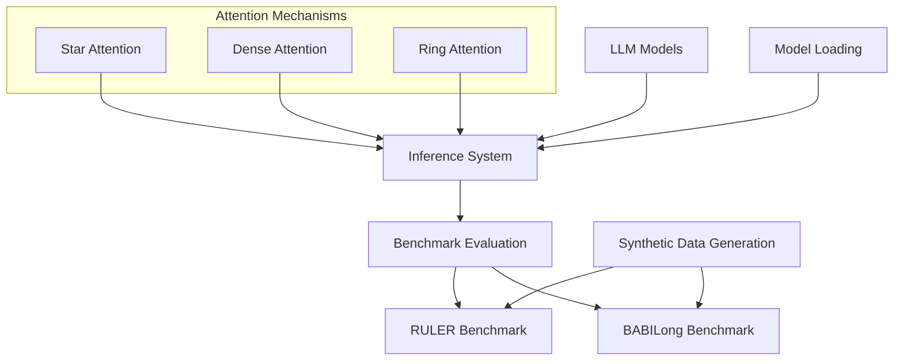
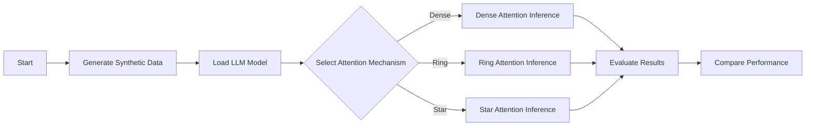
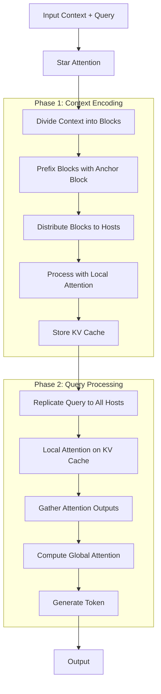
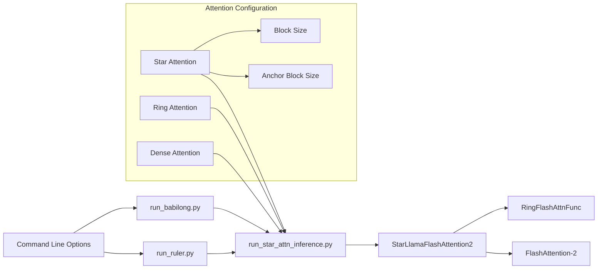

<!-- source: DeepWiki mcp.deepwiki.com · repo NVIDIA/Star-Attention · page 1 Overview · fetched 2026-10-26 -->

# Overview

Relevant source files

The following files were used as context for generating this wiki page:

- [.gitignore](.gitignore)
- [README.md](README.md)
- [images/star_attn_acc_ruler_babilong.png](images/star_attn_acc_ruler_babilong.png)
- [images/star_attn_phase1.png](images/star_attn_phase1.png)
- [images/star_attn_phase2.png](images/star_attn_phase2.png)

Star-Attention is an efficient block-sparse attention mechanism designed for LLM inference over long sequences. This repository contains the implementation of Star Attention, a method that operates in two phases (context encoding and token generation) to significantly improve inference speed while maintaining model accuracy.

This overview provides a high-level understanding of the Star-Attention system architecture, its core mechanisms, and how the various components interact. For more detailed information about the specific Star Attention mechanism and its implementation, see [Star Attention Mechanism](#2).

Sources: [README.md:1-10]()

## System Architecture

Star-Attention consists of several interconnected components that work together to enable efficient inference over long sequences.

### High-Level Components

The system architecture consists of:

1. **Attention Mechanisms**: The system implements three attention mechanisms:
   - **Star Attention**: The novel block-sparse attention method
   - **Ring Attention**: An alternative sparse attention mechanism used for comparison
   - **Dense Attention**: The standard full attention used as a baseline

2. **Inference System**: Handles model loading, input processing, and token generation using the selected attention mechanism.

3. **Benchmark Evaluation**: Evaluates model performance using:
   - **RULER**: A benchmark for retrieving information from long documents
   - **BABILong**: A benchmark for evaluating long-range reasoning

4. **Synthetic Data Generation**: Creates test data for the benchmarks with controlled properties.

5. **Model Loading**: Loads and configures pre-trained LLM models from HuggingFace.

Sources: [README.md:9-10](), [README.md:95-110]()

## System Workflow

The typical workflow in the Star-Attention system follows this sequence:

1. **Generate Synthetic Data**: Create benchmark data with specific properties (length, information placement)
2. **Load LLM Model**: Initialize a pre-trained model from HuggingFace
3. **Select Attention Mechanism**: Choose between Dense, Ring, or Star attention
4. **Run Inference**: Process inputs through the selected attention mechanism
5. **Evaluate Results**: Assess accuracy and performance metrics
6. **Compare Performance**: Compare results across different attention mechanisms and configurations

Sources: [README.md:145-203]()

## Star Attention Mechanism

The core innovation in this repository is the Star Attention mechanism, which operates in two phases to efficiently process long sequences.

The Star Attention operation consists of:

### Phase 1: Context Encoding
1. The context is divided into contiguous blocks
2. Each block (except the first) is prefixed with the first "anchor" block
3. The augmented blocks are distributed across hosts for parallel processing
4. Local attention is computed within each block
5. Key-value caches are stored for the query phase

### Phase 2: Query Processing and Token Generation
1. A query host is designated, and the query is replicated to all hosts
2. Each host computes local attention using its stored KV cache
3. Attention outputs and softmax denominators are gathered from all hosts
4. The query host computes the global attention output
5. The final output is used to generate the next token

This two-phase approach enables efficient processing of long sequences by reducing the quadratic complexity of standard attention while maintaining comprehensive contextual awareness through the anchor block mechanism.

Sources: [README.md:3-5](), [README.md:230-288]()

## Code Structure

The Star-Attention codebase is organized around several main scripts and components:

The key components include:

1. **Entry Point Scripts**:
   - `run_ruler.py`: Entry point for running RULER benchmark
   - `run_babilong.py`: Entry point for running BABILong benchmark
   - `run_star_attn_inference.py`: Core inference script used by all benchmarks

2. **Attention Implementations**:
   - `StarLlamaFlashAttention2`: Implements the Star Attention mechanism
   - `RingFlashAttnFunc`: Implements the Ring Attention baseline
   - Integration with `FlashAttention-2` for efficient attention computation

3. **Configuration Options**:
   - Attention mechanism selection (Dense, Ring, Star)
   - Block size configuration for Star Attention
   - Number of parallel processes and nodes

Sources: [README.md:145-186]()

## Inference System

The inference system handles running LLMs with different attention mechanisms. It supports:

1. **Model Types**:
   - Llama-3-8B-Instruct-262k
   - Llama-3.1-8B-Instruct
   - Llama-3.1-70B-Instruct
   - Other compatible HuggingFace models

2. **Sequence Lengths**:
   - Handles sequences from 16K to 128K tokens
   - Configurable block sizes (typically 1/4 of sequence length)

3. **Distributed Execution**:
   - Multi-host parallel processing
   - Multi-node capabilities for large models or very long sequences

4. **Custom Data Processing**:
   - Supports custom input data in `.jsonl` format
   - Structured with context, query, and expected output fields

Sources: [README.md:202-228]()

## Benchmarks

The Star-Attention system is evaluated using two main benchmarks:

### RULER Benchmark
RULER (Retrieval-focused Unstructured LongER context benchmark) evaluates how well models can retrieve information from long contexts. It consists of:
- Information retrieval tasks using Paul Graham essays
- Question answering using data from SQuAD and HotpotQA
- Synthetic data generation to create controlled test cases

### BABILong Benchmark
BABILong tests long-context reasoning abilities, containing tasks where models need to:
- Keep track of information over long contexts
- Reason about relationships between elements separated by significant distances

Both benchmarks can be run with different attention mechanisms to compare:
- Accuracy: How well the model retrieves and reasons over information
- Efficiency: Processing speed and resource utilization
- Scalability: Performance as sequence length increases

Sources: [README.md:149-169](), [README.md:191-199]()

## Performance Results

Star Attention demonstrates significant performance improvements compared to baseline attention mechanisms while maintaining accuracy. Key results include:

| Model | Seq. Length (K) | Block Size (K) | Ring-Attn Acc. (%) | Star-Attn Δ Acc. | Star-Attn Δ Speedup |
|-------|----------------|----------------|---------------------|-------------------|---------------------|
| Llama3-8B-Instruct-1048K | 16 | 4 | 86.12 | +2.47% | 1.1x |
| Llama3-8B-Instruct-1048K | 32 | 8 | 82.52 | +1.54% | 1.2x |
| Llama3-8B-Instruct-1048K | 64 | 16 | 79.05 | +1.28% | 1.8x |
| Llama3-8B-Instruct-1048K | 128 | 32 | 77.39 | +1.23% | 2.7x |
| Llama-3.1-70B-Instruct | 16 | 4 | 95.09 | -2.85% | 1.7x |
| Llama-3.1-70B-Instruct | 32 | 8 | 94.61 | -2.70% | 2.0x |
| Llama-3.1-70B-Instruct | 64 | 16 | 88.54 | -1.63% | 4.7x |

Key observations:
1. **Speedup**: Up to 11x faster inference compared to dense attention, with larger gains for longer sequences
2. **Accuracy Preservation**: Maintains 95-100% of the accuracy of global attention, sometimes even improving accuracy
3. **Scalability**: Effectively handles sequences up to 128K tokens in length
4. **Compatibility**: Works out-of-the-box with models trained with global attention, without additional training

Sources: [README.md:7](), [README.md:11-82]()

## Getting Started

To use the Star-Attention system:

1. **Setup**:
   - Install dependencies: `pip install -r requirements.txt`
   - Download necessary datasets (RULER, BABILong)
   - Download models from HuggingFace

2. **Running Benchmarks**:
   - RULER: Use `run_ruler.py` with appropriate parameters
   - BABILong: Use `run_babilong.py` with appropriate parameters
   - Custom data: Use `run_star_attn_inference.py` directly

3. **Configuration Options**:
   - Attention type (`-a`): `dense`, `ring`, or `star`
   - Block size (`-bs`): Size of context blocks
   - Sequence length (`-l`): Total sequence length to test
   - Parallel processes (`-np`): Number of hosts for distributed processing

For more detailed information on setup and usage, see [Usage Guide](#5).

Sources: [README.md:112-145](), [README.md:146-186]()

---

