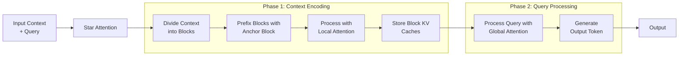
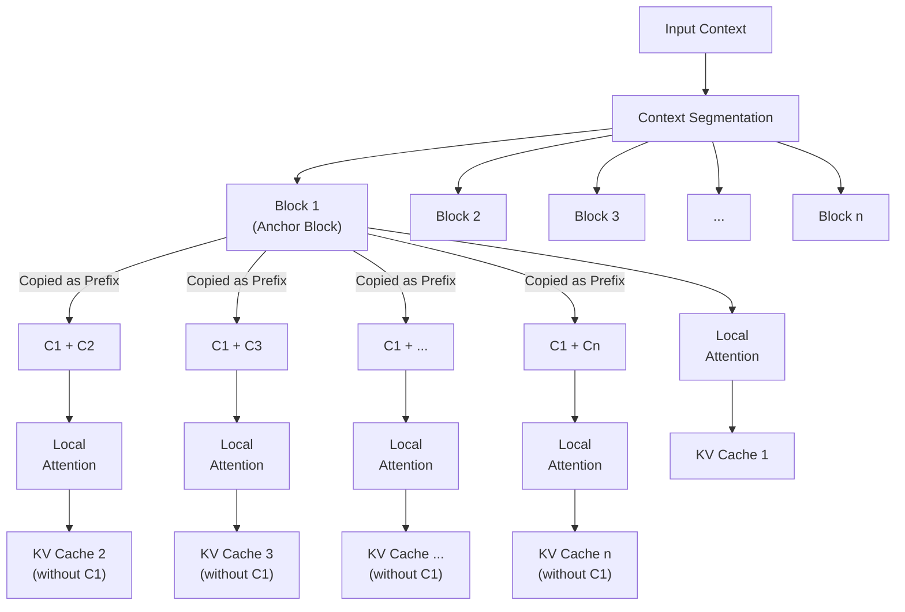
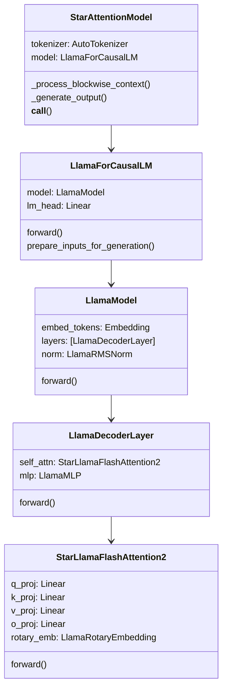
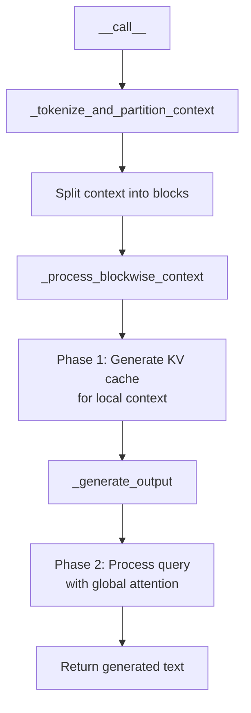
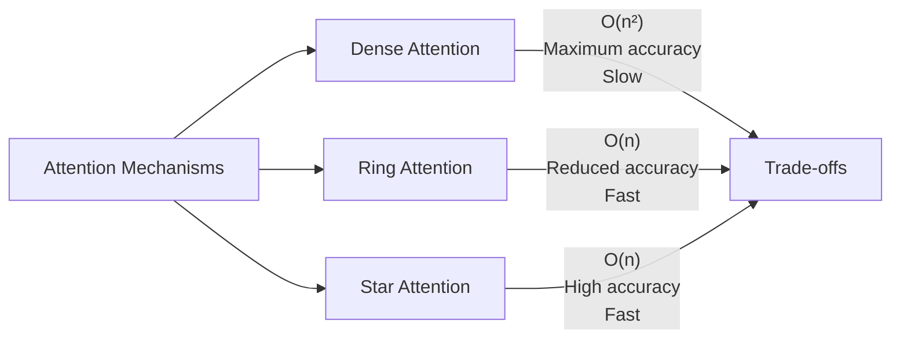

<!-- source: DeepWiki mcp.deepwiki.com · repo NVIDIA/Star-Attention · page 2 Star Attention Mechanism · fetched 2026-10-26 -->

# Star Attention Mechanism

Relevant source files

The following files were used as context for generating this wiki page:

- [.gitignore](.gitignore)
- [README.md](README.md)
- [images/star_attn_acc_ruler_babilong.png](images/star_attn_acc_ruler_babilong.png)
- [images/star_attn_phase1.png](images/star_attn_phase1.png)
- [images/star_attn_phase2.png](images/star_attn_phase2.png)
- [model.py](model.py)
- [star_attention/modeling_llama.py](star_attention/modeling_llama.py)

This document explains the Star Attention mechanism, a novel block-sparse attention mechanism designed for efficient inference on long sequences in transformer-based Large Language Models. The document covers the theory behind Star Attention, its two-phase operation process, and implementation details.

For information about the inference system that uses Star Attention, see [Inference System](#3). For benchmark evaluations of Star Attention, see [Benchmarks](#4).

## Core Concept

Star Attention is an efficient attention mechanism that enables faster inference while maintaining accuracy on long sequences. It operates in two phases: context encoding using blockwise attention with anchor blocks, followed by query processing using sequence-global attention. This approach significantly reduces the computational complexity for long context processing.

Star Attention achieves significant speedups (up to 11x) while preserving 95-100% of the accuracy of global attention. It works out-of-the-box with transformer models trained with global attention, without requiring additional training or fine-tuning.

Sources: [README.md:1-10](), [README.md:231-290]()

## Two-Phase Process

Star Attention operates in two distinct phases:

### Phase 1: Context Encoding

In the first phase, the context is processed using blockwise-local attention with anchor blocks.

The context encoding phase works as follows:

1. The input context is segmented into contiguous blocks: `c = [c₁, c₂, ..., cₙ]`
2. Each block (except the first anchor block) is prefixed with the first block, forming an augmented context: `c' = [c₁, (c₁ c₂), (c₁ c₃), ..., (c₁ cₙ)]`
3. Local attention is computed for each augmented block independently
4. For blocks 2 to n, the KV cache for only the non-anchor portion is stored
5. Blocks can be distributed across multiple hosts for parallel processing

This approach allows each token in the sequence to attend to tokens in its local block plus all tokens in the anchor block, creating a star-shaped attention pattern.

Sources: [README.md:231-247](), [model.py:176-238]()

### Phase 2: Query Processing and Token Generation

In the second phase, the query and generated tokens attend to all prior tokens through sequence-global attention.

```mermaid
flowchart TD
    A["Query Token"] --> B["Replicate to All Hosts"]
    
    B --> C1["Host 1\nLocal Attention\nwith KV Cache 1"]
    B --> C2["Host 2\nLocal Attention\nwith KV Cache 2"]
    B --> C3["Host 3\nLocal Attention\nwith KV Cache 3"]
    B --> C4["..."]
    
    C1 --> D1["Local Attention\nOutput 1"]
    C2 --> D2["Local Attention\nOutput 2"]
    C3 --> D3["Local Attention\nOutput 3"]
    C4 --> D4["..."]
    
    D1 --> E["Query Host"]
    D2 --> E
    D3 --> E
    D4 --> E
    
    E --> F["Compute Global\nAttention"]
    F --> G["Generate Token"]
    G --> H["New Token"]
```

The query processing phase works as follows:

1. A host is designated as the query host
2. The query token is replicated to all hosts
3. Each host computes local attention between the query and its stored KV cache
4. Each host also computes the sum of exponents from its local softmax calculation
5. The query host gathers local attention outputs and sums of exponents from all hosts
6. The query host computes the global attention output by weighted combination of local outputs
7. The generated token is fed back for the next iteration of token generation

The math for computing the global attention is:
- Each host h computes local attention: `Aₕ = softmax(QK_h^T/√d)Vₕ`
- Each host also computes the sum of exponents: `sₕ = Σ exp(QK_{h,k}^T/√d)`
- The query host computes the global sum: `s_global = Σ sₕ`
- The global attention output is: `A_global = Σ (sₕ/s_global) * Aₕ`

This approach ensures correct normalization of attention scores across all hosts while minimizing communication overhead.

Sources: [README.md:248-290](), [model.py:118-168]()

## Implementation Architecture

Star Attention is implemented as a modification to the traditional transformer attention mechanism, specifically integrated with Flash Attention 2 for efficiency.

The key components of the implementation are:

1. `StarLlamaFlashAttention2` - Core class that extends `LlamaFlashAttention2` to implement the Star Attention mechanism
2. `_flash_attention_forward` - Helper function that performs the flash attention computation with support for Star Attention
3. `StarAttentionModel` - High-level model class that orchestrates the two-phase process

Sources: [star_attention/modeling_llama.py:74-200](), [model.py:174-266]()

## Implementation Details

### StarLlamaFlashAttention2

The core of Star Attention is implemented in `StarLlamaFlashAttention2`, which extends the HuggingFace `LlamaFlashAttention2` class. This class modifies the attention computation to support both phases of Star Attention.

Key modifications include:
- Adding support for distributed processing across multiple hosts
- Handling KV cache distribution and merging
- Implementing the star attention pattern with anchor blocks

The `forward` method takes additional parameters:
- `num_ring_steps`: Controls the type of attention (local, ring, or star)
- `enable_star_attn`: Flag to enable/disable Star Attention

Sources: [star_attention/modeling_llama.py:74-200]()

### StarAttentionModel

The `StarAttentionModel` class implements the high-level orchestration of the Star Attention process:

The model handles:
1. Context tokenization and partitioning into blocks
2. Distributed processing of blocks across multiple ranks
3. Anchor block prefixing and KV cache management
4. Coordinating query processing and token generation

Sources: [model.py:174-266]()

## Block Size and Anchor Block Size

Two key parameters control the behavior of Star Attention:

1. **Block Size**: Determines the size of each context block
   - Typically set to one-quarter of the total sequence length
   - Larger blocks improve accuracy but reduce speed
   - Smaller blocks improve speed but may reduce accuracy

2. **Anchor Block Size**: Determines the size of the anchor block (first block)
   - By default, equal to the block size
   - The anchor block is prefixed to all other blocks
   - Controls the "shared context" available to all tokens

The table below shows typical configurations:

| Sequence Length (K) | Block Size (K) | Anchor Block Size (K) |
|---------------------|----------------|----------------------|
| 16                  | 4              | 4                    |
| 32                  | 8              | 8                    |
| 64                  | 16             | 16                   |
| 128                 | 32             | 32                   |

Sources: [README.md:26-77](), [model.py:48-50](), [model.py:183-200]()

## Performance Characteristics

Star Attention achieves significant speedups while maintaining accuracy:

| Model                          | Seq. Length (K) | Block Size (K) | Ring-Attn Acc. (%) | Star-Attn Δ Acc. | Star-Attn Δ Speedup |
|--------------------------------|-----------------|----------------|--------------------|-----------------|--------------------|
| gradientai/Llama3-8B-Instruct  | 16              | 4              | 86.12              | +2.47%          | 1.1x               |
| gradientai/Llama3-8B-Instruct  | 32              | 8              | 82.52              | +1.54%          | 1.2x               |
| gradientai/Llama3-8B-Instruct  | 64              | 16             | 79.05              | +1.28%          | 1.8x               |
| gradientai/Llama3-8B-Instruct  | 128             | 32             | 77.39              | +1.23%          | 2.7x               |
| meta-llama/Llama-3.1-70B       | 16              | 4              | 95.09              | -2.85%          | 1.7x               |
| meta-llama/Llama-3.1-70B       | 32              | 8              | 94.61              | -2.70%          | 2.0x               |
| meta-llama/Llama-3.1-70B       | 64              | 16             | 88.54              | -1.63%          | 4.7x               |

Key observations:
- Star Attention achieves up to 4.7x speedup for large models (70B parameters)
- Accuracy is maintained at 95-100% of global attention
- For some configurations, Star Attention can actually improve accuracy
- Speedup increases with sequence length and model size

Sources: [README.md:11-77]()

## Comparison with Other Attention Mechanisms

Star Attention can be compared with two other attention mechanisms implemented in the codebase:

1. **Dense Attention**: Traditional full attention where every token attends to all previous tokens
   - Has O(n²) computational complexity
   - Provides maximum accuracy but is computationally expensive

2. **Ring Attention**: Block-sparse attention where tokens attend only to tokens in nearby blocks
   - Has O(n) computational complexity
   - Faster than dense attention but may lose some accuracy

3. **Star Attention**: Block-sparse attention with anchor blocks
   - Has O(n) computational complexity
   - Better accuracy than Ring Attention
   - Enables faster inference than dense attention

Sources: [README.md:302-306](), [model.py:24-172](), [model.py:269-335](), [model.py:337-395]()

## Integration with Flash Attention

Star Attention leverages Flash Attention 2 for efficient computation. The integration is achieved through:

1. Custom implementation of `StarLlamaFlashAttention2` extending `LlamaFlashAttention2`
2. Modified forward pass in `_flash_attention_forward` to support star attention pattern
3. Integration with PyTorch's distributed communication primitives for multi-host execution

This integration allows Star Attention to benefit from the optimizations in Flash Attention 2 while implementing its novel attention pattern.

Sources: [star_attention/modeling_llama.py:74-200](), [star_attention/modeling_flash_attention_utils.py]()

---

