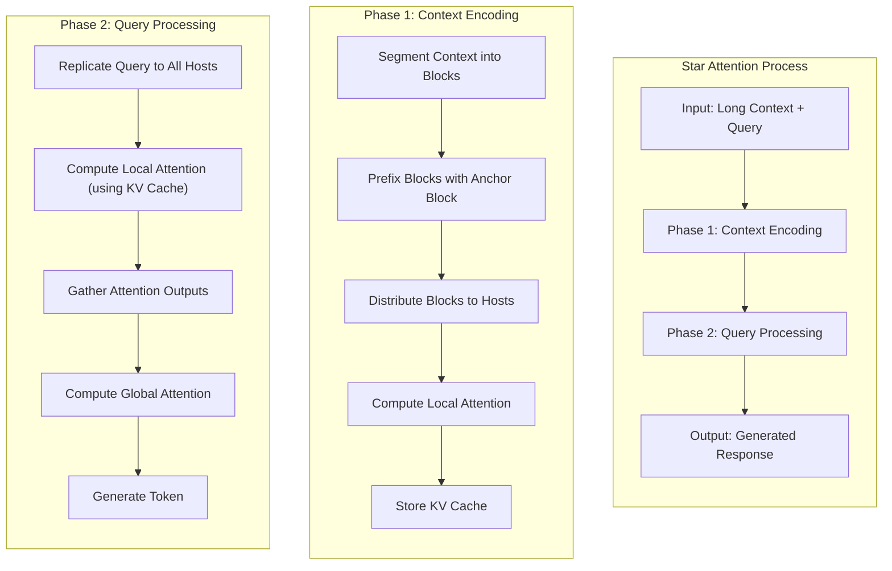
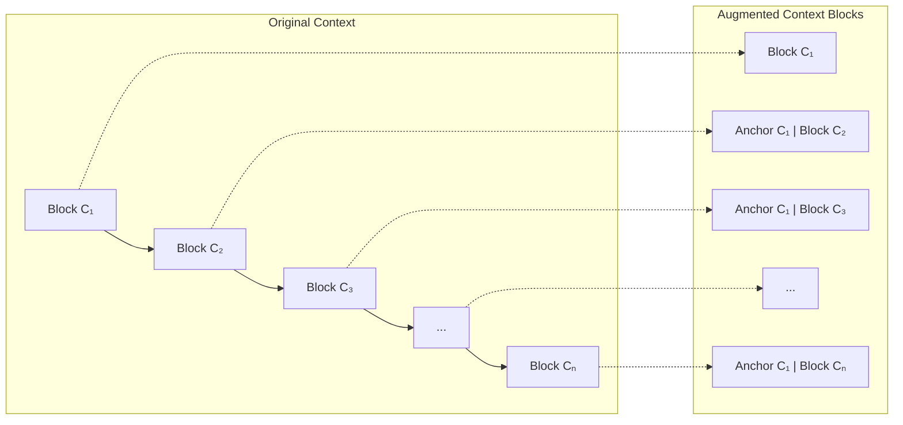
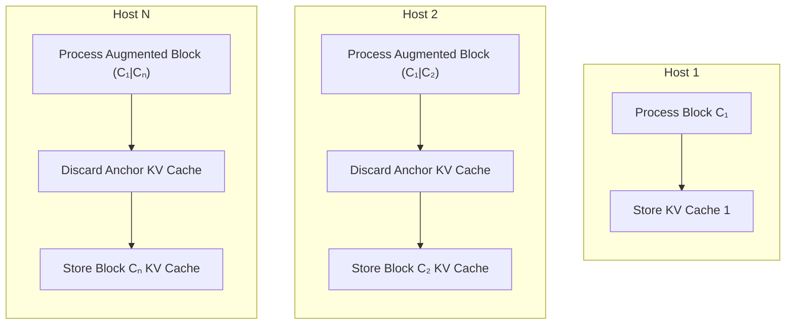
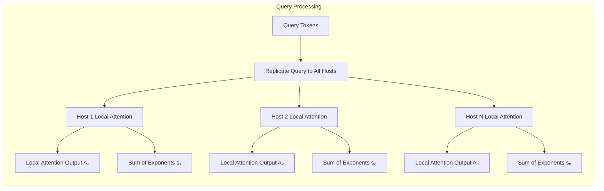
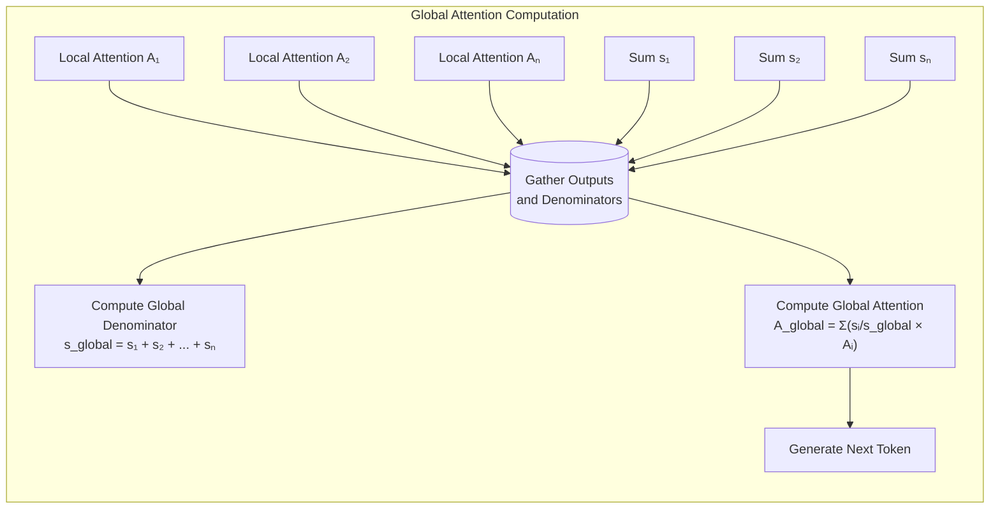

<!-- source: DeepWiki mcp.deepwiki.com · repo NVIDIA/Star-Attention · page 2.1 Two-Phase Process · fetched 2026-10-26 -->

# Two-Phase Process

<details>
<summary>Relevant source files</summary>

The following files were used as context for generating this wiki page:

- [.gitignore](.gitignore)
- [README.md](README.md)
- [images/star_attn_acc_ruler_babilong.png](images/star_attn_acc_ruler_babilong.png)
- [images/star_attn_phase1.png](images/star_attn_phase1.png)
- [images/star_attn_phase2.png](images/star_attn_phase2.png)
- [model.py](model.py)

</details>


This page provides a detailed explanation of the two-phase process in Star Attention, which is the core mechanism for efficient long sequence processing. The two phases—context encoding and query processing/token generation—work together to enable efficient inference on long sequences while preserving model accuracy. For details about the implementation using Flash Attention, see [Star Flash Attention Implementation](#2.2).

## Overview of Star Attention's Two-Phase Approach

Star Attention uses a specialized block-sparse attention mechanism that operates in two distinct phases:

1. **Context Encoding**: The input context is processed using blockwise-local attention, with each block prefixed with an anchor block
2. **Query Processing**: The query is processed using globally-aggregated attention across all previously cached tokens

This approach significantly reduces computational costs while maintaining model performance on long-context tasks.



Sources: [README.md:3-5](), [model.py:119-169]()

## Phase 1: Context Encoding

In the first phase, Star Attention processes the input context to prepare for efficient attention during the query processing phase.

### Context Segmentation and Anchor Block Prefixing

The process begins by dividing the context into multiple blocks and prefixing each block (except the first) with the first block, which serves as an "anchor" block:

1. Context is segmented into contiguous blocks: c = [c₁, c₂, ..., cₙ]
2. The first block c₁ is designated as the anchor block
3. Each subsequent block is prefixed with this anchor block, forming augmented blocks: c' = [c₁, (c₁ c₂), (c₁ c₃), ..., (c₁ cₙ)]



Sources: [README.md:233-249](), [model.py:194-202]()

### Distributed Processing and KV Cache Generation

After augmentation, blocks are distributed across multiple hosts for parallel processing:

1. Blocks are assigned to available hosts (GPUs or machines)
2. Each host processes its assigned blocks independently
3. For each block, the model computes local attention (no attention across blocks)
4. For augmented blocks (block 2 onwards), the KV cache for the anchor portion is discarded
5. Only the KV cache for the non-anchor portion is stored for Phase 2



This approach enables efficient distributed processing while ensuring information is shared across blocks through the anchor mechanism.

Sources: [model.py:202-237](), [README.md:250-254]()

## Phase 2: Query Processing and Token Generation

In the second phase, Star Attention processes the query and generates tokens using a combination of local and global attention.

### Query Replication and Local Attention

When a query is processed or a new token is generated:

1. One host is designated as the "query host"
2. The query (or new token) is replicated to all hosts
3. Each host computes local attention using its stored KV cache from Phase 1
4. Each host also computes the sum of local attention softmax denominators



Sources: [model.py:129-131](), [README.md:264-272]()

### Global Attention Computation

To compute the global attention:

1. The query host gathers the local attention outputs and sums of exponents from all hosts
2. It calculates the global softmax denominator by summing all local denominators
3. It computes the weighted average of local attention outputs to form the global attention output
4. This result is used to predict the next token



This method ensures correct normalization of attention scores across all hosts, requiring minimal communication between hosts.

Sources: [model.py:140-153](), [README.md:273-289]()

## Implementation in the Codebase

The two-phase process is implemented in the `StarAttentionModel` class in the model.py file:

### Phase 1: Context Encoding Implementation

Phase 1 is implemented in the `_process_blockwise_context` method:

```python
# Snippet showing Phase 1 implementation
def _process_blockwise_context(self, ctx_ids_blocks, position_ids_blocks):
    """Phase 1 of Star Attention: Blockwise Context Encoding with Anchor Blocks"""
    
    # If the anchor block size is not provided, use the entire first block
    if self.anchor_block_size is None:
        self.anchor_block_size = ctx_ids_blocks[0][0].shape[-1]
    
    kv_rank = []
    for idx in range(len(ctx_ids_blocks[self.rank])):
        # Select the current block
        ctx_block = ctx_ids_blocks[self.rank][idx]
        position_block = position_ids_blocks[self.rank][idx]
        
        # From 2nd block onwards, prepend the anchor block to the current block
        if self.rank != 0 or idx > 0:
            ctx_block = torch.cat((ctx_ids_blocks[0][0][:, : self.anchor_block_size], ctx_block), dim=-1)
            position_block = torch.cat(
                (position_ids_blocks[0][0][:, : self.anchor_block_size], position_block), dim=-1
            )
        
        # Process the block and generate KV cache
        with torch.no_grad():
            kv_block = self.model(
                ctx_block,
                position_ids=position_block,
                use_cache=True,
                num_ring_steps=0,  # disable ring attention (local blockwise attention)
                enable_star_attn=False,
            ).past_key_values
        
        # Discard the anchor block KV cache for non-first blocks
        if self.rank != 0 or idx > 0:
            kv_block = [
                [x[0][:, :, self.anchor_block_size :], x[1][:, :, self.anchor_block_size :]] for x in kv_block
            ]
        
        # Concatenate KV blocks
        kv_rank = (
            kv_block
            if not kv_rank
            else [
                [torch.cat((kv_rank[i][j], kv_block[i][j]), dim=-2) for j in range(2)] for i in range(len(kv_rank))
            ]
        )
    
    return kv_rank
```

Sources: [model.py:195-238]()

### Phase 2: Query Processing Implementation

Phase 2 is implemented in the `_generate_output` method:

```python
# Snippet showing Phase 2 implementation
def _generate_output(self, input_ids, position_ids, past_key_values):
    """Phase 2 of Star Attention: Process input tokens followed by autoregressive token generation."""
    output_seq = None
    for _ in range(self.max_new_tokens):
        with torch.no_grad():
            outputs = self.model(
                input_ids,
                position_ids=position_ids,
                past_key_values=past_key_values,
                use_cache=True,
                enable_star_attn=True,
            )

        # Assign the new updated KV-cache to the last rank
        if self.rank == self.world_size - 1:
            past_key_values = outputs.past_key_values

        # Get the next token
        next_token_logits = outputs.logits[:, -1, :]
        next_tokens = torch.argmax(next_token_logits, dim=-1)
        output_seq = next_tokens if output_seq is None else torch.cat([output_seq, next_tokens])

        # Update the input_ids and position_ids for the next iteration
        input_ids = next_tokens.unsqueeze(0)
        position_ids = torch.tensor([[position_ids[-1, -1] + 1]]).to(position_ids)

    return output_seq.unsqueeze(0)
```

Sources: [model.py:118-153]()

## Summary and Benefits

The two-phase process in Star Attention provides several key benefits:

| Phase | Benefit |
|-------|---------|
| Context Encoding | - Enables parallel processing of long contexts<br>- Shares information across blocks through anchor mechanism<br>- Reduces memory requirements with strategic KV caching |
| Query Processing | - Provides global attention capabilities<br>- Minimizes communication between hosts<br>- Ensures correct normalization of attention scores |

The combination of these two phases allows Star Attention to achieve significant speedups (up to 11x) while maintaining 95-100% of the accuracy of global attention. This approach is particularly effective for long sequences (16K to 128K tokens) and scales well with larger models.

Sources: [README.md:7-8](), [README.md:65-77]()

---

