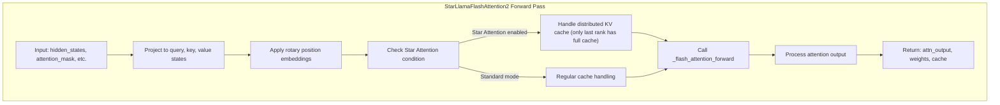
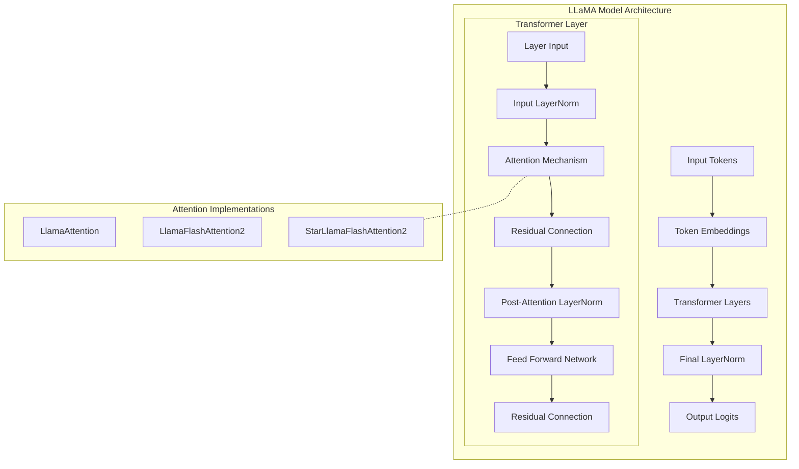

<!-- source: DeepWiki mcp.deepwiki.com · repo NVIDIA/Star-Attention · page 2.2 Star Flash Attention Implementation · fetched 2026-10-26 -->

# Star Flash Attention Implementation

<details>
<summary>Relevant source files</summary>

The following files were used as context for generating this wiki page:

- [star_attention/modeling_llama.py](star_attention/modeling_llama.py)
- [star_attention/star_flash_attn/utils.py](star_attention/star_flash_attn/utils.py)

</details>


## Purpose and Scope

This document details the implementation of Star Attention using Flash Attention 2 to achieve efficient inference on long contexts. The Star Flash Attention implementation leverages the Flash Attention algorithm's optimizations while adding distributed processing capabilities specific to the Star Attention mechanism. For information about the two-phase process of Star Attention, see [Two-Phase Process](#2.1).

## Architecture Overview

Star Flash Attention is implemented through a specialized attention class called `StarLlamaFlashAttention2` that extends the Hugging Face Transformers' implementation of Flash Attention 2. It enables the efficient distributed computation needed for Star Attention's approach to handling long contexts.

```mermaid
classDiagram
    direction TB
    class "LlamaFlashAttention2" {
        +forward()
    }
    class "StarLlamaFlashAttention2" {
        +forward()
        -handle distributed KV cache
        -enable Star Attention patterns
    }
    class "_flash_attention_forward" {
        +process queries and keys
        +compute attention scores
        +apply attention patterns
    }
    class "update_out_and_lse" {
        +combine attention outputs
        +update log-sum-exp values
    }
    
    LlamaFlashAttention2 <|-- StarLlamaFlashAttention2
    StarLlamaFlashAttention2 ..> _flash_attention_forward : calls
    _flash_attention_forward ..> update_out_and_lse : uses
```

Sources: [star_attention/modeling_llama.py:74-200](), [star_attention/star_flash_attn/utils.py:40-58]()

## Core Components

### StarLlamaFlashAttention2

The central class in the implementation is `StarLlamaFlashAttention2`, which inherits from HuggingFace's `LlamaFlashAttention2`. This class overrides the forward method to handle:

1. Distributed KV cache for Star Attention
2. Integration with Flash Attention 2 algorithm
3. Special processing required for the Star Attention pattern



Sources: [star_attention/modeling_llama.py:74-200]()

### Integration with Model Architecture

Star Flash Attention is integrated into the LLaMA model architecture by replacing the standard attention mechanism in the transformer layers.



Sources: [star_attention/modeling_llama.py:202-284](), [star_attention/modeling_llama.py:295-448]()

## Implementation Details

### Distributed KV-Cache Management

Star Flash Attention uses a specialized approach for distributing the KV-cache across multiple GPUs:

1. With Star Attention enabled, only the last rank (last GPU) maintains the full KV-cache
2. During forward pass, the implementation checks if Star Attention is enabled and the current rank is not the last rank
3. In that case, it ensures the KV-cache is empty for all ranks except the last one

```python
# Key logic for Star Attention KV-cache handling
if (
    enable_star_attn
    and RANK != WORLD_SIZE - 1
    and (past_key_value is None or past_key_value.get_seq_length(self.layer_idx) == 0)
):
    raise ValueError('With Star Attention, only the last rank should have a non-empty kv-cache')
```

Sources: [star_attention/modeling_llama.py:100-105]()

### Forward Pass Implementation

The forward pass in `StarLlamaFlashAttention2` is responsible for:

1. Projecting hidden states to query, key, and value states
2. Applying rotary position embeddings
3. Managing the KV-cache based on whether Star Attention is enabled
4. Calling the Flash Attention implementation
5. Processing the attention output

The implementation specifically passes two key parameters to the Flash Attention implementation:
- `num_ring_steps`: Controls the Ring Attention behavior
- `enable_star_attn`: Enables the Star Attention pattern

Sources: [star_attention/modeling_llama.py:81-200]()

### Output and Log-Sum-Exp Update

A critical component of the Star Flash Attention implementation is the `update_out_and_lse` utility function, which:

1. Combines attention outputs from different blocks
2. Updates log-sum-exp (LSE) values for numerically stable computation
3. Handles the merging of attention results in the distributed setting

This function manages both the initial case (when `out` is None) and the update case:

```python
def update_out_and_lse(
    out: Optional[torch.Tensor],
    lse: Optional[torch.Tensor],
    block_out: torch.Tensor,
    block_lse: torch.Tensor,
    slice_=None,
) -> Tuple[torch.Tensor, torch.Tensor]:
    if out is None:
        if slice_ is not None:
            raise RuntimeError("first update_out_and_lse should not pass slice_ args")
        out = block_out.to(torch.float32)
        lse = block_lse.transpose(-2, -1).unsqueeze(dim=-1)
    elif slice_ is not None:
        slice_out, slice_lse = out[slice_], lse[slice_]
        slice_out, slice_lse = _update_out_and_lse(slice_out, slice_lse, block_out, block_lse)
        out[slice_], lse[slice_] = slice_out, slice_lse
    else:
        out, lse = _update_out_and_lse(out, lse, block_out, block_lse)
    return out, lse
```

Sources: [star_attention/star_flash_attn/utils.py:40-58]()

## Key Optimizations

### Flash Attention Algorithm

The Star Flash Attention implementation leverages the Flash Attention 2 algorithm to achieve high computational efficiency:

1. Reduces memory access by computing attention in blocks
2. Avoids materializing the full attention matrix
3. Fuses operations for better GPU utilization

### Distributed Processing

The implementation includes optimizations for distributed processing:

1. KV-cache is distributed across GPUs in a way that minimizes communication
2. Only the last rank maintains the full KV-cache in Star Attention mode
3. Handles the aggregation of attention results across distributed workers

### Numerical Stability

The implementation uses log-sum-exp (LSE) techniques for numerical stability:

1. Attention scores are computed in a numerically stable way
2. The `update_out_and_lse` function combines partial attention results while maintaining numerical stability
3. Handles potential overflow/underflow issues in the softmax computation

## Integration with LLaMA Model

The Star Flash Attention implementation is registered in the model architecture through the `LLAMA_ATTENTION_CLASSES` dictionary, allowing it to be selected via the configuration:

```python
LLAMA_ATTENTION_CLASSES = {
    "eager": LlamaAttention,
    "flash_attention_2": StarLlamaFlashAttention2,
    "sdpa": LlamaSdpaAttention,
}
```

When creating a LLaMA model, the appropriate attention class is instantiated based on the model's configuration:

```python
self.self_attn = LLAMA_ATTENTION_CLASSES[config._attn_implementation](config=config, layer_idx=layer_idx)
```

Sources: [star_attention/modeling_llama.py:203-207](), [star_attention/modeling_llama.py:215-216]()

## Relationship to Other Components

The Star Flash Attention implementation works in conjunction with other components in the system:

| Component | Relationship |
|-----------|--------------|
| Ring Attention | Star Attention is an extension of Ring Attention with an anchor block approach. The `num_ring_steps` parameter controls Ring Attention behavior. |
| Flash Attention 2 | Star Flash Attention leverages the Flash Attention 2 algorithm for efficient computation. |
| LLaMA Model | Star Flash Attention replaces the standard attention mechanism in the LLaMA transformer layers. |
| Inference System | The implementation is integrated with the inference system to support distributed execution. |

Sources: [star_attention/modeling_llama.py:179-192](), [star_attention/modeling_llama.py:203-207]()

---

