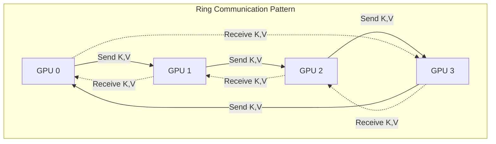
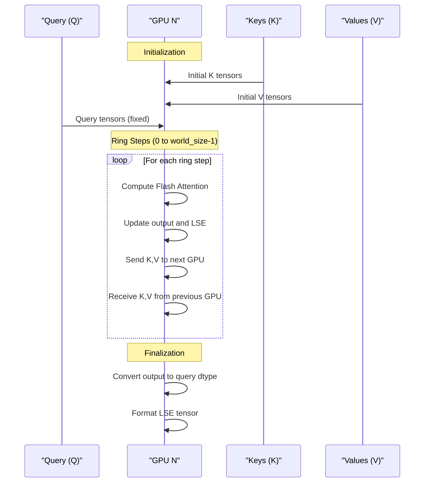
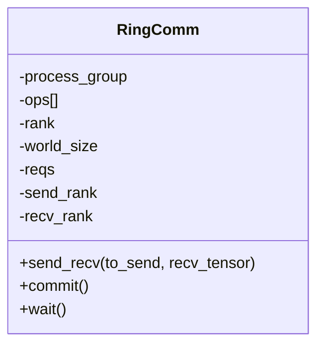
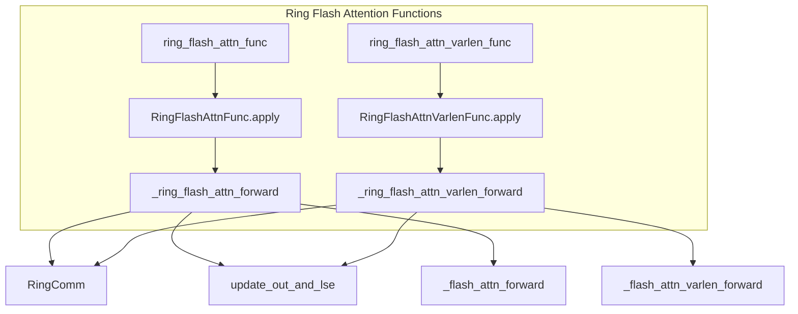
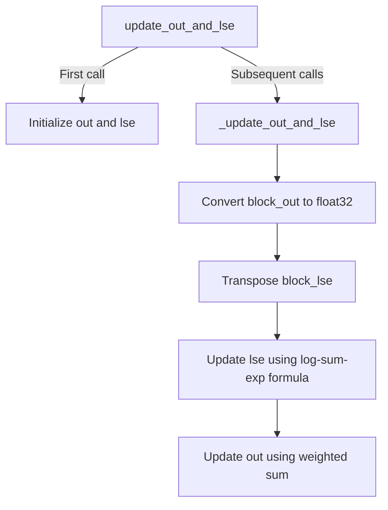

<!-- source: DeepWiki mcp.deepwiki.com · repo NVIDIA/Star-Attention · page 2.3 Ring Attention Implementation · fetched 2026-10-26 -->

# Ring Attention Implementation

<details>
<summary>Relevant source files</summary>

The following files were used as context for generating this wiki page:

- [star_attention/ring_flash_attn/__init__.py](star_attention/ring_flash_attn/__init__.py)
- [star_attention/ring_flash_attn/ring_flash_attn.py](star_attention/ring_flash_attn/ring_flash_attn.py)
- [star_attention/ring_flash_attn/ring_flash_attn_varlen.py](star_attention/ring_flash_attn/ring_flash_attn_varlen.py)
- [star_attention/ring_flash_attn/utils.py](star_attention/ring_flash_attn/utils.py)

</details>


## Overview

Ring Attention is a distributed attention mechanism that efficiently processes long sequences by distributing computation across multiple GPUs in a ring communication pattern. This page documents the Ring Attention implementation found in the Star-Attention repository, which leverages Flash Attention 2 for efficient attention computation while scaling to longer context lengths through distributed processing.

For information about the Star Attention mechanism itself, see [Star Attention Mechanism](#2).

Sources: [star_attention/ring_flash_attn/ring_flash_attn.py](), [star_attention/ring_flash_attn/ring_flash_attn_varlen.py]()

## Ring Attention Architecture

Ring Attention distributes the computation of attention across multiple GPUs arranged in a ring topology, where each node communicates only with its adjacent neighbors. This approach reduces communication overhead while still allowing all nodes to process the entire sequence collectively.

### Ring Communication Pattern



Each GPU sends its key (K) and value (V) tensors to the next GPU in the ring and receives from the previous GPU. After multiple communication rounds, each GPU has processed all parts of the sequence.

Sources: [star_attention/ring_flash_attn/utils.py:103-142]()

### Attention Computation Process



The Ring Attention algorithm processes attention in steps, with each GPU computing attention between its queries and the current keys/values it holds before passing those keys/values to the next GPU in the ring.

Sources: [star_attention/ring_flash_attn/ring_flash_attn.py:22-79](), [star_attention/ring_flash_attn/ring_flash_attn_varlen.py:22-99]()

## Implementation Components

### RingComm Class

The `RingComm` class manages the ring communication pattern between GPUs:



Key functionality:
- `send_recv`: Asynchronously sends a tensor to the next GPU and receives a tensor from the previous GPU
- `commit`: Commits all pending communication operations
- `wait`: Waits for all operations to complete

Sources: [star_attention/ring_flash_attn/utils.py:103-142]()

### Ring Flash Attention Functions

Two main functions implement Ring Attention:

1. **ring_flash_attn_func**: For fixed-length sequences
2. **ring_flash_attn_varlen_func**: For variable-length sequences

Both functions follow the PyTorch custom function pattern with forward and backward passes, though the backward pass is not shown in the provided code.



Sources: [star_attention/ring_flash_attn/ring_flash_attn.py:82-157](), [star_attention/ring_flash_attn/ring_flash_attn_varlen.py:102-200]()

## Ring Attention Algorithm

The core algorithm for Ring Attention follows these steps:

1. Initialize a `RingComm` object for ring communication
2. Determine the number of ring steps (default: world_size - 1)
3. For each step in the ring communication:
   a. Send current K and V tensors to the next node and receive from the previous node
   b. Perform Flash Attention computation on current Q, K, V tensors
   c. Accumulate results using update_out_and_lse utility function
   d. Update K and V with the received tensors for the next step
4. Convert the output to the query's data type and format the LSE tensor appropriately

The algorithm handles both causal and non-causal attention. In causal attention, each node only processes steps where `step <= node_rank` to preserve the causal mask.

Sources: [star_attention/ring_flash_attn/ring_flash_attn.py:22-79]()

## Key Utility Functions

### update_out_and_lse

This function combines attention outputs and log-sum-exp values from different parts of the computation:



The function maintains numerical stability when combining attention results from different portions of the sequence.

Sources: [star_attention/ring_flash_attn/utils.py:39-80]()

### Variable-Length Sequence Handling

For variable-length sequences, additional utility functions handle conversion between different tensor formats:

- `flatten_varlen_lse`: Flattens log-sum-exp values for variable-length sequences
- `unflatten_varlen_lse`: Restructures flattened log-sum-exp values back to the original format

Sources: [star_attention/ring_flash_attn/utils.py:83-100]()

## Usage

Ring Attention can be used by calling one of the two main functions:

1. For fixed-length sequences:
```python
output = ring_flash_attn_func(
    q, k, v, 
    dropout_p=0.0, 
    softmax_scale=None, 
    causal=False, 
    window_size=(-1, -1),
    softcap=0.0, 
    alibi_slopes=None, 
    return_attn_probs=False, 
    num_ring_steps=-1, 
    group=None
)
```

2. For variable-length sequences:
```python
output = ring_flash_attn_varlen_func(
    q, k, v, 
    cu_seqlens_q, cu_seqlens_k, 
    max_seqlen_q, max_seqlen_k,
    dropout_p=0.0, 
    softmax_scale=None, 
    causal=False, 
    window_size=(-1, -1),
    softcap=0.0, 
    alibi_slopes=None, 
    return_attn_probs=False, 
    num_ring_steps=-1, 
    block_table=None, 
    group=None
)
```

### Key Parameters

| Parameter | Description |
|-----------|-------------|
| `q`, `k`, `v` | Query, key, and value tensors |
| `dropout_p` | Dropout probability (default: 0.0) |
| `softmax_scale` | Scale factor for softmax (default: 1/sqrt(d_k)) |
| `causal` | Whether to use causal attention mask (default: False) |
| `window_size` | Size of attention window, (-1, -1) means infinite context window |
| `num_ring_steps` | Number of ring communication steps, -1 means world_size - 1 |
| `group` | Process group for distributed computation |
| `cu_seqlens_q`, `cu_seqlens_k` | Cumulative sequence lengths for variable-length sequences |
| `max_seqlen_q`, `max_seqlen_k` | Maximum sequence lengths for variable-length sequences |

Sources: [star_attention/ring_flash_attn/ring_flash_attn.py:130-157](), [star_attention/ring_flash_attn/ring_flash_attn_varlen.py:163-200]()

## Relationship to Star Attention

While Star Attention uses a star-topology where an anchor block connects to all other blocks, Ring Attention uses a ring topology where each GPU communicates only with its neighbors. Ring Attention serves as both:

1. An alternative attention mechanism for comparison with Star Attention
2. A building block that Star Attention can leverage for efficient distributed computation

The Ring Attention implementation is integrated with the Flash Attention 2 library for efficient computation while adding the distributed capabilities needed for processing very long sequences across multiple GPUs.

Sources: [star_attention/ring_flash_attn/ring_flash_attn.py]()

---

