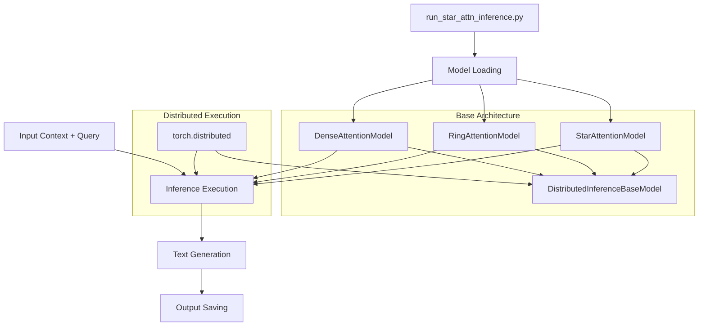
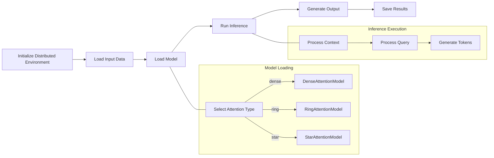
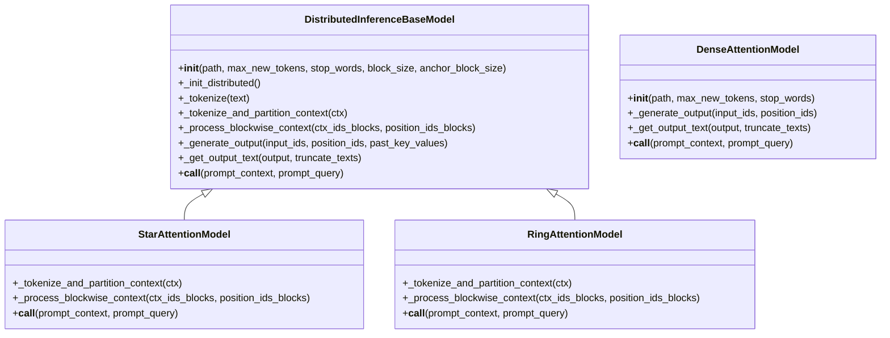
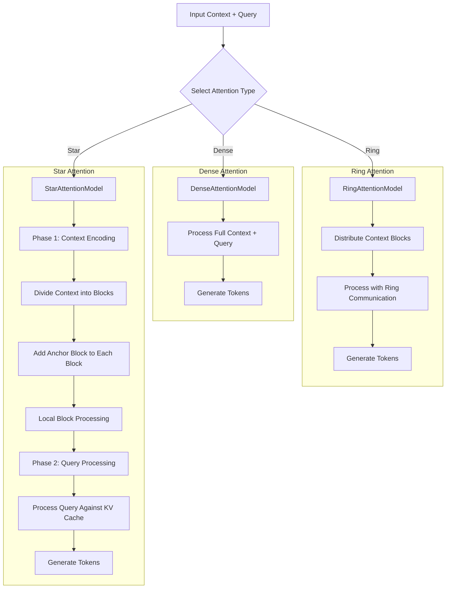
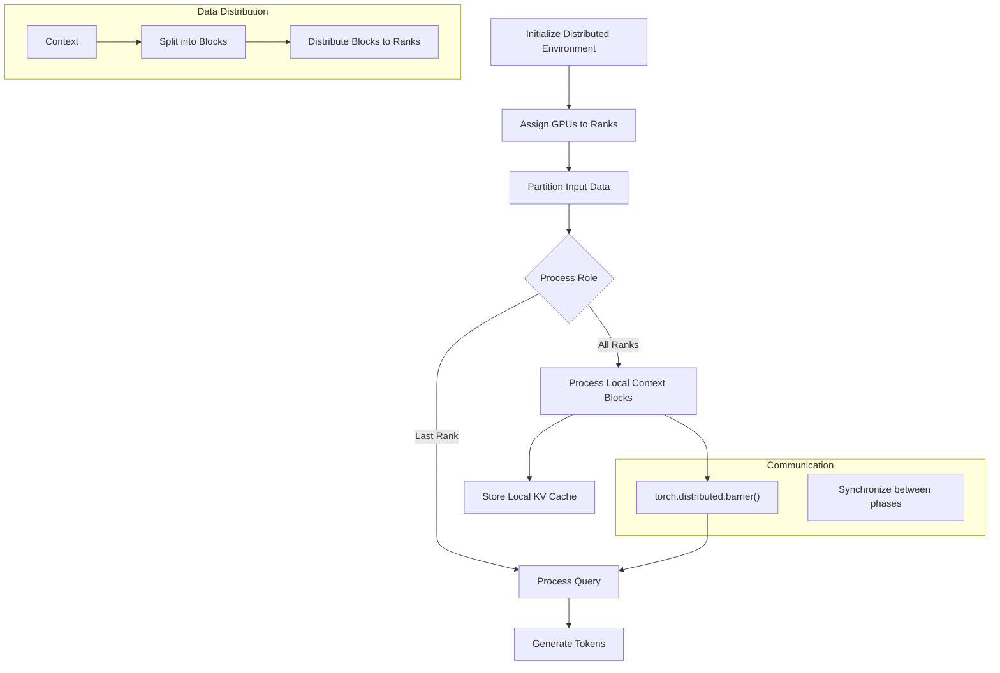

<!-- source: DeepWiki mcp.deepwiki.com · repo NVIDIA/Star-Attention · page 3 Inference System · fetched 2026-10-26 -->

# Inference System

<details>
<summary>Relevant source files</summary>

The following files were used as context for generating this wiki page:

- [model.py](model.py)
- [run_star_attn_inference.py](run_star_attn_inference.py)
- [scripts/time_inference.py](scripts/time_inference.py)

</details>


The Inference System is the core component responsible for executing inference with different attention mechanisms in the Star-Attention repository. It provides a standardized framework for running models with Dense, Ring, and Star Attention, supporting both single-device and distributed execution. This document covers the inference architecture, workflow, model implementations, and usage patterns.

For details about the Star Attention mechanism itself, see [Star Attention Mechanism](#2).

## System Architecture

The Inference System consists of several key components that work together to provide a flexible interface for running models with different attention mechanisms.



Sources: [run_star_attn_inference.py:64-106](), [model.py:24-396]()

The architecture follows a modular design where model loading is separated from execution, with a common interface for different attention mechanisms. The system leverages PyTorch's distributed capabilities for multi-device inference.

## Inference Process Workflow

The inference process involves several steps, from initialization to output generation:



Sources: [run_star_attn_inference.py:108-193]()

The workflow starts with initializing the distributed environment and loading input data from a JSONL file. It then loads the appropriate model based on the specified attention type and runs inference for each input sample. The generated output is saved to a file in JSONL format.

## Model Implementation

The inference system implements multiple model classes for different attention mechanisms, all derived from a common base class.

### Base Model

The `DistributedInferenceBaseModel` serves as the foundation for all distributed attention models, providing common functionality:



Sources: [model.py:24-172]()

The base model handles initialization of the distributed environment, tokenization, and common model loading operations. Specialized derived classes implement attention-specific functionality.

### Attention Models

The system implements three attention models:

1. **DenseAttentionModel**: Implements standard dense attention for baseline comparison. It processes input sequences using regular self-attention mechanisms.

2. **RingAttentionModel**: Implements Ring Attention with distributed processing. It divides the context into blocks and performs efficient attention with ring-based communication.

3. **StarAttentionModel**: Implements the Star Attention mechanism, dividing the processing into two phases:
   - Phase 1: Context encoding with anchor blocks
   - Phase 2: Query processing and token generation

The implementation of these models can be found in [model.py:174-396]().

## Attention Mechanisms Implementation

Each attention mechanism implements a different approach to processing long sequences:



Sources: [model.py:174-396]()

### Dense Attention

The `DenseAttentionModel` processes the entire context and query together using standard attention mechanisms. This provides a baseline for comparison but is memory-intensive for long sequences.

Key implementation details:
- Loads standard LLamaForCausalLM model with Flash Attention 2
- Processes the full context and query in one pass
- Generates tokens autoregressively

### Ring Attention

The `RingAttentionModel` divides the context into blocks distributed across devices. It uses a ring-based communication pattern for efficient attention computation.

Key implementation details:
- Inherits from `DistributedInferenceBaseModel`
- Divides context into blocks of equal size
- Uses Ring Attention for distributed processing
- Leverages the second phase of Star Attention for token generation

### Star Attention

The `StarAttentionModel` implements the two-phase Star Attention mechanism:

Phase 1 (Context Encoding):
- Divides context into blocks
- Prepends anchor block to each non-first block
- Processes blocks locally to build KV cache

Phase 2 (Query Processing):
- Processes query against the distributed KV cache
- Generates tokens with global attention

For detailed explanation of the Star Attention mechanism, see [Star Attention Mechanism](#2).

## Distributed Execution

The inference system supports distributed execution across multiple GPUs and nodes:



Sources: [model.py:55-80](), [run_star_attn_inference.py:36-48]()

Key aspects of distributed execution:

1. **Initialization**: The system initializes the distributed environment using PyTorch's distributed module. It assigns each rank a subset of available GPUs to maximize GPU utilization.

2. **Data Partitioning**: Input sequences are divided into blocks and distributed across devices according to the attention mechanism requirements.

3. **Synchronization**: The system uses barriers to synchronize between processing phases and ensure all ranks complete their work before proceeding.

4. **Memory Management**: Each rank is assigned specific GPU devices to manage memory efficiently across the distributed system.

## Usage Guide

The inference system is primarily used through the `run_star_attn_inference.py` script, which provides a command-line interface for running inference with different attention mechanisms.

### Command-Line Arguments

```
usage: run_star_attn_inference.py [-h] --model_path MODEL_PATH --attn_type ATTN_TYPE 
                                  [--block_size BLOCK_SIZE] [--anchor_block_size ANCHOR_BLOCK_SIZE] 
                                  --tokens_to_generate TOKENS_TO_GENERATE 
                                  [--stop_words STOP_WORDS] --input_path INPUT_PATH 
                                  [--num_samples NUM_SAMPLES] --output_path OUTPUT_PATH 
                                  [--use_cache]
```

Key arguments:
- `--model_path`: Path to the model checkpoint
- `--attn_type`: Type of attention (dense, ring, or star)
- `--block_size`: Block size for star attention
- `--anchor_block_size`: Anchor block size for star attention
- `--tokens_to_generate`: Number of tokens to generate
- `--input_path`: Path to input JSONL file
- `--output_path`: Path to output JSONL file

Sources: [run_star_attn_inference.py:197-233]()

### Input Format

The input file should be in JSONL format with each line containing:
- `input_context`: The context portion of the input
- `input_query`: The query portion of the input
- Optional: `index`, `outputs`, etc.

Example:
```json
{
  "index": 0,
  "input_context": "Long context text...",
  "input_query": "Query or instruction...",
  "outputs": ["Expected output..."]
}
```

### Output Format

The output file is in JSONL format with each line containing:
- `index`: The index from the input (or -1 if not provided)
- `pred`: The generated prediction text
- `input_context`: The original context
- `input_query`: The original query
- `outputs`: The expected outputs (if provided)
- Additional metadata from the input

Sources: [run_star_attn_inference.py:169-185]()

### Example Usage

For Dense Attention:
```bash
python run_star_attn_inference.py \
  --model_path /path/to/model \
  --attn_type dense \
  --tokens_to_generate 100 \
  --input_path input.jsonl \
  --output_path output.jsonl
```

For Star Attention:
```bash
python run_star_attn_inference.py \
  --model_path /path/to/model \
  --attn_type star \
  --block_size 4096 \
  --anchor_block_size 1024 \
  --tokens_to_generate 100 \
  --input_path input.jsonl \
  --output_path output.jsonl
```

For distributed execution, use the standard PyTorch distributed launch method:
```bash
torchrun --nproc_per_node=4 run_star_attn_inference.py \
  --model_path /path/to/model \
  --attn_type star \
  --block_size 4096 \
  --anchor_block_size 1024 \
  --tokens_to_generate 100 \
  --input_path input.jsonl \
  --output_path output.jsonl
```

## Performance Considerations

The inference system includes scripts for benchmarking the performance of different attention mechanisms. The `scripts/time_inference.py` script provides timing information for comparing the efficiency of Dense, Ring, and Star Attention.

Key performance factors:
- **Block Size**: Larger blocks reduce communication overhead but increase memory usage
- **Anchor Block Size**: Affects the amount of context shared between blocks
- **Number of GPUs**: More GPUs allow processing longer sequences but increase communication overhead
- **Sequence Length**: Star Attention shows greater benefits for longer sequences

For detailed benchmark results and evaluation, see [Benchmarks](#4).

Sources: [scripts/time_inference.py:95-160]()

---

