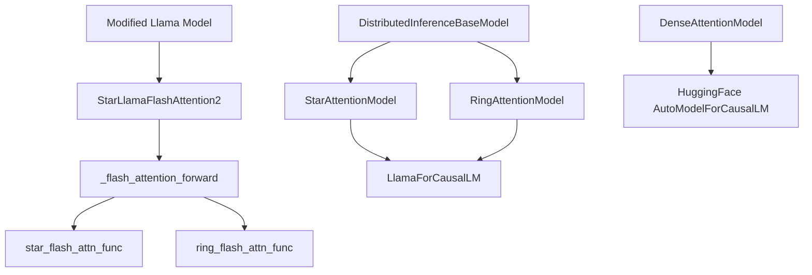
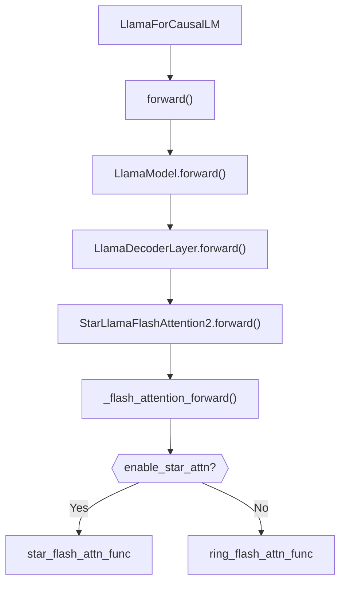
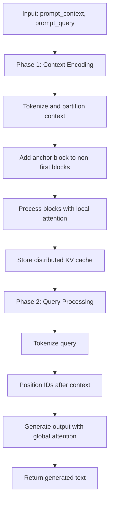
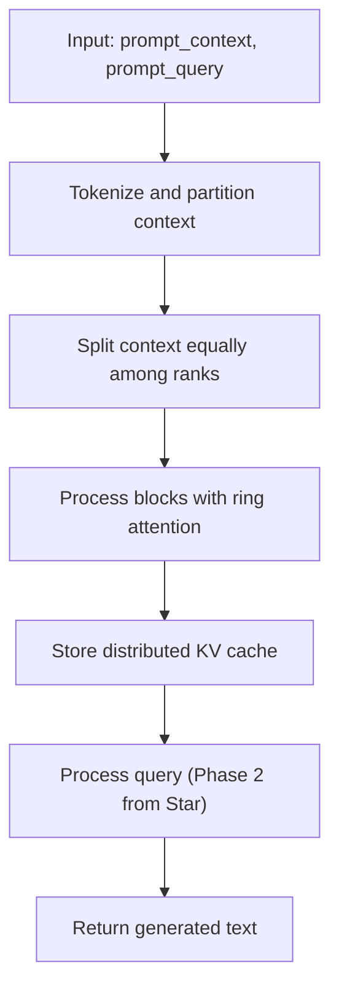
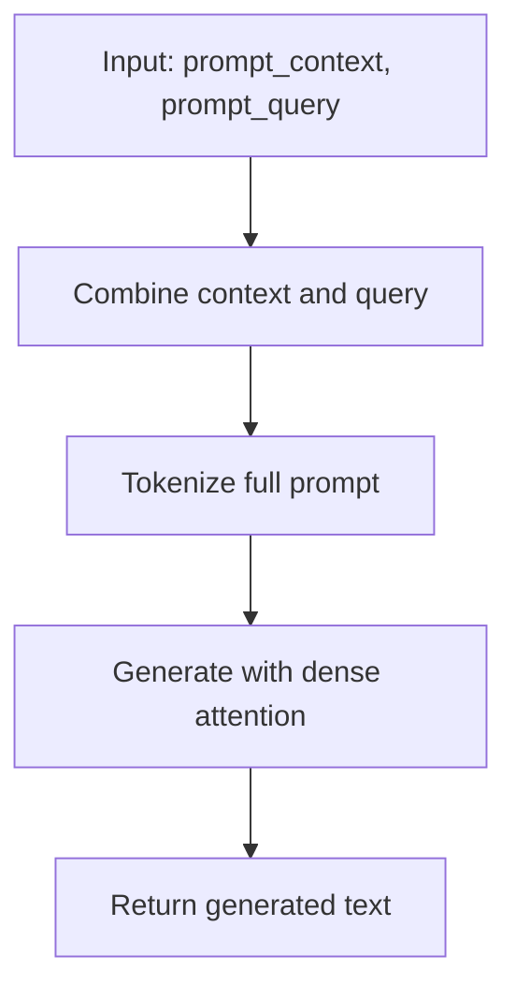
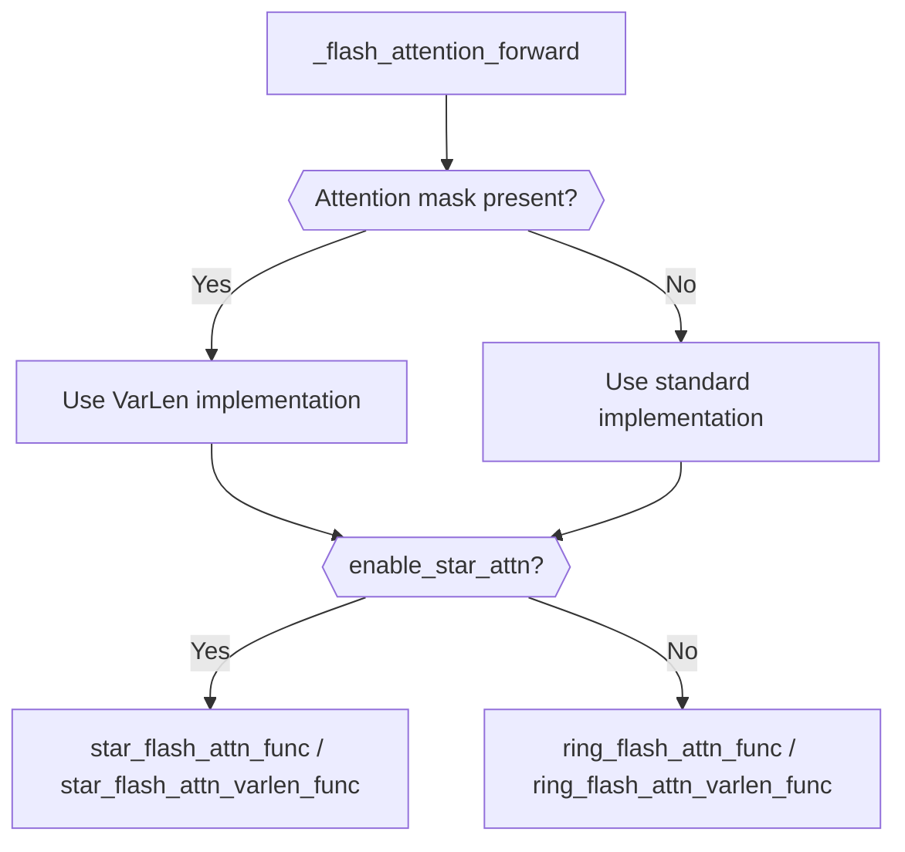
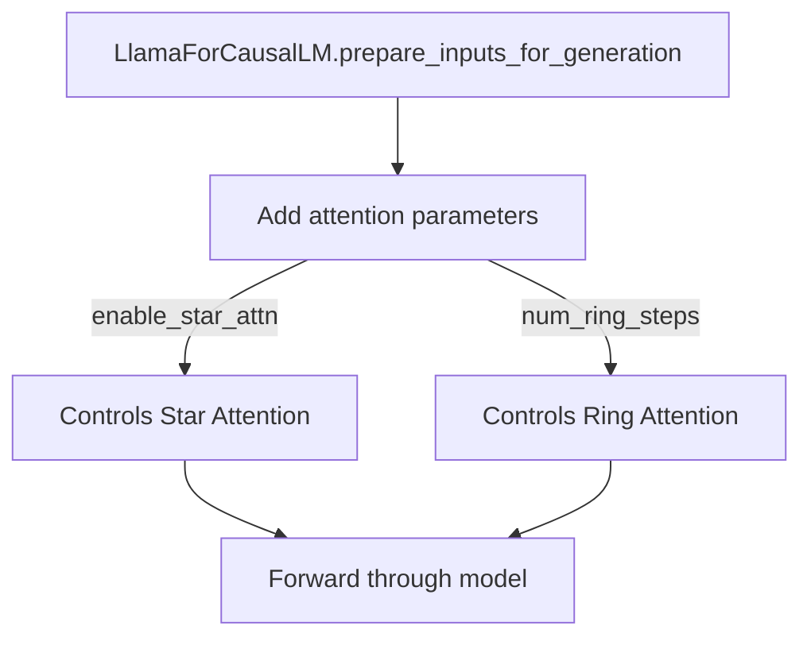

<!-- source: DeepWiki mcp.deepwiki.com · repo NVIDIA/Star-Attention · page 3.1 Model Integration · fetched 2026-10-26 -->

# Model Integration

<details>
<summary>Relevant source files</summary>

The following files were used as context for generating this wiki page:

- [model.py](model.py)
- [star_attention/__init__.py](star_attention/__init__.py)
- [star_attention/modeling_flash_attention_utils.py](star_attention/modeling_flash_attention_utils.py)
- [star_attention/modeling_llama.py](star_attention/modeling_llama.py)

</details>


This page explains how language models are integrated with different attention mechanisms in the Star-Attention system. Here we focus on the core model architecture and integration patterns for Dense, Ring, and Star Attention implementations.

For information about distributed execution details, see [Distributed Execution](#3.2).

## Model Architecture Overview

The Star-Attention framework provides a modular architecture that integrates different attention mechanisms with language models. This design enables swapping between Dense, Ring, and Star Attention while maintaining the same model interface.



Sources: [model.py:24-172](), [star_attention/modeling_llama.py:74-200]()

The system follows a layered design:
- High-level model interfaces handle prompting and token generation
- Modified LLM architectures implement attention-specific processing
- Low-level Flash Attention extensions provide efficient computation

## Integration Model Classes

The codebase provides three main model classes, each implementing a different attention mechanism:

| Model Class | Attention Type | Distributed | Key Features |
|-------------|----------------|-------------|--------------|
| `DenseAttentionModel` | Standard attention to all tokens | No | Simple implementation, baseline performance |
| `RingAttentionModel` | Ring-structured communication | Yes | Balanced efficiency and accuracy |
| `StarAttentionModel` | Two-phase with anchor block | Yes | Highest efficiency for long contexts |

```mermaid
classDiagram
    class "DistributedInferenceBaseModel" {
        +__init__(path, max_new_tokens, stop_words, block_size, anchor_block_size)
        +_init_distributed()
        +_tokenize(text)
        +_tokenize_and_partition_context(ctx)
        +_process_blockwise_context(ctx_ids_blocks, position_ids_blocks)
        +_generate_output(input_ids, position_ids, past_key_values)
        +_get_output_text(output, truncate_texts)
    }
    
    class "StarAttentionModel" {
        +_tokenize_and_partition_context(ctx)
        +_process_blockwise_context(ctx_ids_blocks, position_ids_blocks)
        +__call__(prompt_context, prompt_query)
    }
    
    class "RingAttentionModel" {
        +_tokenize_and_partition_context(ctx)
        +_process_blockwise_context(ctx_ids_blocks, position_ids_blocks)
        +__call__(prompt_context, prompt_query)
    }
    
    class "DenseAttentionModel" {
        +__init__(path, max_new_tokens, stop_words)
        +_generate_output(input_ids, position_ids)
        +_get_output_text(output, truncate_texts)
        +__call__(prompt_context, prompt_query)
    }
    
    "DistributedInferenceBaseModel" <|-- "StarAttentionModel"
    "DistributedInferenceBaseModel" <|-- "RingAttentionModel"
```

Sources: [model.py:24-396]()

### Base Model Implementation

The `DistributedInferenceBaseModel` serves as the foundation for distributed attention mechanisms. It provides:

1. Distributed environment initialization
2. Tokenization and context partitioning
3. Abstract methods for blockwise context processing
4. Token generation with KV cache management

Key methods:
- `_init_distributed()`: Sets up the distributed environment
- `_tokenize_and_partition_context()`: Divides context into blocks
- `_process_blockwise_context()`: Abstract method implemented by specific attention models
- `_generate_output()`: Common token generation logic

Sources: [model.py:24-172]()

## Attention Mechanism Integration

Star-Attention extends the Hugging Face Transformers implementation with custom attention mechanisms. This is achieved by modifying the Flash Attention 2 implementation for Llama models.



Sources: [star_attention/modeling_llama.py:81-200](), [star_attention/modeling_flash_attention_utils.py:40-160]()

The key integration points are:

1. `LLAMA_ATTENTION_CLASSES` dictionary in [star_attention/modeling_llama.py:203-207]() maps attention implementations
2. `StarLlamaFlashAttention2` extends `LlamaFlashAttention2` with Star/Ring attention support
3. `_flash_attention_forward` function selects the appropriate attention implementation
4. Model forward passes include new parameters (`num_ring_steps`, `enable_star_attn`)

## Star Attention Model Flow

The Star Attention model implements a two-phase process for handling long contexts efficiently:



Sources: [model.py:174-266]()

Implementation details:
- Context partitioning in `_tokenize_and_partition_context()` [model.py:177-193]()
- Anchor block prepending in `_process_blockwise_context()` [model.py:195-238]()
- Query processing in `__call__()` [model.py:240-266]()

## Ring Attention Model Flow

Ring Attention offers an alternative approach with distributed processing and ring communication:



Sources: [model.py:269-334]()

Key differences from Star Attention:
- No anchor block prepending
- Uses `num_ring_steps=-1` to enable full ring attention during context processing
- Same Phase 2 implementation as Star Attention for token generation

## Dense Attention Model

The `DenseAttentionModel` provides a baseline implementation using standard attention:



Sources: [model.py:337-395]()

Unlike distributed models, `DenseAttentionModel`:
- Doesn't use distributed processing
- Processes the entire context as a single unit
- Uses standard HuggingFace implementation

## Flash Attention Extensions

The system extends Flash Attention 2 with custom implementations for Star and Ring Attention:



Sources: [star_attention/modeling_flash_attention_utils.py:40-160]()

Key features of the custom implementations:
- Support for both padded and unpadded inputs
- Selection between Star and Ring attention based on `enable_star_attn` parameter
- Support for ring communication steps via `num_ring_steps` parameter

## Integration Usage Example

To use a model with Star Attention:

```python
# Initialize Star Attention model
model = StarAttentionModel(
    path="meta-llama/Llama-2-7b-hf",  # Model path
    max_new_tokens=100,               # Maximum tokens to generate
    stop_words=["###"],               # Optional stop words
    block_size=1024,                  # Size of context blocks
    anchor_block_size=256             # Size of anchor block
)

# Run inference
result = model(
    prompt_context="[Long context text...]",
    prompt_query="[Query to answer...]"
)

# Get generated text
generated_text = result['text'][0]
```

Sources: [model.py:174-266]()

## LlamaForCausalLM Modifications

The custom `LlamaForCausalLM` class adds specific parameters to support Star and Ring Attention:



Sources: [star_attention/modeling_llama.py:649-718]()

These parameters allow controlling attention behavior during generation:
- `enable_star_attn`: Enables Star Attention mechanism when `True`
- `num_ring_steps`: Controls ring communication (-1 for full ring, 0 for local only, >0 for limited steps)

## Summary

The Star-Attention model integration architecture provides a flexible framework for using different attention mechanisms with language models. The key components are:

1. Model interfaces (`StarAttentionModel`, `RingAttentionModel`, `DenseAttentionModel`)
2. Custom attention implementations (`StarLlamaFlashAttention2`)
3. Flash Attention extensions for efficient computation
4. Two-phase processing for Star Attention

This architecture enables efficient inference on very long contexts while maintaining high accuracy through the innovative Star Attention mechanism.

Sources: [model.py:24-396](), [star_attention/modeling_llama.py:74-718](), [star_attention/modeling_flash_attention_utils.py:40-160]()

---

