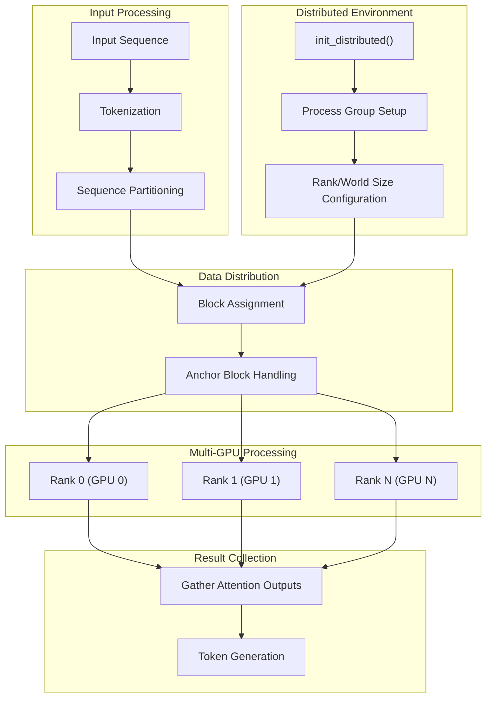
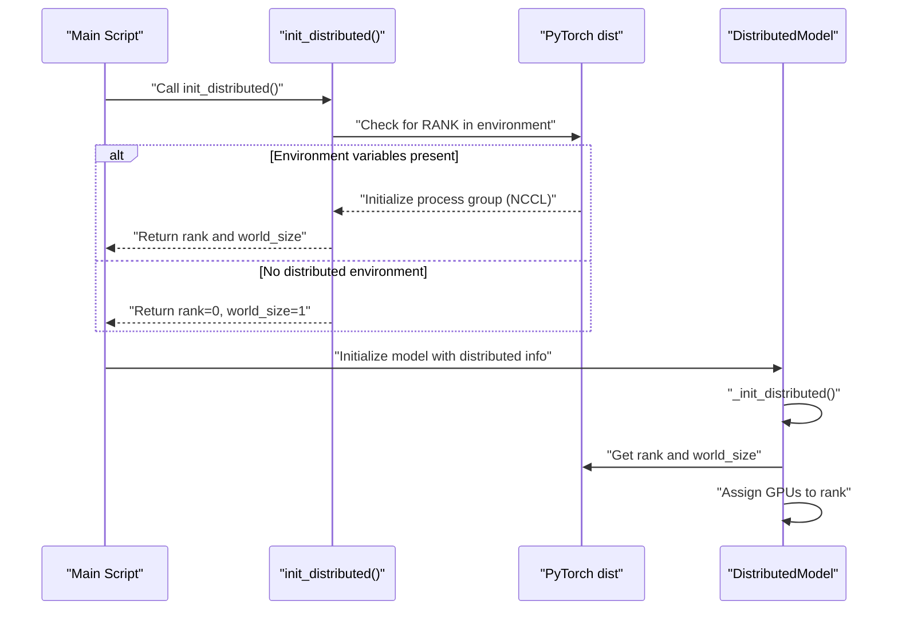
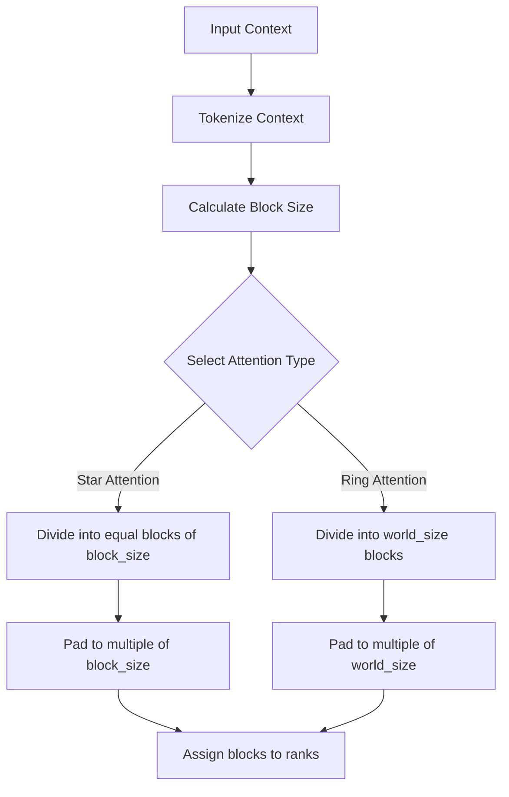
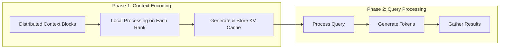
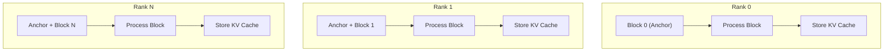
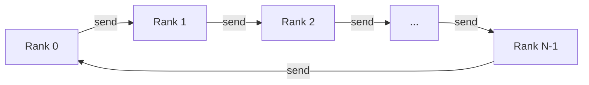
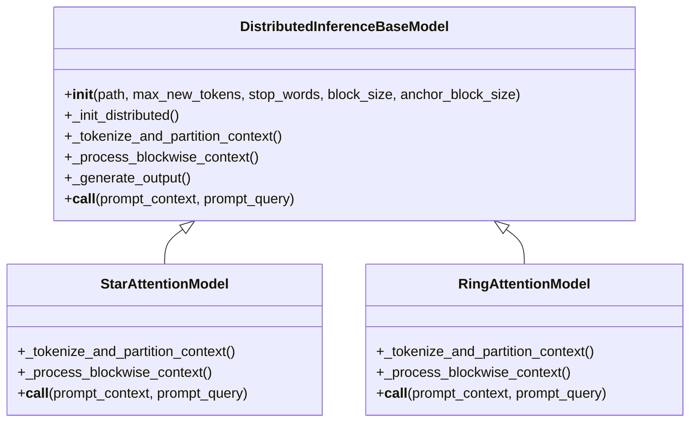

<!-- source: DeepWiki mcp.deepwiki.com · repo NVIDIA/Star-Attention · page 3.2 Distributed Execution · fetched 2026-10-26 -->

# Distributed Execution

<details>
<summary>Relevant source files</summary>

The following files were used as context for generating this wiki page:

- [model.py](model.py)
- [run_star_attn_inference.py](run_star_attn_inference.py)
- [star_attention/ring_flash_attn/utils.py](star_attention/ring_flash_attn/utils.py)

</details>


This page documents the distributed execution capabilities in the Star-Attention system, which enable efficient processing of long sequences across multiple GPUs or nodes. For information about the Star Attention mechanism itself and its theoretical foundations, see [Star Attention Mechanism](#2).

## 1. Distributed Architecture Overview

Star-Attention implements distributed execution primarily for handling long contexts that exceed single-GPU memory capacity. The system partitions input sequences and distributes the workload across multiple GPUs, coordinating through PyTorch's distributed communication framework.



Sources: [run_star_attn_inference.py:36-48](), [model.py:55-80]()

## 2. Distributed Environment Initialization

The system initializes a distributed environment using PyTorch's distributed module. This sets up the necessary communication channels between different processes or GPUs.



The initialization reads environment variables to configure the distributed setup:
- `RANK`: Global rank of the current process
- `WORLD_SIZE`: Total number of processes
- `LOCAL_RANK`: Local rank within the current node
- `LOCAL_WORLD_SIZE`: Number of processes in the current node

Sources: [run_star_attn_inference.py:36-48](), [model.py:55-80]()

## 3. Data Distribution Strategy

### 3.1 Sequence Partitioning

For distributed processing, input sequences are divided into blocks and distributed across the available ranks. The partitioning strategy depends on the attention mechanism:



In the Star Attention approach:
- Context is divided into fixed-size blocks (determined by `block_size` parameter)
- Each block is prefixed with the first "anchor" block
- Blocks are distributed across ranks for parallel processing

Sources: [model.py:177-193](), [model.py:275-290]()

### 3.2 GPU Assignment and Memory Management

The system carefully manages GPU assignment to ensure efficient memory utilization:

```python
# Assign GPUs to each rank based on local rank
num_devices_per_rank = torch.cuda.device_count() // self.local_world_size
device_id_start = self.local_rank * num_devices_per_rank
self.max_memory = {
    x: f'{round(torch.cuda.get_device_properties(0).total_memory / (1024 ** 3))}GB'
    for x in range(device_id_start, device_id_start + num_devices_per_rank)
}
```

This approach ensures each process only uses its assigned GPUs, preventing resource conflicts.

Sources: [model.py:65-72]()

## 4. Distributed Processing Flow

The distributed execution follows a two-phase approach that aligns with the Star Attention mechanism:



### 4.1 Phase 1: Context Encoding

Each rank processes its assigned context blocks:



In Star Attention, each rank except the first prefixes its blocks with the anchor block from the first rank. After processing, it discards the KV cache corresponding to the anchor block.

Sources: [model.py:195-238]()

### 4.2 Phase 2: Query Processing and Token Generation

Query processing leverages the distributed KV caches to generate output tokens:

1. The query is replicated to all ranks
2. Each rank computes attention using its local KV cache
3. Results are gathered at a designated rank (often the last rank)
4. Token generation proceeds autoregressively

Sources: [model.py:118-153](), [model.py:261-266]()

## 5. Communication Patterns

### 5.1 Point-to-Point Communication

For Ring Attention, the system uses point-to-point communication between ranks in a ring topology:



The `RingComm` class handles this communication pattern:

```python
# Ring communication setup
self.send_rank = (self.rank + 1) % self.world_size
self.recv_rank = (self.rank - 1) % self.world_size
```

Sources: [star_attention/ring_flash_attn/utils.py:103-142]()

### 5.2 Barrier Synchronization

The system uses barriers to ensure all ranks complete processing before proceeding to the next step:

```python
# Synchronize all processes
dist.barrier()
```

This is particularly important during token generation, where each step depends on the completion of the previous step across all ranks.

Sources: [run_star_attn_inference.py:186](), [run_star_attn_inference.py:193]()

## 6. Running Distributed Inference

### 6.1 Configuration Options

When running distributed inference, several parameters control the distribution behavior:

| Parameter | Description | Default |
|-----------|-------------|---------|
| `block_size` | Size of context blocks for Star Attention | Required for Star Attention |
| `anchor_block_size` | Size of anchor block prefix | If not provided, uses full first block |
| `attn_type` | Attention mechanism (`dense`, `ring`, `star`) | Required |

Sources: [run_star_attn_inference.py:198-212]()

### 6.2 Launching Distributed Jobs

To run distributed inference, the environment must be properly configured:

```bash
# Example multi-GPU launch command
python -m torch.distributed.launch --nproc_per_node=4 run_star_attn_inference.py \
  --model_path /path/to/model \
  --attn_type star \
  --block_size 4096 \
  --anchor_block_size 1024 \
  --tokens_to_generate 100 \
  --input_path input.jsonl \
  --output_path output.jsonl
```

The script will automatically detect the distributed environment and configure accordingly.

Sources: [run_star_attn_inference.py:36-48]()

## 7. Distributed Model Classes

The system provides specialized model classes for distributed execution:



Each model implements the distributed processing specific to its attention mechanism while sharing common distributed infrastructure.

Sources: [model.py:24-83](), [model.py:174-266](), [model.py:269-334]()

## 8. Memory Considerations

Distributed execution is primarily designed to overcome memory limitations when processing long sequences. The memory requirements scale with:

1. Sequence length
2. Model size
3. Number of attention heads
4. Batch size

By distributing the workload, the system can process sequences that would exceed the memory capacity of a single GPU.

Sources: [model.py:65-72](), [model.py:187-189]()

By leveraging distributed execution, Star-Attention can efficiently process extremely long contexts (up to 128K tokens) while maintaining both accuracy and reasonable inference speeds.

---

