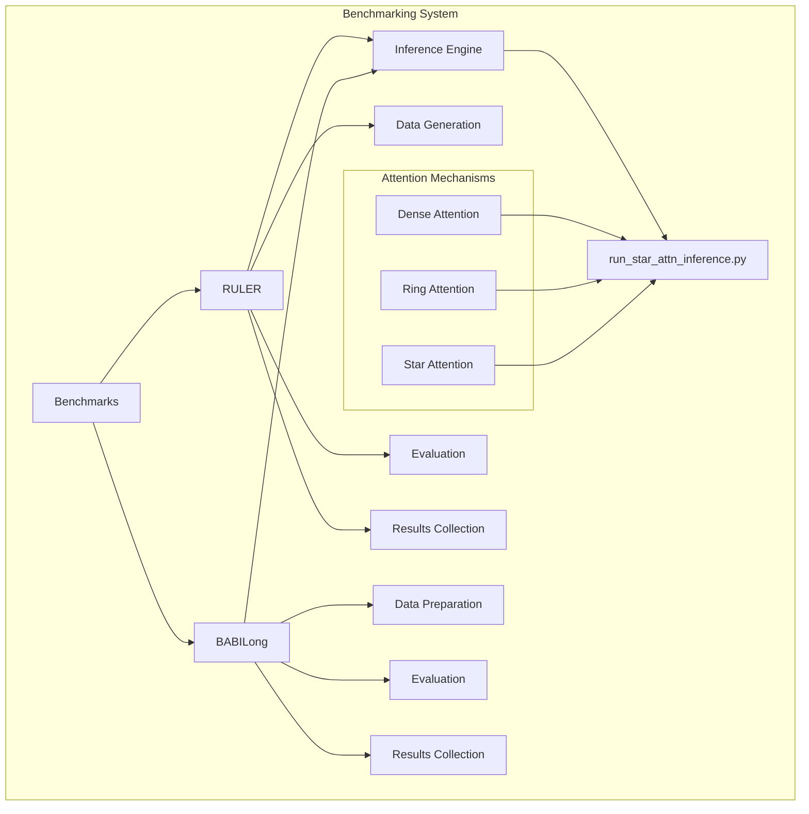
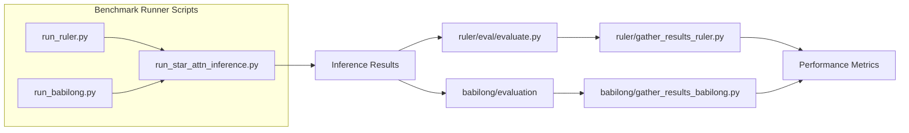
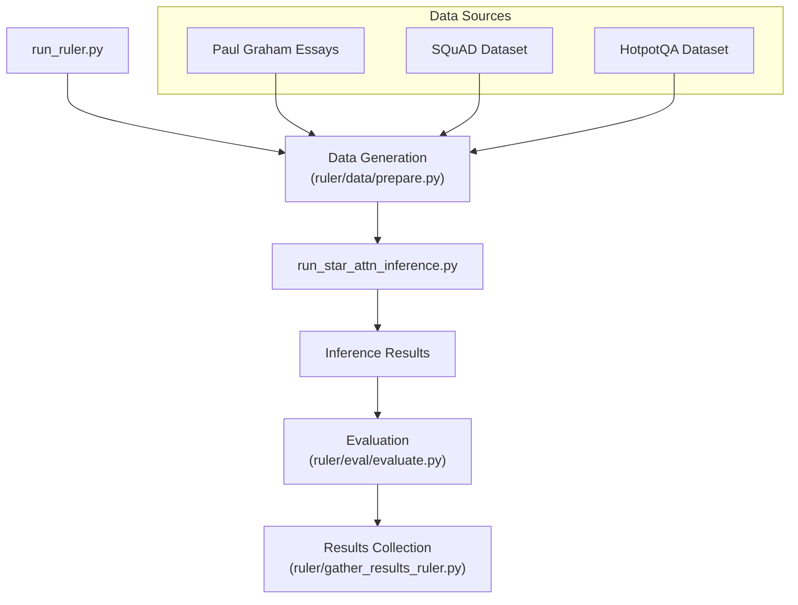
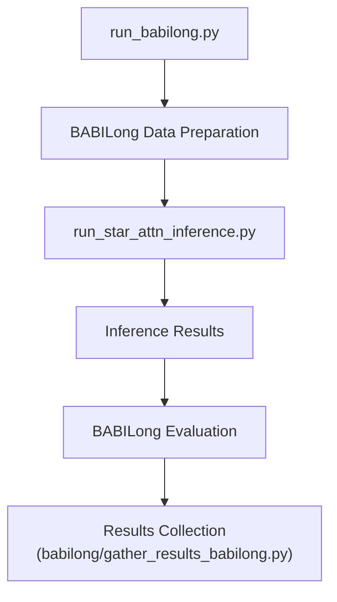
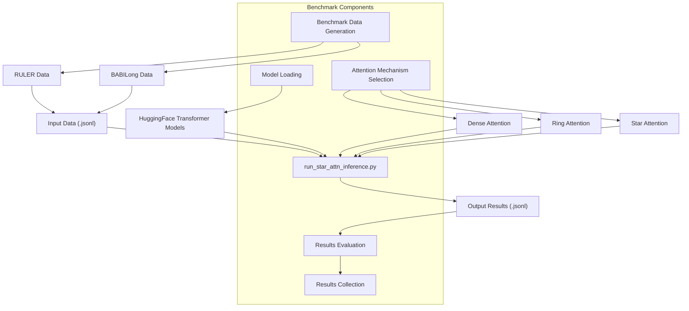

<!-- source: DeepWiki mcp.deepwiki.com · repo NVIDIA/Star-Attention · page 4 Benchmarks · fetched 2026-10-26 -->

# Benchmarks

<details>
<summary>Relevant source files</summary>

The following files were used as context for generating this wiki page:

- [.gitignore](.gitignore)
- [README.md](README.md)
- [babilong/README.md](babilong/README.md)
- [images/star_attn_acc_ruler_babilong.png](images/star_attn_acc_ruler_babilong.png)
- [requirements.txt](requirements.txt)
- [ruler/README.md](ruler/README.md)
- [run_ruler.py](run_ruler.py)

</details>


This page provides an overview of the benchmarking systems used to evaluate Star Attention. The benchmarks are designed to test the performance of LLMs on long sequences, comparing different attention mechanisms including Dense Attention, Ring Attention, and Star Attention.

The benchmarking framework in this repository includes two main benchmarks: RULER and BABILong. For information about how to run experiments with these benchmarks, see [Usage Guide](#5).

## Benchmark Overview

Star-Attention's performance is evaluated using two standard long-context benchmarks:

1. **RULER** (Retrieval-based Understanding and Long-context Evaluation for Reasoning) - Tests models' ability to retrieve and reason over information in long contexts.

2. **BABILong** - A long-context needle-in-a-haystack benchmark adapted from the bAbI dataset.

Each benchmark includes a variety of tasks designed to evaluate different aspects of long-context understanding and retrieval capabilities.



Sources: [README.md:9-10](), [run_ruler.py:16-39](), [run_ruler.py:180-192]()

## Benchmarking Infrastructure

The repository provides scripts for running both benchmarks with various configurations, including different sequence lengths, attention mechanisms, and model parameters.



Sources: [README.md:145-171](), [run_ruler.py:104-198]()

### Command-Line Interface

Both benchmark runners share a similar command-line interface, allowing users to specify:

- Model path
- Attention type (dense, ring, star)
- Block size and anchor block size (for Star Attention)
- Sequence lengths to evaluate
- Number of parallel processes per node

Example command for running RULER:

```
python run_ruler.py \
    -n <experiment_name> \
    -p <path_to_model> \
    -pc <prompt_template_type> \
    -a star \
    -bs <context_block_size> \
    -l <list_of_sequence_lengths_to_run_inference> \
    -np <num_parallel_processes_per_node> \
    --output_dir <output_directory>
```

Sources: [README.md:153-164](), [run_ruler.py:42-91]()

### Distributed Execution

The benchmarking system supports distributed execution with configurable parameters:

- `-np`: Number of parallel processes (hosts) per node
- `-nn`: Number of nodes (for multi-node setup)

This allows scaling the inference to handle larger models and bigger block sizes by distributing the computation across multiple GPUs and nodes.

Sources: [README.md:172-188](), [run_ruler.py:78-82]()

## RULER Benchmark

RULER (Retrieval-based Understanding and Long-context Evaluation for Reasoning) is designed to evaluate LLMs' abilities to retrieve and reason over information in long contexts.

### RULER Tasks

RULER includes several task categories:

| Task Category | Variants | Description |
|---------------|----------|-------------|
| NIAH (Needle in a Haystack) | single_1, single_2, single_3 | Finding specific information embedded in a long context |
| NIAH | multikey_1, multikey_2, multikey_3 | Finding information associated with multiple keys |
| NIAH | multivalue | Finding multiple values associated with a key |
| NIAH | multiquery | Answering multiple queries about a context |
| VT (Verification Test) | - | Verifying statements against information in the context |
| CWE (Cross-Window Evidence) | - | Finding evidence distributed across multiple parts of the context |
| FWE (Far Window Evidence) | - | Finding evidence far from the query in the context |
| QA (Question Answering) | qa_1, qa_2 | General question answering tasks |

Sources: [run_ruler.py:25-39](), [README.md:148-149]()

### RULER Workflow



Sources: [README.md:128-136](), [run_ruler.py:165-178](), [run_ruler.py:194-197]()

### RULER Data Generation

RULER generates synthetic data for evaluation by:

1. Downloading source materials (Paul Graham essays, SQuAD, and HotpotQA datasets)
2. Using `ruler/data/prepare.py` to generate data for each task
3. Adapting the data to the model's prompt template format

The data generation is customizable with parameters like:
- Maximum sequence length
- Number of samples per task
- Tokenizer path and type
- Model template type

Sources: [README.md:128-136](), [run_ruler.py:164-177]()

## BABILong Benchmark

BABILong is a long-context needle-in-a-haystack benchmark adapted from the bAbI dataset, designed to test LLMs on finding information in very long contexts.

### BABILong Workflow



Sources: [README.md:189-199](), [babilong/README.md:1-3]()

## Performance Metrics

The benchmarks evaluate attention mechanisms on two key metrics:

1. **Accuracy**: The percentage of correct responses on the benchmark tasks
2. **Inference Speed**: The time taken to process and generate responses

### Performance Results

The Star Attention mechanism shows significant improvements in inference speed while maintaining accuracy:

| Model | Sequence Length (K) | Block Size (K) | Ring-Attn Acc. (%) | Star-Attn Δ Acc. | Star-Attn Δ Speedup |
|-------|---------------------|----------------|--------------------|--------------------|---------------------|
| Llama3-8B-Instruct-1048K | 16 | 4 | 86.12 | +2.47% | 1.1x |
| Llama3-8B-Instruct-1048K | 32 | 8 | 82.52 | +1.54% | 1.2x |
| Llama3-8B-Instruct-1048K | 64 | 16 | 79.05 | +1.28% | 1.8x |
| Llama3-8B-Instruct-1048K | 128 | 32 | 77.39 | +1.23% | 2.7x |
| Llama-3.1-70B-Instruct | 16 | 4 | 95.09 | -2.85% | 1.7x |
| Llama-3.1-70B-Instruct | 32 | 8 | 94.61 | -2.70% | 2.0x |
| Llama-3.1-70B-Instruct | 64 | 16 | 88.54 | -1.63% | 4.7x |

In these evaluations, the block size is set to one-quarter of the sequence length. Star Attention achieves significant speedup over Ring Attention while maintaining accuracy. For larger models, the speedup is even more pronounced.

Sources: [README.md:11-93]()

## Custom Benchmark Usage

The repository also supports running inference on custom data using the same infrastructure. Custom data should be provided in `.jsonl` format with the following structure:

```json
{
  "index": "<sample index>",  # optional
  "input_context": "<long context portion of the input sample>",
  "input_query": "<query portion of the input sample>",
  "output": "<expected output response>",
}
```

The command to run inference on custom data:

```
python run_star_attn_inference.py \
    --model_path <path_to_model> \
    --attn_type star \
    --block_size <context_block_size> \
    --tokens_to_generate <num_tokens_to_generate> \
    --stop_words <end_of_sequence_tokens> \
    --input_path <path_to_input_jsonl> \
    --output_path <path_to_output_jsonl>
```

This allows researchers to evaluate Star Attention on their own datasets beyond the provided benchmarks.

Sources: [README.md:202-228]()

## Benchmark Architecture

The benchmark system is designed to be modular, allowing for evaluation of different attention mechanisms with consistent methodology:



Sources: [README.md:146-199](), [run_ruler.py:180-197]()

## Dependencies and Setup

The benchmarking system requires various dependencies to run properly:

```
torch==2.3.1
transformers==4.44.0
flash-attn==2.6.3
tqdm
wonderwords
pyyaml
nltk
scipy
```

Additional setup steps:
- Installing the Python dependencies
- Downloading the `punkt` tokenizer from NLTK
- Downloading necessary data for RULER (Paul Graham Essays, SQuAD, HotpotQA)
- Downloading models from HuggingFace

Sources: [README.md:112-142](), [requirements.txt:1-11]()

In summary, the benchmarking system provides a comprehensive framework for evaluating the performance of Star Attention and comparing it with other attention mechanisms across a range of sequence lengths and tasks. The results demonstrate that Star Attention achieves significant speedups while maintaining high accuracy on long-context tasks.

---

