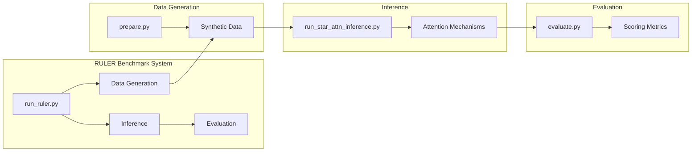
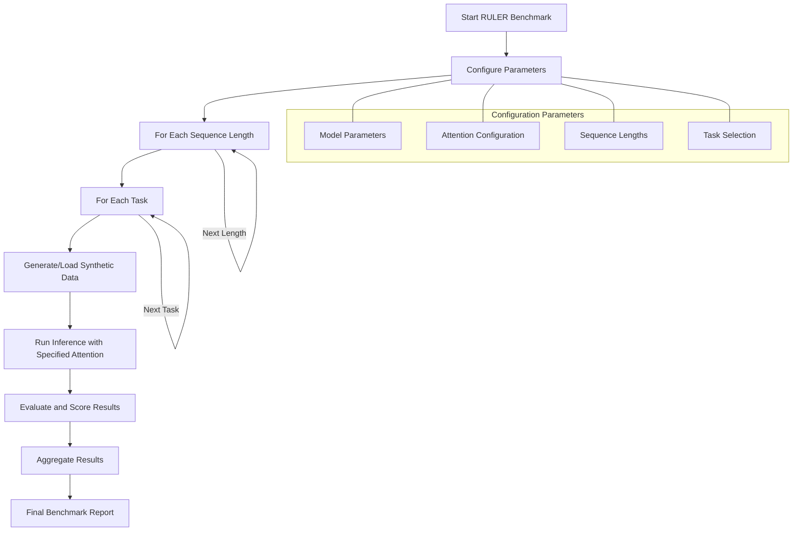
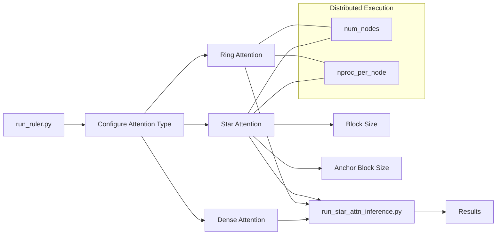

<!-- source: DeepWiki mcp.deepwiki.com · repo NVIDIA/Star-Attention · page 4.1 RULER Benchmark · fetched 2026-10-26 -->

# RULER Benchmark

<details>
<summary>Relevant source files</summary>

The following files were used as context for generating this wiki page:

- [requirements.txt](requirements.txt)
- [ruler/README.md](ruler/README.md)
- [ruler/__init__.py](ruler/__init__.py)
- [ruler/data/__init__.py](ruler/data/__init__.py)
- [run_ruler.py](run_ruler.py)

</details>


## Purpose and Scope

This document details the RULER (Really Understanding Long-context Evaluation Resources) benchmark system as implemented in the Star-Attention repository. RULER is a comprehensive benchmark for evaluating long-context capabilities of language models, focusing specifically on assessing how models handle information retrieval and reasoning over long contexts up to 128K tokens. For information about other benchmarks in the repository, see [BABILong Benchmark](#4.2) and [Synthetic Data Generation](#4.3).

Sources: [ruler/README.md:1-3]()

## Overview of RULER

RULER is a synthetic benchmark suite designed to systematically evaluate a model's ability to access and reason over information distributed across long contexts. It provides controlled scenarios that test specific capabilities needed for effective long-context processing.



Sources: [run_ruler.py:16-43](), [run_ruler.py:166-197]()

## RULER Tasks

RULER includes a diverse set of tasks that evaluate different aspects of long-context processing:

| Task Category | Task Names | Description |
|---------------|------------|-------------|
| Needle in a Haystack (Single) | niah_single_1, niah_single_2, niah_single_3 | Tests ability to find a single key piece of information in a long context |
| Needle in a Haystack (Multi-key) | niah_multikey_1, niah_multikey_2, niah_multikey_3 | Tests ability to locate multiple related key pieces of information |
| Needle in a Haystack (Multi-value) | niah_multivalue | Tests retrieval of multiple values associated with a key |
| Needle in a Haystack (Multi-query) | niah_multiquery | Tests handling of multiple query values |
| Verbatim Task | vt | Tests verbatim recall of specific information |
| Entity Extraction | cwe, fwe | Tests extraction of entities and their properties |
| Question Answering | qa_1, qa_2 | Tests general question answering capabilities |

Sources: [run_ruler.py:25-39]()

## Benchmark Workflow

The RULER benchmark process follows a structured workflow:



Sources: [run_ruler.py:104-197]()

### Data Generation

For each task and sequence length, RULER generates synthetic data with controlled properties:

1. Data is generated using task-specific generators
2. Generated data ensures specific information is placed at known positions within the context
3. Each sample includes a query that requires finding or reasoning over the placed information
4. Data is formatted according to model-specific prompt templates

Sources: [run_ruler.py:162-177]()

### Inference Process

RULER runs inference with the specified model and attention mechanism:

1. The model processes each sample with the configured attention type (Dense, Ring, or Star)
2. For distributed attention types (Ring, Star), the context is processed across multiple nodes/GPUs
3. The model generates responses containing answers to the query
4. Responses are saved for evaluation

Sources: [run_ruler.py:180-192]()

### Evaluation

Responses are evaluated against ground truth:

1. Task-specific scoring metrics measure accuracy and precision
2. Results are aggregated across samples and tasks
3. Performance is analyzed across different sequence lengths to evaluate scaling properties

Sources: [run_ruler.py:194-197]()

## Integration with Star Attention

RULER is specifically adapted to evaluate Star Attention's capabilities on long-context processing:



Star Attention configuration within RULER requires:
- Block size: size of each context block for distributed processing
- Anchor block size: size of the anchor block prefixed to each context block
- Number of nodes and processes: for distributed execution

Sources: [run_ruler.py:57-59](), [run_ruler.py:118-121](), [run_ruler.py:143-147]()

## Usage

### Command Line Options

RULER provides a comprehensive set of command line options for configuring benchmark runs:

#### Model Parameters
- `-n, --model_name`: Experiment name prefix
- `-p, --model_path`: Path to the model
- `-pc, --prompt_config`: Prompt template configuration

#### Attention Configuration
- `-a, --attn_type`: Attention type (dense, ring, star)
- `-bs, --block_size`: Context block size
- `-as, --anchor_block_size`: Anchor block size

#### Sequence Lengths and Tasks
- `-l, --seq_lengths`: Sequence lengths to evaluate
- `-t, --tasks`: Tasks to run
- `-d, --pregen_data_dir`: Pre-generated data directory
- `--num_samples_per_task`: Number of samples per task

#### Distributed Inference
- `-nn, --num_nodes`: Number of nodes
- `-np, --nproc_per_node`: Number of processes per node

#### Output Configuration
- `--output_dir`: Results directory

Sources: [run_ruler.py:42-91]()

### Example Usage

To run the RULER benchmark with Star Attention:

```bash
python run_ruler.py \
  --model_name llama2-7b \
  --model_path /path/to/llama-2-7b \
  --prompt_config llama2 \
  --attn_type star \
  --block_size 4096 \
  --anchor_block_size 1024 \
  --seq_lengths 16384 32768 65536 \
  --tasks niah_single_1 niah_multikey_1 qa_1 \
  --num_nodes 1 \
  --nproc_per_node 8 \
  --output_dir results
```

Sources: [run_ruler.py:200-241]()

## Implementation Details

### Data Preparation and Validation

The `prepare.py` script generates task-specific data that:
1. Embeds relevant information at controlled positions in the context
2. Creates appropriate queries that require finding this information
3. Formats the data according to model-specific prompt templates
4. Validates that the input fits within the specified sequence length

### Performance Evaluation

The benchmark assesses both accuracy and efficiency:
1. **Accuracy Metrics**: Measure how well the model retrieves and reasons over information in long contexts
2. **Efficiency Metrics**: Measure processing speed and memory usage compared to baseline attention methods

For Star Attention specifically, RULER helps evaluate whether the two-phase approach (context encoding and query processing) maintains accuracy while improving efficiency for long contexts.

Sources: [run_ruler.py:162-197]()

---

