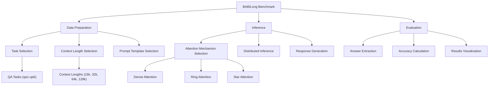
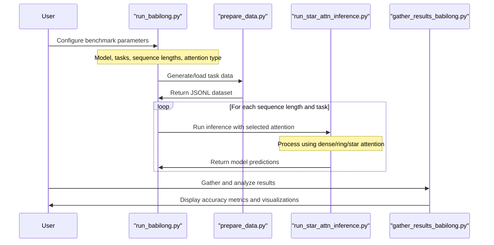
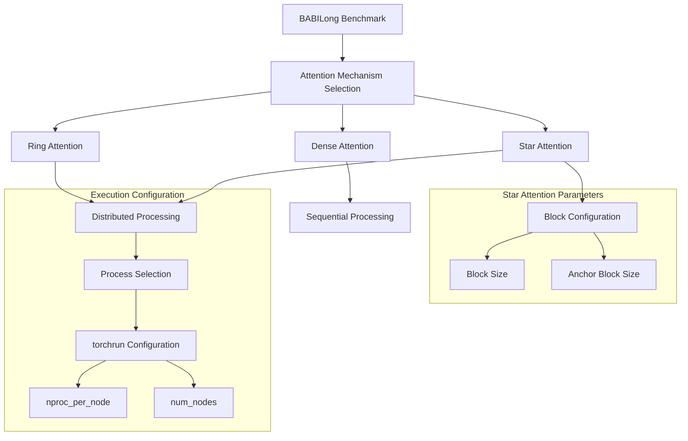

<!-- source: DeepWiki mcp.deepwiki.com · repo NVIDIA/Star-Attention · page 4.2 BABILong Benchmark · fetched 2026-10-26 -->

# BABILong Benchmark

<details>
<summary>Relevant source files</summary>

The following files were used as context for generating this wiki page:

- [babilong/README.md](babilong/README.md)
- [babilong/__init__.py](babilong/__init__.py)
- [babilong/gather_results_babilong.py](babilong/gather_results_babilong.py)
- [babilong/metrics.py](babilong/metrics.py)
- [run_babilong.py](run_babilong.py)

</details>


## Purpose and Scope

This document provides an in-depth explanation of the BABILong benchmark in the Star-Attention system. BABILong is a long-context needle-in-a-haystack benchmark designed to evaluate an LLM's ability to retrieve specific information buried within very long contexts, with sequence lengths ranging from 16K to 128K tokens. 

For information about other benchmarks used to evaluate Star-Attention, see [RULER Benchmark](#4.1) and [Synthetic Data Generation](#4.3).

## Benchmark Overview

BABILong (adapted from the original [BABILong repository](https://github.com/booydar/babilong)) tests a model's capability to answer questions that require locating and retrieving specific facts from very long documents. Unlike traditional benchmarks that focus on short contexts, BABILong specifically evaluates the effective context window utilization in long-sequence scenarios.

The benchmark includes five QA task types, which must be answered by retrieving the correct information from increasingly long contexts:
- qa1: Single supporting fact
- qa2: Two supporting facts
- qa3: Three supporting facts
- qa4: Two argument relations
- qa5: Three argument relations

Sources: [run_babilong.py:24](). [babilong/README.md:1-3]().

## Benchmark Structure



Sources: [run_babilong.py:24-26](). [run_babilong.py:42-46]().

### Data Preparation

The BABILong benchmark tasks are generated through the `prepare_data.py` script, which creates task-specific question-answer pairs embedded in contexts of varying lengths. Each task file is stored in JSONL format with the naming convention `{task}_{sequence_length}.jsonl` (e.g., `qa1_16k.jsonl`).

For each task and sequence length combination, the system:
1. Downloads the original bAbI dataset (if needed)
2. Processes it into longer contexts according to the specified length
3. Generates task-specific questions
4. Formats the data with the specified prompt template

Sources: [run_babilong.py:146-156]().

### Task Types

BABILong includes five different question answering tasks, each requiring different levels of reasoning complexity:

| Task ID | Description | Examples of Labels |
|---------|-------------|-------------------|
| qa1 | Single supporting fact | bathroom, bedroom, garden, hallway, kitchen, office |
| qa2 | Two supporting facts | bathroom, bedroom, garden, hallway, kitchen, office |
| qa3 | Three supporting facts | bathroom, bedroom, garden, hallway, kitchen, office |
| qa4 | Two argument relations | bathroom, bedroom, garden, hallway, kitchen, office |
| qa5 | Three argument relations | Bill, Fred, Jeff, Mary, apple, football, milk |

Sources: [babilong/metrics.py:16-37]().

## Running BABILong Benchmark



Sources: [run_babilong.py:87-217](). [babilong/gather_results_babilong.py:33-131]().

### Command-line Arguments

The benchmark is run using the `run_babilong.py` script, which offers extensive configuration options:

| Argument Group | Key Parameters | Description |
|----------------|---------------|-------------|
| Model Parameters | `--model_name`, `--model_path`, `--prompt_config` | Specify the model and prompt template |
| Attention Configuration | `--attn_type`, `--block_size`, `--anchor_block_size` | Configure attention mechanism |
| Sequence & Tasks | `--seq_lengths`, `--tasks` | Select sequence lengths and tasks to evaluate |
| Distributed Inference | `--num_nodes`, `--nproc_per_node` | Configure distributed processing |
| I/O | `--output_dir`, `--pregen_data_dir` | Specify output and pre-generated data locations |

Sources: [run_babilong.py:28-72](). [run_babilong.py:173-203]().

### Benchmark Workflow

The BABILong benchmark follows this workflow:

1. **Configuration**: Parse command-line arguments to set up the benchmark
2. **Data Preparation**: For each task and sequence length:
   - Use pre-generated data if available
   - Otherwise, generate task-specific data with the specified prompt template
3. **Inference**: For each task and sequence length:
   - Configure the distributed execution environment based on attention type
   - Run the inference using the specified attention mechanism
   - Store results in a JSONL file
4. **Evaluation**: After inference:
   - Read the prediction results
   - Compare predictions with ground truth answers
   - Calculate and display accuracy metrics

Sources: [run_babilong.py:87-169](). [babilong/gather_results_babilong.py:33-131]().

## Integration with Star Attention



Sources: [run_babilong.py:42-45](). [run_babilong.py:62-65](). [run_babilong.py:124-128]().

The BABILong benchmark is specifically designed to evaluate Star Attention's performance against other attention mechanisms. Key integration points:

1. **Attention Type Selection**: The benchmark supports multiple attention types:
   - `dense`: Traditional dense attention (baseline)
   - `star`: Star attention (main focus)
   - `ring`: Ring attention (comparison)

2. **Block Configuration for Star Attention**:
   - `block_size`: Size of context blocks to be processed
   - `anchor_block_size`: Size of the anchor block

3. **Distributed Execution**:
   - For star and ring attention, the benchmark automatically configures distributed execution
   - Number of processes depends on sequence length and block size
   - Dense attention uses sequential processing

4. **Adaptive Configuration**:
   - The framework automatically adjusts the number of processes based on the sequence length and block size
   - For very long sequences, it distributes the workload across multiple processes

Sources: [run_babilong.py:100-126](). [run_babilong.py:195-202]().

## Results Analysis

After running the benchmark, results can be gathered and analyzed using the `gather_results_babilong.py` script. This script:

1. Loads model predictions from output JSONL files
2. Compares predictions with ground truth answers
3. Calculates accuracy scores for each task and sequence length
4. Generates visualizations of results (heatmaps)
5. Reports missing or incomplete experiments

### Evaluation Metrics

BABILong uses a specialized answer comparison function that:

1. Preprocesses model output to extract the actual answer
2. Identifies task-specific labels in the output
3. Excludes labels mentioned in the question
4. Compares the extracted answer with the ground truth
5. Supports both single-label and multi-label answers

```python
def compare_answers(target, output, question, task_labels):
    # Preprocess output to extract the answer
    # Compare with ground truth
    # Return True if correct, False otherwise
```

Sources: [babilong/metrics.py:40-75](). [babilong/gather_results_babilong.py:106-121]().

### Results Visualization

Results can be visualized as a heatmap showing accuracy scores across different tasks and sequence lengths:

| Context size | qa1 | qa2 | qa3 | qa4 | qa5 |
|--------------|-----|-----|-----|-----|-----|
| 16k          | 95% | 92% | 88% | 90% | 85% |
| 32k          | 94% | 90% | 85% | 88% | 82% |
| 64k          | 92% | 88% | 82% | 85% | 78% |
| 128k         | 90% | 85% | 78% | 80% | 75% |

Note: The values shown are examples and not actual results.

Sources: [babilong/gather_results_babilong.py:38-70](). [babilong/gather_results_babilong.py:124]().

## Practical Usage Example

To run the BABILong benchmark with Star Attention:

```bash
python run_babilong.py \
    --model_name llama2-7b \
    --model_path /path/to/model \
    --prompt_config llama_chat \
    --attn_type star \
    --block_size 2048 \
    --anchor_block_size 512 \
    --seq_lengths 16384 32768 64536 131072 \
    --tasks qa1 qa2 qa3 qa4 qa5 \
    --num_nodes 1 \
    --nproc_per_node 8 \
    --output_dir ./results
```

This command will evaluate the specified model using Star Attention across all BABILong tasks and sequence lengths, with a block size of 2048 and anchor block size of 512, using distributed execution with 8 processes.

Sources: [run_babilong.py:174-217]().

---

