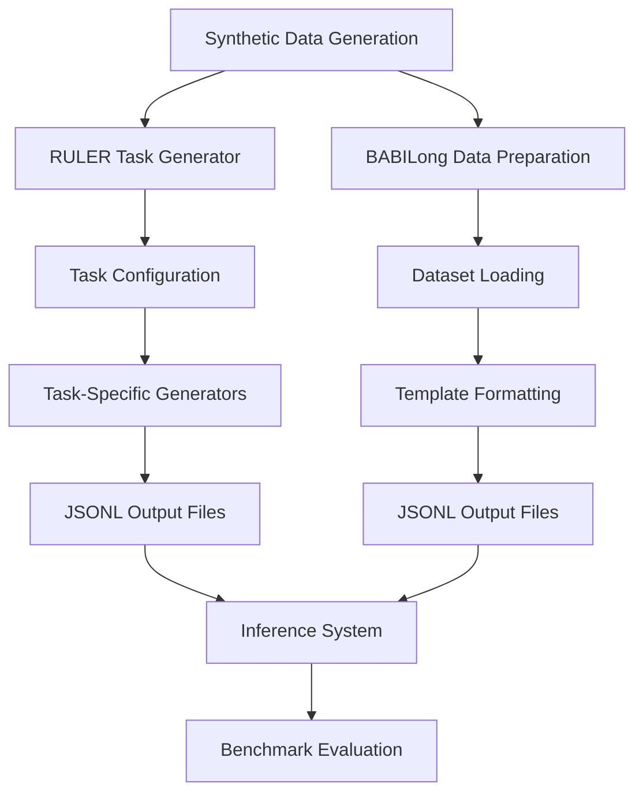
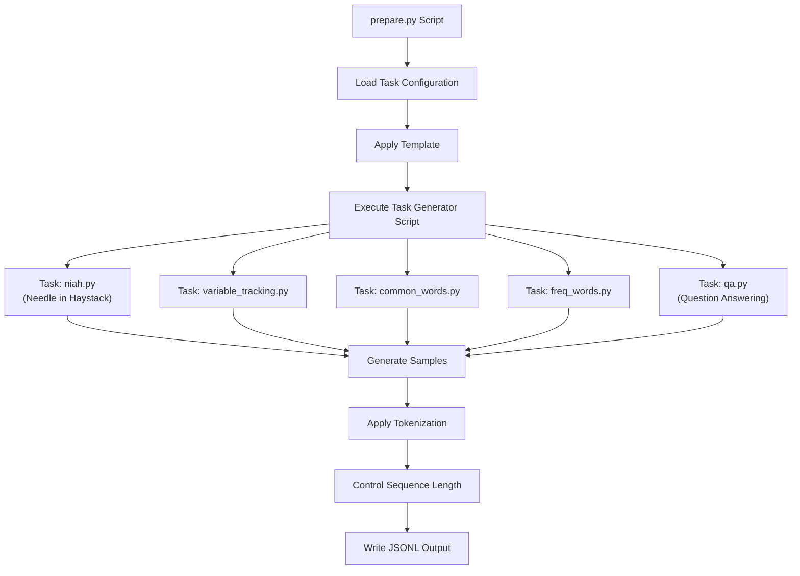
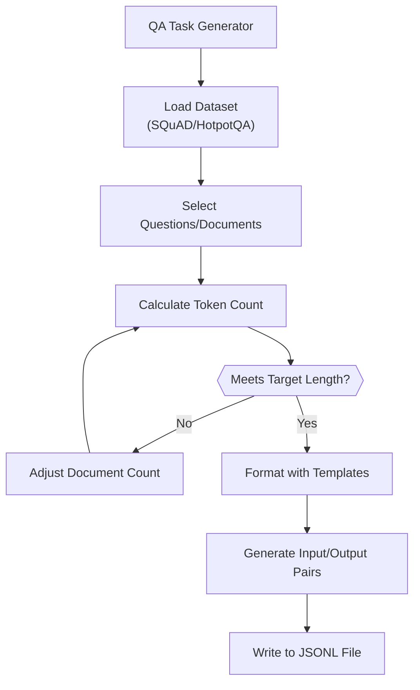
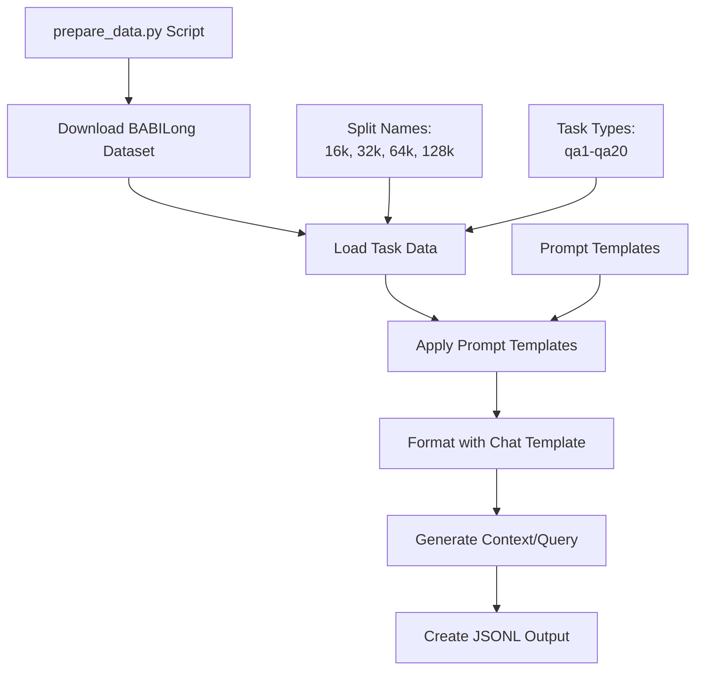
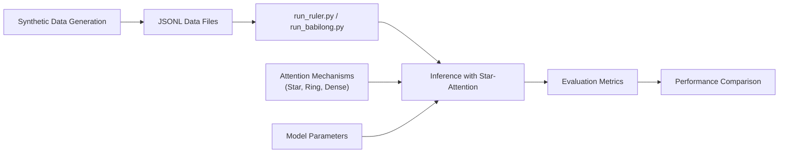

<!-- source: DeepWiki mcp.deepwiki.com · repo NVIDIA/Star-Attention · page 4.3 Synthetic Data Generation · fetched 2026-10-26 -->

# Synthetic Data Generation

<details>
<summary>Relevant source files</summary>

The following files were used as context for generating this wiki page:

- [babilong/prepare_data.py](babilong/prepare_data.py)
- [babilong/prompts.py](babilong/prompts.py)
- [babilong/template.py](babilong/template.py)
- [ruler/data/prepare.py](ruler/data/prepare.py)
- [ruler/data/synthetic/qa.py](ruler/data/synthetic/qa.py)
- [ruler/synthetic_task_config.yaml](ruler/synthetic_task_config.yaml)

</details>


This page documents the synthetic data generation processes used for benchmark evaluations in the Star-Attention system. The synthetic data generation infrastructure creates carefully controlled test datasets that evaluate long-context understanding capabilities in Large Language Models (LLMs). 

These synthetic datasets serve as critical components for the [RULER Benchmark](#4.1) and [BABILong Benchmark](#4.2), allowing for consistent evaluation of attention mechanisms across different context lengths and retrieval tasks.

## 1. Overview of Synthetic Data Generation

The Star-Attention codebase implements two distinct data generation pipelines:

1. **RULER Synthetic Tasks Generator** - Creates various synthetic tasks with controllable complexity and context length for evaluating retrieval capabilities
2. **BABILong Data Preparation** - Formats existing BABILong datasets for long-context reasoning tasks

Both pipelines generate data in a standardized JSONL format with consistent fields that the inference system can process.



**Diagram: Synthetic Data Generation in the Star-Attention System**

Sources: [ruler/data/prepare.py:16-43](), [babilong/prepare_data.py:1-15]()

## 2. RULER Synthetic Data Generation

The RULER data generation system creates synthetic datasets for tasks that evaluate a model's ability to retrieve and process information from long contexts. The system supports various task types with configurable parameters.

### 2.1 Task Types and Configuration

RULER synthetic data generation supports multiple task types, each designed to test specific long-context retrieval capabilities:

| Task Type | Description | Key Parameters |
|-----------|-------------|----------------|
| Needle in a Haystack (niah) | Places key-value pairs within large contexts and tests retrieval | `type_haystack`, `type_needle_k`, `type_needle_v`, `num_needle_k/v/q` |
| Variable Tracking (vt) | Tests ability to track variable values through chains of dependencies | `num_chains`, `num_hops` |
| Common Words Extraction (cwe) | Identifies common words across document sections | `freq_cw`, `freq_ucw`, `num_cw` |
| Frequent Words Extraction (fwe) | Identifies most frequent words in a document | `alpha` |
| Question Answering (qa) | Tests retrieval using standard QA datasets | `dataset` (squad/hotpotqa) |

Task configurations are defined in the `synthetic_task_config.yaml` file, which specifies the task type and arguments for different task variants.

Sources: [ruler/synthetic_task_config.yaml:16-122]()

### 2.2 RULER Data Generation Pipeline

The RULER data generation process follows a consistent workflow:



**Diagram: RULER Data Generation Pipeline**

Sources: [ruler/data/prepare.py:68-141]()

Each task generator script implements a specific task type and handles:
1. Sample generation with controlled complexity
2. Tokenization to ensure proper sequence length
3. Formatting with consistent input/output structure
4. Writing to JSONL files for inference

### 2.3 QA Task Generation Example

The QA task generator demonstrates how RULER creates realistic retrieval tasks:

1. Loads source data from SQuAD or HotpotQA datasets
2. Selects questions and corresponding document contexts
3. Adjusts the number of documents to target a specific sequence length
4. Creates input prompts with proper formatting
5. Generates expected outputs (answers)



**Diagram: QA Task Generation Process**

Sources: [ruler/data/synthetic/qa.py:163-213]()

Example output format for QA tasks:
```json
{
  "index": 0,
  "input_context": "Answer the question based on the given documents...\n\nDocument 1: [document text]...",
  "input_query": "Question: [question text] Answer:",
  "outputs": ["answer text"],
  "length": 3578
}
```

## 3. BABILong Data Preparation

The BABILong benchmark uses a different approach, focusing on transforming existing datasets into long-context variants with standardized formatting.

### 3.1 BABILong Tasks

BABILong includes multiple question-answering tasks designed to test different reasoning capabilities:

| Task ID | Description | Reasoning Type |
|---------|-------------|----------------|
| qa1 | Position tracking | Spatial/temporal reasoning |
| qa2-qa3 | Object tracking | Object permanence and movement |
| qa4-qa5 | Relational reasoning | Deductive reasoning |
| qa6-qa20 | Various reasoning tasks | Diverse reasoning patterns |

Sources: [babilong/prompts.py:39-455]()

### 3.2 BABILong Data Preparation Process



**Diagram: BABILong Data Preparation Process**

Sources: [babilong/prepare_data.py:29-76]()

The BABILong preparation process:
1. Downloads datasets from Hugging Face (`RMT-team/babilong-1k-samples` or `RMT-team/babilong`)
2. Loads specific task data
3. Applies task-specific formatting using predefined prompts
4. Generates context and query pairs
5. Writes formatted data to JSONL files

### 3.3 BABILong Prompt Structure

The BABILong data preparation uses a consistent prompt structure:

```
[CHAT TEMPLATE PREFIX]
[INSTRUCTION]

[EXAMPLES]

[POST PROMPT]

<context>
[CONTEXT]
</context>

[CHAT TEMPLATE SUFFIX]
Question: [QUESTION]
```

Each task type has specific instructions, examples, and post-prompts defined in `prompts.py`.

Sources: [babilong/prompts.py:16-37](), [babilong/template.py:16-22]()

## 4. Usage and Command Line Interface

### 4.1 Generating RULER Data

The RULER data generation is invoked through the `prepare.py` script:

```bash
python ruler/data/prepare.py \
    --save_dir <path_to_save_generated_dataset> \
    --task <task_name> \
    --tokenizer_path <path_to_tokenizer> \
    --tokenizer_type hf \
    --max_seq_length <dataset_sequence_length> \
    --model_template_type <prompt_template> \
    --num_samples <number_of_samples_to_generate>
```

Key parameters:
- `task`: Task name from `synthetic_task_config.yaml` (e.g., `niah_single_1`, `qa_1`)
- `max_seq_length`: Maximum sequence length (including input tokens and generated tokens)
- `model_template_type`: Template format for model prompts (e.g., `base`, `llama3`)

Sources: [ruler/data/prepare.py:47-63]()

### 4.2 Preparing BABILong Data

BABILong data preparation uses the `prepare_data.py` script:

```bash
python babilong/prepare_data.py \
    --download_dir <path_to_download_dataset> \
    --output_dir <path_to_save_the_formatted_dataset> \
    --tasks qa1 qa2 qa3 \
    --split_names 16k 32k \
    --model_template_type base
```

Key parameters:
- `tasks`: List of BABILong tasks to prepare (e.g., `qa1`, `qa2`)
- `split_names`: Context length variants to prepare (e.g., `16k`, `32k`, `64k`, `128k`)
- `model_template_type`: Template format for model prompts

Sources: [babilong/prepare_data.py:78-95]()

## 5. Integration with Benchmark Evaluation

The generated synthetic data serves as input for benchmark evaluation:



**Diagram: Integration with Benchmark Evaluation**

The synthetic data generation system creates standardized inputs that allow for consistent evaluation of different attention mechanisms (Star, Ring, Dense) across varying context lengths, enabling fair comparison of their performance on long-context tasks.

---

