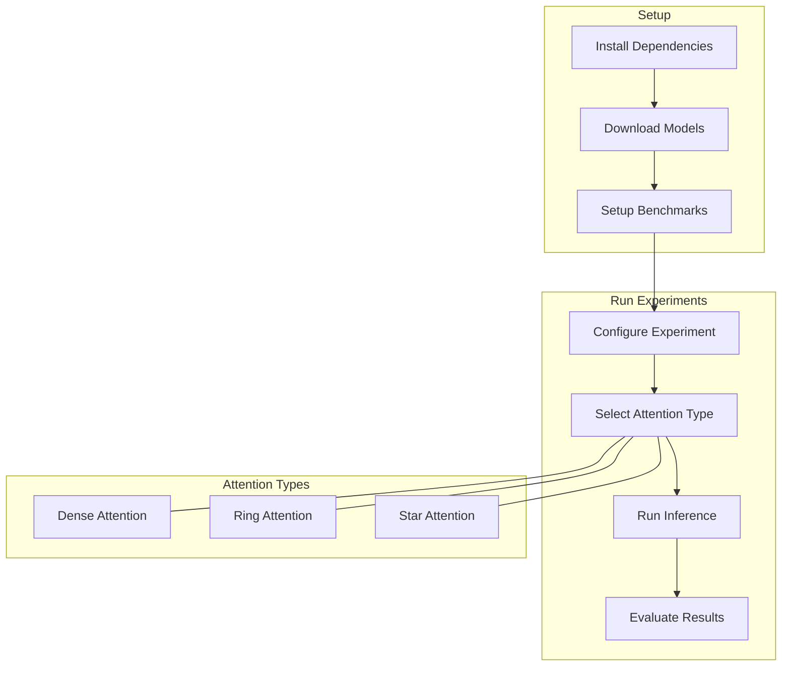
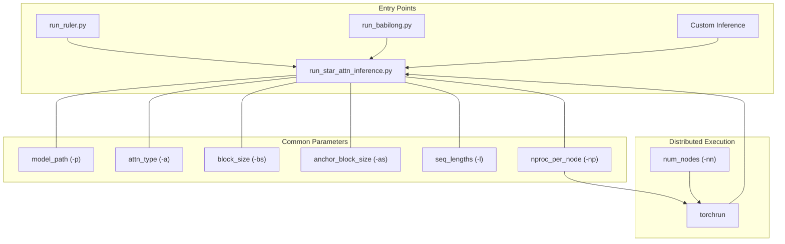
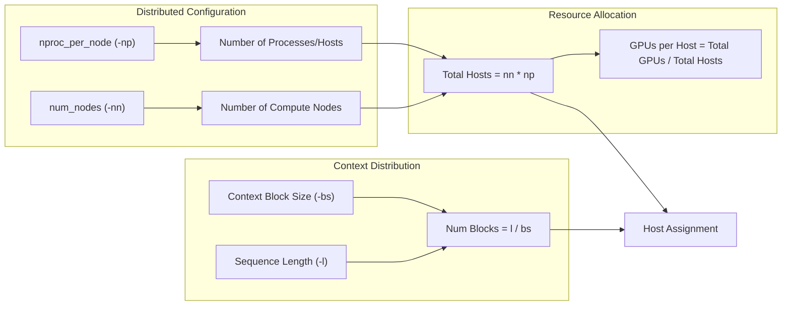
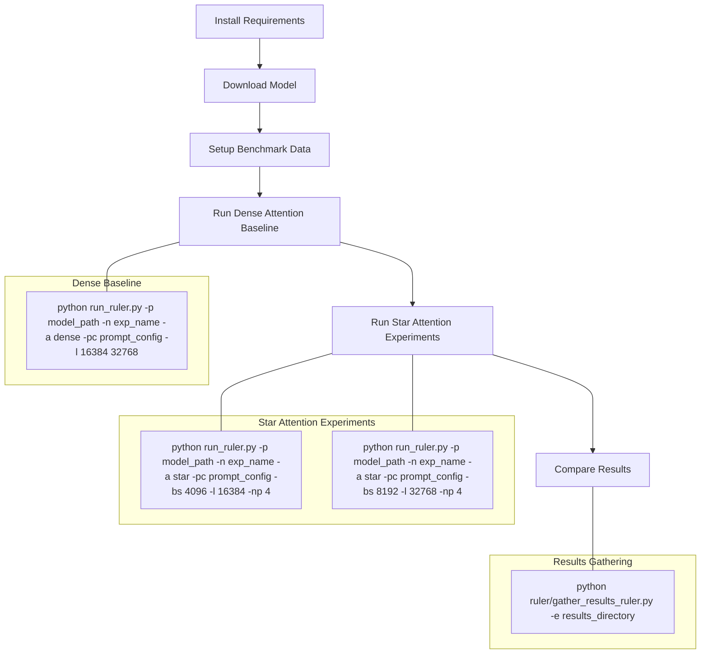

<!-- source: DeepWiki mcp.deepwiki.com · repo NVIDIA/Star-Attention · page 5 Usage Guide · fetched 2026-10-26 -->

# Usage Guide

<details>
<summary>Relevant source files</summary>

The following files were used as context for generating this wiki page:

- [.gitignore](.gitignore)
- [README.md](README.md)
- [images/star_attn_acc_ruler_babilong.png](images/star_attn_acc_ruler_babilong.png)
- [launch.sh](launch.sh)
- [requirements.txt](requirements.txt)
- [run_ruler.py](run_ruler.py)

</details>


This document provides comprehensive instructions for setting up and using the Star-Attention system for efficient LLM inference over long sequences. It covers installation, running experiments with different attention mechanisms, and evaluating results. For theoretical details about the Star Attention mechanism itself, see [Star Attention Mechanism](#2).

## System Overview

The following diagram illustrates the workflow for using the Star-Attention system:



Sources: [README.md:95-111]()

## Installation

### Prerequisites

To use Star-Attention, you need to install the required dependencies:

```bash
pip install -r requirements.txt
```

Additionally, you'll need to download the NLTK punkt tokenizer:

```python
import nltk
nltk.download('punkt_tab')
```

Sources: [README.md:112-125](), [requirements.txt:1-11]()

### Benchmark Setup

#### RULER Benchmark

To set up the RULER benchmark, you need to download the following datasets:
- Paul Graham Essays for NIAH
- SQuAD and HotpotQA datasets

You can download these automatically by running:

```bash
bash ruler/download_data.sh
```

Sources: [README.md:127-136]()

### Model Download

Download models from HuggingFace using the provided script:

```bash
python scripts/download_hf_model.py --model_name <model_name> [--token <your_hf_token>]
```

Note: Some models require a HuggingFace access token.

Sources: [README.md:138-142]()

## Running Experiments

The following diagram illustrates the relationship between different scripts and configuration parameters:



Sources: [README.md:146-151](), [run_ruler.py:42-91](), [launch.sh:16-52]()

### Configuration Parameters

The key parameters for configuring Star-Attention experiments include:

| Parameter | Flag | Description |
|-----------|------|-------------|
| Model Path | `-p, --model_path` | Path to the pretrained model |
| Attention Type | `-a, --attn_type` | Type of attention (`dense`, `ring`, or `star`) |
| Block Size | `-bs, --block_size` | Size of context blocks for star/ring attention |
| Anchor Block Size | `-as, --anchor_block_size` | Size of anchor block (for star attention) |
| Sequence Lengths | `-l, --seq_lengths` | Input sequence lengths to evaluate |
| Processes Per Node | `-np, --nproc_per_node` | Number of parallel processes per node |
| Number of Nodes | `-nn, --num_nodes` | Number of nodes for distributed execution |
| Output Directory | `--output_dir` | Directory to store results |

Sources: [run_ruler.py:42-91](), [README.md:154-186]()

### Running RULER Benchmark

To run the RULER benchmark with Star Attention:

```bash
python run_ruler.py \
    -n <experiment_name> \
    -p <path_to_model> \
    -pc <prompt_template_type> \
    -a star \
    -bs <context_block_size> \
    -l <list_of_sequence_lengths> \
    -np <num_parallel_processes> \
    --output_dir <output_directory>
```

Sources: [README.md:153-170](), [run_ruler.py:104-241]()

### Running BABILong Benchmark

To run the BABILong benchmark with Star Attention:

```bash
python run_babilong.py \
    -n <experiment_name> \
    -p <path_to_model> \
    -pc <prompt_template_type> \
    -a star \
    -bs <context_block_size> \
    -l <list_of_sequence_lengths> \
    -np <num_parallel_processes> \
    --output_dir <output_directory>
```

Sources: [README.md:189-199]()

### Custom Inference

For running inference on custom data:

```bash
python run_star_attn_inference.py \
    --model_path <path_to_model> \
    --attn_type star \
    --block_size <context_block_size> \
    --tokens_to_generate <num_tokens_to_generate> \
    --stop_words <end_of_sequence_tokens> \
    --input_path <path_to_input_jsonl> \
    --output_path <path_to_output_jsonl>
```

The input data should be in `.jsonl` format with each line containing:
```json
{
  "index": "<sample index>",  # optional
  "input_context": "<long context portion>",
  "input_query": "<query portion>",
  "output": "<expected output response>"
}
```

Sources: [README.md:202-227]()

### Configuring Distributed Execution

The following diagram shows how distributed execution is configured in the Star-Attention system:



Sources: [README.md:172-186](), [run_ruler.py:142-149]()

#### GPU Allocation Examples

When configuring distributed execution:

- `-np 8`: Launch 8 hosts, each assigned a single GPU (on an 8-GPU machine)
- `-np 4`: Launch 4 hosts, each assigned 2 GPUs (on an 8-GPU machine)
- `-nn 2 -np 2`: Launch 4 hosts total across 2 nodes, with each host containing 4 GPUs

This flexibility allows you to adjust resource allocation based on model size and memory requirements.

Sources: [README.md:174-185]()

## Evaluating Results

After running experiments, you can gather and visualize results for each benchmark:

### RULER Results

```bash
python ruler/gather_results_ruler.py -e <path_to_results_directory>
```

### BABILong Results

```bash
python babilong/gather_results_babilong.py -e <path_to_results_directory>
```

Sources: [README.md:166-170](), [README.md:195-199]()

## Example Workflow

The following flowchart demonstrates a complete workflow for evaluating Star Attention:



Sources: [launch.sh:16-52](), [README.md:166-170]()

## Recommended Configurations

Based on the examples in the launch script, here are recommended configurations for different sequence lengths:

| Sequence Length | Attention Type | Block Size | Processes | 
|-----------------|---------------|------------|-----------|
| 16K | star | 4K | 4 |
| 32K | star | 8K | 4 |
| 64K | star | 16K | 4 |
| 128K | star | 32K | 8 |

Note: These configurations are tested for Llama-3.1-8B-Instruct on 8 A100 GPUs. Adjust based on your available hardware.

Sources: [launch.sh:42-52]()

## Troubleshooting

### Common Issues

1. **Memory Errors**: If you encounter out-of-memory errors, try:
   - Reducing block size
   - Increasing `-np` to distribute the workload
   - Reducing model size

2. **Block Size Constraints**: Ensure that:
   - `block_size ≥ anchor_block_size`
   - `block_size + anchor_block_size ≤ seq_length`

3. **Model Loading Failures**: Check that:
   - Model path exists
   - You have the correct HuggingFace token for gated models

Sources: [run_ruler.py:118-140](), [run_ruler.py:204-216]()

---

