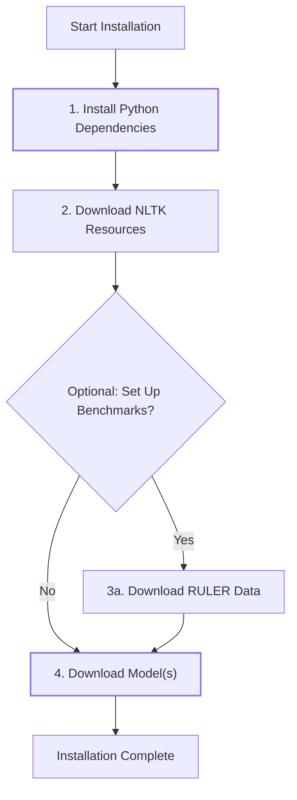
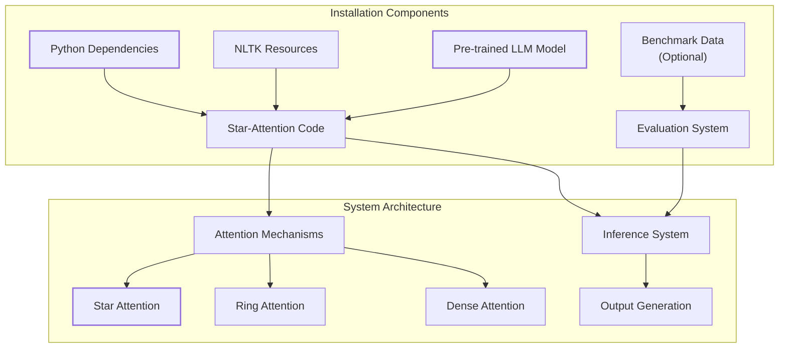
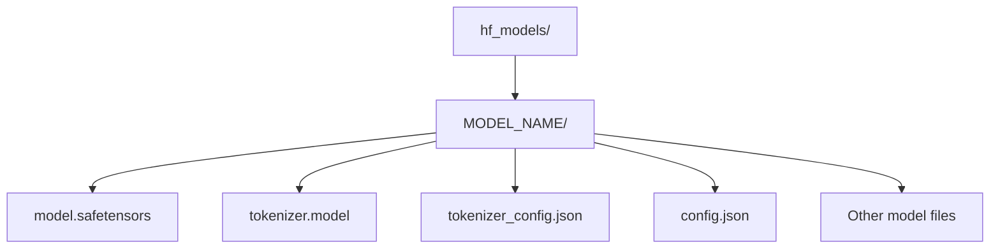

<!-- source: DeepWiki mcp.deepwiki.com · repo NVIDIA/Star-Attention · page 5.1 Installation · fetched 2026-10-26 -->

# Installation

<details>
<summary>Relevant source files</summary>

The following files were used as context for generating this wiki page:

- [.gitignore](.gitignore)
- [README.md](README.md)
- [images/star_attn_acc_ruler_babilong.png](images/star_attn_acc_ruler_babilong.png)
- [requirements.txt](requirements.txt)
- [run_ruler.py](run_ruler.py)
- [scripts/download_hf_model.py](scripts/download_hf_model.py)

</details>


This document provides comprehensive instructions for setting up the Star-Attention system, a method for efficient LLM inference over long sequences. These instructions will guide you through installing required dependencies, configuring the environment, downloading necessary data for benchmarks, and setting up pre-trained models for inference. For information about running experiments after installation, see [Running Experiments](#5.2).

## System Requirements

Before proceeding with the installation, ensure your system meets the following requirements:

| Component | Requirement |
|-----------|-------------|
| CUDA | Compatible with CUDA 12.1 |
| Python | Python 3.8+ recommended |
| Disk Space | Minimum 10GB for code and dependencies, plus additional space for models (varies by model size) |
| GPU Memory | Depends on model size and sequence length; 16GB+ recommended |

Sources: [requirements.txt:1-5]()

## Installation Steps



### 1. Install Python Dependencies

Install all required dependencies using pip:

```bash
pip install -r requirements.txt
```

This will install:
- PyTorch 2.3.1 with CUDA 12.1 support
- Transformers 4.44.0
- Flash Attention 2.6.3
- Other required packages (tqdm, nltk, scipy, etc.)

Sources: [README.md:116-119](), [requirements.txt:1-11]()

### 2. Download NLTK Resources

In a Python shell, download the required NLTK tokenizer:

```python
import nltk
nltk.download('punkt_tab')
```

Sources: [README.md:121-125]()

### 3. Benchmark Setup (Optional)

If you plan to run evaluations with the RULER benchmark, you'll need to download additional data:

```bash
bash ruler/download_data.sh
```

This script downloads:
- Paul Graham Essays for NIAH (Needle In A Haystack) test
- SQuAD and HotpotQA datasets for question-answering tasks

Sources: [README.md:127-136]()

### 4. Download Models

Star-Attention is designed to work with Hugging Face transformers models. You can download models using the provided script:

```bash
python scripts/download_hf_model.py -n MODEL_NAME [-d DIRECTORY] [-t HF_TOKEN]
```

Where:
- `MODEL_NAME`: The Hugging Face model ID (e.g., `meta-llama/Llama-3-8B-Instruct`)
- `DIRECTORY`: Optional directory where the model will be saved (default: `./hf_models`)
- `HF_TOKEN`: Optional Hugging Face authentication token (required for some models)

**Note**: For models requiring authentication (like Llama models), you'll need to provide your Hugging Face token using the `-t` flag.

Sources: [README.md:138-142](), [scripts/download_hf_model.py:16-41]()

## Star-Attention System Components

The following diagram shows how the installation components relate to the overall Star-Attention system:



Sources: [README.md:3-8](), [README.md:95-108]()

## Model Repository Structure

After installation, your model directory will have the following structure:



Sources: [scripts/download_hf_model.py:31-41]()

## Verification

To verify your installation is correct, you can run a simple inference test:

```bash
python run_star_attn_inference.py \
    --model_path PATH_TO_MODEL \
    --attn_type star \
    --block_size 4096 \
    --input_path YOUR_INPUT_FILE.jsonl \
    --output_path test_output.jsonl
```

If the command completes successfully and generates output, your installation is working correctly.

Sources: [README.md:203-228]()

## Troubleshooting

### Common Installation Issues

| Issue | Solution |
|-------|----------|
| CUDA version mismatch | Ensure you have the correct CUDA toolkit installed (12.1) or modify requirements.txt to match your CUDA version |
| Flash Attention installation fails | Flash Attention requires a specific CUDA version. Check compatibility at the [Flash Attention repository](https://github.com/Dao-AILab/flash-attention) |
| "punkt_tab" not found | Ensure you're connected to the internet when running the NLTK download command |
| Model download permission error | For Llama models, you need to provide a valid Hugging Face token with appropriate permissions |

Sources: [requirements.txt:1-6]()

### Multi-Node Setup

If you're installing on a multi-node cluster:

1. Install dependencies on all nodes
2. Ensure network connectivity between nodes
3. Configure your distributed training environment (e.g., Slurm, PyTorch distributed)

For more details on running with multiple nodes, see [Running Experiments](#5.2).

Sources: [README.md:182-186]()

---

