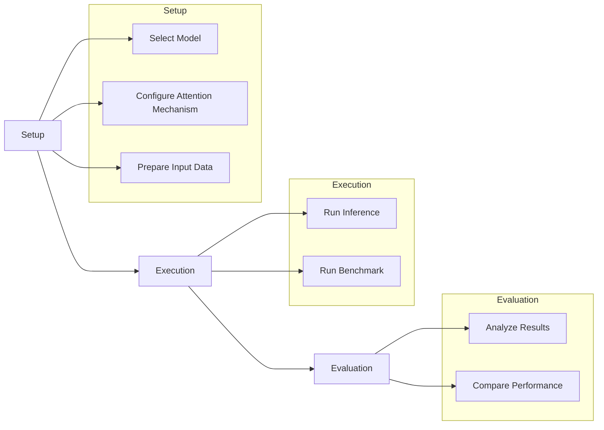
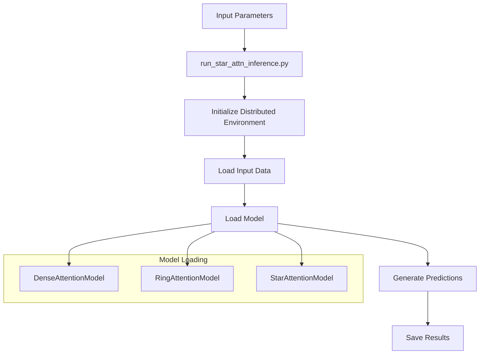
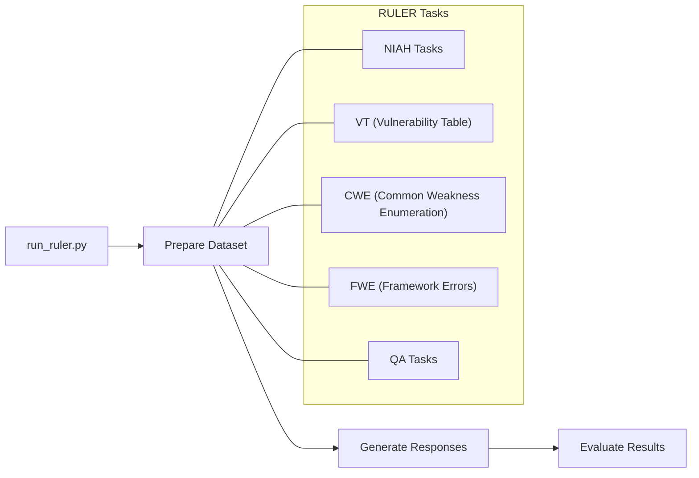
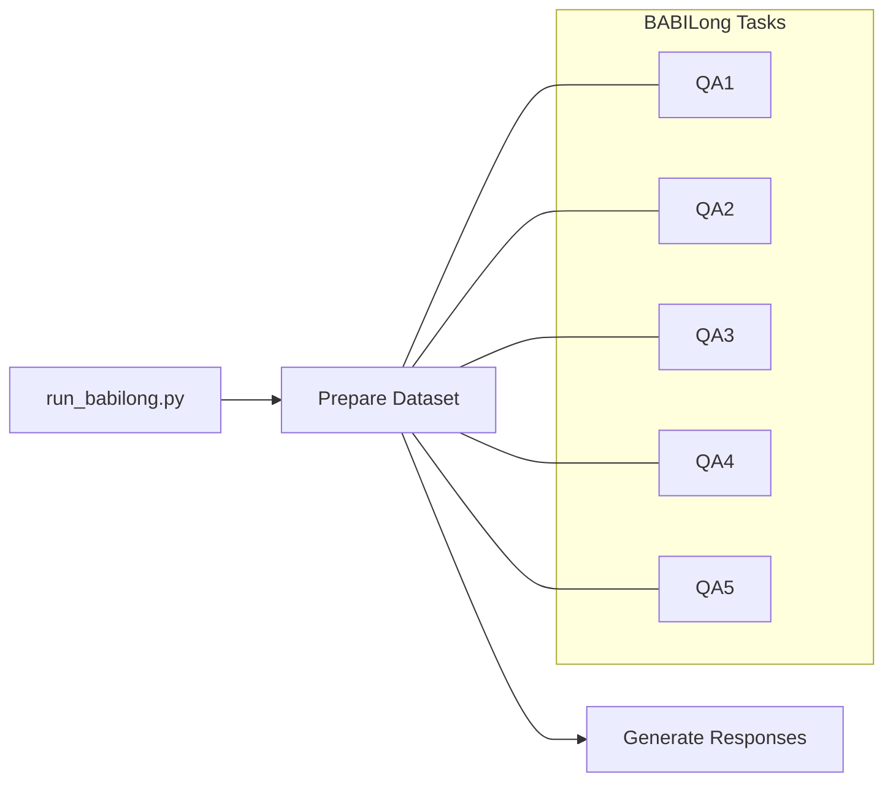
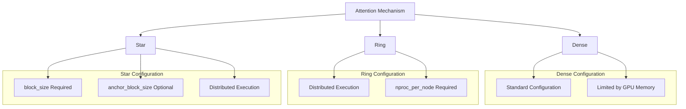
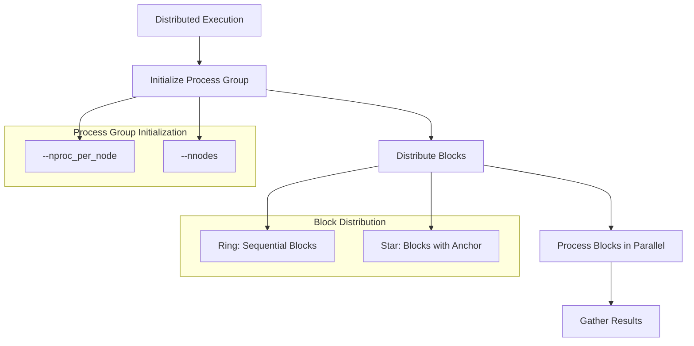

<!-- source: DeepWiki mcp.deepwiki.com · repo NVIDIA/Star-Attention · page 5.2 Running Experiments · fetched 2026-10-26 -->

# Running Experiments

<details>
<summary>Relevant source files</summary>

The following files were used as context for generating this wiki page:

- [launch.sh](launch.sh)
- [requirements.txt](requirements.txt)
- [run_babilong.py](run_babilong.py)
- [run_ruler.py](run_ruler.py)
- [run_star_attn_inference.py](run_star_attn_inference.py)

</details>


This document provides detailed instructions for running experiments with the Star-Attention system. It covers how to perform inference with different attention mechanisms (Dense, Ring, and Star), how to run benchmark evaluations, and how to configure distributed execution for efficient processing of long sequences.

For initial setup and installation instructions, see [Installation](#5.1). For information on evaluating experiment results, see [Evaluating and Visualizing Results](#5.3).

## Experiment Workflow

The Star-Attention experimental workflow consists of three main stages: setup, execution, and evaluation.



Sources: [run_star_attn_inference.py:107-132](), [run_ruler.py:104-197](), [run_babilong.py:87-171]()

## Direct Inference

The core inference functionality is provided by `run_star_attn_inference.py`. This script loads a model with the specified attention mechanism and runs inference on input data.



### Command-Line Parameters

| Parameter | Description | Required |
|-----------|-------------|----------|
| `--model_path` | Path to the model checkpoint | Yes |
| `--attn_type` | Attention type: `dense`, `ring`, or `star` | Yes |
| `--tokens_to_generate` | Number of tokens to generate | Yes |
| `--input_path` | Path to input data (jsonl file) | Yes |
| `--output_path` | Path to save output predictions | Yes |
| `--block_size` | Block size for star attention | For star attention |
| `--anchor_block_size` | Anchor block size for star attention | For star attention |
| `--stop_words` | Comma-separated list of stop words | No |
| `--num_samples` | Number of samples to use from input file | No |
| `--use_cache` | Resume from last generation | No |

### Basic Usage Example

```bash
python run_star_attn_inference.py \
    --model_path /path/to/model \
    --attn_type dense \
    --tokens_to_generate 128 \
    --input_path input.jsonl \
    --output_path output.jsonl
```

Sources: [run_star_attn_inference.py:16-102](), [run_star_attn_inference.py:198-233]()

## Benchmark Evaluations

The Star-Attention system includes two benchmark evaluation frameworks: RULER and BABILong. These benchmarks help evaluate the model's ability to process and reason over long contexts.

### RULER Benchmark

RULER (Reasoning Under Long Evidence Retrieval) evaluates a model's ability to retrieve information and reason over long contexts with various tasks:



#### Running RULER Experiments

```bash
python run_ruler.py \
    --model_path /path/to/model \
    --model_name experiment_name \
    --attn_type star \
    --block_size 4096 \
    --prompt_config llama3 \
    --seq_lengths 16384 32768 \
    --nproc_per_node 4
```

Sources: [run_ruler.py:16-42](), [run_ruler.py:104-197]()

### BABILong Benchmark

BABILong evaluates a model's ability to handle question-answering tasks with long contexts:



#### Running BABILong Experiments

```bash
python run_babilong.py \
    --model_path /path/to/model \
    --model_name experiment_name \
    --attn_type star \
    --block_size 8192 \
    --prompt_config llama3 \
    --seq_lengths 32768 \
    --nproc_per_node 4
```

Sources: [run_babilong.py:16-42](), [run_babilong.py:87-171]()

## Configuring Attention Mechanisms

Star-Attention supports three attention mechanisms: Dense, Ring, and Star. Each has different configuration requirements and performance characteristics.



### Dense Attention

Dense attention is the standard attention mechanism that computes attention over the entire sequence. It's limited by GPU memory for long sequences.

```bash
python run_star_attn_inference.py \
    --model_path /path/to/model \
    --attn_type dense \
    --tokens_to_generate 128 \
    --input_path input.jsonl \
    --output_path output.jsonl
```

### Ring Attention

Ring attention is a distributed attention mechanism that requires multiple processes.

```bash
torchrun --nproc_per_node=4 run_star_attn_inference.py \
    --model_path /path/to/model \
    --attn_type ring \
    --tokens_to_generate 128 \
    --input_path input.jsonl \
    --output_path output.jsonl
```

### Star Attention

Star attention is the main contribution of this repository, designed for efficient processing of long sequences.

```bash
torchrun --nproc_per_node=4 run_star_attn_inference.py \
    --model_path /path/to/model \
    --attn_type star \
    --block_size 4096 \
    --anchor_block_size 4096 \
    --tokens_to_generate 128 \
    --input_path input.jsonl \
    --output_path output.jsonl
```

#### Star Attention Parameters

| Parameter | Description | Default |
|-----------|-------------|---------|
| `block_size` | Size of context blocks | Required |
| `anchor_block_size` | Size of anchor block | Same as `block_size` if not provided |

Sources: [run_star_attn_inference.py:63-105](), [run_ruler.py:204-216](), [run_babilong.py:182-194]()

## Distributed Execution

For Ring and Star attention, distributed execution is required to efficiently process long sequences.



### Configuration for Distributed Execution

When using `run_ruler.py` or `run_babilong.py`, the distributed execution is configured with:

| Parameter | Description | Default |
|-----------|-------------|---------|
| `--nproc_per_node` | Number of processes per node | Required for Ring/Star |
| `--num_nodes` | Number of nodes | 1 |

Sources: [run_star_attn_inference.py:36-48](), [run_ruler.py:125-128](), [run_babilong.py:124-128]()

## Example Experiments

The repository provides a `launch.sh` script with example commands for running experiments with different configurations.

### Example Commands from launch.sh

```bash
# Dense Attention
python run_ruler.py -p /path/to/model -n experiment_name -a dense -pc llama3 -l 16384 32768 65536

# Ring Attention
python run_ruler.py -p /path/to/model -n experiment_name -a ring -pc llama3 -l 131072 -np 8

# Star Attention
python run_ruler.py -p /path/to/model -n experiment_name -a star -pc llama3 -bs 4096 -l 16384 -np 4
python run_ruler.py -p /path/to/model -n experiment_name -a star -pc llama3 -bs 8192 -l 32768 -np 4
python run_ruler.py -p /path/to/model -n experiment_name -a star -pc llama3 -bs 16384 -l 65536 -np 4
python run_ruler.py -p /path/to/model -n experiment_name -a star -pc llama3 -bs 16384 -l 131072 -np 8
```

### Recommended Configurations for Different Sequence Lengths

| Sequence Length | Attention Type | Block Size | Number of Processes |
|-----------------|---------------|------------|---------------------|
| 16K | Dense | - | 1 |
| 16K | Star | 4096 | 4 |
| 32K | Star | 8192 | 4 |
| 65K | Star | 16384 | 4 |
| 131K | Star | 16384 | 8 |

Sources: [launch.sh:16-52]()

## Best Practices

1. **Memory Management**: For long sequences, Star attention is more memory-efficient than Dense attention.
2. **Block Size Selection**: The block size should be chosen based on the sequence length. Larger blocks reduce the number of blocks but require more memory per process.
3. **Number of Processes**: The number of processes should be at least equal to the number of blocks (sequence_length / block_size).
4. **Anchor Block Size**: For most cases, using the same value for anchor_block_size as block_size works well.
5. **Resuming Experiments**: Use the `--use_cache` option to resume from the last generation if the output file already exists.

Sources: [run_star_attn_inference.py:143-149](), [run_ruler.py:134-138](), [run_babilong.py:115-121]()

---

