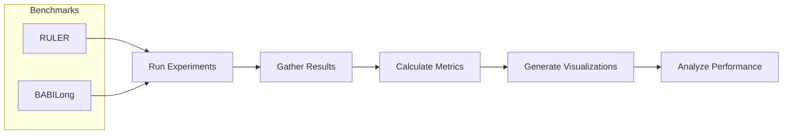
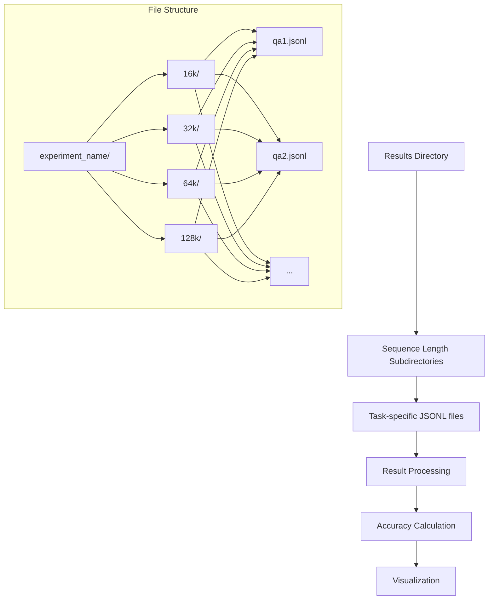
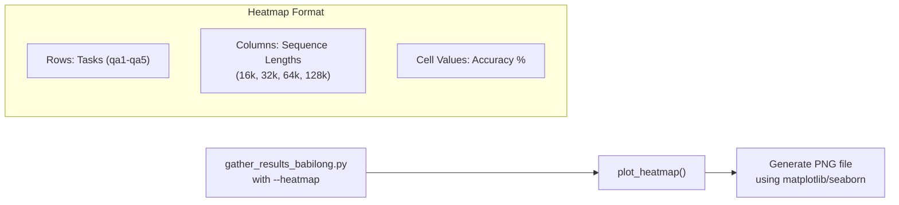
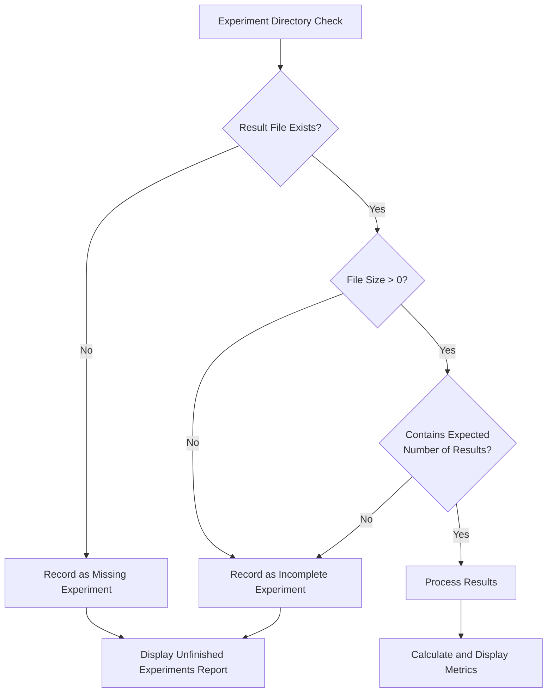

<!-- source: DeepWiki mcp.deepwiki.com · repo NVIDIA/Star-Attention · page 5.3 Evaluating and Visualizing Results · fetched 2026-10-26 -->

# Evaluating and Visualizing Results

<details>
<summary>Relevant source files</summary>

The following files were used as context for generating this wiki page:

- [babilong/gather_results_babilong.py](babilong/gather_results_babilong.py)
- [babilong/metrics.py](babilong/metrics.py)

</details>


This document provides a comprehensive guide on how to evaluate model performance and visualize results from experiments conducted with the Star-Attention system. It covers the tools and methodologies for processing experimental outputs, calculating metrics, and creating visualizations that highlight the performance of different attention mechanisms (Star, Ring, and Dense) across various benchmarks.

For information about running experiments, see [Running Experiments](#5.2).

## 1. Evaluation Workflow

The evaluation process in the Star-Attention repository follows a structured workflow:



The system provides specific tools for gathering and analyzing results from both the RULER and BABILong benchmarks, with a focus on evaluating model performance across different context lengths and attention mechanisms.

Sources: [babilong/gather_results_babilong.py:133-158]()

## 2. BABILong Results Evaluation

The BABILong benchmark evaluation process uses dedicated scripts to collect and analyze experimental results.

### 2.1 Gathering BABILong Results

To gather and analyze results from BABILong benchmark experiments, use the `gather_results_babilong.py` script:

```
python babilong/gather_results_babilong.py -e <experiment_name> [--output_dir <results_directory>] [--heatmap]
```

Parameters:
- `-e/--exp`: Experiment name or path to results directory (required)
- `--output_dir`: Directory containing results (default: `./results`)
- `-ht/--heatmap`: Flag to generate heatmap visualizations

The script processes results from all BABILong tasks (qa1-qa5) across different sequence lengths (16k, 32k, 64k, 128k).

Sources: [babilong/gather_results_babilong.py:133-158]()

### 2.2 Result Structure and Processing

BABILong results are organized by:
- Sequence length (16k, 32k, 64k, 128k)
- Task type (qa1, qa2, qa3, qa4, qa5)

Results are stored in JSONL files, where each line contains:
- Input query
- Predicted output
- Expected output
- Additional metadata

The system calculates accuracy by comparing model predictions against expected outputs using task-specific evaluation criteria.



Sources: [babilong/gather_results_babilong.py:33-41](), [babilong/gather_results_babilong.py:85-131]()

## 3. Metrics and Evaluation Criteria

The evaluation system uses task-specific metrics to assess model performance accurately.

### 3.1 BABILong Answer Comparison

For BABILong tasks, the system evaluates answers using the `compare_answers` function, which:

1. Preprocesses the model output to standardize formatting
2. Identifies task-specific labels in the output
3. Compares extracted labels with expected outputs
4. Handles special cases (e.g., multiple targets)

```
Accuracy = (Number of correct predictions / Total number of questions) × 100
```

Each question type has predefined task labels used for answer validation.

Sources: [babilong/metrics.py:39-75](), [babilong/gather_results_babilong.py:107-121]()

### 3.2 Task Labels for Evaluation

The system uses predefined task labels for each BABILong task category to ensure standardized evaluation:

| Task | Labels |
|------|--------|
| qa1 | bathroom, bedroom, garden, hallway, kitchen, office |
| qa2 | bathroom, bedroom, garden, hallway, kitchen, office |
| qa3 | bathroom, bedroom, garden, hallway, kitchen, office |
| qa4 | bathroom, bedroom, garden, hallway, kitchen, office |
| qa5 | Bill, Fred, Jeff, Mary, apple, football, milk |

The evaluation logic correctly handles cases where labels are mentioned in the question itself to avoid false positives.

Sources: [babilong/metrics.py:16-37](), [babilong/metrics.py:51-63]()

## 4. Visualizing Results

The system provides multiple ways to visualize experimental results, helping users analyze performance patterns across different configurations.

### 4.1 Accuracy Tables

By default, the results gathering script displays a tabular view of accuracy scores:

```
16k,95,82,87,91,73
32k,93,81,85,88,70
64k,91,78,82,85,68
128k,89,76,80,82,65
```

Each row represents a sequence length, and columns represent different tasks. The values are accuracy percentages.

Sources: [babilong/gather_results_babilong.py:72-75](), [babilong/gather_results_babilong.py:126]()

### 4.2 Heatmap Visualization

When the `--heatmap` flag is enabled, the system generates color-coded heatmaps that visualize accuracy across tasks and sequence lengths:



The heatmap provides a clear visual representation of how model performance varies across different context lengths and tasks.

Sources: [babilong/gather_results_babilong.py:38-70](), [babilong/gather_results_babilong.py:124]()

### 4.3 Heatmap Implementation

The heatmap visualization is implemented using matplotlib and seaborn libraries, with the following key features:

- Red-yellow-green color gradient representing low to high accuracy
- Annotated cells showing exact accuracy percentage values
- Row labels representing different tasks
- Column labels representing sequence lengths
- Title based on the experiment name

The generated images are saved as PNG files in the experiment's output directory.

Sources: [babilong/gather_results_babilong.py:38-70]()

## 5. Identifying Incomplete Experiments

The evaluation system automatically detects and reports:

1. **Missing Experiments**: Tasks for which no result files exist
2. **Incomplete Experiments**: Tasks with partial or empty result files

This helps ensure completeness of evaluation before drawing conclusions from the results.



Sources: [babilong/gather_results_babilong.py:85-104](), [babilong/gather_results_babilong.py:128-130](), [babilong/gather_results_babilong.py:77-84]()

## 6. Comparing Different Attention Mechanisms

To compare the performance of different attention mechanisms (Star, Ring, Dense), run experiments with each mechanism and use the evaluation tools to analyze results:

1. Run experiments with different attention configurations (see [Running Experiments](#5.2))
2. Gather results for each configuration
3. Generate visualizations for each configuration
4. Compare accuracy across different mechanisms

The most effective comparisons will:
- Use identical input data across mechanisms
- Test across multiple sequence lengths
- Evaluate on all benchmark tasks

Sources: [babilong/gather_results_babilong.py:85-131]()

## 7. Tips for Effective Evaluation

- **Consistent Environment**: Use the same hardware configuration when comparing different attention mechanisms
- **Complete Runs**: Ensure all experiments complete successfully before drawing conclusions
- **Multiple Seeds**: For more robust evaluation, consider running experiments with multiple random seeds
- **Sequential Analysis**: Analyze performance trends across increasing sequence lengths to understand scaling properties
- **Task-Specific Insights**: Pay attention to performance variations across different task types to identify strengths and weaknesses

The system's reporting of missing or incomplete experiments helps maintain evaluation quality.

Sources: [babilong/gather_results_babilong.py:77-84]()