# Page: Overview

# Overview

<details>
<summary>Relevant source files</summary>

The following files were used as context for generating this wiki page:

- [.gitignore](.gitignore)
- [README.md](README.md)
- [images/star_attn_acc_ruler_babilong.png](images/star_attn_acc_ruler_babilong.png)
- [images/star_attn_phase1.png](images/star_attn_phase1.png)
- [images/star_attn_phase2.png](images/star_attn_phase2.png)

</details>


Star-Attention is an efficient block-sparse attention mechanism designed for LLM inference over long sequences. This repository contains the implementation of Star Attention, a method that operates in two phases (context encoding and token generation) to significantly improve inference speed while maintaining model accuracy.

This overview provides a high-level understanding of the Star-Attention system architecture, its core mechanisms, and how the various components interact. For more detailed information about the specific Star Attention mechanism and its implementation, see [Star Attention Mechanism](#2).

Sources: [README.md:1-10]()

## System Architecture

Star-Attention consists of several interconnected components that work together to enable efficient inference over long sequences.

### High-Level Components

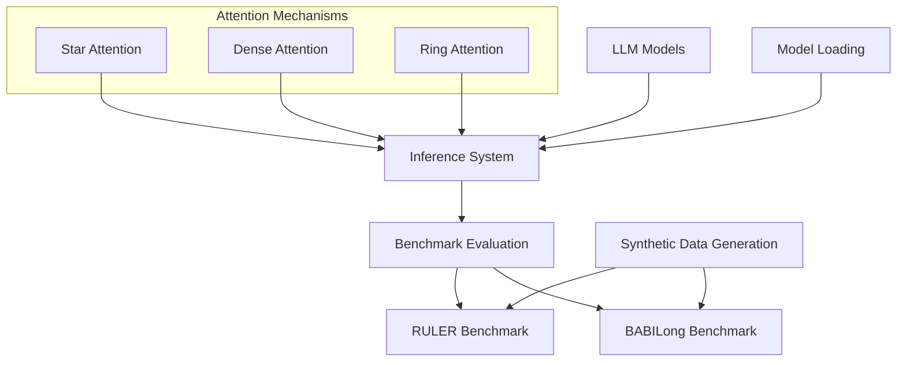

The system architecture consists of:

1. **Attention Mechanisms**: The system implements three attention mechanisms:
   - **Star Attention**: The novel block-sparse attention method
   - **Ring Attention**: An alternative sparse attention mechanism used for comparison
   - **Dense Attention**: The standard full attention used as a baseline

2. **Inference System**: Handles model loading, input processing, and token generation using the selected attention mechanism.

3. **Benchmark Evaluation**: Evaluates model performance using:
   - **RULER**: A benchmark for retrieving information from long documents
   - **BABILong**: A benchmark for evaluating long-range reasoning

4. **Synthetic Data Generation**: Creates test data for the benchmarks with controlled properties.

5. **Model Loading**: Loads and configures pre-trained LLM models from HuggingFace.

Sources: [README.md:9-10](), [README.md:95-110]()

## System Workflow

The typical workflow in the Star-Attention system follows this sequence:

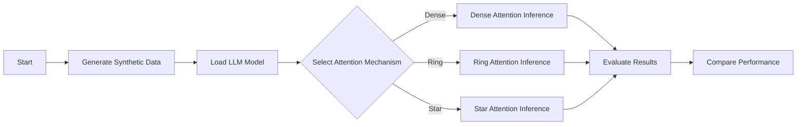

1. **Generate Synthetic Data**: Create benchmark data with specific properties (length, information placement)
2. **Load LLM Model**: Initialize a pre-trained model from HuggingFace
3. **Select Attention Mechanism**: Choose between Dense, Ring, or Star attention
4. **Run Inference**: Process inputs through the selected attention mechanism
5. **Evaluate Results**: Assess accuracy and performance metrics
6. **Compare Performance**: Compare results across different attention mechanisms and configurations

Sources: [README.md:145-203]()

## Star Attention Mechanism

The core innovation in this repository is the Star Attention mechanism, which operates in two phases to efficiently process long sequences.

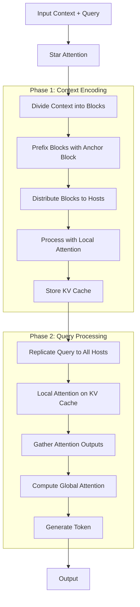

The Star Attention operation consists of:

### Phase 1: Context Encoding
1. The context is divided into contiguous blocks
2. Each block (except the first) is prefixed with the first "anchor" block
3. The augmented blocks are distributed across hosts for parallel processing
4. Local attention is computed within each block
5. Key-value caches are stored for the query phase

### Phase 2: Query Processing and Token Generation
1. A query host is designated, and the query is replicated to all hosts
2. Each host computes local attention using its stored KV cache
3. Attention outputs and softmax denominators are gathered from all hosts
4. The query host computes the global attention output
5. The final output is used to generate the next token

This two-phase approach enables efficient processing of long sequences by reducing the quadratic complexity of standard attention while maintaining comprehensive contextual awareness through the anchor block mechanism.

Sources: [README.md:3-5](), [README.md:230-288]()

## Code Structure

The Star-Attention codebase is organized around several main scripts and components:

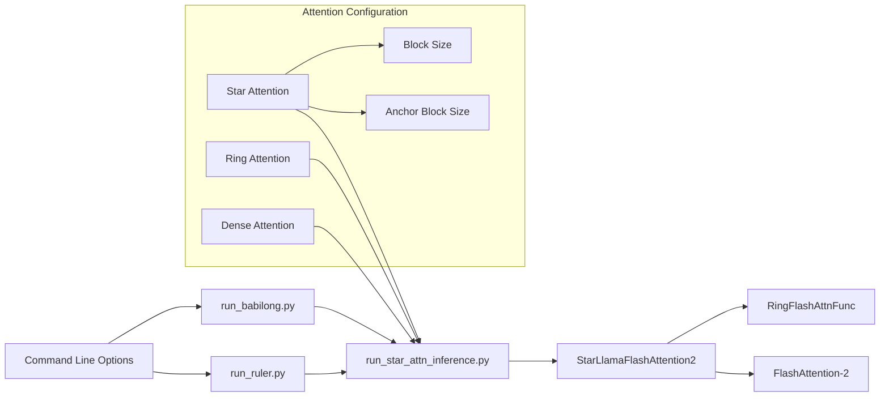

The key components include:

1. **Entry Point Scripts**:
   - `run_ruler.py`: Entry point for running RULER benchmark
   - `run_babilong.py`: Entry point for running BABILong benchmark
   - `run_star_attn_inference.py`: Core inference script used by all benchmarks

2. **Attention Implementations**:
   - `StarLlamaFlashAttention2`: Implements the Star Attention mechanism
   - `RingFlashAttnFunc`: Implements the Ring Attention baseline
   - Integration with `FlashAttention-2` for efficient attention computation

3. **Configuration Options**:
   - Attention mechanism selection (Dense, Ring, Star)
   - Block size configuration for Star Attention
   - Number of parallel processes and nodes

Sources: [README.md:145-186]()

## Inference System

The inference system handles running LLMs with different attention mechanisms. It supports:

1. **Model Types**:
   - Llama-3-8B-Instruct-262k
   - Llama-3.1-8B-Instruct
   - Llama-3.1-70B-Instruct
   - Other compatible HuggingFace models

2. **Sequence Lengths**:
   - Handles sequences from 16K to 128K tokens
   - Configurable block sizes (typically 1/4 of sequence length)

3. **Distributed Execution**:
   - Multi-host parallel processing
   - Multi-node capabilities for large models or very long sequences

4. **Custom Data Processing**:
   - Supports custom input data in `.jsonl` format
   - Structured with context, query, and expected output fields

Sources: [README.md:202-228]()

## Benchmarks

The Star-Attention system is evaluated using two main benchmarks:

### RULER Benchmark
RULER (Retrieval-focused Unstructured LongER context benchmark) evaluates how well models can retrieve information from long contexts. It consists of:
- Information retrieval tasks using Paul Graham essays
- Question answering using data from SQuAD and HotpotQA
- Synthetic data generation to create controlled test cases

### BABILong Benchmark
BABILong tests long-context reasoning abilities, containing tasks where models need to:
- Keep track of information over long contexts
- Reason about relationships between elements separated by significant distances

Both benchmarks can be run with different attention mechanisms to compare:
- Accuracy: How well the model retrieves and reasons over information
- Efficiency: Processing speed and resource utilization
- Scalability: Performance as sequence length increases

Sources: [README.md:149-169](), [README.md:191-199]()

## Performance Results

Star Attention demonstrates significant performance improvements compared to baseline attention mechanisms while maintaining accuracy. Key results include:

| Model | Seq. Length (K) | Block Size (K) | Ring-Attn Acc. (%) | Star-Attn Δ Acc. | Star-Attn Δ Speedup |
|-------|----------------|----------------|---------------------|-------------------|---------------------|
| Llama3-8B-Instruct-1048K | 16 | 4 | 86.12 | +2.47% | 1.1x |
| Llama3-8B-Instruct-1048K | 32 | 8 | 82.52 | +1.54% | 1.2x |
| Llama3-8B-Instruct-1048K | 64 | 16 | 79.05 | +1.28% | 1.8x |
| Llama3-8B-Instruct-1048K | 128 | 32 | 77.39 | +1.23% | 2.7x |
| Llama-3.1-70B-Instruct | 16 | 4 | 95.09 | -2.85% | 1.7x |
| Llama-3.1-70B-Instruct | 32 | 8 | 94.61 | -2.70% | 2.0x |
| Llama-3.1-70B-Instruct | 64 | 16 | 88.54 | -1.63% | 4.7x |

Key observations:
1. **Speedup**: Up to 11x faster inference compared to dense attention, with larger gains for longer sequences
2. **Accuracy Preservation**: Maintains 95-100% of the accuracy of global attention, sometimes even improving accuracy
3. **Scalability**: Effectively handles sequences up to 128K tokens in length
4. **Compatibility**: Works out-of-the-box with models trained with global attention, without additional training

Sources: [README.md:7](), [README.md:11-82]()

## Getting Started

To use the Star-Attention system:

1. **Setup**:
   - Install dependencies: `pip install -r requirements.txt`
   - Download necessary datasets (RULER, BABILong)
   - Download models from HuggingFace

2. **Running Benchmarks**:
   - RULER: Use `run_ruler.py` with appropriate parameters
   - BABILong: Use `run_babilong.py` with appropriate parameters
   - Custom data: Use `run_star_attn_inference.py` directly

3. **Configuration Options**:
   - Attention type (`-a`): `dense`, `ring`, or `star`
   - Block size (`-bs`): Size of context blocks
   - Sequence length (`-l`): Total sequence length to test
   - Parallel processes (`-np`): Number of hosts for distributed processing

For more detailed information on setup and usage, see [Usage Guide](#5).

Sources: [README.md:112-145](), [README.md:146-186]()

---

# Page: Star Attention Mechanism

# Star Attention Mechanism

<details>
<summary>Relevant source files</summary>

The following files were used as context for generating this wiki page:

- [.gitignore](.gitignore)
- [README.md](README.md)
- [images/star_attn_acc_ruler_babilong.png](images/star_attn_acc_ruler_babilong.png)
- [images/star_attn_phase1.png](images/star_attn_phase1.png)
- [images/star_attn_phase2.png](images/star_attn_phase2.png)
- [model.py](model.py)
- [star_attention/modeling_llama.py](star_attention/modeling_llama.py)

</details>


This document explains the Star Attention mechanism, a novel block-sparse attention mechanism designed for efficient inference on long sequences in transformer-based Large Language Models. The document covers the theory behind Star Attention, its two-phase operation process, and implementation details.

For information about the inference system that uses Star Attention, see [Inference System](#3). For benchmark evaluations of Star Attention, see [Benchmarks](#4).

## Core Concept

Star Attention is an efficient attention mechanism that enables faster inference while maintaining accuracy on long sequences. It operates in two phases: context encoding using blockwise attention with anchor blocks, followed by query processing using sequence-global attention. This approach significantly reduces the computational complexity for long context processing.

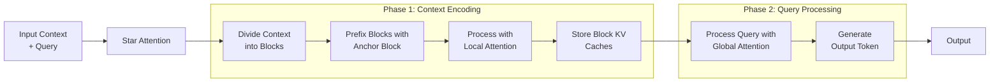

Star Attention achieves significant speedups (up to 11x) while preserving 95-100% of the accuracy of global attention. It works out-of-the-box with transformer models trained with global attention, without requiring additional training or fine-tuning.

Sources: [README.md:1-10](), [README.md:231-290]()

## Two-Phase Process

Star Attention operates in two distinct phases:

### Phase 1: Context Encoding

In the first phase, the context is processed using blockwise-local attention with anchor blocks.

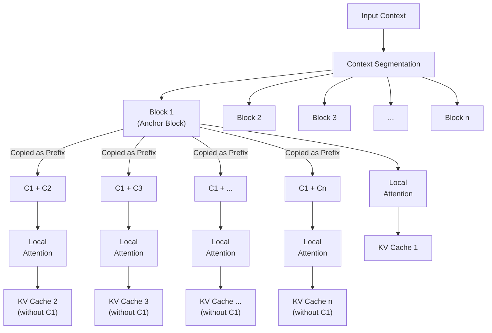

The context encoding phase works as follows:

1. The input context is segmented into contiguous blocks: `c = [c₁, c₂, ..., cₙ]`
2. Each block (except the first anchor block) is prefixed with the first block, forming an augmented context: `c' = [c₁, (c₁ c₂), (c₁ c₃), ..., (c₁ cₙ)]`
3. Local attention is computed for each augmented block independently
4. For blocks 2 to n, the KV cache for only the non-anchor portion is stored
5. Blocks can be distributed across multiple hosts for parallel processing

This approach allows each token in the sequence to attend to tokens in its local block plus all tokens in the anchor block, creating a star-shaped attention pattern.

Sources: [README.md:231-247](), [model.py:176-238]()

### Phase 2: Query Processing and Token Generation

In the second phase, the query and generated tokens attend to all prior tokens through sequence-global attention.

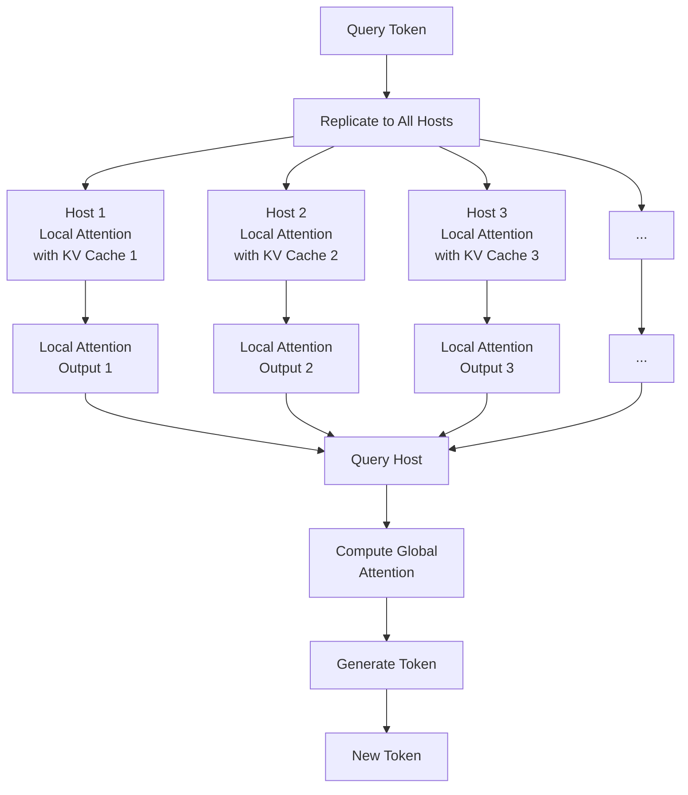

The query processing phase works as follows:

1. A host is designated as the query host
2. The query token is replicated to all hosts
3. Each host computes local attention between the query and its stored KV cache
4. Each host also computes the sum of exponents from its local softmax calculation
5. The query host gathers local attention outputs and sums of exponents from all hosts
6. The query host computes the global attention output by weighted combination of local outputs
7. The generated token is fed back for the next iteration of token generation

The math for computing the global attention is:
- Each host h computes local attention: `Aₕ = softmax(QK_h^T/√d)Vₕ`
- Each host also computes the sum of exponents: `sₕ = Σ exp(QK_{h,k}^T/√d)`
- The query host computes the global sum: `s_global = Σ sₕ`
- The global attention output is: `A_global = Σ (sₕ/s_global) * Aₕ`

This approach ensures correct normalization of attention scores across all hosts while minimizing communication overhead.

Sources: [README.md:248-290](), [model.py:118-168]()

## Implementation Architecture

Star Attention is implemented as a modification to the traditional transformer attention mechanism, specifically integrated with Flash Attention 2 for efficiency.

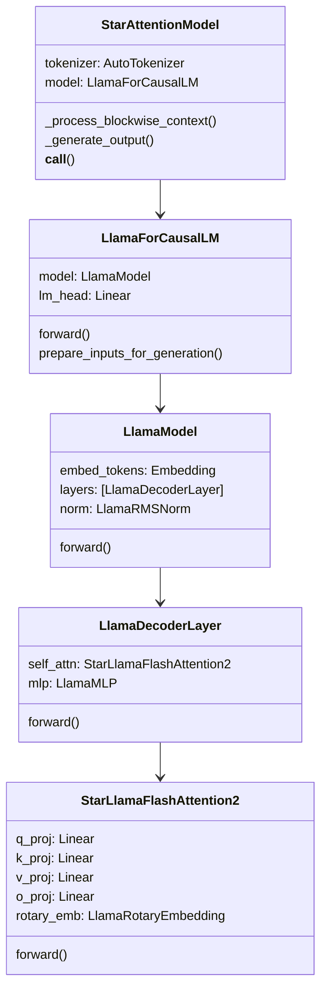

The key components of the implementation are:

1. `StarLlamaFlashAttention2` - Core class that extends `LlamaFlashAttention2` to implement the Star Attention mechanism
2. `_flash_attention_forward` - Helper function that performs the flash attention computation with support for Star Attention
3. `StarAttentionModel` - High-level model class that orchestrates the two-phase process

Sources: [star_attention/modeling_llama.py:74-200](), [model.py:174-266]()

## Implementation Details

### StarLlamaFlashAttention2

The core of Star Attention is implemented in `StarLlamaFlashAttention2`, which extends the HuggingFace `LlamaFlashAttention2` class. This class modifies the attention computation to support both phases of Star Attention.

Key modifications include:
- Adding support for distributed processing across multiple hosts
- Handling KV cache distribution and merging
- Implementing the star attention pattern with anchor blocks

The `forward` method takes additional parameters:
- `num_ring_steps`: Controls the type of attention (local, ring, or star)
- `enable_star_attn`: Flag to enable/disable Star Attention

Sources: [star_attention/modeling_llama.py:74-200]()

### StarAttentionModel

The `StarAttentionModel` class implements the high-level orchestration of the Star Attention process:

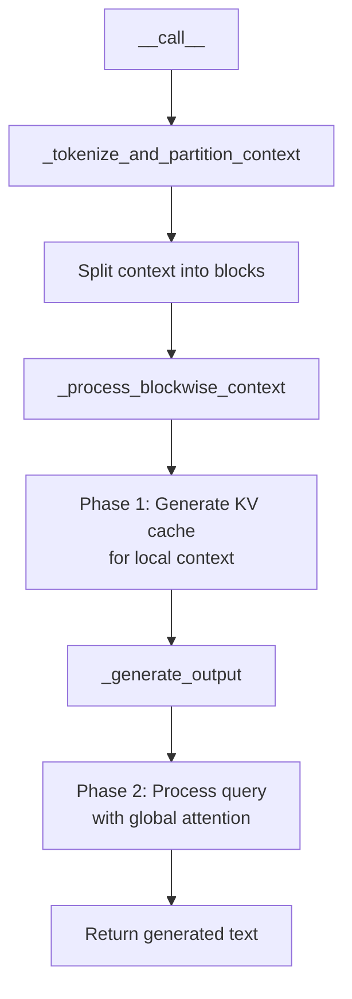

The model handles:
1. Context tokenization and partitioning into blocks
2. Distributed processing of blocks across multiple ranks
3. Anchor block prefixing and KV cache management
4. Coordinating query processing and token generation

Sources: [model.py:174-266]()

## Block Size and Anchor Block Size

Two key parameters control the behavior of Star Attention:

1. **Block Size**: Determines the size of each context block
   - Typically set to one-quarter of the total sequence length
   - Larger blocks improve accuracy but reduce speed
   - Smaller blocks improve speed but may reduce accuracy

2. **Anchor Block Size**: Determines the size of the anchor block (first block)
   - By default, equal to the block size
   - The anchor block is prefixed to all other blocks
   - Controls the "shared context" available to all tokens

The table below shows typical configurations:

| Sequence Length (K) | Block Size (K) | Anchor Block Size (K) |
|---------------------|----------------|----------------------|
| 16                  | 4              | 4                    |
| 32                  | 8              | 8                    |
| 64                  | 16             | 16                   |
| 128                 | 32             | 32                   |

Sources: [README.md:26-77](), [model.py:48-50](), [model.py:183-200]()

## Performance Characteristics

Star Attention achieves significant speedups while maintaining accuracy:

| Model                          | Seq. Length (K) | Block Size (K) | Ring-Attn Acc. (%) | Star-Attn Δ Acc. | Star-Attn Δ Speedup |
|--------------------------------|-----------------|----------------|--------------------|-----------------|--------------------|
| gradientai/Llama3-8B-Instruct  | 16              | 4              | 86.12              | +2.47%          | 1.1x               |
| gradientai/Llama3-8B-Instruct  | 32              | 8              | 82.52              | +1.54%          | 1.2x               |
| gradientai/Llama3-8B-Instruct  | 64              | 16             | 79.05              | +1.28%          | 1.8x               |
| gradientai/Llama3-8B-Instruct  | 128             | 32             | 77.39              | +1.23%          | 2.7x               |
| meta-llama/Llama-3.1-70B       | 16              | 4              | 95.09              | -2.85%          | 1.7x               |
| meta-llama/Llama-3.1-70B       | 32              | 8              | 94.61              | -2.70%          | 2.0x               |
| meta-llama/Llama-3.1-70B       | 64              | 16             | 88.54              | -1.63%          | 4.7x               |

Key observations:
- Star Attention achieves up to 4.7x speedup for large models (70B parameters)
- Accuracy is maintained at 95-100% of global attention
- For some configurations, Star Attention can actually improve accuracy
- Speedup increases with sequence length and model size

Sources: [README.md:11-77]()

## Comparison with Other Attention Mechanisms

Star Attention can be compared with two other attention mechanisms implemented in the codebase:

1. **Dense Attention**: Traditional full attention where every token attends to all previous tokens
   - Has O(n²) computational complexity
   - Provides maximum accuracy but is computationally expensive

2. **Ring Attention**: Block-sparse attention where tokens attend only to tokens in nearby blocks
   - Has O(n) computational complexity
   - Faster than dense attention but may lose some accuracy

3. **Star Attention**: Block-sparse attention with anchor blocks
   - Has O(n) computational complexity
   - Better accuracy than Ring Attention
   - Enables faster inference than dense attention

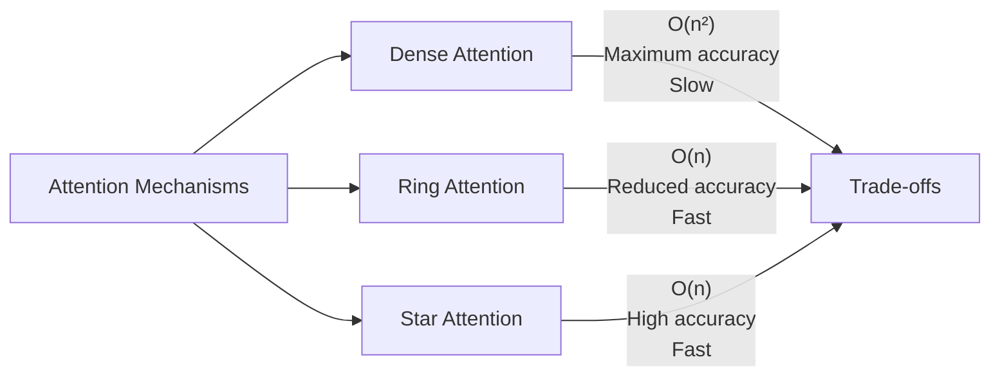

Sources: [README.md:302-306](), [model.py:24-172](), [model.py:269-335](), [model.py:337-395]()

## Integration with Flash Attention

Star Attention leverages Flash Attention 2 for efficient computation. The integration is achieved through:

1. Custom implementation of `StarLlamaFlashAttention2` extending `LlamaFlashAttention2`
2. Modified forward pass in `_flash_attention_forward` to support star attention pattern
3. Integration with PyTorch's distributed communication primitives for multi-host execution

This integration allows Star Attention to benefit from the optimizations in Flash Attention 2 while implementing its novel attention pattern.

Sources: [star_attention/modeling_llama.py:74-200](), [star_attention/modeling_flash_attention_utils.py]()

---

# Page: Two-Phase Process

# Two-Phase Process

<details>
<summary>Relevant source files</summary>

The following files were used as context for generating this wiki page:

- [.gitignore](.gitignore)
- [README.md](README.md)
- [images/star_attn_acc_ruler_babilong.png](images/star_attn_acc_ruler_babilong.png)
- [images/star_attn_phase1.png](images/star_attn_phase1.png)
- [images/star_attn_phase2.png](images/star_attn_phase2.png)
- [model.py](model.py)

</details>


This page provides a detailed explanation of the two-phase process in Star Attention, which is the core mechanism for efficient long sequence processing. The two phases—context encoding and query processing/token generation—work together to enable efficient inference on long sequences while preserving model accuracy. For details about the implementation using Flash Attention, see [Star Flash Attention Implementation](#2.2).

## Overview of Star Attention's Two-Phase Approach

Star Attention uses a specialized block-sparse attention mechanism that operates in two distinct phases:

1. **Context Encoding**: The input context is processed using blockwise-local attention, with each block prefixed with an anchor block
2. **Query Processing**: The query is processed using globally-aggregated attention across all previously cached tokens

This approach significantly reduces computational costs while maintaining model performance on long-context tasks.

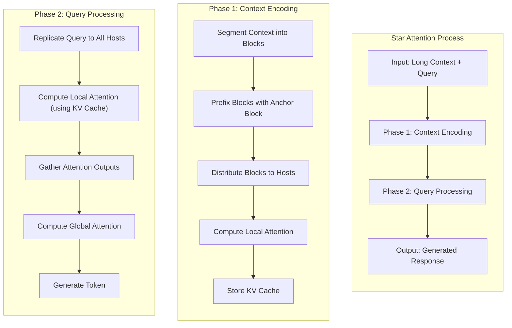

Sources: [README.md:3-5](), [model.py:119-169]()

## Phase 1: Context Encoding

In the first phase, Star Attention processes the input context to prepare for efficient attention during the query processing phase.

### Context Segmentation and Anchor Block Prefixing

The process begins by dividing the context into multiple blocks and prefixing each block (except the first) with the first block, which serves as an "anchor" block:

1. Context is segmented into contiguous blocks: c = [c₁, c₂, ..., cₙ]
2. The first block c₁ is designated as the anchor block
3. Each subsequent block is prefixed with this anchor block, forming augmented blocks: c' = [c₁, (c₁ c₂), (c₁ c₃), ..., (c₁ cₙ)]

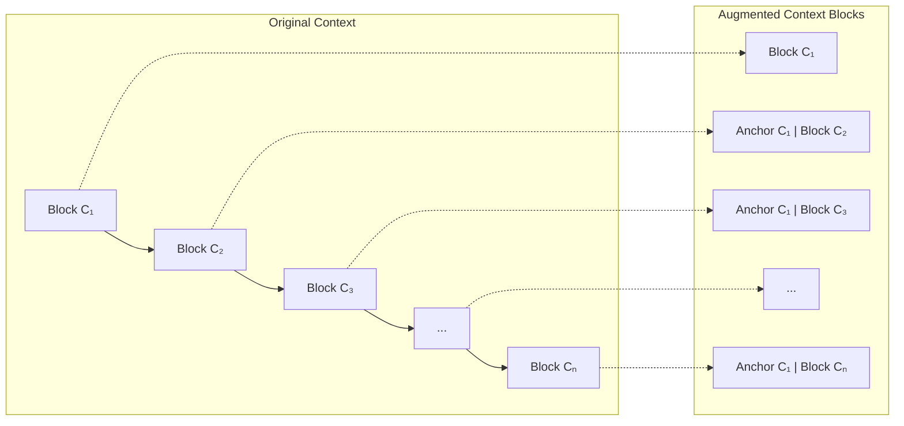

Sources: [README.md:233-249](), [model.py:194-202]()

### Distributed Processing and KV Cache Generation

After augmentation, blocks are distributed across multiple hosts for parallel processing:

1. Blocks are assigned to available hosts (GPUs or machines)
2. Each host processes its assigned blocks independently
3. For each block, the model computes local attention (no attention across blocks)
4. For augmented blocks (block 2 onwards), the KV cache for the anchor portion is discarded
5. Only the KV cache for the non-anchor portion is stored for Phase 2

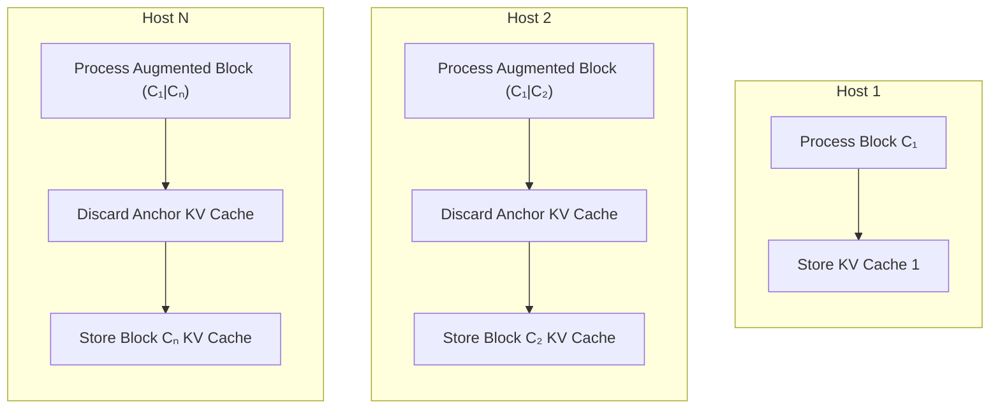

This approach enables efficient distributed processing while ensuring information is shared across blocks through the anchor mechanism.

Sources: [model.py:202-237](), [README.md:250-254]()

## Phase 2: Query Processing and Token Generation

In the second phase, Star Attention processes the query and generates tokens using a combination of local and global attention.

### Query Replication and Local Attention

When a query is processed or a new token is generated:

1. One host is designated as the "query host"
2. The query (or new token) is replicated to all hosts
3. Each host computes local attention using its stored KV cache from Phase 1
4. Each host also computes the sum of local attention softmax denominators

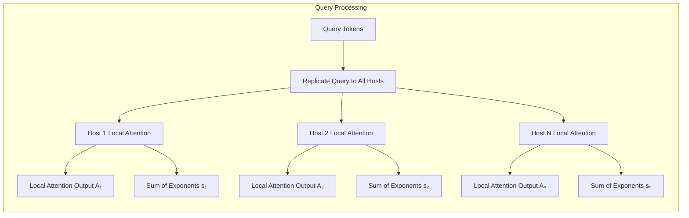

Sources: [model.py:129-131](), [README.md:264-272]()

### Global Attention Computation

To compute the global attention:

1. The query host gathers the local attention outputs and sums of exponents from all hosts
2. It calculates the global softmax denominator by summing all local denominators
3. It computes the weighted average of local attention outputs to form the global attention output
4. This result is used to predict the next token

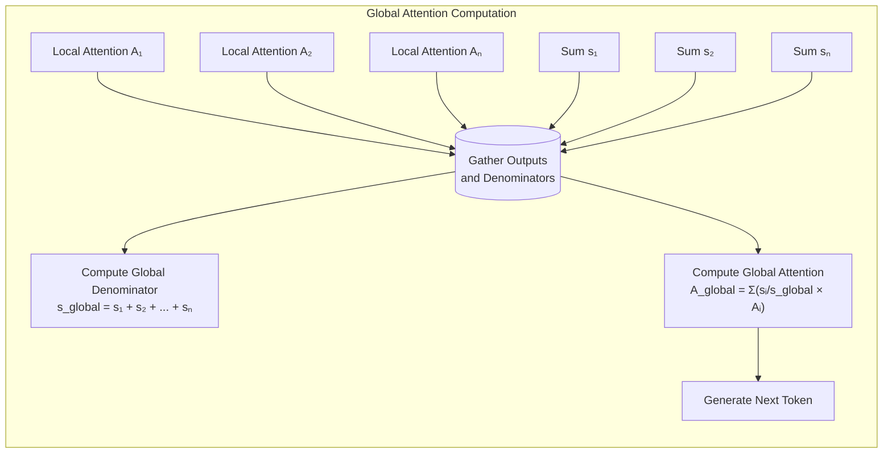

This method ensures correct normalization of attention scores across all hosts, requiring minimal communication between hosts.

Sources: [model.py:140-153](), [README.md:273-289]()

## Implementation in the Codebase

The two-phase process is implemented in the `StarAttentionModel` class in the model.py file:

### Phase 1: Context Encoding Implementation

Phase 1 is implemented in the `_process_blockwise_context` method:

```python
# Snippet showing Phase 1 implementation
def _process_blockwise_context(self, ctx_ids_blocks, position_ids_blocks):
    """Phase 1 of Star Attention: Blockwise Context Encoding with Anchor Blocks"""
    
    # If the anchor block size is not provided, use the entire first block
    if self.anchor_block_size is None:
        self.anchor_block_size = ctx_ids_blocks[0][0].shape[-1]
    
    kv_rank = []
    for idx in range(len(ctx_ids_blocks[self.rank])):
        # Select the current block
        ctx_block = ctx_ids_blocks[self.rank][idx]
        position_block = position_ids_blocks[self.rank][idx]
        
        # From 2nd block onwards, prepend the anchor block to the current block
        if self.rank != 0 or idx > 0:
            ctx_block = torch.cat((ctx_ids_blocks[0][0][:, : self.anchor_block_size], ctx_block), dim=-1)
            position_block = torch.cat(
                (position_ids_blocks[0][0][:, : self.anchor_block_size], position_block), dim=-1
            )
        
        # Process the block and generate KV cache
        with torch.no_grad():
            kv_block = self.model(
                ctx_block,
                position_ids=position_block,
                use_cache=True,
                num_ring_steps=0,  # disable ring attention (local blockwise attention)
                enable_star_attn=False,
            ).past_key_values
        
        # Discard the anchor block KV cache for non-first blocks
        if self.rank != 0 or idx > 0:
            kv_block = [
                [x[0][:, :, self.anchor_block_size :], x[1][:, :, self.anchor_block_size :]] for x in kv_block
            ]
        
        # Concatenate KV blocks
        kv_rank = (
            kv_block
            if not kv_rank
            else [
                [torch.cat((kv_rank[i][j], kv_block[i][j]), dim=-2) for j in range(2)] for i in range(len(kv_rank))
            ]
        )
    
    return kv_rank
```

Sources: [model.py:195-238]()

### Phase 2: Query Processing Implementation

Phase 2 is implemented in the `_generate_output` method:

```python
# Snippet showing Phase 2 implementation
def _generate_output(self, input_ids, position_ids, past_key_values):
    """Phase 2 of Star Attention: Process input tokens followed by autoregressive token generation."""
    output_seq = None
    for _ in range(self.max_new_tokens):
        with torch.no_grad():
            outputs = self.model(
                input_ids,
                position_ids=position_ids,
                past_key_values=past_key_values,
                use_cache=True,
                enable_star_attn=True,
            )

        # Assign the new updated KV-cache to the last rank
        if self.rank == self.world_size - 1:
            past_key_values = outputs.past_key_values

        # Get the next token
        next_token_logits = outputs.logits[:, -1, :]
        next_tokens = torch.argmax(next_token_logits, dim=-1)
        output_seq = next_tokens if output_seq is None else torch.cat([output_seq, next_tokens])

        # Update the input_ids and position_ids for the next iteration
        input_ids = next_tokens.unsqueeze(0)
        position_ids = torch.tensor([[position_ids[-1, -1] + 1]]).to(position_ids)

    return output_seq.unsqueeze(0)
```

Sources: [model.py:118-153]()

## Summary and Benefits

The two-phase process in Star Attention provides several key benefits:

| Phase | Benefit |
|-------|---------|
| Context Encoding | - Enables parallel processing of long contexts<br>- Shares information across blocks through anchor mechanism<br>- Reduces memory requirements with strategic KV caching |
| Query Processing | - Provides global attention capabilities<br>- Minimizes communication between hosts<br>- Ensures correct normalization of attention scores |

The combination of these two phases allows Star Attention to achieve significant speedups (up to 11x) while maintaining 95-100% of the accuracy of global attention. This approach is particularly effective for long sequences (16K to 128K tokens) and scales well with larger models.

Sources: [README.md:7-8](), [README.md:65-77]()

---

# Page: Star Flash Attention Implementation

# Star Flash Attention Implementation

<details>
<summary>Relevant source files</summary>

The following files were used as context for generating this wiki page:

- [star_attention/modeling_llama.py](star_attention/modeling_llama.py)
- [star_attention/star_flash_attn/utils.py](star_attention/star_flash_attn/utils.py)

</details>


## Purpose and Scope

This document details the implementation of Star Attention using Flash Attention 2 to achieve efficient inference on long contexts. The Star Flash Attention implementation leverages the Flash Attention algorithm's optimizations while adding distributed processing capabilities specific to the Star Attention mechanism. For information about the two-phase process of Star Attention, see [Two-Phase Process](#2.1).

## Architecture Overview

Star Flash Attention is implemented through a specialized attention class called `StarLlamaFlashAttention2` that extends the Hugging Face Transformers' implementation of Flash Attention 2. It enables the efficient distributed computation needed for Star Attention's approach to handling long contexts.

```mermaid
classDiagram
    direction TB
    class "LlamaFlashAttention2" {
        +forward()
    }
    class "StarLlamaFlashAttention2" {
        +forward()
        -handle distributed KV cache
        -enable Star Attention patterns
    }
    class "_flash_attention_forward" {
        +process queries and keys
        +compute attention scores
        +apply attention patterns
    }
    class "update_out_and_lse" {
        +combine attention outputs
        +update log-sum-exp values
    }
    
    LlamaFlashAttention2 <|-- StarLlamaFlashAttention2
    StarLlamaFlashAttention2 ..> _flash_attention_forward : calls
    _flash_attention_forward ..> update_out_and_lse : uses
```

Sources: [star_attention/modeling_llama.py:74-200](), [star_attention/star_flash_attn/utils.py:40-58]()

## Core Components

### StarLlamaFlashAttention2

The central class in the implementation is `StarLlamaFlashAttention2`, which inherits from HuggingFace's `LlamaFlashAttention2`. This class overrides the forward method to handle:

1. Distributed KV cache for Star Attention
2. Integration with Flash Attention 2 algorithm
3. Special processing required for the Star Attention pattern

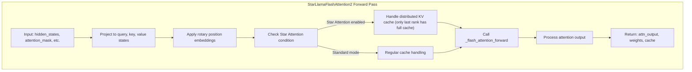

Sources: [star_attention/modeling_llama.py:74-200]()

### Integration with Model Architecture

Star Flash Attention is integrated into the LLaMA model architecture by replacing the standard attention mechanism in the transformer layers.

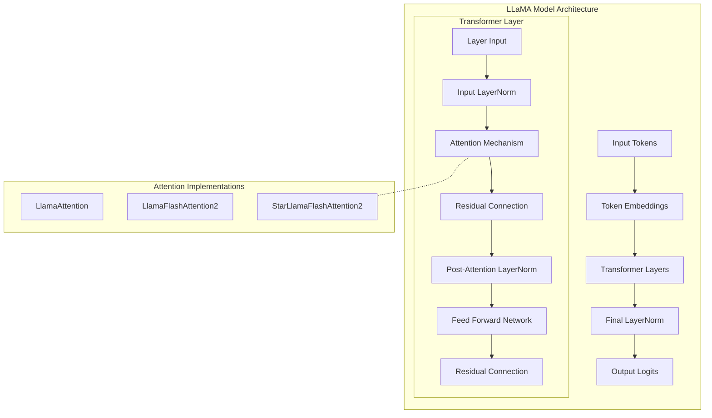

Sources: [star_attention/modeling_llama.py:202-284](), [star_attention/modeling_llama.py:295-448]()

## Implementation Details

### Distributed KV-Cache Management

Star Flash Attention uses a specialized approach for distributing the KV-cache across multiple GPUs:

1. With Star Attention enabled, only the last rank (last GPU) maintains the full KV-cache
2. During forward pass, the implementation checks if Star Attention is enabled and the current rank is not the last rank
3. In that case, it ensures the KV-cache is empty for all ranks except the last one

```python
# Key logic for Star Attention KV-cache handling
if (
    enable_star_attn
    and RANK != WORLD_SIZE - 1
    and (past_key_value is None or past_key_value.get_seq_length(self.layer_idx) == 0)
):
    raise ValueError('With Star Attention, only the last rank should have a non-empty kv-cache')
```

Sources: [star_attention/modeling_llama.py:100-105]()

### Forward Pass Implementation

The forward pass in `StarLlamaFlashAttention2` is responsible for:

1. Projecting hidden states to query, key, and value states
2. Applying rotary position embeddings
3. Managing the KV-cache based on whether Star Attention is enabled
4. Calling the Flash Attention implementation
5. Processing the attention output

The implementation specifically passes two key parameters to the Flash Attention implementation:
- `num_ring_steps`: Controls the Ring Attention behavior
- `enable_star_attn`: Enables the Star Attention pattern

Sources: [star_attention/modeling_llama.py:81-200]()

### Output and Log-Sum-Exp Update

A critical component of the Star Flash Attention implementation is the `update_out_and_lse` utility function, which:

1. Combines attention outputs from different blocks
2. Updates log-sum-exp (LSE) values for numerically stable computation
3. Handles the merging of attention results in the distributed setting

This function manages both the initial case (when `out` is None) and the update case:

```python
def update_out_and_lse(
    out: Optional[torch.Tensor],
    lse: Optional[torch.Tensor],
    block_out: torch.Tensor,
    block_lse: torch.Tensor,
    slice_=None,
) -> Tuple[torch.Tensor, torch.Tensor]:
    if out is None:
        if slice_ is not None:
            raise RuntimeError("first update_out_and_lse should not pass slice_ args")
        out = block_out.to(torch.float32)
        lse = block_lse.transpose(-2, -1).unsqueeze(dim=-1)
    elif slice_ is not None:
        slice_out, slice_lse = out[slice_], lse[slice_]
        slice_out, slice_lse = _update_out_and_lse(slice_out, slice_lse, block_out, block_lse)
        out[slice_], lse[slice_] = slice_out, slice_lse
    else:
        out, lse = _update_out_and_lse(out, lse, block_out, block_lse)
    return out, lse
```

Sources: [star_attention/star_flash_attn/utils.py:40-58]()

## Key Optimizations

### Flash Attention Algorithm

The Star Flash Attention implementation leverages the Flash Attention 2 algorithm to achieve high computational efficiency:

1. Reduces memory access by computing attention in blocks
2. Avoids materializing the full attention matrix
3. Fuses operations for better GPU utilization

### Distributed Processing

The implementation includes optimizations for distributed processing:

1. KV-cache is distributed across GPUs in a way that minimizes communication
2. Only the last rank maintains the full KV-cache in Star Attention mode
3. Handles the aggregation of attention results across distributed workers

### Numerical Stability

The implementation uses log-sum-exp (LSE) techniques for numerical stability:

1. Attention scores are computed in a numerically stable way
2. The `update_out_and_lse` function combines partial attention results while maintaining numerical stability
3. Handles potential overflow/underflow issues in the softmax computation

## Integration with LLaMA Model

The Star Flash Attention implementation is registered in the model architecture through the `LLAMA_ATTENTION_CLASSES` dictionary, allowing it to be selected via the configuration:

```python
LLAMA_ATTENTION_CLASSES = {
    "eager": LlamaAttention,
    "flash_attention_2": StarLlamaFlashAttention2,
    "sdpa": LlamaSdpaAttention,
}
```

When creating a LLaMA model, the appropriate attention class is instantiated based on the model's configuration:

```python
self.self_attn = LLAMA_ATTENTION_CLASSES[config._attn_implementation](config=config, layer_idx=layer_idx)
```

Sources: [star_attention/modeling_llama.py:203-207](), [star_attention/modeling_llama.py:215-216]()

## Relationship to Other Components

The Star Flash Attention implementation works in conjunction with other components in the system:

| Component | Relationship |
|-----------|--------------|
| Ring Attention | Star Attention is an extension of Ring Attention with an anchor block approach. The `num_ring_steps` parameter controls Ring Attention behavior. |
| Flash Attention 2 | Star Flash Attention leverages the Flash Attention 2 algorithm for efficient computation. |
| LLaMA Model | Star Flash Attention replaces the standard attention mechanism in the LLaMA transformer layers. |
| Inference System | The implementation is integrated with the inference system to support distributed execution. |

Sources: [star_attention/modeling_llama.py:179-192](), [star_attention/modeling_llama.py:203-207]()

---

# Page: Ring Attention Implementation

# Ring Attention Implementation

<details>
<summary>Relevant source files</summary>

The following files were used as context for generating this wiki page:

- [star_attention/ring_flash_attn/__init__.py](star_attention/ring_flash_attn/__init__.py)
- [star_attention/ring_flash_attn/ring_flash_attn.py](star_attention/ring_flash_attn/ring_flash_attn.py)
- [star_attention/ring_flash_attn/ring_flash_attn_varlen.py](star_attention/ring_flash_attn/ring_flash_attn_varlen.py)
- [star_attention/ring_flash_attn/utils.py](star_attention/ring_flash_attn/utils.py)

</details>


## Overview

Ring Attention is a distributed attention mechanism that efficiently processes long sequences by distributing computation across multiple GPUs in a ring communication pattern. This page documents the Ring Attention implementation found in the Star-Attention repository, which leverages Flash Attention 2 for efficient attention computation while scaling to longer context lengths through distributed processing.

For information about the Star Attention mechanism itself, see [Star Attention Mechanism](#2).

Sources: [star_attention/ring_flash_attn/ring_flash_attn.py](), [star_attention/ring_flash_attn/ring_flash_attn_varlen.py]()

## Ring Attention Architecture

Ring Attention distributes the computation of attention across multiple GPUs arranged in a ring topology, where each node communicates only with its adjacent neighbors. This approach reduces communication overhead while still allowing all nodes to process the entire sequence collectively.

### Ring Communication Pattern

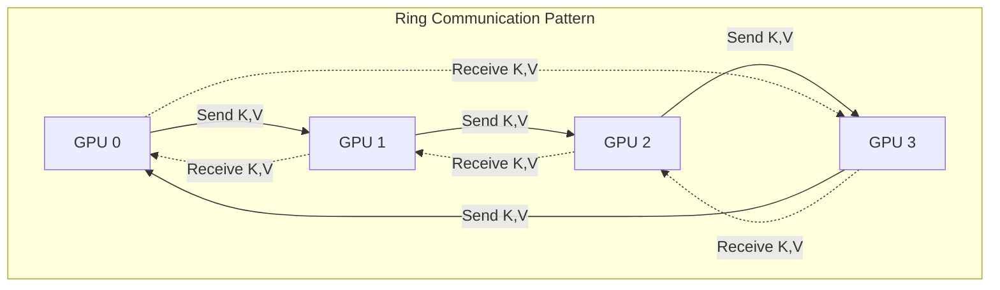

Each GPU sends its key (K) and value (V) tensors to the next GPU in the ring and receives from the previous GPU. After multiple communication rounds, each GPU has processed all parts of the sequence.

Sources: [star_attention/ring_flash_attn/utils.py:103-142]()

### Attention Computation Process

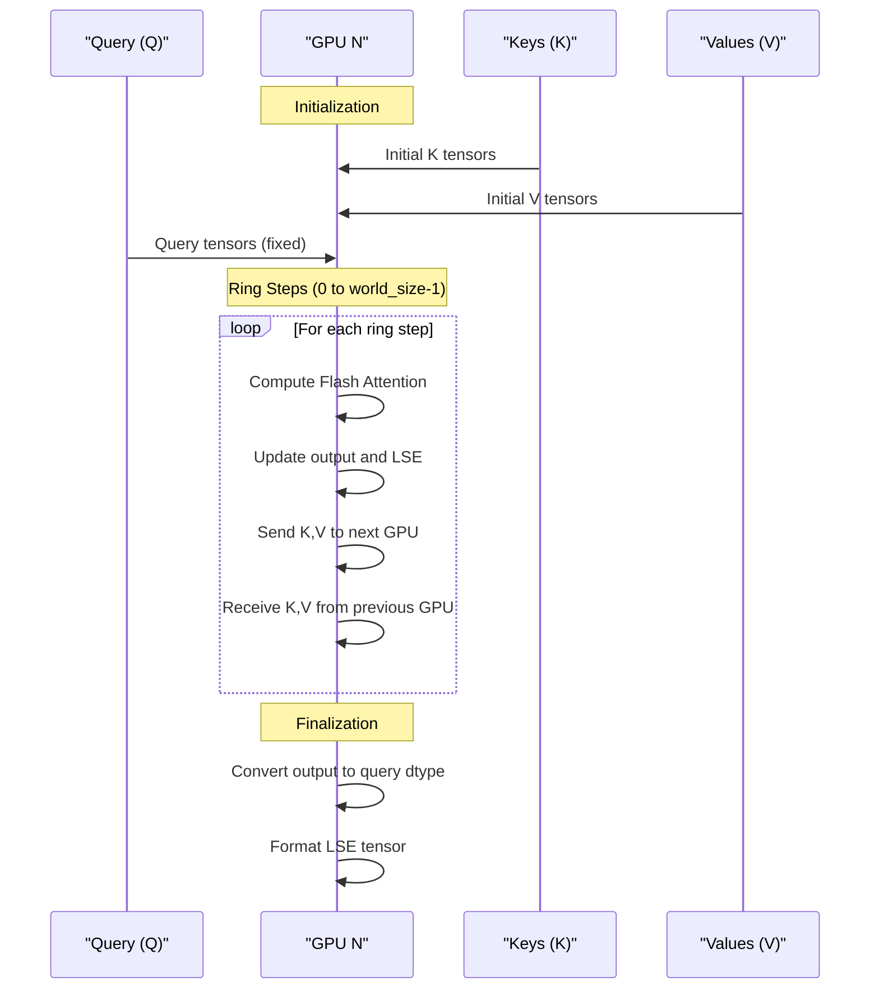

The Ring Attention algorithm processes attention in steps, with each GPU computing attention between its queries and the current keys/values it holds before passing those keys/values to the next GPU in the ring.

Sources: [star_attention/ring_flash_attn/ring_flash_attn.py:22-79](), [star_attention/ring_flash_attn/ring_flash_attn_varlen.py:22-99]()

## Implementation Components

### RingComm Class

The `RingComm` class manages the ring communication pattern between GPUs:

```mermaid
classDiagram
    class RingComm {
        -process_group
        -ops[]
        -rank
        -world_size
        -reqs
        -send_rank
        -recv_rank
        +send_recv(to_send, recv_tensor)
        +commit()
        +wait()
    }
```

Key functionality:
- `send_recv`: Asynchronously sends a tensor to the next GPU and receives a tensor from the previous GPU
- `commit`: Commits all pending communication operations
- `wait`: Waits for all operations to complete

Sources: [star_attention/ring_flash_attn/utils.py:103-142]()

### Ring Flash Attention Functions

Two main functions implement Ring Attention:

1. **ring_flash_attn_func**: For fixed-length sequences
2. **ring_flash_attn_varlen_func**: For variable-length sequences

Both functions follow the PyTorch custom function pattern with forward and backward passes, though the backward pass is not shown in the provided code.

```mermaid
graph TD
    subgraph "Ring Flash Attention Functions"
        A["ring_flash_attn_func"] --> B["RingFlashAttnFunc.apply"]
        B --> C["_ring_flash_attn_forward"]
        
        D["ring_flash_attn_varlen_func"] --> E["RingFlashAttnVarlenFunc.apply"]
        E --> F["_ring_flash_attn_varlen_forward"]
    end
    
    C --> G["RingComm"]
    F --> G
    
    C --> H["update_out_and_lse"]
    F --> H
    
    C --> I["_flash_attn_forward"]
    F --> J["_flash_attn_varlen_forward"]
```

Sources: [star_attention/ring_flash_attn/ring_flash_attn.py:82-157](), [star_attention/ring_flash_attn/ring_flash_attn_varlen.py:102-200]()

## Ring Attention Algorithm

The core algorithm for Ring Attention follows these steps:

1. Initialize a `RingComm` object for ring communication
2. Determine the number of ring steps (default: world_size - 1)
3. For each step in the ring communication:
   a. Send current K and V tensors to the next node and receive from the previous node
   b. Perform Flash Attention computation on current Q, K, V tensors
   c. Accumulate results using update_out_and_lse utility function
   d. Update K and V with the received tensors for the next step
4. Convert the output to the query's data type and format the LSE tensor appropriately

The algorithm handles both causal and non-causal attention. In causal attention, each node only processes steps where `step <= node_rank` to preserve the causal mask.

Sources: [star_attention/ring_flash_attn/ring_flash_attn.py:22-79]()

## Key Utility Functions

### update_out_and_lse

This function combines attention outputs and log-sum-exp values from different parts of the computation:

```mermaid
graph TD
    A["update_out_and_lse"] -->|"First call"| B["Initialize out and lse"]
    A -->|"Subsequent calls"| C["_update_out_and_lse"]
    
    C --> D["Convert block_out to float32"]
    D --> E["Transpose block_lse"]
    E --> F["Update lse using log-sum-exp formula"]
    F --> G["Update out using weighted sum"]
```

The function maintains numerical stability when combining attention results from different portions of the sequence.

Sources: [star_attention/ring_flash_attn/utils.py:39-80]()

### Variable-Length Sequence Handling

For variable-length sequences, additional utility functions handle conversion between different tensor formats:

- `flatten_varlen_lse`: Flattens log-sum-exp values for variable-length sequences
- `unflatten_varlen_lse`: Restructures flattened log-sum-exp values back to the original format

Sources: [star_attention/ring_flash_attn/utils.py:83-100]()

## Usage

Ring Attention can be used by calling one of the two main functions:

1. For fixed-length sequences:
```python
output = ring_flash_attn_func(
    q, k, v, 
    dropout_p=0.0, 
    softmax_scale=None, 
    causal=False, 
    window_size=(-1, -1),
    softcap=0.0, 
    alibi_slopes=None, 
    return_attn_probs=False, 
    num_ring_steps=-1, 
    group=None
)
```

2. For variable-length sequences:
```python
output = ring_flash_attn_varlen_func(
    q, k, v, 
    cu_seqlens_q, cu_seqlens_k, 
    max_seqlen_q, max_seqlen_k,
    dropout_p=0.0, 
    softmax_scale=None, 
    causal=False, 
    window_size=(-1, -1),
    softcap=0.0, 
    alibi_slopes=None, 
    return_attn_probs=False, 
    num_ring_steps=-1, 
    block_table=None, 
    group=None
)
```

### Key Parameters

| Parameter | Description |
|-----------|-------------|
| `q`, `k`, `v` | Query, key, and value tensors |
| `dropout_p` | Dropout probability (default: 0.0) |
| `softmax_scale` | Scale factor for softmax (default: 1/sqrt(d_k)) |
| `causal` | Whether to use causal attention mask (default: False) |
| `window_size` | Size of attention window, (-1, -1) means infinite context window |
| `num_ring_steps` | Number of ring communication steps, -1 means world_size - 1 |
| `group` | Process group for distributed computation |
| `cu_seqlens_q`, `cu_seqlens_k` | Cumulative sequence lengths for variable-length sequences |
| `max_seqlen_q`, `max_seqlen_k` | Maximum sequence lengths for variable-length sequences |

Sources: [star_attention/ring_flash_attn/ring_flash_attn.py:130-157](), [star_attention/ring_flash_attn/ring_flash_attn_varlen.py:163-200]()

## Relationship to Star Attention

While Star Attention uses a star-topology where an anchor block connects to all other blocks, Ring Attention uses a ring topology where each GPU communicates only with its neighbors. Ring Attention serves as both:

1. An alternative attention mechanism for comparison with Star Attention
2. A building block that Star Attention can leverage for efficient distributed computation

The Ring Attention implementation is integrated with the Flash Attention 2 library for efficient computation while adding the distributed capabilities needed for processing very long sequences across multiple GPUs.

Sources: [star_attention/ring_flash_attn/ring_flash_attn.py]()

---

# Page: Inference System

# Inference System

<details>
<summary>Relevant source files</summary>

The following files were used as context for generating this wiki page:

- [model.py](model.py)
- [run_star_attn_inference.py](run_star_attn_inference.py)
- [scripts/time_inference.py](scripts/time_inference.py)

</details>


The Inference System is the core component responsible for executing inference with different attention mechanisms in the Star-Attention repository. It provides a standardized framework for running models with Dense, Ring, and Star Attention, supporting both single-device and distributed execution. This document covers the inference architecture, workflow, model implementations, and usage patterns.

For details about the Star Attention mechanism itself, see [Star Attention Mechanism](#2).

## System Architecture

The Inference System consists of several key components that work together to provide a flexible interface for running models with different attention mechanisms.

```mermaid
graph TD
    A["run_star_attn_inference.py"] --> B["Model Loading"]
    B --> C1["DenseAttentionModel"]
    B --> C2["RingAttentionModel"]
    B --> C3["StarAttentionModel"]
    
    C1 & C2 & C3 --> D["Inference Execution"]
    D --> E["Text Generation"]
    E --> F["Output Saving"]
    
    G["Input Context + Query"] --> D
    
    subgraph "Base Architecture"
        C1 & C2 & C3 --> H["DistributedInferenceBaseModel"]
    end
    
    subgraph "Distributed Execution"
        I["torch.distributed"] --> H
        I --> D
    end
```

Sources: [run_star_attn_inference.py:64-106](), [model.py:24-396]()

The architecture follows a modular design where model loading is separated from execution, with a common interface for different attention mechanisms. The system leverages PyTorch's distributed capabilities for multi-device inference.

## Inference Process Workflow

The inference process involves several steps, from initialization to output generation:

```mermaid
flowchart LR
    A["Initialize Distributed Environment"] --> B["Load Input Data"]
    B --> C["Load Model"]
    C --> D["Run Inference"]
    D --> E["Generate Output"]
    E --> F["Save Results"]
    
    subgraph "Model Loading"
        G["Select Attention Type"]
        G -- "dense" --> H["DenseAttentionModel"]
        G -- "ring" --> I["RingAttentionModel"]
        G -- "star" --> J["StarAttentionModel"]
    end
    
    C --- G
    
    subgraph "Inference Execution"
        K["Process Context"] --> L["Process Query"]
        L --> M["Generate Tokens"]
    end
    
    D --- K
```

Sources: [run_star_attn_inference.py:108-193]()

The workflow starts with initializing the distributed environment and loading input data from a JSONL file. It then loads the appropriate model based on the specified attention type and runs inference for each input sample. The generated output is saved to a file in JSONL format.

## Model Implementation

The inference system implements multiple model classes for different attention mechanisms, all derived from a common base class.

### Base Model

The `DistributedInferenceBaseModel` serves as the foundation for all distributed attention models, providing common functionality:

```mermaid
classDiagram
    class DistributedInferenceBaseModel {
        +__init__(path, max_new_tokens, stop_words, block_size, anchor_block_size)
        +_init_distributed()
        +_tokenize(text)
        +_tokenize_and_partition_context(ctx)
        +_process_blockwise_context(ctx_ids_blocks, position_ids_blocks)
        +_generate_output(input_ids, position_ids, past_key_values)
        +_get_output_text(output, truncate_texts)
        +__call__(prompt_context, prompt_query)
    }
    
    class StarAttentionModel {
        +_tokenize_and_partition_context(ctx)
        +_process_blockwise_context(ctx_ids_blocks, position_ids_blocks)
        +__call__(prompt_context, prompt_query)
    }
    
    class RingAttentionModel {
        +_tokenize_and_partition_context(ctx)
        +_process_blockwise_context(ctx_ids_blocks, position_ids_blocks)
        +__call__(prompt_context, prompt_query)
    }
    
    class DenseAttentionModel {
        +__init__(path, max_new_tokens, stop_words)
        +_generate_output(input_ids, position_ids)
        +_get_output_text(output, truncate_texts)
        +__call__(prompt_context, prompt_query)
    }
    
    DistributedInferenceBaseModel <|-- StarAttentionModel
    DistributedInferenceBaseModel <|-- RingAttentionModel
```

Sources: [model.py:24-172]()

The base model handles initialization of the distributed environment, tokenization, and common model loading operations. Specialized derived classes implement attention-specific functionality.

### Attention Models

The system implements three attention models:

1. **DenseAttentionModel**: Implements standard dense attention for baseline comparison. It processes input sequences using regular self-attention mechanisms.

2. **RingAttentionModel**: Implements Ring Attention with distributed processing. It divides the context into blocks and performs efficient attention with ring-based communication.

3. **StarAttentionModel**: Implements the Star Attention mechanism, dividing the processing into two phases:
   - Phase 1: Context encoding with anchor blocks
   - Phase 2: Query processing and token generation

The implementation of these models can be found in [model.py:174-396]().

## Attention Mechanisms Implementation

Each attention mechanism implements a different approach to processing long sequences:

```mermaid
flowchart TD
    A["Input Context + Query"] --> B{"Select Attention Type"}
    
    B -- "Dense" --> C["DenseAttentionModel"]
    B -- "Ring" --> D["RingAttentionModel"]
    B -- "Star" --> E["StarAttentionModel"]
    
    subgraph "Dense Attention"
        C --> C1["Process Full Context + Query"]
        C1 --> C2["Generate Tokens"]
    end
    
    subgraph "Ring Attention"
        D --> D1["Distribute Context Blocks"]
        D1 --> D2["Process with Ring Communication"]
        D2 --> D3["Generate Tokens"]
    end
    
    subgraph "Star Attention"
        E --> E1["Phase 1: Context Encoding"]
        E1 --> E1a["Divide Context into Blocks"]
        E1a --> E1b["Add Anchor Block to Each Block"]
        E1b --> E1c["Local Block Processing"]
        
        E1c --> E2["Phase 2: Query Processing"]
        E2 --> E2a["Process Query Against KV Cache"]
        E2a --> E2b["Generate Tokens"]
    end
```

Sources: [model.py:174-396]()

### Dense Attention

The `DenseAttentionModel` processes the entire context and query together using standard attention mechanisms. This provides a baseline for comparison but is memory-intensive for long sequences.

Key implementation details:
- Loads standard LLamaForCausalLM model with Flash Attention 2
- Processes the full context and query in one pass
- Generates tokens autoregressively

### Ring Attention

The `RingAttentionModel` divides the context into blocks distributed across devices. It uses a ring-based communication pattern for efficient attention computation.

Key implementation details:
- Inherits from `DistributedInferenceBaseModel`
- Divides context into blocks of equal size
- Uses Ring Attention for distributed processing
- Leverages the second phase of Star Attention for token generation

### Star Attention

The `StarAttentionModel` implements the two-phase Star Attention mechanism:

Phase 1 (Context Encoding):
- Divides context into blocks
- Prepends anchor block to each non-first block
- Processes blocks locally to build KV cache

Phase 2 (Query Processing):
- Processes query against the distributed KV cache
- Generates tokens with global attention

For detailed explanation of the Star Attention mechanism, see [Star Attention Mechanism](#2).

## Distributed Execution

The inference system supports distributed execution across multiple GPUs and nodes:

```mermaid
flowchart TD
    A["Initialize Distributed Environment"] --> B["Assign GPUs to Ranks"]
    B --> C["Partition Input Data"]
    
    C --> D{"Process Role"}
    D -- "All Ranks" --> E["Process Local Context Blocks"]
    E --> F["Store Local KV Cache"]
    
    D -- "Last Rank" --> G["Process Query"]
    G --> H["Generate Tokens"]
    
    subgraph "Data Distribution"
        I["Context"] --> J["Split into Blocks"]
        J --> K["Distribute Blocks to Ranks"]
    end
    
    subgraph "Communication"
        L["torch.distributed.barrier()"]
        M["Synchronize between phases"]
    end
    
    E --> L
    L --> G
```

Sources: [model.py:55-80](), [run_star_attn_inference.py:36-48]()

Key aspects of distributed execution:

1. **Initialization**: The system initializes the distributed environment using PyTorch's distributed module. It assigns each rank a subset of available GPUs to maximize GPU utilization.

2. **Data Partitioning**: Input sequences are divided into blocks and distributed across devices according to the attention mechanism requirements.

3. **Synchronization**: The system uses barriers to synchronize between processing phases and ensure all ranks complete their work before proceeding.

4. **Memory Management**: Each rank is assigned specific GPU devices to manage memory efficiently across the distributed system.

## Usage Guide

The inference system is primarily used through the `run_star_attn_inference.py` script, which provides a command-line interface for running inference with different attention mechanisms.

### Command-Line Arguments

```
usage: run_star_attn_inference.py [-h] --model_path MODEL_PATH --attn_type ATTN_TYPE 
                                  [--block_size BLOCK_SIZE] [--anchor_block_size ANCHOR_BLOCK_SIZE] 
                                  --tokens_to_generate TOKENS_TO_GENERATE 
                                  [--stop_words STOP_WORDS] --input_path INPUT_PATH 
                                  [--num_samples NUM_SAMPLES] --output_path OUTPUT_PATH 
                                  [--use_cache]
```

Key arguments:
- `--model_path`: Path to the model checkpoint
- `--attn_type`: Type of attention (dense, ring, or star)
- `--block_size`: Block size for star attention
- `--anchor_block_size`: Anchor block size for star attention
- `--tokens_to_generate`: Number of tokens to generate
- `--input_path`: Path to input JSONL file
- `--output_path`: Path to output JSONL file

Sources: [run_star_attn_inference.py:197-233]()

### Input Format

The input file should be in JSONL format with each line containing:
- `input_context`: The context portion of the input
- `input_query`: The query portion of the input
- Optional: `index`, `outputs`, etc.

Example:
```json
{
  "index": 0,
  "input_context": "Long context text...",
  "input_query": "Query or instruction...",
  "outputs": ["Expected output..."]
}
```

### Output Format

The output file is in JSONL format with each line containing:
- `index`: The index from the input (or -1 if not provided)
- `pred`: The generated prediction text
- `input_context`: The original context
- `input_query`: The original query
- `outputs`: The expected outputs (if provided)
- Additional metadata from the input

Sources: [run_star_attn_inference.py:169-185]()

### Example Usage

For Dense Attention:
```bash
python run_star_attn_inference.py \
  --model_path /path/to/model \
  --attn_type dense \
  --tokens_to_generate 100 \
  --input_path input.jsonl \
  --output_path output.jsonl
```

For Star Attention:
```bash
python run_star_attn_inference.py \
  --model_path /path/to/model \
  --attn_type star \
  --block_size 4096 \
  --anchor_block_size 1024 \
  --tokens_to_generate 100 \
  --input_path input.jsonl \
  --output_path output.jsonl
```

For distributed execution, use the standard PyTorch distributed launch method:
```bash
torchrun --nproc_per_node=4 run_star_attn_inference.py \
  --model_path /path/to/model \
  --attn_type star \
  --block_size 4096 \
  --anchor_block_size 1024 \
  --tokens_to_generate 100 \
  --input_path input.jsonl \
  --output_path output.jsonl
```

## Performance Considerations

The inference system includes scripts for benchmarking the performance of different attention mechanisms. The `scripts/time_inference.py` script provides timing information for comparing the efficiency of Dense, Ring, and Star Attention.

Key performance factors:
- **Block Size**: Larger blocks reduce communication overhead but increase memory usage
- **Anchor Block Size**: Affects the amount of context shared between blocks
- **Number of GPUs**: More GPUs allow processing longer sequences but increase communication overhead
- **Sequence Length**: Star Attention shows greater benefits for longer sequences

For detailed benchmark results and evaluation, see [Benchmarks](#4).

Sources: [scripts/time_inference.py:95-160]()

---

# Page: Model Integration

# Model Integration

<details>
<summary>Relevant source files</summary>

The following files were used as context for generating this wiki page:

- [model.py](model.py)
- [star_attention/__init__.py](star_attention/__init__.py)
- [star_attention/modeling_flash_attention_utils.py](star_attention/modeling_flash_attention_utils.py)
- [star_attention/modeling_llama.py](star_attention/modeling_llama.py)

</details>


This page explains how language models are integrated with different attention mechanisms in the Star-Attention system. Here we focus on the core model architecture and integration patterns for Dense, Ring, and Star Attention implementations.

For information about distributed execution details, see [Distributed Execution](#3.2).

## Model Architecture Overview

The Star-Attention framework provides a modular architecture that integrates different attention mechanisms with language models. This design enables swapping between Dense, Ring, and Star Attention while maintaining the same model interface.

```mermaid
graph TD
    A["DistributedInferenceBaseModel"] --> B["StarAttentionModel"]
    A --> C["RingAttentionModel"]
    D["DenseAttentionModel"] 
    
    E["Modified Llama Model"] --> F["StarLlamaFlashAttention2"]
    F --> G["_flash_attention_forward"]
    G --> H["star_flash_attn_func"]
    G --> I["ring_flash_attn_func"]
    
    B & C --> J["LlamaForCausalLM"]
    D --> K["HuggingFace AutoModelForCausalLM"]
```

Sources: [model.py:24-172](), [star_attention/modeling_llama.py:74-200]()

The system follows a layered design:
- High-level model interfaces handle prompting and token generation
- Modified LLM architectures implement attention-specific processing
- Low-level Flash Attention extensions provide efficient computation

## Integration Model Classes

The codebase provides three main model classes, each implementing a different attention mechanism:

| Model Class | Attention Type | Distributed | Key Features |
|-------------|----------------|-------------|--------------|
| `DenseAttentionModel` | Standard attention to all tokens | No | Simple implementation, baseline performance |
| `RingAttentionModel` | Ring-structured communication | Yes | Balanced efficiency and accuracy |
| `StarAttentionModel` | Two-phase with anchor block | Yes | Highest efficiency for long contexts |

```mermaid
classDiagram
    class "DistributedInferenceBaseModel" {
        +__init__(path, max_new_tokens, stop_words, block_size, anchor_block_size)
        +_init_distributed()
        +_tokenize(text)
        +_tokenize_and_partition_context(ctx)
        +_process_blockwise_context(ctx_ids_blocks, position_ids_blocks)
        +_generate_output(input_ids, position_ids, past_key_values)
        +_get_output_text(output, truncate_texts)
    }
    
    class "StarAttentionModel" {
        +_tokenize_and_partition_context(ctx)
        +_process_blockwise_context(ctx_ids_blocks, position_ids_blocks)
        +__call__(prompt_context, prompt_query)
    }
    
    class "RingAttentionModel" {
        +_tokenize_and_partition_context(ctx)
        +_process_blockwise_context(ctx_ids_blocks, position_ids_blocks)
        +__call__(prompt_context, prompt_query)
    }
    
    class "DenseAttentionModel" {
        +__init__(path, max_new_tokens, stop_words)
        +_generate_output(input_ids, position_ids)
        +_get_output_text(output, truncate_texts)
        +__call__(prompt_context, prompt_query)
    }
    
    "DistributedInferenceBaseModel" <|-- "StarAttentionModel"
    "DistributedInferenceBaseModel" <|-- "RingAttentionModel"
```

Sources: [model.py:24-396]()

### Base Model Implementation

The `DistributedInferenceBaseModel` serves as the foundation for distributed attention mechanisms. It provides:

1. Distributed environment initialization
2. Tokenization and context partitioning
3. Abstract methods for blockwise context processing
4. Token generation with KV cache management

Key methods:
- `_init_distributed()`: Sets up the distributed environment
- `_tokenize_and_partition_context()`: Divides context into blocks
- `_process_blockwise_context()`: Abstract method implemented by specific attention models
- `_generate_output()`: Common token generation logic

Sources: [model.py:24-172]()

## Attention Mechanism Integration

Star-Attention extends the Hugging Face Transformers implementation with custom attention mechanisms. This is achieved by modifying the Flash Attention 2 implementation for Llama models.

```mermaid
graph TD
    A["LlamaForCausalLM"] --> B["forward()"]
    B --> C["LlamaModel.forward()"]
    C --> D["LlamaDecoderLayer.forward()"]
    D --> E["StarLlamaFlashAttention2.forward()"]
    E --> F["_flash_attention_forward()"]
    F --> G{{"enable_star_attn?"}}
    G -->|"Yes"| H["star_flash_attn_func"]
    G -->|"No"| I["ring_flash_attn_func"]
```

Sources: [star_attention/modeling_llama.py:81-200](), [star_attention/modeling_flash_attention_utils.py:40-160]()

The key integration points are:

1. `LLAMA_ATTENTION_CLASSES` dictionary in [star_attention/modeling_llama.py:203-207]() maps attention implementations
2. `StarLlamaFlashAttention2` extends `LlamaFlashAttention2` with Star/Ring attention support
3. `_flash_attention_forward` function selects the appropriate attention implementation
4. Model forward passes include new parameters (`num_ring_steps`, `enable_star_attn`)

## Star Attention Model Flow

The Star Attention model implements a two-phase process for handling long contexts efficiently:

```mermaid
flowchart TD
    A["Input: prompt_context, prompt_query"] --> B["Phase 1: Context Encoding"]
    B --> C["Tokenize and partition context"]
    C --> D["Add anchor block to non-first blocks"]
    D --> E["Process blocks with local attention"]
    E --> F["Store distributed KV cache"]
    F --> G["Phase 2: Query Processing"]
    G --> H["Tokenize query"]
    H --> I["Position IDs after context"]
    I --> J["Generate output with global attention"]
    J --> K["Return generated text"]
```

Sources: [model.py:174-266]()

Implementation details:
- Context partitioning in `_tokenize_and_partition_context()` [model.py:177-193]()
- Anchor block prepending in `_process_blockwise_context()` [model.py:195-238]()
- Query processing in `__call__()` [model.py:240-266]()

## Ring Attention Model Flow

Ring Attention offers an alternative approach with distributed processing and ring communication:

```mermaid
flowchart TD
    A["Input: prompt_context, prompt_query"] --> B["Tokenize and partition context"]
    B --> C["Split context equally among ranks"]
    C --> D["Process blocks with ring attention"]
    D --> E["Store distributed KV cache"]
    E --> F["Process query (Phase 2 from Star)"]
    F --> G["Return generated text"]
```

Sources: [model.py:269-334]()

Key differences from Star Attention:
- No anchor block prepending
- Uses `num_ring_steps=-1` to enable full ring attention during context processing
- Same Phase 2 implementation as Star Attention for token generation

## Dense Attention Model

The `DenseAttentionModel` provides a baseline implementation using standard attention:

```mermaid
flowchart TD
    A["Input: prompt_context, prompt_query"] --> B["Combine context and query"]
    B --> C["Tokenize full prompt"]
    C --> D["Generate with dense attention"]
    D --> E["Return generated text"]
```

Sources: [model.py:337-395]()

Unlike distributed models, `DenseAttentionModel`:
- Doesn't use distributed processing
- Processes the entire context as a single unit
- Uses standard HuggingFace implementation

## Flash Attention Extensions

The system extends Flash Attention 2 with custom implementations for Star and Ring Attention:

```mermaid
graph TD
    A["_flash_attention_forward"] --> B{{"Attention mask present?"}}
    B -->|"Yes"| C["Use VarLen implementation"]
    B -->|"No"| D["Use standard implementation"]
    
    C --> E{{"enable_star_attn?"}}
    D --> E
    
    E -->|"Yes"| F["star_flash_attn_func / star_flash_attn_varlen_func"]
    E -->|"No"| G["ring_flash_attn_func / ring_flash_attn_varlen_func"]
```

Sources: [star_attention/modeling_flash_attention_utils.py:40-160]()

Key features of the custom implementations:
- Support for both padded and unpadded inputs
- Selection between Star and Ring attention based on `enable_star_attn` parameter
- Support for ring communication steps via `num_ring_steps` parameter

## Integration Usage Example

To use a model with Star Attention:

```python
# Initialize Star Attention model
model = StarAttentionModel(
    path="meta-llama/Llama-2-7b-hf",  # Model path
    max_new_tokens=100,               # Maximum tokens to generate
    stop_words=["###"],               # Optional stop words
    block_size=1024,                  # Size of context blocks
    anchor_block_size=256             # Size of anchor block
)

# Run inference
result = model(
    prompt_context="[Long context text...]",
    prompt_query="[Query to answer...]"
)

# Get generated text
generated_text = result['text'][0]
```

Sources: [model.py:174-266]()

## LlamaForCausalLM Modifications

The custom `LlamaForCausalLM` class adds specific parameters to support Star and Ring Attention:

```mermaid
graph TD
    A["LlamaForCausalLM.prepare_inputs_for_generation"] --> B["Add attention parameters"]
    B -->|"enable_star_attn"| C["Controls Star Attention"]
    B -->|"num_ring_steps"| D["Controls Ring Attention"]
    C & D --> E["Forward through model"]
```

Sources: [star_attention/modeling_llama.py:649-718]()

These parameters allow controlling attention behavior during generation:
- `enable_star_attn`: Enables Star Attention mechanism when `True`
- `num_ring_steps`: Controls ring communication (-1 for full ring, 0 for local only, >0 for limited steps)

## Summary

The Star-Attention model integration architecture provides a flexible framework for using different attention mechanisms with language models. The key components are:

1. Model interfaces (`StarAttentionModel`, `RingAttentionModel`, `DenseAttentionModel`)
2. Custom attention implementations (`StarLlamaFlashAttention2`)
3. Flash Attention extensions for efficient computation
4. Two-phase processing for Star Attention

This architecture enables efficient inference on very long contexts while maintaining high accuracy through the innovative Star Attention mechanism.

Sources: [model.py:24-396](), [star_attention/modeling_llama.py:74-718](), [star_attention/modeling_flash_attention_utils.py:40-160]()

---

# Page: Distributed Execution

# Distributed Execution

<details>
<summary>Relevant source files</summary>

The following files were used as context for generating this wiki page:

- [model.py](model.py)
- [run_star_attn_inference.py](run_star_attn_inference.py)
- [star_attention/ring_flash_attn/utils.py](star_attention/ring_flash_attn/utils.py)

</details>


This page documents the distributed execution capabilities in the Star-Attention system, which enable efficient processing of long sequences across multiple GPUs or nodes. For information about the Star Attention mechanism itself and its theoretical foundations, see [Star Attention Mechanism](#2).

## 1. Distributed Architecture Overview

Star-Attention implements distributed execution primarily for handling long contexts that exceed single-GPU memory capacity. The system partitions input sequences and distributes the workload across multiple GPUs, coordinating through PyTorch's distributed communication framework.

```mermaid
flowchart TD
    subgraph "Input Processing"
        A["Input Sequence"]
        B["Tokenization"]
        C["Sequence Partitioning"]
    end

    subgraph "Distributed Environment"
        D["init_distributed()"]
        E["Process Group Setup"]
        F["Rank/World Size Configuration"]
    end

    subgraph "Data Distribution"
        G["Block Assignment"]
        H["Anchor Block Handling"]
    end

    subgraph "Multi-GPU Processing"
        I["Rank 0 (GPU 0)"]
        J["Rank 1 (GPU 1)"]
        K["Rank N (GPU N)"]
    end

    subgraph "Result Collection"
        L["Gather Attention Outputs"]
        M["Token Generation"]
    end

    A --> B
    B --> C
    C --> G
    D --> E
    E --> F
    F --> G
    G --> H
    H --> I & J & K
    I & J & K --> L
    L --> M
```

Sources: [run_star_attn_inference.py:36-48](), [model.py:55-80]()

## 2. Distributed Environment Initialization

The system initializes a distributed environment using PyTorch's distributed module. This sets up the necessary communication channels between different processes or GPUs.

```mermaid
sequenceDiagram
    participant M as "Main Script"
    participant D as "init_distributed()"
    participant P as "PyTorch dist"
    participant R as "DistributedModel"
    
    M->>D: "Call init_distributed()"
    D->>P: "Check for RANK in environment"
    alt Environment variables present
        P-->>D: "Initialize process group (NCCL)"
        D-->>M: "Return rank and world_size"
    else No distributed environment
        D-->>M: "Return rank=0, world_size=1"
    end
    
    M->>R: "Initialize model with distributed info"
    R->>R: "_init_distributed()"
    R->>P: "Get rank and world_size"
    R->>R: "Assign GPUs to rank"
```

The initialization reads environment variables to configure the distributed setup:
- `RANK`: Global rank of the current process
- `WORLD_SIZE`: Total number of processes
- `LOCAL_RANK`: Local rank within the current node
- `LOCAL_WORLD_SIZE`: Number of processes in the current node

Sources: [run_star_attn_inference.py:36-48](), [model.py:55-80]()

## 3. Data Distribution Strategy

### 3.1 Sequence Partitioning

For distributed processing, input sequences are divided into blocks and distributed across the available ranks. The partitioning strategy depends on the attention mechanism:

```mermaid
flowchart TD
    A["Input Context"] --> B["Tokenize Context"]
    B --> C["Calculate Block Size"]
    
    C --> D{"Select Attention Type"}
    D -->|"Star Attention"| E["Divide into equal blocks of block_size"]
    D -->|"Ring Attention"| F["Divide into world_size blocks"]
    
    E --> G["Pad to multiple of block_size"]
    F --> H["Pad to multiple of world_size"]
    
    G & H --> I["Assign blocks to ranks"]
```

In the Star Attention approach:
- Context is divided into fixed-size blocks (determined by `block_size` parameter)
- Each block is prefixed with the first "anchor" block
- Blocks are distributed across ranks for parallel processing

Sources: [model.py:177-193](), [model.py:275-290]()

### 3.2 GPU Assignment and Memory Management

The system carefully manages GPU assignment to ensure efficient memory utilization:

```python
# Assign GPUs to each rank based on local rank
num_devices_per_rank = torch.cuda.device_count() // self.local_world_size
device_id_start = self.local_rank * num_devices_per_rank
self.max_memory = {
    x: f'{round(torch.cuda.get_device_properties(0).total_memory / (1024 ** 3))}GB'
    for x in range(device_id_start, device_id_start + num_devices_per_rank)
}
```

This approach ensures each process only uses its assigned GPUs, preventing resource conflicts.

Sources: [model.py:65-72]()

## 4. Distributed Processing Flow

The distributed execution follows a two-phase approach that aligns with the Star Attention mechanism:

```mermaid
flowchart LR
    subgraph "Phase 1: Context Encoding"
        A["Distributed Context Blocks"]
        B["Local Processing on Each Rank"]
        C["Generate & Store KV Cache"]
    end

    subgraph "Phase 2: Query Processing"
        D["Process Query"]
        E["Generate Tokens"]
        F["Gather Results"]
    end

    A --> B
    B --> C
    C --> D
    D --> E
    E --> F
```

### 4.1 Phase 1: Context Encoding

Each rank processes its assigned context blocks:

```mermaid
flowchart TD
    subgraph "Rank 0"
        A0["Block 0 (Anchor)"]
        B0["Process Block"]
        C0["Store KV Cache"]
    end
    
    subgraph "Rank 1"
        A1["Anchor + Block 1"]
        B1["Process Block"]
        C1["Store KV Cache"]
    end
    
    subgraph "Rank N"
        AN["Anchor + Block N"]
        BN["Process Block"]
        CN["Store KV Cache"]
    end

    A0 --> B0
    B0 --> C0
    
    A1 --> B1
    B1 --> C1
    
    AN --> BN
    BN --> CN
```

In Star Attention, each rank except the first prefixes its blocks with the anchor block from the first rank. After processing, it discards the KV cache corresponding to the anchor block.

Sources: [model.py:195-238]()

### 4.2 Phase 2: Query Processing and Token Generation

Query processing leverages the distributed KV caches to generate output tokens:

1. The query is replicated to all ranks
2. Each rank computes attention using its local KV cache
3. Results are gathered at a designated rank (often the last rank)
4. Token generation proceeds autoregressively

Sources: [model.py:118-153](), [model.py:261-266]()

## 5. Communication Patterns

### 5.1 Point-to-Point Communication

For Ring Attention, the system uses point-to-point communication between ranks in a ring topology:

```mermaid
flowchart LR
    A["Rank 0"] -->|"send"| B["Rank 1"]
    B -->|"send"| C["Rank 2"]
    C -->|"send"| D["..."]
    D -->|"send"| E["Rank N-1"]
    E -->|"send"| A
```

The `RingComm` class handles this communication pattern:

```python
# Ring communication setup
self.send_rank = (self.rank + 1) % self.world_size
self.recv_rank = (self.rank - 1) % self.world_size
```

Sources: [star_attention/ring_flash_attn/utils.py:103-142]()

### 5.2 Barrier Synchronization

The system uses barriers to ensure all ranks complete processing before proceeding to the next step:

```python
# Synchronize all processes
dist.barrier()
```

This is particularly important during token generation, where each step depends on the completion of the previous step across all ranks.

Sources: [run_star_attn_inference.py:186](), [run_star_attn_inference.py:193]()

## 6. Running Distributed Inference

### 6.1 Configuration Options

When running distributed inference, several parameters control the distribution behavior:

| Parameter | Description | Default |
|-----------|-------------|---------|
| `block_size` | Size of context blocks for Star Attention | Required for Star Attention |
| `anchor_block_size` | Size of anchor block prefix | If not provided, uses full first block |
| `attn_type` | Attention mechanism (`dense`, `ring`, `star`) | Required |

Sources: [run_star_attn_inference.py:198-212]()

### 6.2 Launching Distributed Jobs

To run distributed inference, the environment must be properly configured:

```bash
# Example multi-GPU launch command
python -m torch.distributed.launch --nproc_per_node=4 run_star_attn_inference.py \
  --model_path /path/to/model \
  --attn_type star \
  --block_size 4096 \
  --anchor_block_size 1024 \
  --tokens_to_generate 100 \
  --input_path input.jsonl \
  --output_path output.jsonl
```

The script will automatically detect the distributed environment and configure accordingly.

Sources: [run_star_attn_inference.py:36-48]()

## 7. Distributed Model Classes

The system provides specialized model classes for distributed execution:

```mermaid
classDiagram
    class DistributedInferenceBaseModel {
        +__init__(path, max_new_tokens, stop_words, block_size, anchor_block_size)
        +_init_distributed()
        +_tokenize_and_partition_context()
        +_process_blockwise_context()
        +_generate_output()
        +__call__(prompt_context, prompt_query)
    }
    
    class StarAttentionModel {
        +_tokenize_and_partition_context()
        +_process_blockwise_context()
        +__call__(prompt_context, prompt_query)
    }
    
    class RingAttentionModel {
        +_tokenize_and_partition_context()
        +_process_blockwise_context()
        +__call__(prompt_context, prompt_query)
    }
    
    DistributedInferenceBaseModel <|-- StarAttentionModel
    DistributedInferenceBaseModel <|-- RingAttentionModel
```

Each model implements the distributed processing specific to its attention mechanism while sharing common distributed infrastructure.

Sources: [model.py:24-83](), [model.py:174-266](), [model.py:269-334]()

## 8. Memory Considerations

Distributed execution is primarily designed to overcome memory limitations when processing long sequences. The memory requirements scale with:

1. Sequence length
2. Model size
3. Number of attention heads
4. Batch size

By distributing the workload, the system can process sequences that would exceed the memory capacity of a single GPU.

Sources: [model.py:65-72](), [model.py:187-189]()

By leveraging distributed execution, Star-Attention can efficiently process extremely long contexts (up to 128K tokens) while maintaining both accuracy and reasonable inference speeds.

---

# Page: Benchmarks

# Benchmarks

<details>
<summary>Relevant source files</summary>

The following files were used as context for generating this wiki page:

- [.gitignore](.gitignore)
- [README.md](README.md)
- [babilong/README.md](babilong/README.md)
- [images/star_attn_acc_ruler_babilong.png](images/star_attn_acc_ruler_babilong.png)
- [requirements.txt](requirements.txt)
- [ruler/README.md](ruler/README.md)
- [run_ruler.py](run_ruler.py)

</details>


This page provides an overview of the benchmarking systems used to evaluate Star Attention. The benchmarks are designed to test the performance of LLMs on long sequences, comparing different attention mechanisms including Dense Attention, Ring Attention, and Star Attention.

The benchmarking framework in this repository includes two main benchmarks: RULER and BABILong. For information about how to run experiments with these benchmarks, see [Usage Guide](#5).

## Benchmark Overview

Star-Attention's performance is evaluated using two standard long-context benchmarks:

1. **RULER** (Retrieval-based Understanding and Long-context Evaluation for Reasoning) - Tests models' ability to retrieve and reason over information in long contexts.

2. **BABILong** - A long-context needle-in-a-haystack benchmark adapted from the bAbI dataset.

Each benchmark includes a variety of tasks designed to evaluate different aspects of long-context understanding and retrieval capabilities.

```mermaid
flowchart TD
    subgraph "Benchmarking System"
        A["Benchmarks"]
        A --> B["RULER"]
        A --> C["BABILong"]
        
        B --> D["Data Generation"]
        B --> E["Inference Engine"]
        B --> F["Evaluation"]
        B --> G["Results Collection"]
        
        C --> H["Data Preparation"]
        C --> E
        C --> I["Evaluation"]
        C --> J["Results Collection"]
        
        E --> K["run_star_attn_inference.py"]
        
        subgraph "Attention Mechanisms"
            L["Dense Attention"]
            M["Ring Attention"]
            N["Star Attention"]
        end
        
        L & M & N --> K
    end
```

Sources: [README.md:9-10](), [run_ruler.py:16-39](), [run_ruler.py:180-192]()

## Benchmarking Infrastructure

The repository provides scripts for running both benchmarks with various configurations, including different sequence lengths, attention mechanisms, and model parameters.

```mermaid
flowchart LR
    subgraph "Benchmark Runner Scripts"
        A["run_ruler.py"] --> C["run_star_attn_inference.py"]
        B["run_babilong.py"] --> C
    end
    
    C --> D["Inference Results"]
    
    D --> E["ruler/eval/evaluate.py"]
    D --> F["babilong/evaluation"]
    
    E --> G["ruler/gather_results_ruler.py"]
    F --> H["babilong/gather_results_babilong.py"]
    
    G & H --> I["Performance Metrics"]
```

Sources: [README.md:145-171](), [run_ruler.py:104-198]()

### Command-Line Interface

Both benchmark runners share a similar command-line interface, allowing users to specify:

- Model path
- Attention type (dense, ring, star)
- Block size and anchor block size (for Star Attention)
- Sequence lengths to evaluate
- Number of parallel processes per node

Example command for running RULER:

```
python run_ruler.py \
    -n <experiment_name> \
    -p <path_to_model> \
    -pc <prompt_template_type> \
    -a star \
    -bs <context_block_size> \
    -l <list_of_sequence_lengths_to_run_inference> \
    -np <num_parallel_processes_per_node> \
    --output_dir <output_directory>
```

Sources: [README.md:153-164](), [run_ruler.py:42-91]()

### Distributed Execution

The benchmarking system supports distributed execution with configurable parameters:

- `-np`: Number of parallel processes (hosts) per node
- `-nn`: Number of nodes (for multi-node setup)

This allows scaling the inference to handle larger models and bigger block sizes by distributing the computation across multiple GPUs and nodes.

Sources: [README.md:172-188](), [run_ruler.py:78-82]()

## RULER Benchmark

RULER (Retrieval-based Understanding and Long-context Evaluation for Reasoning) is designed to evaluate LLMs' abilities to retrieve and reason over information in long contexts.

### RULER Tasks

RULER includes several task categories:

| Task Category | Variants | Description |
|---------------|----------|-------------|
| NIAH (Needle in a Haystack) | single_1, single_2, single_3 | Finding specific information embedded in a long context |
| NIAH | multikey_1, multikey_2, multikey_3 | Finding information associated with multiple keys |
| NIAH | multivalue | Finding multiple values associated with a key |
| NIAH | multiquery | Answering multiple queries about a context |
| VT (Verification Test) | - | Verifying statements against information in the context |
| CWE (Cross-Window Evidence) | - | Finding evidence distributed across multiple parts of the context |
| FWE (Far Window Evidence) | - | Finding evidence far from the query in the context |
| QA (Question Answering) | qa_1, qa_2 | General question answering tasks |

Sources: [run_ruler.py:25-39](), [README.md:148-149]()

### RULER Workflow

```mermaid
flowchart TD
    A["run_ruler.py"] --> B["Data Generation\n(ruler/data/prepare.py)"]
    B --> C["run_star_attn_inference.py"]
    C --> D["Inference Results"]
    D --> E["Evaluation\n(ruler/eval/evaluate.py)"]
    E --> F["Results Collection\n(ruler/gather_results_ruler.py)"]
    
    subgraph "Data Sources"
        G["Paul Graham Essays"]
        H["SQuAD Dataset"]
        I["HotpotQA Dataset"]
    end
    
    G & H & I --> B
```

Sources: [README.md:128-136](), [run_ruler.py:165-178](), [run_ruler.py:194-197]()

### RULER Data Generation

RULER generates synthetic data for evaluation by:

1. Downloading source materials (Paul Graham essays, SQuAD, and HotpotQA datasets)
2. Using `ruler/data/prepare.py` to generate data for each task
3. Adapting the data to the model's prompt template format

The data generation is customizable with parameters like:
- Maximum sequence length
- Number of samples per task
- Tokenizer path and type
- Model template type

Sources: [README.md:128-136](), [run_ruler.py:164-177]()

## BABILong Benchmark

BABILong is a long-context needle-in-a-haystack benchmark adapted from the bAbI dataset, designed to test LLMs on finding information in very long contexts.

### BABILong Workflow

```mermaid
flowchart TD
    A["run_babilong.py"] --> B["BABILong Data Preparation"]
    B --> C["run_star_attn_inference.py"]
    C --> D["Inference Results"]
    D --> E["BABILong Evaluation"]
    E --> F["Results Collection\n(babilong/gather_results_babilong.py)"]
```

Sources: [README.md:189-199](), [babilong/README.md:1-3]()

## Performance Metrics

The benchmarks evaluate attention mechanisms on two key metrics:

1. **Accuracy**: The percentage of correct responses on the benchmark tasks
2. **Inference Speed**: The time taken to process and generate responses

### Performance Results

The Star Attention mechanism shows significant improvements in inference speed while maintaining accuracy:

| Model | Sequence Length (K) | Block Size (K) | Ring-Attn Acc. (%) | Star-Attn Δ Acc. | Star-Attn Δ Speedup |
|-------|---------------------|----------------|--------------------|--------------------|---------------------|
| Llama3-8B-Instruct-1048K | 16 | 4 | 86.12 | +2.47% | 1.1x |
| Llama3-8B-Instruct-1048K | 32 | 8 | 82.52 | +1.54% | 1.2x |
| Llama3-8B-Instruct-1048K | 64 | 16 | 79.05 | +1.28% | 1.8x |
| Llama3-8B-Instruct-1048K | 128 | 32 | 77.39 | +1.23% | 2.7x |
| Llama-3.1-70B-Instruct | 16 | 4 | 95.09 | -2.85% | 1.7x |
| Llama-3.1-70B-Instruct | 32 | 8 | 94.61 | -2.70% | 2.0x |
| Llama-3.1-70B-Instruct | 64 | 16 | 88.54 | -1.63% | 4.7x |

In these evaluations, the block size is set to one-quarter of the sequence length. Star Attention achieves significant speedup over Ring Attention while maintaining accuracy. For larger models, the speedup is even more pronounced.

Sources: [README.md:11-93]()

## Custom Benchmark Usage

The repository also supports running inference on custom data using the same infrastructure. Custom data should be provided in `.jsonl` format with the following structure:

```json
{
  "index": "<sample index>",  # optional
  "input_context": "<long context portion of the input sample>",
  "input_query": "<query portion of the input sample>",
  "output": "<expected output response>",
}
```

The command to run inference on custom data:

```
python run_star_attn_inference.py \
    --model_path <path_to_model> \
    --attn_type star \
    --block_size <context_block_size> \
    --tokens_to_generate <num_tokens_to_generate> \
    --stop_words <end_of_sequence_tokens> \
    --input_path <path_to_input_jsonl> \
    --output_path <path_to_output_jsonl>
```

This allows researchers to evaluate Star Attention on their own datasets beyond the provided benchmarks.

Sources: [README.md:202-228]()

## Benchmark Architecture

The benchmark system is designed to be modular, allowing for evaluation of different attention mechanisms with consistent methodology:

```mermaid
graph TB
    subgraph "Benchmark Components"
        A["Benchmark Data Generation"]
        B["Model Loading"]
        C["Attention Mechanism Selection"]
        D["Inference Engine"]
        E["Results Evaluation"]
        F["Results Collection"]
    end
    
    A --> G["RULER Data"]
    A --> H["BABILong Data"]
    
    G & H --> I["Input Data (.jsonl)"]
    
    B --> J["HuggingFace Transformer Models"]
    
    C --> K["Dense Attention"]
    C --> L["Ring Attention"]
    C --> M["Star Attention"]
    
    I & J & K & L & M --> D["run_star_attn_inference.py"]
    
    D --> N["Output Results (.jsonl)"]
    
    N --> E
    E --> F
```

Sources: [README.md:146-199](), [run_ruler.py:180-197]()

## Dependencies and Setup

The benchmarking system requires various dependencies to run properly:

```
torch==2.3.1
transformers==4.44.0
flash-attn==2.6.3
tqdm
wonderwords
pyyaml
nltk
scipy
```

Additional setup steps:
- Installing the Python dependencies
- Downloading the `punkt` tokenizer from NLTK
- Downloading necessary data for RULER (Paul Graham Essays, SQuAD, HotpotQA)
- Downloading models from HuggingFace

Sources: [README.md:112-142](), [requirements.txt:1-11]()

In summary, the benchmarking system provides a comprehensive framework for evaluating the performance of Star Attention and comparing it with other attention mechanisms across a range of sequence lengths and tasks. The results demonstrate that Star Attention achieves significant speedups while maintaining high accuracy on long-context tasks.

---

# Page: RULER Benchmark

# RULER Benchmark

<details>
<summary>Relevant source files</summary>

The following files were used as context for generating this wiki page:

- [requirements.txt](requirements.txt)
- [ruler/README.md](ruler/README.md)
- [ruler/__init__.py](ruler/__init__.py)
- [ruler/data/__init__.py](ruler/data/__init__.py)
- [run_ruler.py](run_ruler.py)

</details>


## Purpose and Scope

This document details the RULER (Really Understanding Long-context Evaluation Resources) benchmark system as implemented in the Star-Attention repository. RULER is a comprehensive benchmark for evaluating long-context capabilities of language models, focusing specifically on assessing how models handle information retrieval and reasoning over long contexts up to 128K tokens. For information about other benchmarks in the repository, see [BABILong Benchmark](#4.2) and [Synthetic Data Generation](#4.3).

Sources: [ruler/README.md:1-3]()

## Overview of RULER

RULER is a synthetic benchmark suite designed to systematically evaluate a model's ability to access and reason over information distributed across long contexts. It provides controlled scenarios that test specific capabilities needed for effective long-context processing.

```mermaid
flowchart LR
    subgraph "RULER Benchmark System"
        A["run_ruler.py"]
        B["Data Generation"]
        C["Inference"]
        D["Evaluation"]
        
        A --> B
        A --> C
        C --> D
    end
    
    subgraph "Data Generation"
        E["prepare.py"]
        F["Synthetic Data"]
        
        E --> F
    end
    
    subgraph "Inference"
        G["run_star_attn_inference.py"]
        H["Attention Mechanisms"]
        
        G --> H
    end
    
    subgraph "Evaluation"
        I["evaluate.py"]
        J["Scoring Metrics"]
        
        I --> J
    end
    
    B --> F
    F --> G
    H --> I
```

Sources: [run_ruler.py:16-43](), [run_ruler.py:166-197]()

## RULER Tasks

RULER includes a diverse set of tasks that evaluate different aspects of long-context processing:

| Task Category | Task Names | Description |
|---------------|------------|-------------|
| Needle in a Haystack (Single) | niah_single_1, niah_single_2, niah_single_3 | Tests ability to find a single key piece of information in a long context |
| Needle in a Haystack (Multi-key) | niah_multikey_1, niah_multikey_2, niah_multikey_3 | Tests ability to locate multiple related key pieces of information |
| Needle in a Haystack (Multi-value) | niah_multivalue | Tests retrieval of multiple values associated with a key |
| Needle in a Haystack (Multi-query) | niah_multiquery | Tests handling of multiple query values |
| Verbatim Task | vt | Tests verbatim recall of specific information |
| Entity Extraction | cwe, fwe | Tests extraction of entities and their properties |
| Question Answering | qa_1, qa_2 | Tests general question answering capabilities |

Sources: [run_ruler.py:25-39]()

## Benchmark Workflow

The RULER benchmark process follows a structured workflow:

```mermaid
flowchart TD
    A["Start RULER Benchmark"] --> B["Configure Parameters"]
    B --> C["For Each Sequence Length"]
    C --> D["For Each Task"]
    D --> E["Generate/Load Synthetic Data"]
    E --> F["Run Inference with Specified Attention"]
    F --> G["Evaluate and Score Results"]
    G --> H["Aggregate Results"]
    D --> |Next Task| D
    C --> |Next Length| C
    H --> I["Final Benchmark Report"]
    
    subgraph "Configuration Parameters"
        J["Model Parameters"]
        K["Attention Configuration"]
        L["Sequence Lengths"]
        M["Task Selection"]
    end
    
    B --- J
    B --- K
    B --- L
    B --- M
```

Sources: [run_ruler.py:104-197]()

### Data Generation

For each task and sequence length, RULER generates synthetic data with controlled properties:

1. Data is generated using task-specific generators
2. Generated data ensures specific information is placed at known positions within the context
3. Each sample includes a query that requires finding or reasoning over the placed information
4. Data is formatted according to model-specific prompt templates

Sources: [run_ruler.py:162-177]()

### Inference Process

RULER runs inference with the specified model and attention mechanism:

1. The model processes each sample with the configured attention type (Dense, Ring, or Star)
2. For distributed attention types (Ring, Star), the context is processed across multiple nodes/GPUs
3. The model generates responses containing answers to the query
4. Responses are saved for evaluation

Sources: [run_ruler.py:180-192]()

### Evaluation

Responses are evaluated against ground truth:

1. Task-specific scoring metrics measure accuracy and precision
2. Results are aggregated across samples and tasks
3. Performance is analyzed across different sequence lengths to evaluate scaling properties

Sources: [run_ruler.py:194-197]()

## Integration with Star Attention

RULER is specifically adapted to evaluate Star Attention's capabilities on long-context processing:

```mermaid
flowchart LR
    A["run_ruler.py"] --> B["Configure Attention Type"]
    
    B --> C["Dense Attention"]
    B --> D["Ring Attention"]
    B --> E["Star Attention"]
    
    E --> F["Block Size"]
    E --> G["Anchor Block Size"]
    
    subgraph "Distributed Execution"
        H["num_nodes"]
        I["nproc_per_node"]
    end
    
    E --- H
    E --- I
    D --- H
    D --- I
    
    C & D & E --> J["run_star_attn_inference.py"]
    J --> K["Results"]
```

Star Attention configuration within RULER requires:
- Block size: size of each context block for distributed processing
- Anchor block size: size of the anchor block prefixed to each context block
- Number of nodes and processes: for distributed execution

Sources: [run_ruler.py:57-59](), [run_ruler.py:118-121](), [run_ruler.py:143-147]()

## Usage

### Command Line Options

RULER provides a comprehensive set of command line options for configuring benchmark runs:

#### Model Parameters
- `-n, --model_name`: Experiment name prefix
- `-p, --model_path`: Path to the model
- `-pc, --prompt_config`: Prompt template configuration

#### Attention Configuration
- `-a, --attn_type`: Attention type (dense, ring, star)
- `-bs, --block_size`: Context block size
- `-as, --anchor_block_size`: Anchor block size

#### Sequence Lengths and Tasks
- `-l, --seq_lengths`: Sequence lengths to evaluate
- `-t, --tasks`: Tasks to run
- `-d, --pregen_data_dir`: Pre-generated data directory
- `--num_samples_per_task`: Number of samples per task

#### Distributed Inference
- `-nn, --num_nodes`: Number of nodes
- `-np, --nproc_per_node`: Number of processes per node

#### Output Configuration
- `--output_dir`: Results directory

Sources: [run_ruler.py:42-91]()

### Example Usage

To run the RULER benchmark with Star Attention:

```bash
python run_ruler.py \
  --model_name llama2-7b \
  --model_path /path/to/llama-2-7b \
  --prompt_config llama2 \
  --attn_type star \
  --block_size 4096 \
  --anchor_block_size 1024 \
  --seq_lengths 16384 32768 65536 \
  --tasks niah_single_1 niah_multikey_1 qa_1 \
  --num_nodes 1 \
  --nproc_per_node 8 \
  --output_dir results
```

Sources: [run_ruler.py:200-241]()

## Implementation Details

### Data Preparation and Validation

The `prepare.py` script generates task-specific data that:
1. Embeds relevant information at controlled positions in the context
2. Creates appropriate queries that require finding this information
3. Formats the data according to model-specific prompt templates
4. Validates that the input fits within the specified sequence length

### Performance Evaluation

The benchmark assesses both accuracy and efficiency:
1. **Accuracy Metrics**: Measure how well the model retrieves and reasons over information in long contexts
2. **Efficiency Metrics**: Measure processing speed and memory usage compared to baseline attention methods

For Star Attention specifically, RULER helps evaluate whether the two-phase approach (context encoding and query processing) maintains accuracy while improving efficiency for long contexts.

Sources: [run_ruler.py:162-197]()

---

# Page: BABILong Benchmark

# BABILong Benchmark

<details>
<summary>Relevant source files</summary>

The following files were used as context for generating this wiki page:

- [babilong/README.md](babilong/README.md)
- [babilong/__init__.py](babilong/__init__.py)
- [babilong/gather_results_babilong.py](babilong/gather_results_babilong.py)
- [babilong/metrics.py](babilong/metrics.py)
- [run_babilong.py](run_babilong.py)

</details>


## Purpose and Scope

This document provides an in-depth explanation of the BABILong benchmark in the Star-Attention system. BABILong is a long-context needle-in-a-haystack benchmark designed to evaluate an LLM's ability to retrieve specific information buried within very long contexts, with sequence lengths ranging from 16K to 128K tokens. 

For information about other benchmarks used to evaluate Star-Attention, see [RULER Benchmark](#4.1) and [Synthetic Data Generation](#4.3).

## Benchmark Overview

BABILong (adapted from the original [BABILong repository](https://github.com/booydar/babilong)) tests a model's capability to answer questions that require locating and retrieving specific facts from very long documents. Unlike traditional benchmarks that focus on short contexts, BABILong specifically evaluates the effective context window utilization in long-sequence scenarios.

The benchmark includes five QA task types, which must be answered by retrieving the correct information from increasingly long contexts:
- qa1: Single supporting fact
- qa2: Two supporting facts
- qa3: Three supporting facts
- qa4: Two argument relations
- qa5: Three argument relations

Sources: [run_babilong.py:24](). [babilong/README.md:1-3]().

## Benchmark Structure

```mermaid
flowchart TD
    A["BABILong Benchmark"] --> B["Data Preparation"]
    A --> C["Inference"]
    A --> D["Evaluation"]
    
    B --> B1["Task Selection"]
    B --> B2["Context Length Selection"]
    B --> B3["Prompt Template Selection"]
    
    C --> C1["Attention Mechanism Selection"]
    C --> C2["Distributed Inference"]
    C --> C3["Response Generation"]
    
    D --> D1["Answer Extraction"]
    D --> D2["Accuracy Calculation"]
    D --> D3["Results Visualization"]
    
    B1 --> E["QA Tasks (qa1-qa5)"]
    B2 --> F["Context Lengths (16k, 32k, 64k, 128k)"]
    C1 --> G["Dense Attention"]
    C1 --> H["Ring Attention"]
    C1 --> I["Star Attention"]
```

Sources: [run_babilong.py:24-26](). [run_babilong.py:42-46]().

### Data Preparation

The BABILong benchmark tasks are generated through the `prepare_data.py` script, which creates task-specific question-answer pairs embedded in contexts of varying lengths. Each task file is stored in JSONL format with the naming convention `{task}_{sequence_length}.jsonl` (e.g., `qa1_16k.jsonl`).

For each task and sequence length combination, the system:
1. Downloads the original bAbI dataset (if needed)
2. Processes it into longer contexts according to the specified length
3. Generates task-specific questions
4. Formats the data with the specified prompt template

Sources: [run_babilong.py:146-156]().

### Task Types

BABILong includes five different question answering tasks, each requiring different levels of reasoning complexity:

| Task ID | Description | Examples of Labels |
|---------|-------------|-------------------|
| qa1 | Single supporting fact | bathroom, bedroom, garden, hallway, kitchen, office |
| qa2 | Two supporting facts | bathroom, bedroom, garden, hallway, kitchen, office |
| qa3 | Three supporting facts | bathroom, bedroom, garden, hallway, kitchen, office |
| qa4 | Two argument relations | bathroom, bedroom, garden, hallway, kitchen, office |
| qa5 | Three argument relations | Bill, Fred, Jeff, Mary, apple, football, milk |

Sources: [babilong/metrics.py:16-37]().

## Running BABILong Benchmark

```mermaid
sequenceDiagram
    participant User
    participant RunScript as "run_babilong.py"
    participant PrepareData as "prepare_data.py"
    participant InferenceEngine as "run_star_attn_inference.py"
    participant ResultAnalysis as "gather_results_babilong.py"
    
    User->>RunScript: Configure benchmark parameters
    Note over RunScript: Model, tasks, sequence lengths, attention type
    
    RunScript->>PrepareData: Generate/load task data
    PrepareData->>RunScript: Return JSONL dataset
    
    loop For each sequence length and task
        RunScript->>InferenceEngine: Run inference with selected attention
        Note over InferenceEngine: Process using dense/ring/star attention
        InferenceEngine->>RunScript: Return model predictions
    end
    
    User->>ResultAnalysis: Gather and analyze results
    ResultAnalysis->>User: Display accuracy metrics and visualizations
```

Sources: [run_babilong.py:87-217](). [babilong/gather_results_babilong.py:33-131]().

### Command-line Arguments

The benchmark is run using the `run_babilong.py` script, which offers extensive configuration options:

| Argument Group | Key Parameters | Description |
|----------------|---------------|-------------|
| Model Parameters | `--model_name`, `--model_path`, `--prompt_config` | Specify the model and prompt template |
| Attention Configuration | `--attn_type`, `--block_size`, `--anchor_block_size` | Configure attention mechanism |
| Sequence & Tasks | `--seq_lengths`, `--tasks` | Select sequence lengths and tasks to evaluate |
| Distributed Inference | `--num_nodes`, `--nproc_per_node` | Configure distributed processing |
| I/O | `--output_dir`, `--pregen_data_dir` | Specify output and pre-generated data locations |

Sources: [run_babilong.py:28-72](). [run_babilong.py:173-203]().

### Benchmark Workflow

The BABILong benchmark follows this workflow:

1. **Configuration**: Parse command-line arguments to set up the benchmark
2. **Data Preparation**: For each task and sequence length:
   - Use pre-generated data if available
   - Otherwise, generate task-specific data with the specified prompt template
3. **Inference**: For each task and sequence length:
   - Configure the distributed execution environment based on attention type
   - Run the inference using the specified attention mechanism
   - Store results in a JSONL file
4. **Evaluation**: After inference:
   - Read the prediction results
   - Compare predictions with ground truth answers
   - Calculate and display accuracy metrics

Sources: [run_babilong.py:87-169](). [babilong/gather_results_babilong.py:33-131]().

## Integration with Star Attention

```mermaid
graph TD
    A["BABILong Benchmark"] --> B["Attention Mechanism Selection"]
    
    B --> C["Dense Attention"]
    B --> D["Ring Attention"]
    B --> E["Star Attention"]
    
    E --> F["Block Configuration"]
    F --> G["Block Size"]
    F --> H["Anchor Block Size"]
    
    C --> I["Sequential Processing"]
    D & E --> J["Distributed Processing"]
    
    J --> K["Process Selection"]
    K --> L["torchrun Configuration"]
    L --> M["nproc_per_node"]
    L --> N["num_nodes"]
    
    subgraph "Star Attention Parameters"
        F
        G
        H
    end
    
    subgraph "Execution Configuration"
        J
        K
        L
        M
        N
    end
```

Sources: [run_babilong.py:42-45](). [run_babilong.py:62-65](). [run_babilong.py:124-128]().

The BABILong benchmark is specifically designed to evaluate Star Attention's performance against other attention mechanisms. Key integration points:

1. **Attention Type Selection**: The benchmark supports multiple attention types:
   - `dense`: Traditional dense attention (baseline)
   - `star`: Star attention (main focus)
   - `ring`: Ring attention (comparison)

2. **Block Configuration for Star Attention**:
   - `block_size`: Size of context blocks to be processed
   - `anchor_block_size`: Size of the anchor block

3. **Distributed Execution**:
   - For star and ring attention, the benchmark automatically configures distributed execution
   - Number of processes depends on sequence length and block size
   - Dense attention uses sequential processing

4. **Adaptive Configuration**:
   - The framework automatically adjusts the number of processes based on the sequence length and block size
   - For very long sequences, it distributes the workload across multiple processes

Sources: [run_babilong.py:100-126](). [run_babilong.py:195-202]().

## Results Analysis

After running the benchmark, results can be gathered and analyzed using the `gather_results_babilong.py` script. This script:

1. Loads model predictions from output JSONL files
2. Compares predictions with ground truth answers
3. Calculates accuracy scores for each task and sequence length
4. Generates visualizations of results (heatmaps)
5. Reports missing or incomplete experiments

### Evaluation Metrics

BABILong uses a specialized answer comparison function that:

1. Preprocesses model output to extract the actual answer
2. Identifies task-specific labels in the output
3. Excludes labels mentioned in the question
4. Compares the extracted answer with the ground truth
5. Supports both single-label and multi-label answers

```python
def compare_answers(target, output, question, task_labels):
    # Preprocess output to extract the answer
    # Compare with ground truth
    # Return True if correct, False otherwise
```

Sources: [babilong/metrics.py:40-75](). [babilong/gather_results_babilong.py:106-121]().

### Results Visualization

Results can be visualized as a heatmap showing accuracy scores across different tasks and sequence lengths:

| Context size | qa1 | qa2 | qa3 | qa4 | qa5 |
|--------------|-----|-----|-----|-----|-----|
| 16k          | 95% | 92% | 88% | 90% | 85% |
| 32k          | 94% | 90% | 85% | 88% | 82% |
| 64k          | 92% | 88% | 82% | 85% | 78% |
| 128k         | 90% | 85% | 78% | 80% | 75% |

Note: The values shown are examples and not actual results.

Sources: [babilong/gather_results_babilong.py:38-70](). [babilong/gather_results_babilong.py:124]().

## Practical Usage Example

To run the BABILong benchmark with Star Attention:

```bash
python run_babilong.py \
    --model_name llama2-7b \
    --model_path /path/to/model \
    --prompt_config llama_chat \
    --attn_type star \
    --block_size 2048 \
    --anchor_block_size 512 \
    --seq_lengths 16384 32768 64536 131072 \
    --tasks qa1 qa2 qa3 qa4 qa5 \
    --num_nodes 1 \
    --nproc_per_node 8 \
    --output_dir ./results
```

This command will evaluate the specified model using Star Attention across all BABILong tasks and sequence lengths, with a block size of 2048 and anchor block size of 512, using distributed execution with 8 processes.

Sources: [run_babilong.py:174-217]().

---

# Page: Synthetic Data Generation

# Synthetic Data Generation

<details>
<summary>Relevant source files</summary>

The following files were used as context for generating this wiki page:

- [babilong/prepare_data.py](babilong/prepare_data.py)
- [babilong/prompts.py](babilong/prompts.py)
- [babilong/template.py](babilong/template.py)
- [ruler/data/prepare.py](ruler/data/prepare.py)
- [ruler/data/synthetic/qa.py](ruler/data/synthetic/qa.py)
- [ruler/synthetic_task_config.yaml](ruler/synthetic_task_config.yaml)

</details>


This page documents the synthetic data generation processes used for benchmark evaluations in the Star-Attention system. The synthetic data generation infrastructure creates carefully controlled test datasets that evaluate long-context understanding capabilities in Large Language Models (LLMs). 

These synthetic datasets serve as critical components for the [RULER Benchmark](#4.1) and [BABILong Benchmark](#4.2), allowing for consistent evaluation of attention mechanisms across different context lengths and retrieval tasks.

## 1. Overview of Synthetic Data Generation

The Star-Attention codebase implements two distinct data generation pipelines:

1. **RULER Synthetic Tasks Generator** - Creates various synthetic tasks with controllable complexity and context length for evaluating retrieval capabilities
2. **BABILong Data Preparation** - Formats existing BABILong datasets for long-context reasoning tasks

Both pipelines generate data in a standardized JSONL format with consistent fields that the inference system can process.

```mermaid
flowchart TD
    A["Synthetic Data Generation"] --> B["RULER Task Generator"]
    A --> C["BABILong Data Preparation"]
    
    B --> D["Task Configuration"]
    D --> E["Task-Specific Generators"]
    E --> F["JSONL Output Files"]
    
    C --> G["Dataset Loading"]
    G --> H["Template Formatting"]
    H --> I["JSONL Output Files"]
    
    F --> J["Inference System"]
    I --> J
    J --> K["Benchmark Evaluation"]
```

**Diagram: Synthetic Data Generation in the Star-Attention System**

Sources: [ruler/data/prepare.py:16-43](), [babilong/prepare_data.py:1-15]()

## 2. RULER Synthetic Data Generation

The RULER data generation system creates synthetic datasets for tasks that evaluate a model's ability to retrieve and process information from long contexts. The system supports various task types with configurable parameters.

### 2.1 Task Types and Configuration

RULER synthetic data generation supports multiple task types, each designed to test specific long-context retrieval capabilities:

| Task Type | Description | Key Parameters |
|-----------|-------------|----------------|
| Needle in a Haystack (niah) | Places key-value pairs within large contexts and tests retrieval | `type_haystack`, `type_needle_k`, `type_needle_v`, `num_needle_k/v/q` |
| Variable Tracking (vt) | Tests ability to track variable values through chains of dependencies | `num_chains`, `num_hops` |
| Common Words Extraction (cwe) | Identifies common words across document sections | `freq_cw`, `freq_ucw`, `num_cw` |
| Frequent Words Extraction (fwe) | Identifies most frequent words in a document | `alpha` |
| Question Answering (qa) | Tests retrieval using standard QA datasets | `dataset` (squad/hotpotqa) |

Task configurations are defined in the `synthetic_task_config.yaml` file, which specifies the task type and arguments for different task variants.

Sources: [ruler/synthetic_task_config.yaml:16-122]()

### 2.2 RULER Data Generation Pipeline

The RULER data generation process follows a consistent workflow:

```mermaid
flowchart TD
    A["prepare.py Script"] --> B["Load Task Configuration"]
    B --> C["Apply Template"]
    C --> D["Execute Task Generator Script"]
    
    D --> E["Task: niah.py \n(Needle in Haystack)"]
    D --> F["Task: variable_tracking.py"]
    D --> G["Task: common_words.py"]
    D --> H["Task: freq_words.py"]
    D --> I["Task: qa.py \n(Question Answering)"]
    
    E & F & G & H & I --> J["Generate Samples"]
    J --> K["Apply Tokenization"]
    K --> L["Control Sequence Length"]
    L --> M["Write JSONL Output"]
```

**Diagram: RULER Data Generation Pipeline**

Sources: [ruler/data/prepare.py:68-141]()

Each task generator script implements a specific task type and handles:
1. Sample generation with controlled complexity
2. Tokenization to ensure proper sequence length
3. Formatting with consistent input/output structure
4. Writing to JSONL files for inference

### 2.3 QA Task Generation Example

The QA task generator demonstrates how RULER creates realistic retrieval tasks:

1. Loads source data from SQuAD or HotpotQA datasets
2. Selects questions and corresponding document contexts
3. Adjusts the number of documents to target a specific sequence length
4. Creates input prompts with proper formatting
5. Generates expected outputs (answers)

```mermaid
flowchart TD
    A["QA Task Generator"] --> B["Load Dataset \n(SQuAD/HotpotQA)"]
    B --> C["Select Questions/Documents"]
    C --> D["Calculate Token Count"]
    D --> E{{"Meets Target Length?"}}
    
    E -->|"No"| F["Adjust Document Count"]
    F --> D
    
    E -->|"Yes"| G["Format with Templates"]
    G --> H["Generate Input/Output Pairs"]
    H --> I["Write to JSONL File"]
```

**Diagram: QA Task Generation Process**

Sources: [ruler/data/synthetic/qa.py:163-213]()

Example output format for QA tasks:
```json
{
  "index": 0,
  "input_context": "Answer the question based on the given documents...\n\nDocument 1: [document text]...",
  "input_query": "Question: [question text] Answer:",
  "outputs": ["answer text"],
  "length": 3578
}
```

## 3. BABILong Data Preparation

The BABILong benchmark uses a different approach, focusing on transforming existing datasets into long-context variants with standardized formatting.

### 3.1 BABILong Tasks

BABILong includes multiple question-answering tasks designed to test different reasoning capabilities:

| Task ID | Description | Reasoning Type |
|---------|-------------|----------------|
| qa1 | Position tracking | Spatial/temporal reasoning |
| qa2-qa3 | Object tracking | Object permanence and movement |
| qa4-qa5 | Relational reasoning | Deductive reasoning |
| qa6-qa20 | Various reasoning tasks | Diverse reasoning patterns |

Sources: [babilong/prompts.py:39-455]()

### 3.2 BABILong Data Preparation Process

```mermaid
flowchart TD
    A["prepare_data.py Script"] --> B["Download BABILong Dataset"]
    B --> C["Load Task Data"]
    
    C --> D["Apply Prompt Templates"]
    D --> E["Format with Chat Template"]
    
    E --> F["Generate Context/Query"]
    F --> G["Create JSONL Output"]
    
    H["Split Names: \n16k, 32k, 64k, 128k"] --> C
    I["Task Types: \nqa1-qa20"] --> C
    J["Prompt Templates"] --> D
```

**Diagram: BABILong Data Preparation Process**

Sources: [babilong/prepare_data.py:29-76]()

The BABILong preparation process:
1. Downloads datasets from Hugging Face (`RMT-team/babilong-1k-samples` or `RMT-team/babilong`)
2. Loads specific task data
3. Applies task-specific formatting using predefined prompts
4. Generates context and query pairs
5. Writes formatted data to JSONL files

### 3.3 BABILong Prompt Structure

The BABILong data preparation uses a consistent prompt structure:

```
[CHAT TEMPLATE PREFIX]
[INSTRUCTION]

[EXAMPLES]

[POST PROMPT]

<context>
[CONTEXT]
</context>

[CHAT TEMPLATE SUFFIX]
Question: [QUESTION]
```

Each task type has specific instructions, examples, and post-prompts defined in `prompts.py`.

Sources: [babilong/prompts.py:16-37](), [babilong/template.py:16-22]()

## 4. Usage and Command Line Interface

### 4.1 Generating RULER Data

The RULER data generation is invoked through the `prepare.py` script:

```bash
python ruler/data/prepare.py \
    --save_dir <path_to_save_generated_dataset> \
    --task <task_name> \
    --tokenizer_path <path_to_tokenizer> \
    --tokenizer_type hf \
    --max_seq_length <dataset_sequence_length> \
    --model_template_type <prompt_template> \
    --num_samples <number_of_samples_to_generate>
```

Key parameters:
- `task`: Task name from `synthetic_task_config.yaml` (e.g., `niah_single_1`, `qa_1`)
- `max_seq_length`: Maximum sequence length (including input tokens and generated tokens)
- `model_template_type`: Template format for model prompts (e.g., `base`, `llama3`)

Sources: [ruler/data/prepare.py:47-63]()

### 4.2 Preparing BABILong Data

BABILong data preparation uses the `prepare_data.py` script:

```bash
python babilong/prepare_data.py \
    --download_dir <path_to_download_dataset> \
    --output_dir <path_to_save_the_formatted_dataset> \
    --tasks qa1 qa2 qa3 \
    --split_names 16k 32k \
    --model_template_type base
```

Key parameters:
- `tasks`: List of BABILong tasks to prepare (e.g., `qa1`, `qa2`)
- `split_names`: Context length variants to prepare (e.g., `16k`, `32k`, `64k`, `128k`)
- `model_template_type`: Template format for model prompts

Sources: [babilong/prepare_data.py:78-95]()

## 5. Integration with Benchmark Evaluation

The generated synthetic data serves as input for benchmark evaluation:

```mermaid
flowchart LR
    A["Synthetic Data Generation"] --> B["JSONL Data Files"]
    B --> C["run_ruler.py / run_babilong.py"]
    C --> D["Inference with Star-Attention"]
    D --> E["Evaluation Metrics"]
    E --> F["Performance Comparison"]
    
    G["Attention Mechanisms \n(Star, Ring, Dense)"] --> D
    H["Model Parameters"] --> D
```

**Diagram: Integration with Benchmark Evaluation**

The synthetic data generation system creates standardized inputs that allow for consistent evaluation of different attention mechanisms (Star, Ring, Dense) across varying context lengths, enabling fair comparison of their performance on long-context tasks.

---

# Page: Usage Guide

# Usage Guide

<details>
<summary>Relevant source files</summary>

The following files were used as context for generating this wiki page:

- [.gitignore](.gitignore)
- [README.md](README.md)
- [images/star_attn_acc_ruler_babilong.png](images/star_attn_acc_ruler_babilong.png)
- [launch.sh](launch.sh)
- [requirements.txt](requirements.txt)
- [run_ruler.py](run_ruler.py)

</details>


This document provides comprehensive instructions for setting up and using the Star-Attention system for efficient LLM inference over long sequences. It covers installation, running experiments with different attention mechanisms, and evaluating results. For theoretical details about the Star Attention mechanism itself, see [Star Attention Mechanism](#2).

## System Overview

The following diagram illustrates the workflow for using the Star-Attention system:

```mermaid
flowchart TD
    subgraph "Setup"
        A["Install Dependencies"] --> B["Download Models"]
        B --> C["Setup Benchmarks"]
    end
    
    subgraph "Run Experiments"
        D["Configure Experiment"] --> E["Select Attention Type"]
        E --> F["Run Inference"]
        F --> G["Evaluate Results"]
    end
    
    C --> D
    
    subgraph "Attention Types"
        H["Dense Attention"]
        I["Ring Attention"]
        J["Star Attention"]
    end
    
    E --- H & I & J
```

Sources: [README.md:95-111]()

## Installation

### Prerequisites

To use Star-Attention, you need to install the required dependencies:

```bash
pip install -r requirements.txt
```

Additionally, you'll need to download the NLTK punkt tokenizer:

```python
import nltk
nltk.download('punkt_tab')
```

Sources: [README.md:112-125](), [requirements.txt:1-11]()

### Benchmark Setup

#### RULER Benchmark

To set up the RULER benchmark, you need to download the following datasets:
- Paul Graham Essays for NIAH
- SQuAD and HotpotQA datasets

You can download these automatically by running:

```bash
bash ruler/download_data.sh
```

Sources: [README.md:127-136]()

### Model Download

Download models from HuggingFace using the provided script:

```bash
python scripts/download_hf_model.py --model_name <model_name> [--token <your_hf_token>]
```

Note: Some models require a HuggingFace access token.

Sources: [README.md:138-142]()

## Running Experiments

The following diagram illustrates the relationship between different scripts and configuration parameters:

```mermaid
flowchart TD
    subgraph "Entry Points"
        A["run_ruler.py"] --> D["run_star_attn_inference.py"]
        B["run_babilong.py"] --> D
        C["Custom Inference"] --> D
    end
    
    subgraph "Common Parameters"
        E["model_path (-p)"]
        F["attn_type (-a)"]
        G["block_size (-bs)"]
        H["anchor_block_size (-as)"]
        I["seq_lengths (-l)"]
        J["nproc_per_node (-np)"]
    end
    
    D <--- E & F & G & H & I & J
    
    subgraph "Distributed Execution"
        K["torchrun"]
        L["num_nodes (-nn)"]
    end
    
    J --> K
    L --> K
    K --> D
```

Sources: [README.md:146-151](), [run_ruler.py:42-91](), [launch.sh:16-52]()

### Configuration Parameters

The key parameters for configuring Star-Attention experiments include:

| Parameter | Flag | Description |
|-----------|------|-------------|
| Model Path | `-p, --model_path` | Path to the pretrained model |
| Attention Type | `-a, --attn_type` | Type of attention (`dense`, `ring`, or `star`) |
| Block Size | `-bs, --block_size` | Size of context blocks for star/ring attention |
| Anchor Block Size | `-as, --anchor_block_size` | Size of anchor block (for star attention) |
| Sequence Lengths | `-l, --seq_lengths` | Input sequence lengths to evaluate |
| Processes Per Node | `-np, --nproc_per_node` | Number of parallel processes per node |
| Number of Nodes | `-nn, --num_nodes` | Number of nodes for distributed execution |
| Output Directory | `--output_dir` | Directory to store results |

Sources: [run_ruler.py:42-91](), [README.md:154-186]()

### Running RULER Benchmark

To run the RULER benchmark with Star Attention:

```bash
python run_ruler.py \
    -n <experiment_name> \
    -p <path_to_model> \
    -pc <prompt_template_type> \
    -a star \
    -bs <context_block_size> \
    -l <list_of_sequence_lengths> \
    -np <num_parallel_processes> \
    --output_dir <output_directory>
```

Sources: [README.md:153-170](), [run_ruler.py:104-241]()

### Running BABILong Benchmark

To run the BABILong benchmark with Star Attention:

```bash
python run_babilong.py \
    -n <experiment_name> \
    -p <path_to_model> \
    -pc <prompt_template_type> \
    -a star \
    -bs <context_block_size> \
    -l <list_of_sequence_lengths> \
    -np <num_parallel_processes> \
    --output_dir <output_directory>
```

Sources: [README.md:189-199]()

### Custom Inference

For running inference on custom data:

```bash
python run_star_attn_inference.py \
    --model_path <path_to_model> \
    --attn_type star \
    --block_size <context_block_size> \
    --tokens_to_generate <num_tokens_to_generate> \
    --stop_words <end_of_sequence_tokens> \
    --input_path <path_to_input_jsonl> \
    --output_path <path_to_output_jsonl>
```

The input data should be in `.jsonl` format with each line containing:
```json
{
  "index": "<sample index>",  # optional
  "input_context": "<long context portion>",
  "input_query": "<query portion>",
  "output": "<expected output response>"
}
```

Sources: [README.md:202-227]()

### Configuring Distributed Execution

The following diagram shows how distributed execution is configured in the Star-Attention system:

```mermaid
flowchart LR
    subgraph "Distributed Configuration"
        A["nproc_per_node (-np)"] --> B["Number of Processes/Hosts"]
        C["num_nodes (-nn)"] --> D["Number of Compute Nodes"]
    end
    
    subgraph "Resource Allocation"
        E["Total Hosts = nn * np"]
        F["GPUs per Host = Total GPUs / Total Hosts"]
    end
    
    B & D --> E
    E --> F
    
    subgraph "Context Distribution"
        G["Context Block Size (-bs)"]
        H["Sequence Length (-l)"]
        I["Num Blocks = l / bs"]
    end
    
    G & H --> I
    I & E --> J["Host Assignment"]
```

Sources: [README.md:172-186](), [run_ruler.py:142-149]()

#### GPU Allocation Examples

When configuring distributed execution:

- `-np 8`: Launch 8 hosts, each assigned a single GPU (on an 8-GPU machine)
- `-np 4`: Launch 4 hosts, each assigned 2 GPUs (on an 8-GPU machine)
- `-nn 2 -np 2`: Launch 4 hosts total across 2 nodes, with each host containing 4 GPUs

This flexibility allows you to adjust resource allocation based on model size and memory requirements.

Sources: [README.md:174-185]()

## Evaluating Results

After running experiments, you can gather and visualize results for each benchmark:

### RULER Results

```bash
python ruler/gather_results_ruler.py -e <path_to_results_directory>
```

### BABILong Results

```bash
python babilong/gather_results_babilong.py -e <path_to_results_directory>
```

Sources: [README.md:166-170](), [README.md:195-199]()

## Example Workflow

The following flowchart demonstrates a complete workflow for evaluating Star Attention:

```mermaid
flowchart TD
    A["Install Requirements"] --> B["Download Model"]
    B --> C["Setup Benchmark Data"]
    C --> D["Run Dense Attention Baseline"]
    D --> E["Run Star Attention Experiments"]
    E --> F["Compare Results"]
    
    subgraph "Dense Baseline"
        G["python run_ruler.py -p model_path -n exp_name -a dense -pc prompt_config -l 16384 32768"]
    end
    
    subgraph "Star Attention Experiments"
        H["python run_ruler.py -p model_path -n exp_name -a star -pc prompt_config -bs 4096 -l 16384 -np 4"]
        I["python run_ruler.py -p model_path -n exp_name -a star -pc prompt_config -bs 8192 -l 32768 -np 4"]
    end
    
    subgraph "Results Gathering"
        J["python ruler/gather_results_ruler.py -e results_directory"]
    end
    
    D --- G
    E --- H & I
    F --- J
```

Sources: [launch.sh:16-52](), [README.md:166-170]()

## Recommended Configurations

Based on the examples in the launch script, here are recommended configurations for different sequence lengths:

| Sequence Length | Attention Type | Block Size | Processes | 
|-----------------|---------------|------------|-----------|
| 16K | star | 4K | 4 |
| 32K | star | 8K | 4 |
| 64K | star | 16K | 4 |
| 128K | star | 32K | 8 |

Note: These configurations are tested for Llama-3.1-8B-Instruct on 8 A100 GPUs. Adjust based on your available hardware.

Sources: [launch.sh:42-52]()

## Troubleshooting

### Common Issues

1. **Memory Errors**: If you encounter out-of-memory errors, try:
   - Reducing block size
   - Increasing `-np` to distribute the workload
   - Reducing model size

2. **Block Size Constraints**: Ensure that:
   - `block_size ≥ anchor_block_size`
   - `block_size + anchor_block_size ≤ seq_length`

3. **Model Loading Failures**: Check that:
   - Model path exists
   - You have the correct HuggingFace token for gated models

Sources: [run_ruler.py:118-140](), [run_ruler.py:204-216]()

---

# Page: Installation

# Installation

<details>
<summary>Relevant source files</summary>

The following files were used as context for generating this wiki page:

- [.gitignore](.gitignore)
- [README.md](README.md)
- [images/star_attn_acc_ruler_babilong.png](images/star_attn_acc_ruler_babilong.png)
- [requirements.txt](requirements.txt)
- [run_ruler.py](run_ruler.py)
- [scripts/download_hf_model.py](scripts/download_hf_model.py)

</details>


This document provides comprehensive instructions for setting up the Star-Attention system, a method for efficient LLM inference over long sequences. These instructions will guide you through installing required dependencies, configuring the environment, downloading necessary data for benchmarks, and setting up pre-trained models for inference. For information about running experiments after installation, see [Running Experiments](#5.2).

## System Requirements

Before proceeding with the installation, ensure your system meets the following requirements:

| Component | Requirement |
|-----------|-------------|
| CUDA | Compatible with CUDA 12.1 |
| Python | Python 3.8+ recommended |
| Disk Space | Minimum 10GB for code and dependencies, plus additional space for models (varies by model size) |
| GPU Memory | Depends on model size and sequence length; 16GB+ recommended |

Sources: [requirements.txt:1-5]()

## Installation Steps

```mermaid
flowchart TD
    A["Start Installation"] --> B["1. Install Python Dependencies"]
    B --> C["2. Download NLTK Resources"]
    C --> D{"Optional: Set Up Benchmarks?"}
    D -->|"Yes"| E["3a. Download RULER Data"]
    D -->|"No"| F["4. Download Model(s)"]
    E --> F
    F --> G["Installation Complete"]

    style B stroke-width:2px
    style F stroke-width:2px
```

### 1. Install Python Dependencies

Install all required dependencies using pip:

```bash
pip install -r requirements.txt
```

This will install:
- PyTorch 2.3.1 with CUDA 12.1 support
- Transformers 4.44.0
- Flash Attention 2.6.3
- Other required packages (tqdm, nltk, scipy, etc.)

Sources: [README.md:116-119](), [requirements.txt:1-11]()

### 2. Download NLTK Resources

In a Python shell, download the required NLTK tokenizer:

```python
import nltk
nltk.download('punkt_tab')
```

Sources: [README.md:121-125]()

### 3. Benchmark Setup (Optional)

If you plan to run evaluations with the RULER benchmark, you'll need to download additional data:

```bash
bash ruler/download_data.sh
```

This script downloads:
- Paul Graham Essays for NIAH (Needle In A Haystack) test
- SQuAD and HotpotQA datasets for question-answering tasks

Sources: [README.md:127-136]()

### 4. Download Models

Star-Attention is designed to work with Hugging Face transformers models. You can download models using the provided script:

```bash
python scripts/download_hf_model.py -n MODEL_NAME [-d DIRECTORY] [-t HF_TOKEN]
```

Where:
- `MODEL_NAME`: The Hugging Face model ID (e.g., `meta-llama/Llama-3-8B-Instruct`)
- `DIRECTORY`: Optional directory where the model will be saved (default: `./hf_models`)
- `HF_TOKEN`: Optional Hugging Face authentication token (required for some models)

**Note**: For models requiring authentication (like Llama models), you'll need to provide your Hugging Face token using the `-t` flag.

Sources: [README.md:138-142](), [scripts/download_hf_model.py:16-41]()

## Star-Attention System Components

The following diagram shows how the installation components relate to the overall Star-Attention system:

```mermaid
flowchart TD
    subgraph "Installation Components"
        A["Python Dependencies"] --> B["Star-Attention Code"]
        C["NLTK Resources"] --> B
        D["Pre-trained LLM Model"] --> B
        E["Benchmark Data<br>(Optional)"] --> F["Evaluation System"]
    end

    subgraph "System Architecture"
        B --> G["Attention Mechanisms"]
        G --> H["Star Attention"]
        G --> I["Ring Attention"]
        G --> J["Dense Attention"]
        B --> K["Inference System"]
        F --> K
        K --> L["Output Generation"]
    end

    style A stroke-width:2px
    style D stroke-width:2px
    style H stroke-width:2px
```

Sources: [README.md:3-8](), [README.md:95-108]()

## Model Repository Structure

After installation, your model directory will have the following structure:

```mermaid
flowchart TD
    A["hf_models/"] --> B["MODEL_NAME/"]
    B --> C["model.safetensors"]
    B --> D["tokenizer.model"]
    B --> E["tokenizer_config.json"]
    B --> F["config.json"]
    B --> G["Other model files"]
```

Sources: [scripts/download_hf_model.py:31-41]()

## Verification

To verify your installation is correct, you can run a simple inference test:

```bash
python run_star_attn_inference.py \
    --model_path PATH_TO_MODEL \
    --attn_type star \
    --block_size 4096 \
    --input_path YOUR_INPUT_FILE.jsonl \
    --output_path test_output.jsonl
```

If the command completes successfully and generates output, your installation is working correctly.

Sources: [README.md:203-228]()

## Troubleshooting

### Common Installation Issues

| Issue | Solution |
|-------|----------|
| CUDA version mismatch | Ensure you have the correct CUDA toolkit installed (12.1) or modify requirements.txt to match your CUDA version |
| Flash Attention installation fails | Flash Attention requires a specific CUDA version. Check compatibility at the [Flash Attention repository](https://github.com/Dao-AILab/flash-attention) |
| "punkt_tab" not found | Ensure you're connected to the internet when running the NLTK download command |
| Model download permission error | For Llama models, you need to provide a valid Hugging Face token with appropriate permissions |

Sources: [requirements.txt:1-6]()

### Multi-Node Setup

If you're installing on a multi-node cluster:

1. Install dependencies on all nodes
2. Ensure network connectivity between nodes
3. Configure your distributed training environment (e.g., Slurm, PyTorch distributed)

For more details on running with multiple nodes, see [Running Experiments](#5.2).

Sources: [README.md:182-186]()

---

# Page: Running Experiments

# Running Experiments

<details>
<summary>Relevant source files</summary>

The following files were used as context for generating this wiki page:

- [launch.sh](launch.sh)
- [requirements.txt](requirements.txt)
- [run_babilong.py](run_babilong.py)
- [run_ruler.py](run_ruler.py)
- [run_star_attn_inference.py](run_star_attn_inference.py)

</details>


This document provides detailed instructions for running experiments with the Star-Attention system. It covers how to perform inference with different attention mechanisms (Dense, Ring, and Star), how to run benchmark evaluations, and how to configure distributed execution for efficient processing of long sequences.

For initial setup and installation instructions, see [Installation](#5.1). For information on evaluating experiment results, see [Evaluating and Visualizing Results](#5.3).

## Experiment Workflow

The Star-Attention experimental workflow consists of three main stages: setup, execution, and evaluation.

```mermaid
flowchart LR
    A["Setup"] --> B["Execution"]
    B --> C["Evaluation"]
    
    subgraph "Setup"
        A1["Select Model"]
        A2["Configure Attention Mechanism"]
        A3["Prepare Input Data"]
    end
    
    subgraph "Execution"
        B1["Run Inference"]
        B2["Run Benchmark"]
    end
    
    subgraph "Evaluation"
        C1["Analyze Results"]
        C2["Compare Performance"]
    end
    
    A --> A1
    A --> A2
    A --> A3
    
    B --> B1
    B --> B2
    
    C --> C1
    C --> C2
```

Sources: [run_star_attn_inference.py:107-132](), [run_ruler.py:104-197](), [run_babilong.py:87-171]()

## Direct Inference

The core inference functionality is provided by `run_star_attn_inference.py`. This script loads a model with the specified attention mechanism and runs inference on input data.

```mermaid
flowchart TD
    A["Input Parameters"] --> B["run_star_attn_inference.py"]
    
    B --> C["Initialize Distributed Environment"]
    C --> D["Load Input Data"]
    D --> E["Load Model"]
    E --> F["Generate Predictions"]
    F --> G["Save Results"]
    
    subgraph "Model Loading"
        E1["DenseAttentionModel"]
        E2["RingAttentionModel"]
        E3["StarAttentionModel"]
    end
    
    E --> E1
    E --> E2
    E --> E3
```

### Command-Line Parameters

| Parameter | Description | Required |
|-----------|-------------|----------|
| `--model_path` | Path to the model checkpoint | Yes |
| `--attn_type` | Attention type: `dense`, `ring`, or `star` | Yes |
| `--tokens_to_generate` | Number of tokens to generate | Yes |
| `--input_path` | Path to input data (jsonl file) | Yes |
| `--output_path` | Path to save output predictions | Yes |
| `--block_size` | Block size for star attention | For star attention |
| `--anchor_block_size` | Anchor block size for star attention | For star attention |
| `--stop_words` | Comma-separated list of stop words | No |
| `--num_samples` | Number of samples to use from input file | No |
| `--use_cache` | Resume from last generation | No |

### Basic Usage Example

```bash
python run_star_attn_inference.py \
    --model_path /path/to/model \
    --attn_type dense \
    --tokens_to_generate 128 \
    --input_path input.jsonl \
    --output_path output.jsonl
```

Sources: [run_star_attn_inference.py:16-102](), [run_star_attn_inference.py:198-233]()

## Benchmark Evaluations

The Star-Attention system includes two benchmark evaluation frameworks: RULER and BABILong. These benchmarks help evaluate the model's ability to process and reason over long contexts.

### RULER Benchmark

RULER (Reasoning Under Long Evidence Retrieval) evaluates a model's ability to retrieve information and reason over long contexts with various tasks:

```mermaid
flowchart LR
    A["run_ruler.py"] --> B["Prepare Dataset"]
    B --> C["Generate Responses"]
    C --> D["Evaluate Results"]
    
    subgraph "RULER Tasks"
        T1["NIAH Tasks"]
        T2["VT (Vulnerability Table)"]
        T3["CWE (Common Weakness Enumeration)"]
        T4["FWE (Framework Errors)"]
        T5["QA Tasks"]
    end
    
    B --- T1
    B --- T2
    B --- T3
    B --- T4
    B --- T5
```

#### Running RULER Experiments

```bash
python run_ruler.py \
    --model_path /path/to/model \
    --model_name experiment_name \
    --attn_type star \
    --block_size 4096 \
    --prompt_config llama3 \
    --seq_lengths 16384 32768 \
    --nproc_per_node 4
```

Sources: [run_ruler.py:16-42](), [run_ruler.py:104-197]()

### BABILong Benchmark

BABILong evaluates a model's ability to handle question-answering tasks with long contexts:

```mermaid
flowchart LR
    A["run_babilong.py"] --> B["Prepare Dataset"]
    B --> C["Generate Responses"]
    
    subgraph "BABILong Tasks"
        T1["QA1"]
        T2["QA2"]
        T3["QA3"]
        T4["QA4"]
        T5["QA5"]
    end
    
    B --- T1
    B --- T2
    B --- T3
    B --- T4
    B --- T5
```

#### Running BABILong Experiments

```bash
python run_babilong.py \
    --model_path /path/to/model \
    --model_name experiment_name \
    --attn_type star \
    --block_size 8192 \
    --prompt_config llama3 \
    --seq_lengths 32768 \
    --nproc_per_node 4
```

Sources: [run_babilong.py:16-42](), [run_babilong.py:87-171]()

## Configuring Attention Mechanisms

Star-Attention supports three attention mechanisms: Dense, Ring, and Star. Each has different configuration requirements and performance characteristics.

```mermaid
flowchart TD
    A["Attention Mechanism"] --> B["Dense"]
    A --> C["Ring"]
    A --> D["Star"]
    
    subgraph "Dense Configuration"
        B1["Standard Configuration"]
        B2["Limited by GPU Memory"]
    end
    
    subgraph "Ring Configuration"
        C1["Distributed Execution"]
        C2["nproc_per_node Required"]
    end
    
    subgraph "Star Configuration"
        D1["block_size Required"]
        D2["anchor_block_size Optional"]
        D3["Distributed Execution"]
    end
    
    B --> B1
    B --> B2
    
    C --> C1
    C --> C2
    
    D --> D1
    D --> D2
    D --> D3
```

### Dense Attention

Dense attention is the standard attention mechanism that computes attention over the entire sequence. It's limited by GPU memory for long sequences.

```bash
python run_star_attn_inference.py \
    --model_path /path/to/model \
    --attn_type dense \
    --tokens_to_generate 128 \
    --input_path input.jsonl \
    --output_path output.jsonl
```

### Ring Attention

Ring attention is a distributed attention mechanism that requires multiple processes.

```bash
torchrun --nproc_per_node=4 run_star_attn_inference.py \
    --model_path /path/to/model \
    --attn_type ring \
    --tokens_to_generate 128 \
    --input_path input.jsonl \
    --output_path output.jsonl
```

### Star Attention

Star attention is the main contribution of this repository, designed for efficient processing of long sequences.

```bash
torchrun --nproc_per_node=4 run_star_attn_inference.py \
    --model_path /path/to/model \
    --attn_type star \
    --block_size 4096 \
    --anchor_block_size 4096 \
    --tokens_to_generate 128 \
    --input_path input.jsonl \
    --output_path output.jsonl
```

#### Star Attention Parameters

| Parameter | Description | Default |
|-----------|-------------|---------|
| `block_size` | Size of context blocks | Required |
| `anchor_block_size` | Size of anchor block | Same as `block_size` if not provided |

Sources: [run_star_attn_inference.py:63-105](), [run_ruler.py:204-216](), [run_babilong.py:182-194]()

## Distributed Execution

For Ring and Star attention, distributed execution is required to efficiently process long sequences.

```mermaid
flowchart TD
    A["Distributed Execution"] --> B["Initialize Process Group"]
    B --> C["Distribute Blocks"]
    C --> D["Process Blocks in Parallel"]
    D --> E["Gather Results"]
    
    subgraph "Process Group Initialization"
        B1["--nproc_per_node"]
        B2["--nnodes"]
    end
    
    subgraph "Block Distribution"
        C1["Ring: Sequential Blocks"]
        C2["Star: Blocks with Anchor"]
    end
    
    B --> B1
    B --> B2
    
    C --> C1
    C --> C2
```

### Configuration for Distributed Execution

When using `run_ruler.py` or `run_babilong.py`, the distributed execution is configured with:

| Parameter | Description | Default |
|-----------|-------------|---------|
| `--nproc_per_node` | Number of processes per node | Required for Ring/Star |
| `--num_nodes` | Number of nodes | 1 |

Sources: [run_star_attn_inference.py:36-48](), [run_ruler.py:125-128](), [run_babilong.py:124-128]()

## Example Experiments

The repository provides a `launch.sh` script with example commands for running experiments with different configurations.

### Example Commands from launch.sh

```bash
# Dense Attention
python run_ruler.py -p /path/to/model -n experiment_name -a dense -pc llama3 -l 16384 32768 65536

# Ring Attention
python run_ruler.py -p /path/to/model -n experiment_name -a ring -pc llama3 -l 131072 -np 8

# Star Attention
python run_ruler.py -p /path/to/model -n experiment_name -a star -pc llama3 -bs 4096 -l 16384 -np 4
python run_ruler.py -p /path/to/model -n experiment_name -a star -pc llama3 -bs 8192 -l 32768 -np 4
python run_ruler.py -p /path/to/model -n experiment_name -a star -pc llama3 -bs 16384 -l 65536 -np 4
python run_ruler.py -p /path/to/model -n experiment_name -a star -pc llama3 -bs 16384 -l 131072 -np 8
```

### Recommended Configurations for Different Sequence Lengths

| Sequence Length | Attention Type | Block Size | Number of Processes |
|-----------------|---------------|------------|---------------------|
| 16K | Dense | - | 1 |
| 16K | Star | 4096 | 4 |
| 32K | Star | 8192 | 4 |
| 65K | Star | 16384 | 4 |
| 131K | Star | 16384 | 8 |

Sources: [launch.sh:16-52]()

## Best Practices

1. **Memory Management**: For long sequences, Star attention is more memory-efficient than Dense attention.
2. **Block Size Selection**: The block size should be chosen based on the sequence length. Larger blocks reduce the number of blocks but require more memory per process.
3. **Number of Processes**: The number of processes should be at least equal to the number of blocks (sequence_length / block_size).
4. **Anchor Block Size**: For most cases, using the same value for anchor_block_size as block_size works well.
5. **Resuming Experiments**: Use the `--use_cache` option to resume from the last generation if the output file already exists.

Sources: [run_star_attn_inference.py:143-149](), [run_ruler.py:134-138](), [run_babilong.py:115-121]()

---

# Page: Evaluating and Visualizing Results

# Evaluating and Visualizing Results

<details>
<summary>Relevant source files</summary>

The following files were used as context for generating this wiki page:

- [babilong/gather_results_babilong.py](babilong/gather_results_babilong.py)
- [babilong/metrics.py](babilong/metrics.py)

</details>


This document provides a comprehensive guide on how to evaluate model performance and visualize results from experiments conducted with the Star-Attention system. It covers the tools and methodologies for processing experimental outputs, calculating metrics, and creating visualizations that highlight the performance of different attention mechanisms (Star, Ring, and Dense) across various benchmarks.

For information about running experiments, see [Running Experiments](#5.2).

## 1. Evaluation Workflow

The evaluation process in the Star-Attention repository follows a structured workflow:

```mermaid
flowchart LR
    A["Run Experiments"] --> B["Gather Results"]
    B --> C["Calculate Metrics"]
    C --> D["Generate Visualizations"]
    D --> E["Analyze Performance"]
    
    subgraph "Benchmarks"
        F["RULER"]
        G["BABILong"]
    end
    
    F & G --> A
```

The system provides specific tools for gathering and analyzing results from both the RULER and BABILong benchmarks, with a focus on evaluating model performance across different context lengths and attention mechanisms.

Sources: [babilong/gather_results_babilong.py:133-158]()

## 2. BABILong Results Evaluation

The BABILong benchmark evaluation process uses dedicated scripts to collect and analyze experimental results.

### 2.1 Gathering BABILong Results

To gather and analyze results from BABILong benchmark experiments, use the `gather_results_babilong.py` script:

```
python babilong/gather_results_babilong.py -e <experiment_name> [--output_dir <results_directory>] [--heatmap]
```

Parameters:
- `-e/--exp`: Experiment name or path to results directory (required)
- `--output_dir`: Directory containing results (default: `./results`)
- `-ht/--heatmap`: Flag to generate heatmap visualizations

The script processes results from all BABILong tasks (qa1-qa5) across different sequence lengths (16k, 32k, 64k, 128k).

Sources: [babilong/gather_results_babilong.py:133-158]()

### 2.2 Result Structure and Processing

BABILong results are organized by:
- Sequence length (16k, 32k, 64k, 128k)
- Task type (qa1, qa2, qa3, qa4, qa5)

Results are stored in JSONL files, where each line contains:
- Input query
- Predicted output
- Expected output
- Additional metadata

The system calculates accuracy by comparing model predictions against expected outputs using task-specific evaluation criteria.

```mermaid
flowchart TD
    A["Results Directory"] --> B["Sequence Length Subdirectories"]
    B --> C["Task-specific JSONL files"]
    C --> D["Result Processing"]
    D --> E["Accuracy Calculation"]
    E --> F["Visualization"]
    
    subgraph "File Structure"
        G["experiment_name/"]
        G --> H["16k/"]
        G --> I["32k/"]
        G --> J["64k/"]
        G --> K["128k/"]
        H & I & J & K --> L["qa1.jsonl"]
        H & I & J & K --> M["qa2.jsonl"]
        H & I & J & K --> N["..."]
    end
```

Sources: [babilong/gather_results_babilong.py:33-41](), [babilong/gather_results_babilong.py:85-131]()

## 3. Metrics and Evaluation Criteria

The evaluation system uses task-specific metrics to assess model performance accurately.

### 3.1 BABILong Answer Comparison

For BABILong tasks, the system evaluates answers using the `compare_answers` function, which:

1. Preprocesses the model output to standardize formatting
2. Identifies task-specific labels in the output
3. Compares extracted labels with expected outputs
4. Handles special cases (e.g., multiple targets)

```
Accuracy = (Number of correct predictions / Total number of questions) × 100
```

Each question type has predefined task labels used for answer validation.

Sources: [babilong/metrics.py:39-75](), [babilong/gather_results_babilong.py:107-121]()

### 3.2 Task Labels for Evaluation

The system uses predefined task labels for each BABILong task category to ensure standardized evaluation:

| Task | Labels |
|------|--------|
| qa1 | bathroom, bedroom, garden, hallway, kitchen, office |
| qa2 | bathroom, bedroom, garden, hallway, kitchen, office |
| qa3 | bathroom, bedroom, garden, hallway, kitchen, office |
| qa4 | bathroom, bedroom, garden, hallway, kitchen, office |
| qa5 | Bill, Fred, Jeff, Mary, apple, football, milk |

The evaluation logic correctly handles cases where labels are mentioned in the question itself to avoid false positives.

Sources: [babilong/metrics.py:16-37](), [babilong/metrics.py:51-63]()

## 4. Visualizing Results

The system provides multiple ways to visualize experimental results, helping users analyze performance patterns across different configurations.

### 4.1 Accuracy Tables

By default, the results gathering script displays a tabular view of accuracy scores:

```
16k,95,82,87,91,73
32k,93,81,85,88,70
64k,91,78,82,85,68
128k,89,76,80,82,65
```

Each row represents a sequence length, and columns represent different tasks. The values are accuracy percentages.

Sources: [babilong/gather_results_babilong.py:72-75](), [babilong/gather_results_babilong.py:126]()

### 4.2 Heatmap Visualization

When the `--heatmap` flag is enabled, the system generates color-coded heatmaps that visualize accuracy across tasks and sequence lengths:

```mermaid
flowchart LR
    A["gather_results_babilong.py\nwith --heatmap"] --> B["plot_heatmap()"]
    B --> C["Generate PNG file\nusing matplotlib/seaborn"]
    
    subgraph "Heatmap Format"
        D["Rows: Tasks (qa1-qa5)"]
        E["Columns: Sequence Lengths\n(16k, 32k, 64k, 128k)"]
        F["Cell Values: Accuracy %"]
    end
```

The heatmap provides a clear visual representation of how model performance varies across different context lengths and tasks.

Sources: [babilong/gather_results_babilong.py:38-70](), [babilong/gather_results_babilong.py:124]()

### 4.3 Heatmap Implementation

The heatmap visualization is implemented using matplotlib and seaborn libraries, with the following key features:

- Red-yellow-green color gradient representing low to high accuracy
- Annotated cells showing exact accuracy percentage values
- Row labels representing different tasks
- Column labels representing sequence lengths
- Title based on the experiment name

The generated images are saved as PNG files in the experiment's output directory.

Sources: [babilong/gather_results_babilong.py:38-70]()

## 5. Identifying Incomplete Experiments

The evaluation system automatically detects and reports:

1. **Missing Experiments**: Tasks for which no result files exist
2. **Incomplete Experiments**: Tasks with partial or empty result files

This helps ensure completeness of evaluation before drawing conclusions from the results.

```mermaid
flowchart TD
    A["Experiment Directory Check"] --> B{"Result File Exists?"}
    B -- "No" --> C["Record as Missing Experiment"]
    B -- "Yes" --> D{"File Size > 0?"}
    D -- "No" --> E["Record as Incomplete Experiment"]
    D -- "Yes" --> F{"Contains Expected\nNumber of Results?"}
    F -- "No" --> E
    F -- "Yes" --> G["Process Results"]
    
    C & E --> H["Display Unfinished Experiments Report"]
    G --> I["Calculate and Display Metrics"]
```

Sources: [babilong/gather_results_babilong.py:85-104](), [babilong/gather_results_babilong.py:128-130](), [babilong/gather_results_babilong.py:77-84]()

## 6. Comparing Different Attention Mechanisms

To compare the performance of different attention mechanisms (Star, Ring, Dense), run experiments with each mechanism and use the evaluation tools to analyze results:

1. Run experiments with different attention configurations (see [Running Experiments](#5.2))
2. Gather results for each configuration
3. Generate visualizations for each configuration
4. Compare accuracy across different mechanisms

The most effective comparisons will:
- Use identical input data across mechanisms
- Test across multiple sequence lengths
- Evaluate on all benchmark tasks

Sources: [babilong/gather_results_babilong.py:85-131]()

## 7. Tips for Effective Evaluation

- **Consistent Environment**: Use the same hardware configuration when comparing different attention mechanisms
- **Complete Runs**: Ensure all experiments complete successfully before drawing conclusions
- **Multiple Seeds**: For more robust evaluation, consider running experiments with multiple random seeds
- **Sequential Analysis**: Analyze performance trends across increasing sequence lengths to understand scaling properties
- **Task-Specific Insights**: Pay attention to performance variations across different task types to identify strengths and weaknesses

The system's reporting of missing or incomplete experiments helps maintain evaluation quality.

Sources: [babilong/gather_results_babilong.py:77-84]()