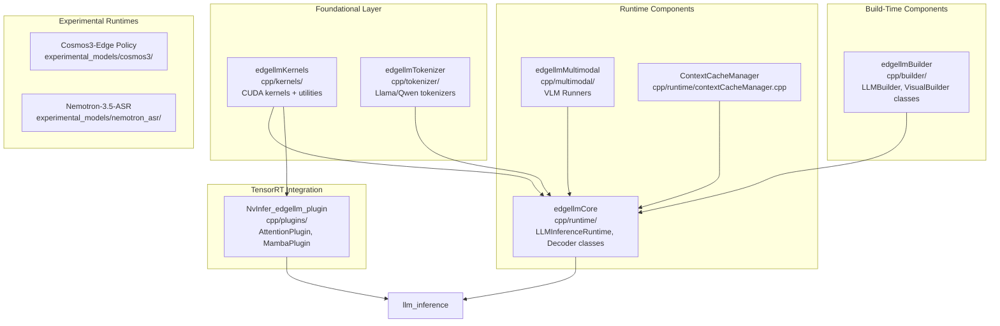
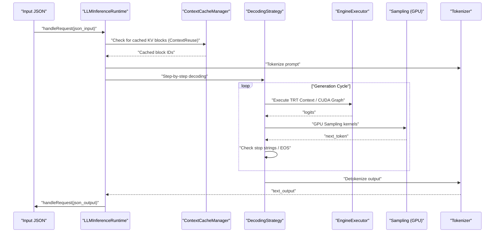
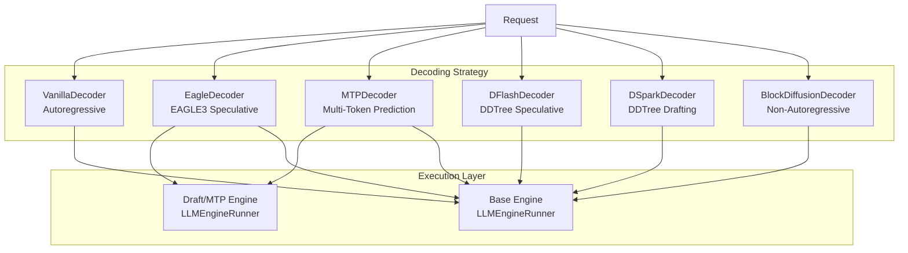

<!-- source: DeepWiki mcp.deepwiki.com · repo NVIDIA/TensorRT-Edge-LLM · page 1 Home · fetched 2026-10-26 -->

# Home

Relevant source files

The following files were used as context for generating this wiki page:

- [.github/CODEOWNERS](.github/CODEOWNERS)
- [CHANGELOG.md](CHANGELOG.md)
- [README.md](README.md)

**Purpose and Scope**: This page introduces TensorRT-Edge-LLM, a high-performance C++ inference runtime for deploying Large Language Models (LLMs) and Vision-Language Models (VLMs) on NVIDIA edge platforms. It provides an architectural overview of the system and guides users to relevant documentation sections based on their needs.

For step-by-step instructions on building and running your first inference, see [Getting Started](#2). For detailed architectural documentation, see [Architecture](#4). For advanced features like speculative decoding and multimodal support, see [Advanced Features](#7).

---

## What is TensorRT-Edge-LLM

TensorRT-Edge-LLM is NVIDIA's production-grade inference framework designed specifically for resource-constrained edge devices such as NVIDIA Jetson Thor, Jetson Orin, and NVIDIA DRIVE platforms [README.md:26-26](). The system provides a complete pipeline from Hugging Face model checkpoints to optimized on-device inference, combining Python-based model preparation tools with a highly optimized C++ runtime [README.md:26-27]().

### Key Features

| Feature Category | Capabilities |
|-----------------|--------------|
| **Target Platforms** | Jetson Thor (SM 101), Jetson Orin (SM 87), NVIDIA DRIVE GB10 (SM 120/121), NVIDIA DGX Spark [README.md:26-26](), [CHANGELOG.md:40-42]() |
| **Model Support** | Qwen 3.x/3.5/3.8, Gemma 4 (E2B-31B), NVIDIA Nemotron-3.5 Lightning, Cosmos3-Edge, DiffusionGemma, Alpamayo-1 [CHANGELOG.md:4-8](), [CHANGELOG.md:60-60]() |
| **Precision Options** | FP16, FP8, NVFP4 (4-bit float), INT4/INT4_GPTQ/INT4_AWQ [CHANGELOG.md:16-17](), [CHANGELOG.md:38-40]() |
| **Decoding Strategies** | Vanilla, EAGLE3, MTP, DFlash with DDTree, DSpark (DDTree drafting), BlockDiffusion [CHANGELOG.md:5-10]() |
| **Runtime Optimizations** | CUDA Graph, Paged KV-cache reuse (multi-turn/media-aware), Vocabulary reduction, Dynamic LoRA, FP8 KV Cache [CHANGELOG.md:11-11](), [CHANGELOG.md:96-97](), [CHANGELOG.md:109-109]() |
| **Multimodal Processing** | Unified image/audio inference, Video input support, Whisper-based audio preprocessing, FP8 ViT [CHANGELOG.md:7-12](), [CHANGELOG.md:62-62]() |

**Sources**: [README.md:26-27](), [CHANGELOG.md:1-25](), [CHANGELOG.md:34-43](), [CHANGELOG.md:60-62]()

---

## System Architecture

TensorRT-Edge-LLM follows a two-stage deployment architecture: offline model preparation and engine building, followed by on-device inference execution. Version 0.10.0 introduced an experimental ONNX-less workflow to build engines directly from checkpoints [CHANGELOG.md:6-6]().

### Deployment Pipeline

```mermaid
graph LR
    subgraph "Stage 1: Model Preparation (Python)"
        HF["HuggingFace<br/>Model Checkpoint"]
        LLM_LOADER["llm_loader<br/>(tensorrt_edgellm)"]
        QUANT["tensorrt-edgellm-quantize<br/>(Python CLI)"]
        EXPORT["tensorrt-edgellm-export<br/>(Python CLI)"]
        ONNX["ONNX Files<br/>(*.onnx)"]
    end
    
    subgraph "Stage 2: Engine Building (C++ / Experimental Python)"
        BUILD_EXE["llm_build<br/>(Executable)"]
        DIRECT_BUILD["Experimental ONNX-less<br/>(tensorrt-edgellm-build)"]
        BUILDER_LIB["edgellmBuilder<br/>(Static Library)"]
        ENGINE["TensorRT Engine<br/>(*.trt)"]
    end
    
    subgraph "Stage 3: Inference Execution (C++)"
        INFER_EXE["llm_inference<br/>(Executable)"]
        CORE_LIB["edgellmCore<br/>(Static Library)"]
        PLUGIN["NvInfer_edgellm_plugin<br/>(Shared Library)"]
        OUTPUT["JSON Output<br/>(Responses)"]
    end
    
    HF --> LLM_LOADER
    LLM_LOADER --> QUANT
    QUANT -->|"quantized weights"| EXPORT
    EXPORT --> ONNX
    ONNX --> BUILD_EXE
    LLM_LOADER -->|"direct path"| DIRECT_BUILD
    DIRECT_BUILD --> ENGINE
    BUILD_EXE --> BUILDER_LIB
    BUILDER_LIB --> ENGINE
    ENGINE --> INFER_EXE
    INFER_EXE --> CORE_LIB
    INFER_EXE --> PLUGIN
    CORE_LIB --> OUTPUT
```

**Stage Descriptions**:

1. **Model Preparation**: Python tools handle model quantization and conversion. The primary path is the checkpoint-based `llm_loader` workflow [CHANGELOG.md:48-48](), which supports architectures using `AutoModel.from_pretrained`. Commands like `tensorrt-edgellm-quantize-llm` and `tensorrt-edgellm-export-llm` orchestrate this flow [CHANGELOG.md:121-121]().

2. **Engine Building**: The `llm_build` executable consumes ONNX files and produces optimized TensorRT engine files (`.trt`). Version 0.10.0 adds `tensorrt-edgellm-build` for direct checkpoint-to-engine conversion without intermediate ONNX files [CHANGELOG.md:6-6]().

3. **Inference Execution**: The `llm_inference` executable loads TensorRT engines and executes inference with JSON-formatted input/output [CHANGELOG.md:118-118](). It links against `edgellmCore` and the `NvInfer_edgellm_plugin` shared library.

**Sources**: [README.md:26-44](), [CHANGELOG.md:3-25](), [CHANGELOG.md:117-121]()

---

### C++ Component Architecture

The C++ codebase is organized into modular static libraries and specialized runtimes for experimental models:

**Component Details**:

- **`edgellmKernels`** (`cpp/kernels/`): Contains CUDA kernel implementations including CuTe DSL FMHA-v2, XQA, MoE, and specialized kernels for Gemma 4 audio attention [CHANGELOG.md:14-14](), [CHANGELOG.md:29-29]().
- **`edgellmTokenizer`** (`cpp/tokenizer/`): Text tokenization support for Llama and Qwen model families.
- **`edgellmBuilder`** (`cpp/builder/`): Library for building TensorRT engines, now moved to the `cpp` folder for tighter integration [CHANGELOG.md:120-120]().
- **`edgellmCore`** (`cpp/runtime/`): The primary runtime library containing `LLMInferenceRuntime`, `Decoder` strategies, and the `ContextCacheManager` for paged KV-cache reuse [CHANGELOG.md:11-11]().
- **`NvInfer_edgellm_plugin`** (`cpp/plugins/`): Shared library containing custom TensorRT plugins like `AttentionPlugin` (upgraded to Plugin V3) and `Gemma4AudioAttentionPlugin` [CHANGELOG.md:47-47]().
- **`Experimental Runtimes`**: Dedicated runtimes for Cosmos3-Edge multimodal reasoning and Nemotron-3.5-ASR RNN-T transcription [CHANGELOG.md:7-9]().

**Sources**: [CHANGELOG.md:3-25](), [CHANGELOG.md:47-56](), [CHANGELOG.md:115-121]()

---

## Runtime Execution Flow

The runtime utilizes a composable execution architecture where `LLMInferenceRuntime` manages the lifecycle of requests via `handleRequest()` [CHANGELOG.md:118-118]().

**Key Classes**:

- **`ContextCacheManager`**: Manages paged KV-cache reuse for multi-turn LLM requests and media-aware reuse for VLM requests using collision-resistant hashing [CHANGELOG.md:11-11](), [CHANGELOG.md:99-99]().
- **`EngineExecutor`**: Handles TensorRT execution context, supporting CUDA Graph capture and execution for reduced latency [CHANGELOG.md:49-49]().
- **`DecodingStrategy`**: Pluggable interface for generation modes including `VanillaDecoder`, `EagleDecoder`, `MTPDecoder`, `DFlashDecoder`, `DSparkDecoder`, and `BlockDiffusionDecoder` [CHANGELOG.md:10-10](), [CHANGELOG.md:50-50]().
- **`StreamChannel`**: API for per-slot streaming output [CHANGELOG.md:79-79]().

**Sources**: [CHANGELOG.md:3-25](), [CHANGELOG.md:49-50](), [CHANGELOG.md:79-99]()

---

## Supported Models and Precisions

The compatibility matrix as of version **0.10.0**:

| Model Family | Supported Models | Multimodal | Precisions |
|--------------|------------------|------------|------------|
| **Qwen** | Qwen 3.8-27B, 3.x, 3.5, 3.6 | ✓ | FP16, FP8, NVFP4, INT4 AWQ/GPTQ [CHANGELOG.md:4-17]() |
| **Nemotron** | Nemotron-3.5 Lightning, 3.5-ASR, Omni | ✓ | NVFP4, FP16 [CHANGELOG.md:5-9]() |
| **Gemma** | Gemma 4 (12B, 26B-A4B, 31B), DiffusionGemma | ✓ | FP16, FP8, INT4 AWQ [CHANGELOG.md:8-24]() |
| **Cosmos** | Cosmos3-Edge | ✓ | Multimodal Reasoning [CHANGELOG.md:7-7]() |
| **Phi** | Phi-4-Multimodal | ✓ | FP16, FP8, NVFP4 [CHANGELOG.md:112-112]() |
| **Llama** | Llama 3.x | ✗ | FP16, FP8, NVFP4, INT4 |

**Precision Details**:
- **NVFP4**: NVIDIA 4-bit floating point format for Blackwell (SM100/101) [CHANGELOG.md:38-42]().
- **INT4 AWQ/GPTQ**: Supported for large MoE models like Gemma 4 26B-A4B and Qwen3-Omni 30B-A3B to reduce memory footprint [CHANGELOG.md:16-17]().
- **FP8 ViT**: Optimized vision transformer processing for VLMs [CHANGELOG.md:62-62]().

**Sources**: [CHANGELOG.md:3-25](), [CHANGELOG.md:38-42](), [CHANGELOG.md:62-62]()

---

## Advanced Decoding: Speculative and Non-Autoregressive

The runtime supports multiple pluggable decoding strategies to improve throughput and latency [CHANGELOG.md:50-50]().

**Implementation Details**:
- **DSpark**: New speculative decoding strategy using DDTree drafting for enhanced performance [CHANGELOG.md:10-10]().
- **BlockDiffusion**: Non-autoregressive decoding supported for models like DiffusionGemma [CHANGELOG.md:8-8]().
- **MTP (Multi-Token Prediction)**: Native support for Nemotron-3.5 Lightning and Gemma 4 paired-checkpoints [CHANGELOG.md:5-15]().
- **DFlash**: Optimized speculative decoding for Qwen3/Qwen3.5 hybrid models using DDTree [CHANGELOG.md:25-25]().

**Sources**: [CHANGELOG.md:3-25](), [CHANGELOG.md:50-50]()

---

## Build System and Cross-Compilation

The project uses a CMake-based build system optimized for NVIDIA edge platforms [CHANGELOG.md:80-80]().

- **Target Platforms**: Supports `jetson-thor`, `jetson-orin`, and `gb10` (NVIDIA DRIVE) [CHANGELOG.md:40-42]().
- **CuTe DSL**: High-performance FMHA-v2, XQA, and MoE kernels are generated via CuTe DSL, replacing legacy cubin artifacts [CHANGELOG.md:14-14](), [CHANGELOG.md:29-29]().
- **Experimental Flags**: `BUILD_EXPERIMENTAL_MODELS` enables building Cosmos3 and Nemotron-ASR runtimes [CHANGELOG.md:7-9]().

**Sources**: [CHANGELOG.md:3-14](), [CHANGELOG.md:40-42](), [CHANGELOG.md:80-80]()

---

## Version Information

Current version: **0.10.0** [CHANGELOG.md:3-3]()

**Major Recent Updates**:
- **Qwen 3.8-27B** Day-0 support [CHANGELOG.md:4-4]().
- **ONNX-less workflow** for direct engine building from checkpoints [CHANGELOG.md:6-6]().
- **Paged KV-cache reuse** for multi-turn and media-aware requests [CHANGELOG.md:11-11]().
- **Cosmos3-Edge** and **DiffusionGemma** support [CHANGELOG.md:7-8]().
- **OpenAI-compatible server** expansion with video input, tool-calling, and ASR/TTS endpoints [CHANGELOG.md:12-19]().

**Sources**: [CHANGELOG.md:1-25]()

---

