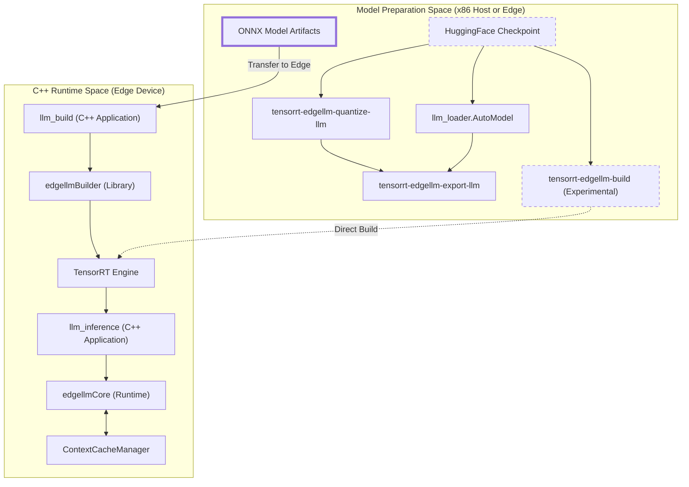
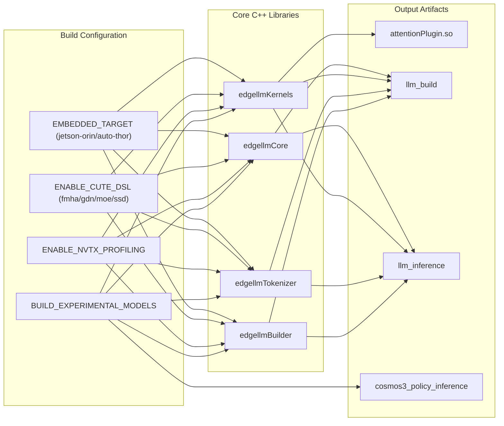

<!-- source: DeepWiki mcp.deepwiki.com · repo NVIDIA/TensorRT-Edge-LLM · page 2 Getting Started · fetched 2026-10-26 -->

# Getting Started

<details>
<summary>Relevant source files</summary>

The following files were used as context for generating this wiki page:

- [CMakeLists.txt](CMakeLists.txt)
- [README.md](README.md)

</details>


This page provides an introduction to setting up and running TensorRT-Edge-LLM for the first time. It covers the basic workflow from model preparation through inference execution, with links to detailed documentation for each step.

For comprehensive installation instructions, see [Installation](#2.2). For detailed system requirements and platform compatibility, see [System Requirements](#2.1). For a complete hands-on tutorial with example commands, see [Quick Start Tutorial](#2.3).

---

## Overview

TensorRT-Edge-LLM is a high-performance C++ inference framework designed for text, vision, audio, speech, and action models on NVIDIA edge platforms like Jetson, DRIVE, and DGX Spark [README.md:3-6](). The framework bridges the gap between HuggingFace checkpoints and optimized TensorRT engines by providing two primary deployment paths:

1.  **ONNX-based Pipeline**: Convert HuggingFace models to ONNX format with optional quantization (FP8, NVFP4, INT4) using the `tensorrt_edgellm` Python package, then build the engine [README.md:22-26]().
2.  **Experimental Direct Builder**: Build TensorRT engines directly from checkpoints without an intermediate ONNX export step [README.md:18-19, 26]().

The SDK supports state-of-the-art architectures including the full **Gemma 4** family (multimodal text/image/audio with MTP), **Qwen3**, **NVIDIA Nemotron-3.5 Lightning**, and **Cosmos3-Edge** [README.md:18-20]().

**Sources**: [README.md:3-6](), [README.md:18-20](), [README.md:22-26]()

---

## Deployment Workflow

The following diagram illustrates the transition from the Python-based model preparation space to the C++ runtime execution space, mapping high-level tasks to specific code entities.



**Diagram: End-to-End Deployment Pipeline**

The Python scripts handle weight transformation and graph export. The resulting ONNX files are consumed by the `llm_build` utility, which utilizes the `edgellmBuilder` library [CMakeLists.txt:158]() to generate optimized engines. Release 0.10.0 introduced `ContextCacheManager` for paged KV-cache reuse across multi-turn requests [README.md:18-19](). Inference is handled by `llm_inference` via the `edgellmCore` runtime [CMakeLists.txt:158]().

**Sources**: [README.md:18-19](), [README.md:22-26](), [README.md:37-45](), [CMakeLists.txt:158-163]()

---

## Prerequisites

Before starting, ensure your environment meets these high-level requirements. For a detailed checklist, see [System Requirements](#2.1).

| Component | Requirement | Notes |
|-----------|-------------|-------|
| **Host (Export)** | x86_64 Linux with NVIDIA GPU | Required for quantization and ONNX export |
| **Target (Inference)** | NVIDIA Jetson (Orin/Thor), DRIVE (Thor), or GB10 | Supported via `EMBEDDED_TARGET` [CMakeLists.txt:85-90, 113-118]() |
| **CUDA** | Version 12.8+ | Default: `/usr/local/cuda-12.8` [CMakeLists.txt:82-83]() |
| **TensorRT** | Version 10.x+ | Required with `OnnxParser` [CMakeLists.txt:158]() |
| **C++ Standard** | C++17 | Required for SDK compilation [CMakeLists.txt:24-27]() |

**Sources**: [CMakeLists.txt:24-27](), [CMakeLists.txt:82-83](), [CMakeLists.txt:85-90](), [CMakeLists.txt:113-118](), [CMakeLists.txt:158]()

---

## Installation Overview

The project uses a CMake-based build system supporting both native and cross-compilation. For detailed setup, see [Installation](#2.2).



**Diagram: Build System Components and Artifacts**

The build process links core libraries into the final executables. A key feature is the `ENABLE_CUTE_DSL` option, which enables high-performance CuTe-based kernels for FMHA, MoE, SSD, and Gated Delta Networks [CMakeLists.txt:183-205](). Release 0.10.0 also added `BUILD_EXPERIMENTAL_MODELS` for Cosmos3 and Nemotron-ASR runtimes [CMakeLists.txt:213-220]().

**Sources**: [CMakeLists.txt:131-133](), [CMakeLists.txt:158-163](), [CMakeLists.txt:183-205](), [CMakeLists.txt:213-220]()

---

## Quick Start Summary

To run your first model, follow these high-level steps. For a hands-on guide, see [Quick Start Tutorial](#2.3).

### 1. Export the Model (Host)
Install the Python package and export a model to ONNX using the checkpoint exporter [README.md:43]():
```bash
tensorrt-edgellm-export-llm --model_dir Qwen/Qwen3-0.6B --output_dir ./onnx_models/qwen3-0.6b
```

### 2. Build the Engine (Edge)
Use the `llm_build` utility to create a TensorRT engine. This process utilizes the `edgellmBuilder` library internally to optimize the model for the target hardware [CMakeLists.txt:158-163]():
```bash
./llm_build --onnxDir ./onnx_models/qwen3-0.6b --engineDir ./engines/qwen3-0.6b --maxBatchSize 1
```

### 3. Run Inference (Edge)
Execute inference using the `llm_inference` tool, which leverages the `edgellmCore` runtime for token generation [CMakeLists.txt:158-163]():
```bash
./llm_inference --engineDir ./engines/qwen3-0.6b --inputFile input.json --outputFile output.json
```

**Sources**: [README.md:32](), [README.md:43](), [CMakeLists.txt:158-163]()

---

## Next Steps

*   **System Requirements**: Verify your hardware and software compatibility. [System Requirements](#2.1)
*   **Installation**: Detailed guide for building the SDK from source. [Installation](#2.2)
*   **Quick Start Tutorial**: Step-by-step walkthrough with sample data. [Quick Start Tutorial](#2.3)
*   **Model Deployment**: Learn about the full Python-to-C++ pipeline and quantization options. [Model Deployment Workflow](#3)

---

