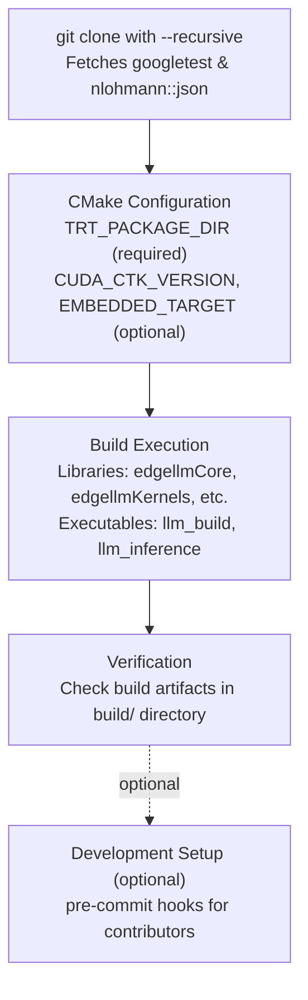
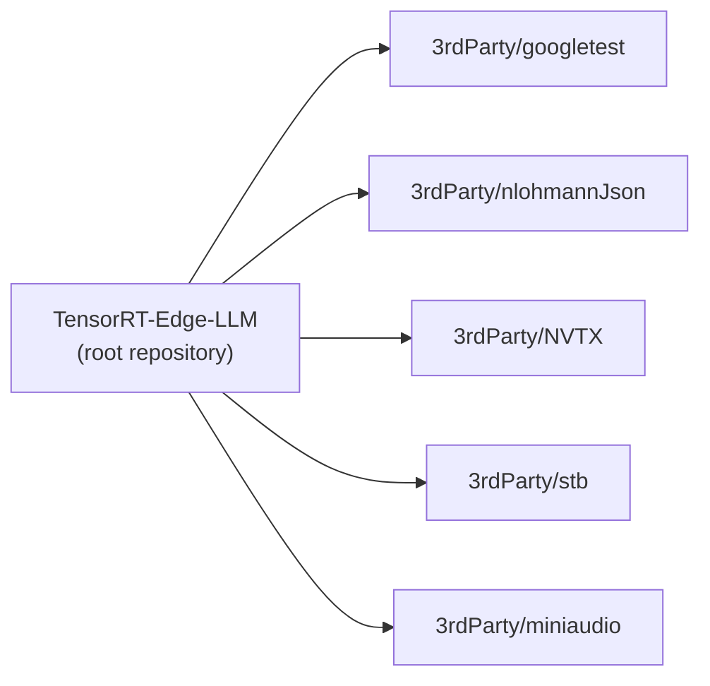
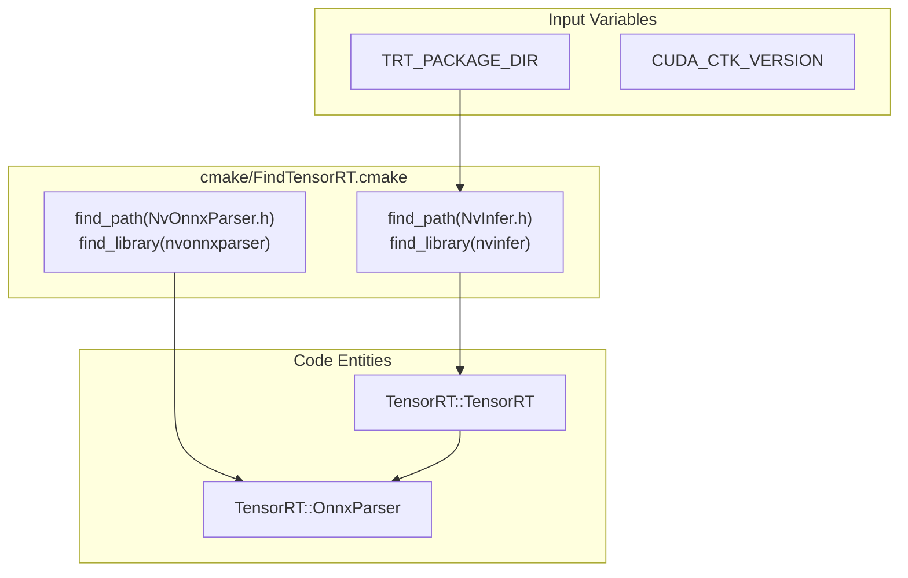

<!-- source: DeepWiki mcp.deepwiki.com · repo NVIDIA/TensorRT-Edge-LLM · page 2.2 Installation · fetched 2026-10-26 -->

# Installation

<details>
<summary>Relevant source files</summary>

The following files were used as context for generating this wiki page:

- [.gitmodules](.gitmodules)
- [CMakeLists.txt](CMakeLists.txt)
- [cmake/FindTensorRT.cmake](cmake/FindTensorRT.cmake)

</details>


This page provides step-by-step instructions for building the TensorRT-Edge-LLM SDK from source. It covers cloning the repository, configuring CMake with required dependencies, and compiling the C++ libraries and executables. For hardware and software prerequisites, see [System Requirements](#2.1). For a hands-on tutorial walking through model deployment, see [Quick Start Tutorial](#2.3).

---

## Installation Overview

The installation process consists of four main stages: obtaining source code, configuring build variables, compiling C++ components, and optionally setting up development tools.



**Sources**: [CMakeLists.txt:16-21](), [CMakeLists.txt:129-130](), [CMakeLists.txt:158-159]()

---

## Prerequisites

Before beginning installation, ensure the following dependencies are available on your system:

| Dependency | Requirement | Notes |
|------------|-------------|-------|
| **CMake** | ≥ 3.20 | Required for build configuration [CMakeLists.txt:16-16]() |
| **C++ Compiler** | C++17 support | Specified via `CMAKE_CXX_STANDARD` [CMakeLists.txt:24-25]() |
| **CUDA Toolkit** | Default: 12.8 | Customizable via `CUDA_CTK_VERSION` [CMakeLists.txt:82-83]() |
| **TensorRT** | Must be specified | Set via `TRT_PACKAGE_DIR` [cmake/FindTensorRT.cmake:18-20]() |
| **Git** | With submodule support | For cloning repository dependencies |

The system automatically detects native GPU architectures (SM 80, 86, 89, and if CUDA ≥12.8: SM 100a, 120) [CMakeLists.txt:85-90]() or uses target-specific architectures when `EMBEDDED_TARGET` is specified in the toolchain.

---

## Cloning the Repository

### Basic Clone with Submodules

The repository contains submodules for third-party dependencies like `googletest`, `nlohmannJson`, and `NVTX`. Clone with the `--recursive` flag to automatically fetch these:

```bash
git clone --recursive https://github.com/NVIDIA/TensorRT-Edge-LLM.git
cd TensorRT-Edge-LLM
```

### Submodule Structure



The `googletest` submodule is initialized via `.gitmodules` [.gitmodules:1-3](). The `nlohmannJson`, `stb`, and `miniaudio` headers are included via `COMMON_INCLUDE_DIRS` [CMakeLists.txt:165-171]().

**Sources**: [.gitmodules:1-9](), [CMakeLists.txt:165-171]()

---

## CMake Configuration

### Required Variables

The `TRT_PACKAGE_DIR` variable is the primary root hint for locating TensorRT. If not set, the system falls back to standard system paths like `/usr` or `/opt/tensorrt` [cmake/FindTensorRT.cmake:18-21]().

```bash
cmake -DTRT_PACKAGE_DIR=/path/to/TensorRT -B build
```

### Optional Variables

| Variable | Default | Purpose |
|----------|---------|---------|
| `CUDA_CTK_VERSION` | `12.8` | CUDA Toolkit version [CMakeLists.txt:82-82]() |
| `EMBEDDED_TARGET` | (unset) | Target: `auto-thor`, `jetson-thor`, `jetson-orin`, `gb10` [CMakeLists.txt:94-94]() |
| `BUILD_UNIT_TESTS` | `OFF` | Enable building unit tests [CMakeLists.txt:42-42]() |
| `ENABLE_NVTX_PROFILING` | `OFF` | Enable NVTX profiling support [CMakeLists.txt:132-132]() |
| `ENABLE_CUTE_DSL` | `OFF` | Enable CuTe DSL unified kernel generation [CMakeLists.txt:183-184]() |
| `ENABLE_COVERAGE` | `OFF` | Enable gcov code coverage instrumentation [CMakeLists.txt:37-37]() |

### Configuration Logic

The `FindTensorRT.cmake` module defines the logic for locating the inference engine and ONNX parser:



**Sources**: [cmake/FindTensorRT.cmake:25-45](), [cmake/FindTensorRT.cmake:81-97]()

---

## Building the SDK

### Standard Build Process

After configuration, build all targets:

```bash
cmake --build build -j$(nproc)
```

### Build Targets and Outputs

The build system links core components through `commonLibraryExt`, which includes TensorRT and the ONNX parser [CMakeLists.txt:173-176]().

| Target | Type | Description |
|--------|------|-------------|
| `commonLibraryExt` | Interface Lib | Base target linking TensorRT, OnnxParser, and CUDART [CMakeLists.txt:173-176]() |
| `edgellmCore` | Static Lib | Core runtime library (defined in `cpp/` subdirectory) |
| `edgellmBuilder` | Static Lib | Engine building library (defined in `cpp/` subdirectory) |

### Cross-Compilation for ARM64

For embedded platforms, use target-specific variables. The project handles `AARCH64_BUILD` logic to adjust library paths and linking options [CMakeLists.txt:58-72]().

```bash
cmake -DEMBEDDED_TARGET=jetson-orin \
      -DTRT_PACKAGE_DIR=/path/to/aarch64/TRT \
      -B build
```

The build system configures specific `CMAKE_CUDA_ARCHITECTURES` for the target and applies `TRT_EDGELLM_CUDA_LIBRARY_T_COMPAT` for Jetson Orin to handle `cudaLibrary_t` compatibility [CMakeLists.txt:94-96]().

**Sources**: [CMakeLists.txt:57-73](), [CMakeLists.txt:94-96](), [CMakeLists.txt:173-181]()

---

## Troubleshooting

### CUDA Version Ambiguity
If you see an error regarding `CUDA_VERSION`, use `-DCUDA_CTK_VERSION` instead to avoid macro conflicts with CUDA internal macros [CMakeLists.txt:76-81]().

### Jetson Orin `cudaLibrary_t`
On Jetson Orin, `cuda.h` may lack `cudaLibrary_t`. Setting `EMBEDDED_TARGET` to `jetson-orin` automatically defines `TRT_EDGELLM_CUDA_LIBRARY_T_COMPAT` to enable a compatibility typedef [CMakeLists.txt:94-96]().

### Unresolved Symbols in Cross-Compilation
When cross-compiling, `libnvinfer.so` might link to `libnvdla_compilers`. The build system uses `INTERFACE` link options `-Wl,--unresolved-symbols=ignore-in-shared-libs` to allow these to be resolved at execution time on the target board [CMakeLists.txt:180-181]().

### NVTX Headers
If `ENABLE_NVTX_PROFILING` is ON, the build system expects NVTX3 headers at `3rdParty/NVTX/include/nvtx3`. Ensure the submodule is initialized if this fails [CMakeLists.txt:134-150]().

**Sources**: [CMakeLists.txt:76-83](), [CMakeLists.txt:94-96](), [CMakeLists.txt:134-150](), [CMakeLists.txt:180-181]()

---

