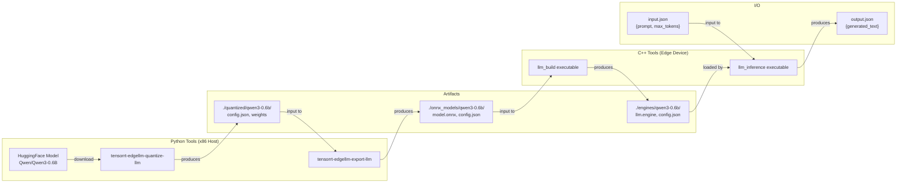
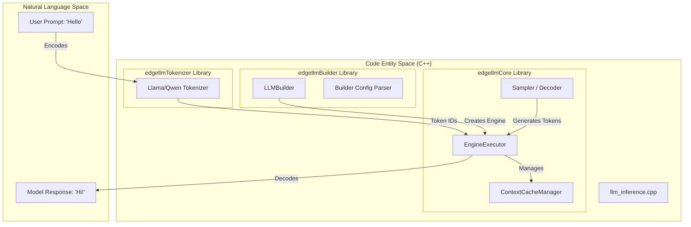

<!-- source: DeepWiki mcp.deepwiki.com · repo NVIDIA/TensorRT-Edge-LLM · page 2.3 Quick Start Tutorial · fetched 2026-10-26 -->

# Quick Start Tutorial

<details>
<summary>Relevant source files</summary>

The following files were used as context for generating this wiki page:

- [CMakeLists.txt](CMakeLists.txt)
- [README.md](README.md)

</details>


## Purpose and Scope

This tutorial provides a hands-on walkthrough of the complete TensorRT Edge-LLM deployment pipeline, from downloading a pretrained model to executing inference on an edge device. You will learn to:

1.  Quantize and export a HuggingFace model to ONNX format using Python tools.
2.  Build a TensorRT engine from ONNX files using the C++ builder (`LLMBuilder`).
3.  Execute inference using the C++ runtime with JSON input/output.

This tutorial demonstrates the workflow using a specific example model (Qwen3-0.6B) and should take approximately 15 minutes to complete.

**Prerequisites**: Before starting this tutorial, ensure you have completed the installation steps in **Installation (2.2)** and verified your system meets the requirements in **System Requirements (2.1)**.

---

## End-to-End Workflow Overview

The following diagram illustrates the complete deployment pipeline, showing the transition from a HuggingFace model to edge inference:

### Model Deployment Pipeline


**Sources**: [README.md:24-28](), [README.md:46-55]()

---

## Step 1: Model Quantization

The first step converts a HuggingFace model to a quantized format. This step runs on an x86 host with a GPU and requires the Python export tools.

### Command Structure

```bash
tensorrt-edgellm-quantize-llm \
    --model_dir <HF_MODEL_NAME_OR_PATH> \
    --output_dir <QUANTIZED_OUTPUT_DIR> \
    --quantization <PRECISION>
```

### Parameters

| Parameter | Description | Example Values |
|-----------|-------------|----------------|
| `--model_dir` | HuggingFace model name or local path | `Qwen/Qwen3-0.6B`, `nvidia/Cosmos3-Edge` |
| `--output_dir` | Directory for quantized model output | `./quantized/qwen3-0.6b` |
| `--quantization` | Quantization precision | `fp16`, `fp8`, `nvfp4`, `int4`, `int4_awq` |

### Example: Quantizing Qwen3-0.6B to FP8

```bash
tensorrt-edgellm-quantize-llm \
    --model_dir Qwen/Qwen3-0.6B \
    --output_dir ./quantized/qwen3-0.6b \
    --quantization fp8
```

This command downloads the model, applies FP8 quantization, and saves the quantized weights and configuration to `./quantized/qwen3-0.6b/`.

**Sources**: [README.md:18-20](), [README.md:51-51]()

---

## Step 2: ONNX Export

The second step converts the quantized model to ONNX format, which can be ingested by the TensorRT engine builder.

### Example: Exporting Qwen3-0.6B to ONNX

```bash
tensorrt-edgellm-export-llm \
    --model_dir ./quantized/qwen3-0.6b \
    --output_dir ./onnx_models/qwen3-0.6b
```

**Output artifacts**: The ONNX directory contains:
- `model.onnx`: The main transformer network.
- `config.json`: Model configuration for the builder.
- Tokenizer files: Necessary for runtime string-to-token conversion.

**Sources**: [README.md:43-44](), [README.md:48-49]()

---

## Step 3: TensorRT Engine Building

The third step compiles the ONNX models into optimized TensorRT engines using the `llm_build` example. This process is handled by the C++ `edgellmBuilder` library.

### Example: Building Engine for Qwen3-0.6B

```bash
./build/examples/llm/llm_build \
    --onnxDir ./onnx_models/qwen3-0.6b \
    --engineDir ./engines/qwen3-0.6b \
    --maxBatchSize 1
```

### Build Logic
The building process involves:
1.  **Plugin Registration**: Loading custom CUDA kernels (e.g., Attention, MoE) into the TensorRT registry.
2.  **Network Parsing**: Parsing the ONNX graph into a TensorRT network.
3.  **Optimization**: Applying platform-specific optimizations for Jetson or DRIVE platforms (e.g., Orin/Thor).
4.  **Serialization**: Saving the optimized `.engine` file to disk.

**Sources**: [CMakeLists.txt:158-158](), [CMakeLists.txt:183-200](), [README.md:61-61]()

---

## Step 4: Running Inference

The final step executes inference using the `llm_inference` executable.

### Example: Running Inference

```bash
./build/examples/llm/llm_inference \
    --engineDir ./engines/qwen3-0.6b \
    --inputFile input.json \
    --outputFile output.json
```

### Input JSON Format (`input.json`)
```json
{
  "prompt": "What is the capital of France?",
  "max_tokens": 100,
  "temperature": 0.7,
  "top_p": 0.9,
  "enableContextReuse": true
}
```
*Note: The `--enableContextReuse` flag (introduced in 0.10.0) allows for multi-turn KV-cache reuse.*

**Sources**: [README.md:19-19](), [README.md:53-53]()

---

## Runtime Component Association

The following diagram bridges the high-level inference flow with the specific code entities involved in the process.

### Code Entity Mapping


**Sources**: [CMakeLists.txt:165-171](), [README.md:62-64](), [README.md:19-19]()

---

## Experimental: Direct Engine Builder (ONNX-less)

As of version **0.10.0**, an experimental path allows building engines directly from checkpoints, bypassing the ONNX export step.

### Example: Direct Build

```bash
tensorrt-edgellm-build \
    --checkpoint_dir ./quantized/qwen3-0.6b \
    --output_dir ./engines/qwen3-0.6b
```

This uses the `NetworkModule` and `ops.functional` API to define the model architecture directly in the builder.

**Sources**: [README.md:19-19](), [README.md:44-44]()

---

## Troubleshooting Common Issues

### Issue: CUDA Version Mismatch
**Cause**: The SDK was built for a different CUDA version than the one installed.
**Check**: Verify `CUDA_CTK_VERSION` in `CMakeLists.txt`.
**Fix**: Ensure `-DCUDA_CTK_VERSION` matches your environment during CMake configuration.

### Issue: NVTX Profiling Headers Missing
**Cause**: NVTX submodule not initialized.
**Check**: `3rdParty/NVTX/include/nvtx3/nvtx3.hpp` existence.
**Fix**: Run `git submodule update --init 3rdParty/NVTX`.

### Issue: Missing Plugins
**Cause**: The TensorRT engine was built without custom edge-LLM plugins.
**Check**: Ensure `commonLibraryExt` is linked and `loadEdgellmPluginLib()` is called in the application.

**Sources**: [CMakeLists.txt:82-83](), [CMakeLists.txt:132-155](), [CMakeLists.txt:173-176]()

---

